<a id="huong-dan"></a>
# Hướng dẫn sử dụng Bcode & BcodeViewer

Tài liệu cho người triển khai / kiểm thử FastBusiness dùng **Bcode** (bộ công cụ quản trị, triển khai ERP) và **BcodeViewer** (trình soạn file controller FCode). Viết theo từng tính năng: mở ở đâu, làm từng bước thế nào, phím tắt, lưu ý và lỗi hay gặp.

Trong Bcode, tài liệu này mở bằng nút **Trợ giúp** trên thanh trên (hoặc `Ctrl+F1`). Bản gốc nằm ở `docs/HuongDanSuDung.md` của mã nguồn, chép kèm Bcode.exe thành `Help\HuongDanSuDung.md`.

**Mục lục**

- [Bắt đầu nhanh](#bat-dau)
- [Dùng tab Trợ giúp](#tro-giup)
- **Phần I — Bcode**
  - [Chế độ giao diện Web và App](#che-do-giao-dien)
  - [Chọn dự án / workspace](#du-an)
  - [Màn hình chính Bcode](#khung-chinh)
  - [SQL Query](#sql-query) · [Debug từng bước](#debug-sql) · [Lịch sử SQL](#lich-su-sql) · [Write Schema (.xsd / .rpt)](#write-schema)
  - [Table](#table) · [Command và Lookup](#command-lookup) · [SQL Object, Ai đang dùng, So sánh](#sql-object)
  - [WCommand](#wcommand) · [Mobile](#mobile) · [File Lookup](#file-lookup) · [Cấp source, Copy to, Clone](#cap-source)
  - [Gen Update](#gen-update) · [Note và Note (New)](#note) · [Create RPT & XML, Tạo báo cáo](#create-rpt)
  - [Menu Triển khai](#trien-khai) · [Menu Tool mở rộng](#tool-mo-rong) · [Tiện ích khác](#tien-ich)
  - [Template giao diện](#template) · [Phím tắt và Settings phím tắt](#phim-tat) · [Key bản quyền](#key-ban-quyen) · [Lỗi hay gặp](#loi-thuong-gap)
- **Phần II — BcodeViewer**
  - [Màn hình chính](#viewer-giao-dien) · [Mở, lưu file và lịch sử](#viewer-mo-file) · [IntelliSense](#viewer-intellisense)
  - [F12 / Peek entity và điều hướng](#viewer-entity) · [Problems, tìm / thay](#viewer-problems) · [Xem trước Dir (Alt+P)](#viewer-dir-preview)
  - [Chạy SQL](#viewer-sql) · [Ctrl+Tab](#viewer-tab) · [Settings và phím tắt](#viewer-settings) · [AI](#viewer-ai) · [Liên kết với Bcode](#viewer-bcode) · [Lỗi hay gặp](#viewer-loi)
- **Phụ lục**
  - [Bảng phím tắt tổng hợp](#phim-tat-tong-hop) · [Dữ liệu lưu ở đâu](#du-lieu)

<a id="bat-dau"></a>
## Bắt đầu nhanh

1. **Mở Bcode** → chọn chế độ giao diện (**Web** đầy đủ tính năng / **App** nhẹ) — xem [Chế độ giao diện](#che-do-giao-dien).
2. **Màn Projects**: chọn dự án → **Chọn**. Chưa có dự án: **＋ New** khai server, Sys Data / App Data, Source Path… hoặc `Ctrl+F5` đồng bộ từ FSG — xem [Chọn dự án](#du-an).
3. **Làm việc**:
   - Chạy SQL: `Ctrl+Shift+Q` → gõ script → `F5`.
   - Xem / sửa dữ liệu bảng: `Ctrl+Shift+T` → gõ tên bảng → `Enter`.
   - Tìm source của một menu: cột trái **WCommand** → double-click menu → tab File Lookup → **Edit in BcodeViewer**.
   - Đóng gói cập nhật: `Ctrl+Shift+G` (Gen Update) hoặc `Ctrl+Shift+4` (Note (New)).
4. Quên chức năng nằm đâu: `Ctrl+P` (Command Palette) rồi gõ tên.
5. Đang ở tab nào không biết dùng: bấm **Trợ giúp** (`Ctrl+F1`) — mở đúng mục của tab đó.

<a id="tro-giup"></a>
## Dùng tab Trợ giúp

Nút **Trợ giúp** trên thanh trên của Bcode (cả chế độ Web và App) hoặc `Ctrl+F1` mở tab **Trợ giúp**, dạng giống file trợ giúp CHM:

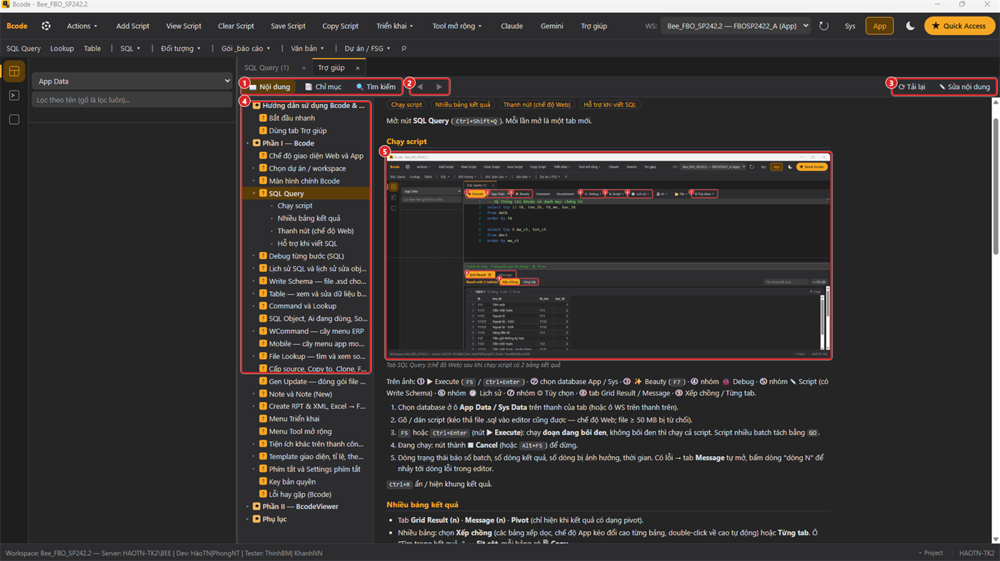

Trên ảnh: **①** Nội dung / Chỉ mục / Tìm kiếm · **②** ◀ ▶ lùi / tới · **③** ⟳ Tải lại · ✎ Sửa nội dung · **④** cây tính năng · **⑤** ảnh minh hoạ (bấm để phóng to).

- **Cột trái** có 3 trang:
  - **📖 Nội dung** — cây tính năng theo phần (Bcode / BcodeViewer / Phụ lục). Bấm tên tính năng để xem hướng dẫn; bấm ▸ để mở các mục con, bấm mục con để nhảy tới đúng đoạn.
  - **📑 Chỉ mục** — mọi mục xếp theo vần A–Z, gõ từ khoá để lọc.
  - **🔍 Tìm kiếm** (`Ctrl+F`) — tìm chữ trong toàn bộ hướng dẫn, gõ có dấu hay không dấu đều được (vd `phim tat`); kết quả xếp theo độ khớp, mở ra là chữ tìm được tô vàng.
- **Khung phải**: hướng dẫn của tính năng đang chọn. Bấm link trong bài để nhảy sang mục khác; ◀ ▶ (`Alt+←` / `Alt+→`) để lùi / tới.
- **Ảnh minh hoạ**: phần lớn tính năng có ảnh chụp màn hình thật, khung đỏ đánh số ①②③… khớp với dòng "Trên ảnh:" ngay dưới ảnh. Bấm vào ảnh để phóng to, bấm lần nữa hoặc `Esc` để đóng.
- Kéo vạch giữa 2 khung để đổi độ rộng cột trái.
- **Mở theo ngữ cảnh**: đang ở tab SQL Query, Table, File Lookup, Gen Update… mà bấm Trợ giúp / `Ctrl+F1` thì tab Trợ giúp mở thẳng mục của công cụ đó.
- **✎ Sửa nội dung**: mở file `Help\HuongDanSuDung.md` (cạnh Bcode.exe) để bổ sung ghi chú, cách dùng riêng của nhóm; sửa xong bấm **⟳ Tải lại**. Quy ước file: `#` = phần, `##` = một tính năng (một trang), `###` = mục con; dòng `<a id="ten-muc"></a>` ngay trên tiêu đề đặt mã mục để link `[chữ](#ten-muc)` trỏ tới; ảnh viết `` (một dòng riêng), file ảnh để trong thư mục `Help\images` cạnh file .md.

> **Lưu ý:** file trong thư mục Bcode.exe bị ghi đè khi cập nhật bản Bcode mới. Muốn giữ lâu dài, gửi phần bổ sung cho người phát triển để đưa vào `docs/HuongDanSuDung.md`.

<a id="bcode"></a>
# Phần I — Bcode

Bcode (Bcode.exe) là bộ công cụ quản trị / triển khai FastBusiness ERP: chạy SQL, sửa dữ liệu bảng, quản lý menu WCommand, tìm source, đóng gói cập nhật, tạo báo cáo… Mỗi cửa sổ Bcode làm việc với **một dự án** (workspace); mở thêm cửa sổ để làm song song nhiều dự án.

<a id="che-do-giao-dien"></a>
## Chế độ giao diện Web và App

Bcode có 2 chế độ, chọn lúc mở chương trình (hộp "Bcode — chọn chế độ giao diện"):

| | **Web / WebView2** | **App / WinForms** |
|---|---|---|
| Đặc điểm | Mỗi màn hình là một trang web trong WebView2 — **đầy đủ tính năng nhất** | Giao diện Windows tự vẽ — **nhẹ, mở nhanh, ít bộ nhớ** |
| Editor SQL | Monaco (giống VS Code): gợi ý code, AI `Ctrl+I`, ghost text, peek `F12`, Debug từng bước, tuỳ biến thanh nút | Scintilla: đủ tính năng như Web — gợi ý code (`Ctrl+Space`), AI `Ctrl+I`, ghost text (hiện thành khối chữ xám dưới dòng con trỏ, `Tab` nhận / `Esc` bỏ), peek `F12`, Debug từng bước, tuỳ biến thanh nút, Check Fields, kéo thả file `.sql` vào editor, `Ctrl+F` thanh tìm |
| Công cụ vẫn dùng WebView2 | — | Create RPT & XML, Tạo báo cáo, Tạo nhanh danh mục, Template giao diện, Báo cáo yêu cầu FSG, Biên bản xác nhận, Check Mail, Excel → FRX, Claude / Gemini, Trợ giúp (tự dựng khi mở, đóng tab là giải phóng) |

- Tick "Hỏi lại mỗi lần mở Bcode" để lần sau vẫn hỏi; bỏ tick thì vào thẳng chế độ đã chọn. Đóng hộp chọn = thoát Bcode.
- Đổi sau này: ⚙ Settings → **Chế độ giao diện: … — đổi...** → Bcode hỏi mở lại để áp dụng.
- Vào thẳng một chế độ không hỏi: chạy `Bcode.exe --web` hoặc `Bcode.exe --native` (`--app` cũng được).
- **Chế độ an toàn**: giữ phím **Shift** khi mở Bcode → bỏ qua CSS / HTML tự chỉnh của phiên đó (dùng khi tuỳ chỉnh giao diện làm hỏng trang). Bật / tắt lâu dài: Actions → **Tuỳ chỉnh giao diện web: …**.

<a id="du-an"></a>
## Chọn dự án / workspace

Mỗi dự án (workspace) gồm: kết nối SQL Server, 2 database **Sys Data** và **App Data**, các đường dẫn (Source Path, Program Path, Mobile Path, Working Path) và link web đăng nhập (Login WLink). Danh sách lưu ở `%AppData%\Bcode\settings.json` — BcodeViewer và Screen Designer đọc chung.

### Màn hình Projects

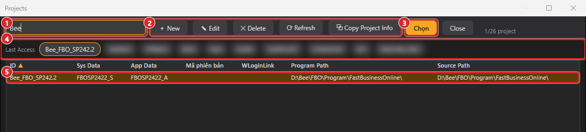

Trên ảnh: **①** ô lọc · **②** ＋ New / ✎ Edit / ✕ Delete / ⟳ Refresh / ⧉ Copy Project Info · **③** **Chọn** — vào dự án · **④** Last Access — dự án dùng gần đây · **⑤** dòng dự án (double-click = chọn).

Hiện tự động khi mở Bcode (trừ khi chạy với `--project <tên>`), hoặc `Ctrl+Shift+P` / Actions → **Projects...**.

1. Gõ vào ô "Gõ để lọc (ID, database, link, đường dẫn)..." — nhiều từ thì lọc theo tất cả. Dải **Last Access** phía trên là 10 dự án dùng gần nhất, bấm để chọn ngay.
2. Chọn dòng → **Chọn** (hoặc `Enter` / double-click). `Esc` để đóng.
3. Nút khác: **＋ New** · **✎ Edit** · **✕ Delete** (chỉ xoá khỏi danh sách) · **⟳ Refresh** · **⧉ Copy Project Info** (copy ID, server, database, link, đường dẫn, phiên bản — không copy mật khẩu).
4. `Ctrl+F5` trên màn này = mở Edit Project kèm hộp **Synchronize** (đồng bộ từ FSG).

### Edit Project (Choose Server / Workspaces)

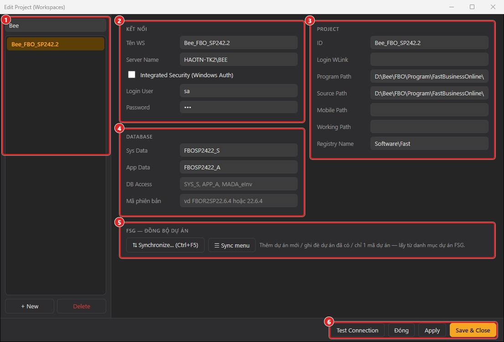

Trên ảnh: **①** danh sách dự án + ô lọc · **②** Kết nối SQL Server · **③** Project: ID, Login WLink, các đường dẫn · **④** Database: Sys Data, App Data, DB Access, Mã phiên bản · **⑤** đồng bộ từ FSG · **⑥** Test Connection · Đóng · Apply · Save & Close.

Mở: ⚙ Settings → **Choose Server / Workspaces...**, hoặc **＋ New / ✎ Edit** ở màn Projects. Cửa sổ "Edit Project (Workspaces)":

- **Kết nối**: Tên WS, Server Name, Integrated Security (Windows Auth) hoặc Login User / Password.
- **Project**: ID, Login WLink, Program Path, **Source Path** (đường dẫn UNC tới site, vd `\\server\...\FBISP23` — bắt buộc cho File Lookup, Gen Update), Mobile Path, Working Path, Registry Name.
- **Database**: Sys Data, App Data, **DB Access** (các database khác hiện thêm trong ô WS trên thanh trên, vd `SYS_S, APP_A, MADA_eInv`), Mã phiên bản.
- **FSG — Đồng bộ dự án**: **⇅ Synchronize... (Ctrl+F5)** và **☰ Sync menu**.
- Nút **Test Connection** · **Apply** · **Save & Close** · **Đóng** (đóng mà chưa Save là bỏ thay đổi).

### Đồng bộ dự án từ FSG (`Ctrl+F5`)

Hộp **Synchronize** có 3 chế độ: **Thêm mới 1 mã dự án (ma_da)** · **Chỉ sync dự án mới** · **Overwrite tất cả** (hỏi xác nhận; mật khẩu web, Mobile Path, cấu hình Profiler được giữ). Kết quả "Thêm X, cập nhật Y, bỏ qua Z" — **phải bấm Apply / Save** mới lưu.

### Đổi dự án và nhiều cửa sổ

| Phím | Tác dụng |
|---|---|
| `Ctrl+Shift+P` | Màn Projects — chọn dự án khác ngay trong cửa sổ hiện tại. |
| `Ctrl+O` | Choose Server: cũng mở màn Projects; nếu cửa sổ **đang có tab** mà chọn dự án **khác** → mở **Bcode mới** vào thẳng dự án đó, cửa sổ cũ giữ nguyên tab. Không có tab thì đổi tại chỗ. |
| `Ctrl+Shift+N` | Mở thêm một cửa sổ Bcode (cùng chế độ giao diện), bắt đầu từ màn Projects. |

### Chọn database đang làm việc

- Ô **WS:** trên thanh trên liệt kê các database **của dự án hiện tại**: "<AppDB> (App)", "<SysDB> (Sys)" và từng database trong DB Access "<DB> (DB)" — chỉ ghi tên database, không kèm mã dự án. Chọn ô nào thì tab SQL Query / Table đang dùng chuyển theo.
- Nút **Sys** / **App** (hoặc `Ctrl+1` — Switch Database) đổi nhanh giữa 2 database chính.
- Nút **⟳** cạnh WS = **Refresh database**: nạp lại danh sách object / bảng / cột (dùng sau khi tạo bảng, procedure mới mà gợi ý chưa thấy).

### Khôi phục phiên làm việc

Khi mở lại một dự án có phiên cũ, Bcode hỏi "Khôi phục phiên làm việc": **Chỉ Query** / **Query + Table** / **Tất cả** / **Không khôi phục** (tick "Lần sau không hỏi nữa" để nhớ lựa chọn — đổi lại ở Template → Cửa sổ). Bật / tắt ở ⚙ Settings → **Khôi phục các tab khi mở lại Bcode**; chu kỳ tự lưu: **Tự lưu phiên mỗi N giây...**. `Ctrl+Shift+B` mở lại tab vừa đóng (nhớ 20 tab, giữ cả SQL).

<a id="khung-chinh"></a>
## Màn hình chính Bcode

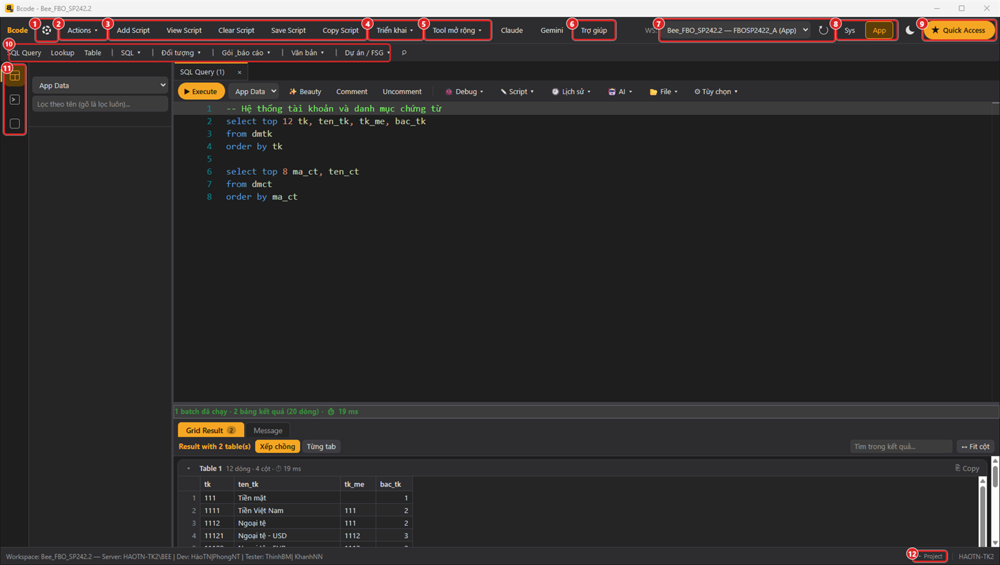

Trên ảnh: **①** ⚙ Settings · **②** Actions · **③** giỏ script: Add / View / Clear / Save / Copy Script · **④** menu Triển khai · **⑤** menu Tool mở rộng · **⑥** Trợ giúp · **⑦** ô WS chọn database + ⟳ Refresh database · **⑧** Sys / App · **⑨** Quick Access · **⑩** thanh công cụ (nút ghim + nhóm ▾, ⌕ = Command Palette) · **⑪** cột icon: SQL Object / WCommand / Mobile · **⑫** ▾ Project — mở nhanh thư mục, Copy Project Info.

### Thanh trên

| Mục | Dùng để |
|---|---|
| ⚙ (bánh răng) | Menu **Settings**: Choose Server / Workspaces · Tỉ lệ giao diện · Khôi phục các tab · Tự lưu phiên · Claude/Gemini nhúng vào tab SQL Query · **Giao diện (Template)...** · Kiểu giao diện (Mềm / Gọn / Thoáng / Vuông vức) · Chế độ giao diện · Cây menu: bỏ qua file theo tên · Hướng dẫn gợi ý code SQL · **Key bản quyền** · Backup / Restore / Attach Database · Exit |
| **Actions ▾** | Choose Server (`Ctrl+O`) · Projects (`Ctrl+Shift+P`) · New Bcode window (`Ctrl+Shift+N`) · Switch Database (`Ctrl+1`) · SQL Profiler (`Ctrl+3`) · Open Program Path (`Ctrl+5`) · Script ▸ · **Tools ▸** (mọi công cụ kèm phím tắt) · **Tab & cửa sổ ▸** (Close Tab, Close All But This, Close Tabs to the Right, Close All Tab, Hide / Show cây menu, Tuỳ chỉnh giao diện web) · Clear Structure App · **Open Web.config** · Refresh Web.config · Create Menu |
| **Add / View / Clear / Save / Copy Script** | Giỏ script (Script Cart) — xem dưới |
| **Triển khai ▾**, **Tool mở rộng ▾** | Các công cụ triển khai và mở rộng (xem [Menu Triển khai](#trien-khai), [Menu Tool mở rộng](#tool-mo-rong)) |
| **Claude**, **Gemini** | Mở claude.ai / gemini trong một tab (đăng nhập bằng tài khoản web, không cần API key) |
| **Trợ giúp** | Tab hướng dẫn này — mở đúng mục của tab đang dùng (`Ctrl+F1`) |
| **WS:** · ⟳ · **Sys / App** | Chọn database, Refresh database (xem [Chọn dự án](#du-an)) |
| ☀/☾ | Đổi giao diện sáng / tối |
| ★ **Quick Access** | Chọn nút nào hiện trên thanh công cụ |

> **Lưu ý:** trong Actions có vài mục giữ chỗ chưa làm gì: SQL SMS, Refresh, Database, Document, Create Source, Get Key Data/Value.

### Cột icon bên trái

3 mục: **SQL Object** (cây object SQL), **WCommand** (cây menu ERP), **Mobile** (cây menu app mobile). `Ctrl+Shift+H` ẩn / hiện cả khung cây.

### Thanh công cụ

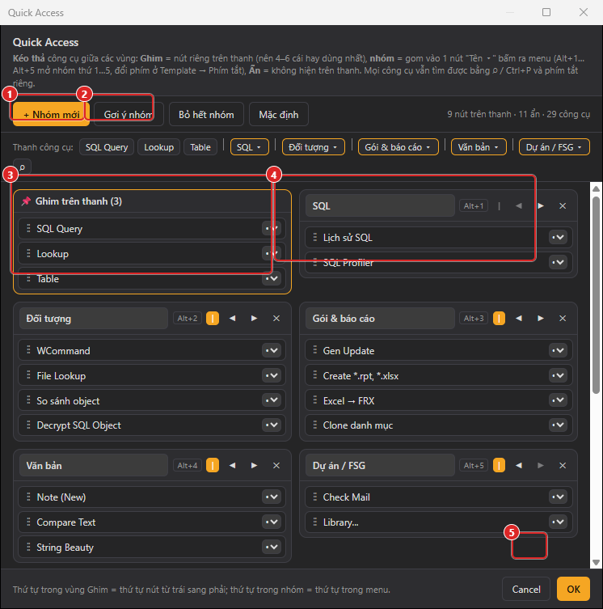

Trên ảnh: **①** ＋ Nhóm mới · **②** Gợi ý nhóm (chia sẵn) · **③** vùng 📌 Ghim trên thanh · **④** một nhóm (Alt+1…5 thả menu nhóm) · **⑤** OK để lưu.

Hàng nút dưới thanh trên, chia vùng bằng dấu "|": SQL (SQL Query, Lookup, Table, Command, Lịch sử SQL, SQL Profiler) · Object & source (WCommand, File Lookup, File Reference, Change Owner, So sánh object, Compare Structure, Decrypt SQL Object) · Gói & báo cáo (Gen Update, Gen Update (Result), Create *.rpt *.xlsx, Excel → FRX, Clone danh mục…) · Văn bản (Note, Note (New), Compare Text, String Beauty) · Khác (Check Mail, Setup eInvoice, FSG Yêu cầu, FSG FBO, Library). Rê chuột lên nút để xem phím tắt.

**Quick Access** (★ trên thanh trên): kéo từng công cụ vào **📌 Ghim trên thanh** (nút riêng, nên 4–6 nút), vào **Nhóm** (gộp thành nút "Tên ▾"; `Alt+1`…`Alt+5` thả menu nhóm thứ 1…5) hoặc **🚫 Ẩn**. Nút **Gợi ý nhóm** chia sẵn nhóm SQL / Đối tượng / Gói & báo cáo / Văn bản / Dự án. Công cụ ẩn vẫn gọi được bằng phím tắt và `Ctrl+P`.

### Command Palette (`Ctrl+P`)

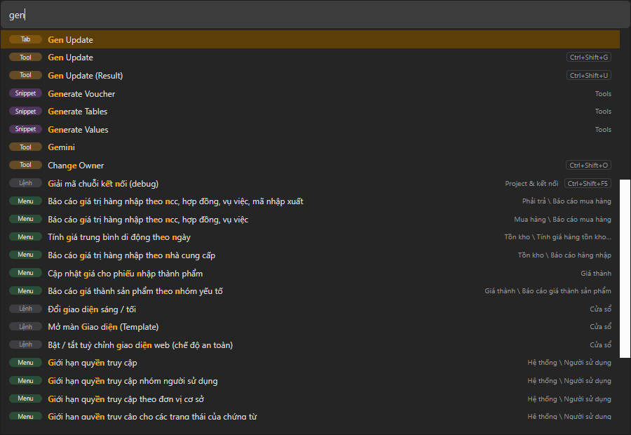

Ô tìm nhanh mọi thứ: tab đang mở, công cụ, lệnh, menu WCommand, object SQL, snippet. Gõ tiền tố để lọc: `>` công cụ / lệnh · `#` object SQL (đọc cache trên máy, không chạm database) · `@` menu WCommand · `$` snippet Library. `Enter` mở; `Shift+Enter` trên object SQL = "Ai đang dùng?"; `Esc` đóng.

### Tab

- `Ctrl+Tab` tab kế; **giữ Ctrl rồi bấm Tab** → hộp "Chuyển tab" (`↑ ↓` / `Tab` để chọn, `Enter` để đi, giữ Shift để đi ngược). Kiểu `Ctrl+Tab` bấm nhanh (Tab tới A → B → C / Tab song song A ⇄ B) chọn ở Template → Cửa sổ.
- `Ctrl+W` đóng tab (hỏi nếu chưa lưu) · `Ctrl+Shift+B` mở lại tab vừa đóng.
- Chuột phải tab: Pin Tab / Unpin Tab · Reopen Closed Tab · Close Tab · Close Other Tabs · Close Tabs to the Right · Close All Tabs (tab ghim không bị đóng hàng loạt).
- Chuột phải vùng trống thanh tab: **Tab đã đóng gần đây** và danh sách **Mở nhanh** các công cụ.

### Giỏ script (Script Cart)

- **Add Script** (`Ctrl+Alt+Shift+A`): ở tab Table → sinh script DELETE + nạp lại dữ liệu đang xem; ở tab SQL Query → lấy đoạn chọn (hoặc cả script) bọc header FCode + GO. Script được copy vào clipboard **và** thêm vào giỏ. Ở tab khác → chọn file `*.f;*.xml;*.sql` để thêm.
- **View Script** (`Ctrl+Alt+Shift+V`): xem giỏ "Script Cart (N files)". **Clear Script**: xoá giỏ.
- **Save Script / Copy Script**: lưu / copy nội dung tab script đang mở.

### Thanh trạng thái

Bên trái: workspace + server đang dùng. Bên phải: **Login WLink** (bấm để mở web đăng nhập), nút **▾ Project** (mở nhanh thư mục Program / Source / Working / Mobile, **Copy Project Info**) và tên máy.

<a id="sql-query"></a>
## SQL Query

Mở: nút **SQL Query** (`Ctrl+Shift+Q`). Mỗi lần mở là một tab mới.

### Chạy script

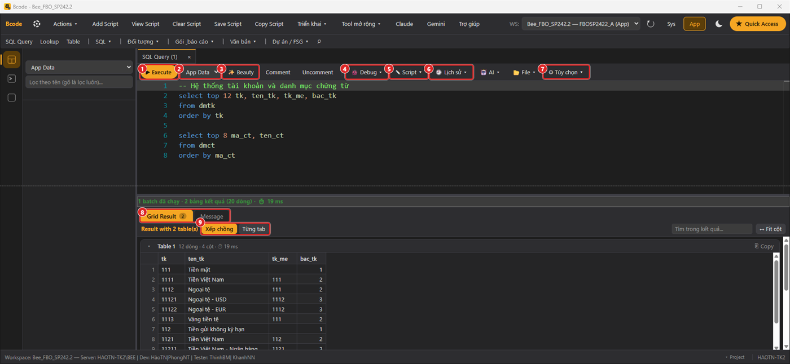

Trên ảnh: **①** ▶ Execute (`F5` / `Ctrl+Enter`) · **②** chọn database App / Sys · **③** ✨ Beauty (`F7`) · **④** nhóm 🐞 Debug · **⑤** nhóm ✎ Script (có Write Schema) · **⑥** nhóm 🕘 Lịch sử · **⑦** nhóm ⚙ Tùy chọn · **⑧** tab Grid Result / Message · **⑨** Xếp chồng / Từng tab.

1. Chọn database ở ô **App Data / Sys Data** trên thanh của tab (hoặc ô WS trên thanh trên).
2. Gõ / dán script (kéo thả file .sql vào editor cũng được — chế độ Web; file ≥ 50 MB bị từ chối).
3. `F5` hoặc `Ctrl+Enter` (nút **▶ Execute**): chạy **đoạn đang bôi đen**, không bôi đen thì chạy cả script. Script nhiều batch tách bằng `GO`.
4. Đang chạy: nút thành **■ Cancel** (hoặc `Alt+F5`) để dừng.
5. Dòng trạng thái báo số batch, số dòng kết quả, số dòng bị ảnh hưởng, thời gian. Có lỗi → tab **Message** tự mở, bấm dòng "dòng N" để nhảy tới dòng lỗi trong editor.

`Ctrl+R` ẩn / hiện khung kết quả.

### Nhiều bảng kết quả

- Tab **Grid Result (n)** · **Message (n)** · **Pivot** (chỉ hiện khi kết quả có dạng pivot).
- Nhiều bảng: chọn **Xếp chồng** (các bảng xếp dọc, chế độ App kéo đổi cao từng bảng, double-click về cao tự động) hoặc **Từng tab**. Ô "Tìm trong kết quả...", **↔ Fit cột**, mỗi bảng có **⎘ Copy**.
- Chọn nhiều ô số → thanh dưới hiện Average / Count / Sum.
- Chuột phải ô: Copy (`Ctrl+C`) · Copy kèm tên cột (`Ctrl+Shift+C`) · Copy cả bảng · Goto Column (`Ctrl+G`) · Copy tên cột · Filter · Add Index Column Order · Generate Design Fields · Maxlength Column Content · Compare Column Content · Set Color Cell. Chuột phải tiêu đề cột: **Thống kê** Sum / Max / Min / Avg.
- Bật **Result Tab** (⚙ Tùy chọn) để mỗi lần chạy ra một tab kết quả riêng ("Command Result").
- Tab **Pivot** có nút **Tạo file Excel pivot…** (mở Create RPT & XML ở chế độ Pivot — cần key).
- Bcode nhận diện pivot theo thứ tự:
  1. `<pivot rowField columnField dataFields>` trong Grid controller của báo cáo (Source Path của workspace). Tên controller lấy từ lệnh `exec` cuối của script, bỏ tiền tố `rs_`; đọc được cả file controller `.xml` lẫn `.f`.
  2. Không đọc được controller thì đoán theo **quy tắc** trong file `pivot-rules.txt`. Mở file này ở **Settings → Pivot SQL Query: quy tắc đoán cấu trúc...**; chưa có file thì Bcode tạo từ mẫu mặc định.
- Mỗi dòng trong `pivot-rules.txt` là `khoá dòng | khoá cột | cột tiêu đề cột | field giá trị`. Ví dụ `ma_vt | ma_kho | ten_kho | so_luong, tien`.
  - Khoá dòng `*` = tự đoán: lấy cột chữ đầu tiên không phải cột hệ thống. Quy tắc `*` chỉ áp khi có thêm bảng định nghĩa kiểu Fast (cột `id`, `name` có dạng `so_luong$1`). Ví dụ có sẵn: `* | sysColumn`.
  - Lưu file rồi chạy lại script là áp dụng, không cần mở lại Bcode. Xoá file = quay về mẫu mặc định.

### Thanh nút (chế độ Web)

Mặc định ghim **▶ Execute**, ô database, **✨ Beauty**; còn lại gom nhóm:

| Nhóm | Mục |
|---|---|
| 🐞 Debug | Debug store/function · Debug từng bước (bật / tắt) |
| ✎ Script | Comment · Uncomment · Default Type (UPPER / lower Keyword) · **Write Schema** · Check Fields |
| 🕘 Lịch sử | 💾 Lưu lịch sử · Lịch sử sửa procedure / function |
| 🤖 AI | → Claude · → Gemini (gửi script sang tab AI) |
| 📂 File | Open · Save (file .sql) |
| ⚙ Tùy chọn | Suggest Param/Caret · Reset Connection · Result Tab · Wrap · Options… |

Chuột phải lên thanh → "Tùy chỉnh thanh SQL Query": kéo nút giữa Ghim / nhóm / Ẩn (áp cho mọi tab SQL). Toggle khác mặc định hiện thành chip trên thanh, vd **⚠ Giữ kết nối** khi tắt Reset Connection (kết nối được giữ giữa các lần chạy — transaction và bảng `#temp` còn nguyên).

Chế độ App: **▶ Execute**, ô database, **✦ Beauty**, Default Type, **Script ▾** (Comment, Uncomment, Beauty, UPPER/lower, Write Schema, Mở object dưới con trỏ ở tab mới), **Lịch sử ▾**, **File ▾**, **Tùy chọn ▾**.
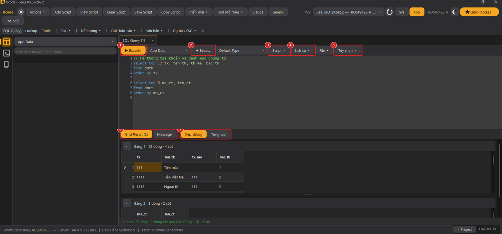

Trên ảnh: **①** ▶ Execute · **②** ✦ Beauty · **③** Script ▾ (Write Schema, Comment…) · **④** Lịch sử ▾ · **⑤** Tùy chọn ▾ · **⑥** Grid Result / Message · **⑦** Xếp chồng / Từng tab.


### Hỗ trợ khi viết SQL

| Phím / thao tác | Tác dụng |
|---|---|
| Gõ | Gợi ý bảng, cột, procedure, function, snippet theo database đang chọn. Bảng "gõ gì ra gì": ⚙ Settings → **Hướng dẫn gợi ý code SQL**. |
| `Ctrl+/` | Bật / tắt chú thích dòng `--` cho dòng hiện tại hoặc các dòng đang chọn (như VS Code) |
| `Ctrl+K` rồi `Ctrl+C` / `Ctrl+K` rồi `Ctrl+U` | **Comment** / **Uncomment** các dòng đang chọn (chuỗi phím như VS Code) |
| `Alt+Shift+A` | Chú thích khối `/* ... */` quanh đoạn chọn (bấm lần nữa để gỡ) |
| `F7` | **Beauty** — định dạng lại đoạn chọn / cả script |
| `F12` | Xem nhanh (peek) object dưới con trỏ hoặc mọi tên trong đoạn chọn (tối đa 40): bảng → cấu trúc, procedure / function / view / trigger → code. Tìm database đang chọn trước, rồi database kia. (Chế độ App: mở sang tab mới.) Đứng trên **biến** `@x` thì khung peek hiện cả script, cuộn tới **chỗ khai báo** (tham số store hoặc `DECLARE`) trong lô hiện tại và tô xanh dòng đó. |
| `Ctrl+F12` | Mở object dưới con trỏ sang tab SQL Query mới |
| `Ctrl`+chuột phải lên tên procedure / function | Chèn định nghĩa của nó lên **đầu script** + `GO` (đã có thì nhảy tới); `Ctrl+Z` để bỏ |
| `Ctrl+I` | AI sửa / sinh SQL theo yêu cầu (gõ yêu cầu, `Ctrl+Enter` gửi, xem lại rồi **Insert**). Cần API key: ⚙ Options → Cấu hình Claude / Gemini API Key. |
| `Alt+\` | Gọi gợi ý AI (ghost text) ngay |
| `Ctrl+Alt+H` | Lưu đoạn chọn / script vào **Lịch sử SQL** |
| `Alt+Z` | Bật / tắt tự xuống dòng |
| Bấm lề trái | Đặt breakpoint (dùng cho Debug từng bước) |
| Check Fields | Kiểm tra mọi bảng / cột trong script có tồn tại (chạy `SET NOEXEC ON`, không chạy thật) |

Chuột phải trong editor: snippet theo nhóm (Library), Cut / Copy / Paste, Beauty Format; khi có vùng chọn: **Change Field to:** MAX / MIN / SUM / COUNT / AVG, **Alias** (gắn / bỏ tiền tố a., b.…), ISNULL…; Hỏi AI.

> **Lưu ý:** `Ctrl` + lăn chuột (hoặc ⚙ Tùy chọn → Tăng / Giảm cỡ chữ) đổi cỡ chữ editor, `Ctrl+0` về mặc định.

<a id="debug-sql"></a>
## Debug từng bước (SQL)

Chỉ có ở **chế độ Web** (chế độ App chỉ nạp code store/function vào editor và nhắc chuyển sang Web).

### Bắt đầu

- **Cách 1 — debug script đang mở**: nhóm 🐞 Debug → bật **Debug từng bước**, rồi `F5`.
- **Cách 2 — debug store / function được gọi trong script**: 🐞 Debug → **Debug store/function** → hộp "Chọn store/function để debug" liệt kê các câu EXEC / gọi function (Dòng, Loại, Đối tượng, Câu gọi) → chọn → **Debug**. Bcode mở tab mới chứa code của object đó.
- Object có tham số → hộp "Debug từng bước — tham số": nhập giá trị dạng T-SQL (`'chuỗi'`, số, `NULL`); ô được điền sẵn từ câu EXEC, không có thì lấy DEFAULT → **Bắt đầu debug**.

### Trong khi debug

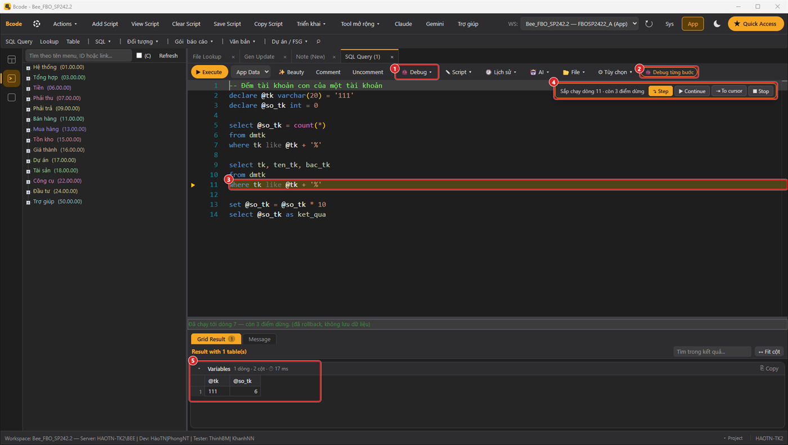

Trên ảnh: **①** nhóm 🐞 Debug (Debug store/function, Debug từng bước) · **②** chip "Debug từng bước" đang bật · **③** dòng sắp chạy (tô vàng) · **④** thanh Step / Continue / To cursor / Stop · **⑤** bảng **Variables**.

| Phím | Nút | Tác dụng |
|---|---|---|
| `F10` | ⤵ Step | Chạy tới điểm dừng kế |
| `F5` | ▶ Continue | Chạy tiếp tới breakpoint kế (hoặc hết) |
| `Ctrl+F10` | ⇥ To cursor | Chạy tới dòng con trỏ |
| `Shift+F5` | ⏹ Stop | Thoát debug |

- Dòng sắp chạy tô vàng; thanh nổi báo "Sắp chạy dòng N · còn M điểm dừng".
- Giá trị biến hiện ở bảng **Variables** (và bảng có tên biến bảng); kết quả thật hiện thành "Kết quả i".

> **Lưu ý:** mỗi bước Bcode chạy lại script từ dòng 1 tới dòng đích trong `BEGIN TRAN` rồi **luôn ROLLBACK** — không thay đổi dữ liệu, nhưng script nặng sẽ chậm dần về cuối. Chưa hỗ trợ CTE, inline table function; không dừng được ở dòng IF / WHILE / ELSE chờ dòng sau hoặc dòng BEGIN trống.

<a id="lich-su-sql"></a>
## Lịch sử SQL và lịch sử sửa object

### Lịch sử SQL (`Ctrl+Shift+Y`)

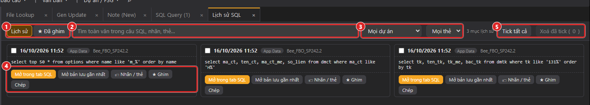

Trên ảnh: **①** tab Lịch sử / ★ Đã ghim · **②** tìm toàn văn · **③** lọc theo dự án / thẻ · **④** một mục: Mở trong tab SQL · Mở bản lưu gần nhất · 🏷 Nhãn / thẻ · ★ Ghim · Chép · **⑤** Tick tất cả / Xoá đã tick.

Kho câu SQL bạn chủ động lưu — **không tự lưu** mỗi lần chạy.

1. Ở tab SQL Query: **💾 Lưu lịch sử** (nhóm 🕘 Lịch sử) hoặc `Ctrl+Alt+H`.
2. Mở tab **Lịch sử SQL**: tab **Lịch sử** / **★ Đã ghim**, ô tìm toàn văn (câu SQL, nhãn, thẻ), lọc theo dự án / thẻ.
3. Mỗi mục: **Mở trong tab SQL** (chỉ mở, không chạy) · **Mở bản lưu gần nhất** · **🏷 Nhãn / thẻ** · **★ Ghim** · **Chép**.
4. Ghim: đặt Nhãn (tên dễ nhớ), Thẻ (cách nhau dấu phẩy), tuỳ chọn "chỉ hiện ở dự án …". Mục ghim có thêm **Mở với tham số lần trước**.
5. Tick nhiều mục → **Xoá đã tick**.

### Lịch sử sửa procedure / function

Mở: 🕘 Lịch sử → **Lịch sử sửa procedure / function** (hoặc ⚙ Options).

- Bcode **tự ghi** mỗi lần bạn chạy CREATE / ALTER PROCEDURE, FUNCTION, VIEW, TRIGGER (kèm bản BASELINE trước lần sửa đầu).
- Chọn dự án → lọc tên object → chọn phiên bản → so sánh với **Bản liền trước** / **Bản liền sau** / **Hiện tại (trong database)** (khung diff; `Alt+F5` / `Shift+Alt+F5` nhảy khác biệt).
- **Copy bản này** · **Khôi phục bản này** (đưa vào editor, không tự chạy) · **Mở thư mục lịch sử**.
- **Theo dõi ngoài Bcode**: cài DDL trigger + bảng log để ghi cả thay đổi làm bằng công cụ khác (SSMS…).

Thư mục lưu lịch sử đặt ở Template → **Lịch sử SQL**.

<a id="write-schema"></a>
## Write Schema — file .xsd cho Crystal Report và cập nhật file .rpt

Dùng khi sửa procedure báo cáo (thêm / bớt / đổi cột) và cần cập nhật cấu trúc dữ liệu của file Crystal Report.

### Tạo file .xsd

1. Ở tab SQL Query, chạy procedure báo cáo (`F5`) để có các bảng kết quả.
2. Chế độ Web: nhóm **✎ Script ▾ → Write Schema**. Chế độ App: **Script ▾ → Write Schema (.xsd cho Crystal Report từ bảng kết quả)...**.
3. Hộp lưu file: tên gợi ý = tên procedure vừa EXEC + `.xsd`; thư mục mặc định `<Source Path>\App_Data\Controllers\Templates\Rpt` (không có thì thư mục dùng lần trước).
4. Bcode ghi DataSet **NewDataSet** với các bảng **d1, d2, … dN** theo đúng thứ tự bảng kết quả (chỉ cấu trúc, không có dữ liệu) — cùng dạng các file `Templates\Rpt\*.xsd`.
5. Bcode hỏi "Cập nhật bảng trong file Crystal Report (.rpt) theo schema này luôn?" → **Yes** để sang bước dưới.

> **Lưu ý:** chưa chạy gì mà bấm Write Schema → "Chưa có bảng kết quả. Chạy script / procedure (F5) trước…". Bcode lấy kết quả của **lần chạy gần nhất** trong tab.

### Cập nhật bảng trong file .rpt

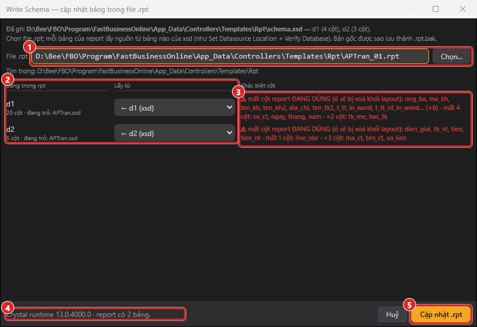

Trên ảnh: **①** chọn file .rpt (gõ để tìm / Chọn...) · **②** bảng trong rpt → lấy từ dN của xsd · **③** khác biệt cột — chữ đỏ = cột report đang dùng sẽ bị xoá · **④** trạng thái Crystal runtime · **⑤** **Cập nhật .rpt** (bản gốc lưu thành .rpt.bak).

Hộp "Write Schema — cập nhật bảng trong file .rpt" (giống Set Datasource Location + Verify Database của Crystal):

1. **File .rpt**: gõ tên để tìm — danh sách nạp sẵn các file .rpt trong `Templates\Rpt` (khớp đầu tên trước, rồi chứa); hoặc dán đường dẫn rồi `Enter`; hoặc **Chọn...**. File .rpt cùng tên xsd được chọn sẵn.
2. Bcode đọc report ("Crystal runtime … · report có N bảng, M subreport"), rồi hiện bảng ghép:
   - **Bảng trong rpt** (số cột, file đang trỏ) → **Lấy từ**: "(giữ nguyên)" hoặc "← dN (xsd)" (bảng cùng tên chọn sẵn).
   - Bảng xsd chưa có trong rpt: **Thêm vào rpt** / **Bỏ qua**.
   - Cột **Khác biệt cột**: "+n cột", "mất n cột" (cam), "cột giống hệt"; **chữ đỏ "⚠ mất cột report ĐANG DÙNG"** = cột đang đặt trên layout sẽ bị Crystal xoá khỏi report.
3. Có subreport → tick "Cập nhật cả subreport" để trỏ các bảng cùng tên trong subreport sang xsd mới.
4. **Cập nhật .rpt**. Nếu có cột đang dùng bị mất, Bcode hỏi lại lần nữa. Xong: "Đã cập nhật … ; bản cũ: <tên>.rpt.bak".

> **Lưu ý:** bản gốc luôn được sao lưu thành **`<tên>.rpt.bak`** cạnh file — muốn quay lại thì đổi tên file .bak.

### Yêu cầu và lỗi hay gặp

- Máy cần cài **SAP Crystal Reports runtime 13 for .NET Framework** (bản 64-bit, `CRRuntime_64bit_13_0_x.msi`). Bcode gọi runtime qua **Windows PowerShell 5.1** có sẵn của Windows.
- "Máy chưa cài SAP Crystal Reports runtime…" → cài runtime rồi thử lại.
- "Không chạy được Windows PowerShell." → PowerShell 5.1 bị chặn / gỡ (kiểm tra chính sách máy).
- "Crystal Reports runtime không trả lời sau 3 phút." → file .rpt quá lớn hoặc runtime treo; đóng Crystal Designer nếu đang mở file đó rồi thử lại.
- "File .rpt không có bảng dữ liệu nào để lấy mẫu kết nối ADO.NET (XML)." → report chưa có bảng nguồn nào; thêm một bảng bằng Crystal Designer trước.

<a id="table"></a>
## Table — xem và sửa dữ liệu bảng

Mở: nút **Table** (`Ctrl+Shift+T`). Mỗi lần mở là một tab mới; tab đổi tên theo bảng sau khi nạp.

### Các bước

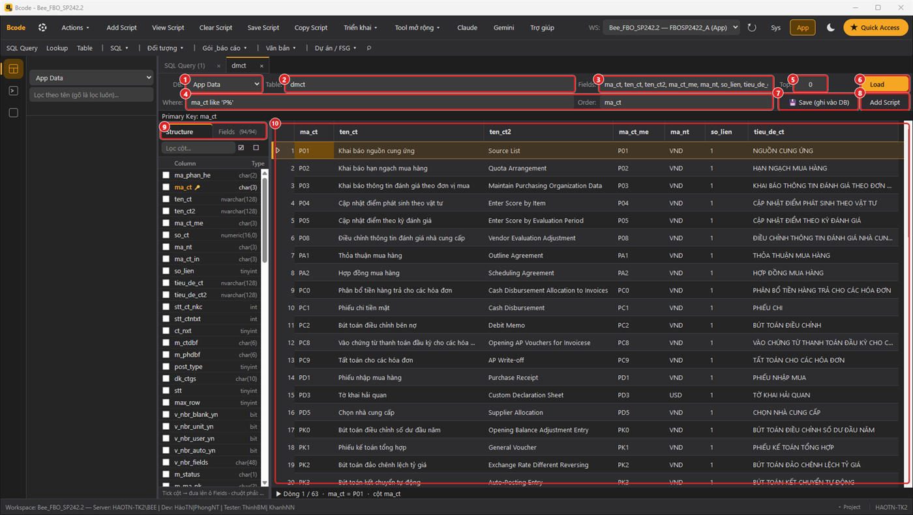

Trên ảnh: **①** DB · **②** ô Table (gợi ý tên bảng) · **③** Fields · **④** Where / Order · **⑤** Top (0 = tất cả) · **⑥** Load · **⑦** 💾 Save (ghi vào DB) · **⑧** Add Script · **⑨** khung Structure / Fields · **⑩** lưới sửa dữ liệu (F1, F3, F4, F8…).

1. Chọn **DB:** App Data / Sys Data.
2. Gõ tên vào ô **Table** — gợi ý hiện ngay: khớp đầu tên trước, rồi chứa; **bảng phân kỳ** (`d91$000000`, `d91$202501`…) xếp lên đầu theo thứ tự kỳ.
3. Chọn một gợi ý (bấm / `Enter` / `Tab`) → Bcode **chỉ nạp structure** (khung trái) — "Đã nạp structure — Enter / Load để tải dữ liệu".
4. Nhập (tuỳ chọn) **Fields** (mặc định `*`), **Where** (vd `ma_kh like 'KH%' and status = '1'`), **Order** (vd `ngay_ct desc`), **Top** (mặc định `0` = tất cả). Where / Order / Fields có gợi ý tên cột.
5. `Enter`, **Load** hoặc `F5` → tải dữ liệu. Bảng chỉ có ở database kia → Bcode tự chuyển DB.

Trên lưới hiện khoá chính ("Primary Key: …"); bảng không có khoá chính thì không lưu / xoá được an toàn.

### Menu của bảng

Khi gõ tên bảng hoặc tải bảng, dưới ô Where / Order hiện thêm dòng **Menu:** là màn hình dùng bảng đó. Ví dụ `i74$000000` → *Phiếu nhập kho (inctpnd.aspx)*, `dmkh` → *Danh mục khách hàng (arkh.aspx)*.

- **Bấm** vào một menu → cây **WCommand** bên trái được hiện ra, các nhánh cha mở sẵn và menu đó được chọn, giống như bấm chọn trên cây.
- Đưa chuột lên một menu để xem mã menu (wmenu_id), đường dẫn trên cây và nguồn tra được.
- Một bảng có thể ra nhiều menu, ví dụ cùng một danh mục khai ở nhiều phân hệ. Khi đó tên phân hệ hiện trong ngoặc vuông, như *Hóa đơn bán hàng [Bán hàng]*. Tên chỉ khác nhau ở dấu customize `(*)` / `(C)` cũng tính là trùng, ví dụ *Hóa đơn bán hàng (\*) [Bán hàng]* và *Hóa đơn bán hàng [Phải thu]*. Hai bản cùng một phân hệ thì ghi cả đường dẫn cha. Dòng hiện tối đa 4 menu, phần còn lại là "+N" (đưa chuột lên để xem).
- Cách tra: tên bảng bỏ đuôi kỳ (`$202601`, `$000000`, `$log`). Bcode tìm theo hai nguồn:
  - Bảng **dmct9** (chứng từ): cột c$ / m$ / d$ / i$ chứa tên bảng, cột url là trang aspx, rồi tìm menu có link trỏ tới trang đó.
  - Controller của menu trong Source Path: `Dir\<sysid>.f` khai `table="…"` (kể cả khai qua entity như `&Tag;`), cùng các Grid chi tiết mà Dir trỏ tới.
- Chữ mờ *(fxctcc1.aspx) — chưa thấy menu*: dmct9 có trang aspx nhưng cây WCommand không có menu nào trỏ tới trang đó. Không tra được gì thì dòng Menu không hiện.
- Kết quả được nhớ theo dự án. Bấm nút ⟳ (Refresh database) để tra lại sau khi sửa dmct9 hoặc source.

### Check Partitions Struct — kiểm cấu trúc bảng phân kỳ

Khi ô **Table** đang là bảng phân kỳ (`i74$000000`, `i74$202601`…), **chuột phải vào ô Table** → **Check Partitions Struct**. Bảng không phân kỳ thì chuột phải vẫn ra menu Cắt / Chép / Dán như cũ.

Bcode so mọi bảng cùng tiền tố (`i74$yyyymm`, kể cả kỳ đặc biệt như `$999999`) với bảng mẫu `i74$000000` (không có bảng mẫu thì so với bảng kỳ đầu tiên), theo DB đang chọn ở ô **DB:**. Bảng `$log` không được xét. Hộp kết quả gồm:

- Dòng đầu: **Tables are same structure** (chữ xanh) khi mọi bảng giống nhau, hoặc chữ đỏ "N/M bảng kỳ khác cấu trúc so với …".
- Lưới **Table | Description**: `OK` = giống bảng mẫu. Bảng khác thì tên bảng in đỏ, cột Description ghi rõ:
  - **Thiếu cột** / **Thừa cột**;
  - **Khác kiểu**: kiểu, độ dài, `null` / `not null` của bảng đó so với bảng mẫu;
  - **Khác thứ tự cột**: cùng bộ cột nhưng xếp khác. Lỗi này cũng cần sửa, vì tra `xxx$000000` ghép các kỳ bằng UNION ALL theo vị trí cột, lệch thứ tự là sai dữ liệu.
- **Copy** chép kết quả (Table / Description, cách nhau bằng Tab) để dán vào Excel. **OK** hoặc `Esc` để đóng.

Chỉ đọc cấu trúc (INFORMATION_SCHEMA), không sửa bảng nào. Muốn thêm hoặc sửa cột cho mọi kỳ, dùng chuột phải tab Structure → **Gen Add Column** / **Gen Alter Column**.

### Khung trái: Structure / Fields

- Tick cột để thay `*` trong ô Fields; ô "Lọc cột...", ☑ / ☐ tick hết / bỏ hết.
- Chuột phải tab Structure: **Gen Structure Table** · **Gen Add Column** · **Gen Alter Column** · **Gen Drop Column** (Add to Clipboard / Preview / Design) · **Render XML** (Dir / Grid XML từ cấu trúc bảng).

### Sửa dữ liệu kiểu Excel

- Sửa ô rồi **rời khỏi dòng là tự lưu** ("Đã tự động lưu N thay đổi lúc …"); dòng lỗi giữ dấu "!" đỏ.
- **💾 Save (ghi vào DB)** ghi các thay đổi còn lại (hỏi xác nhận nơi ghi).
- Dán từ Excel (`Ctrl+V`) điền được nhiều ô.

| Phím | Tác dụng |
|---|---|
| `F1` | Xem / sửa chi tiết dòng (mọi cột thành một form) |
| `F3` | Khai báo nhanh danh sách "a, b, c" trong các ô đang chọn |
| `F4` | Thêm dòng mới |
| `F8` | Xoá các dòng đang chọn (ghi ngay vào database, hỏi trước) |
| `Ctrl+I` | Nhân bản dòng |
| `Ctrl+N` | Chèn dòng mới sau dòng đang chọn |
| `Ctrl+'` | Copy giá trị ô đang chọn |
| `Ctrl+0` | Đặt các ô đang chọn thành NULL |
| `Ctrl+G` | Goto Column |
| `F5` | Tải lại |

Chuột phải lưới: Add New · Delete · Copy Row · Paste · Clone Row · Insert New Row After · Copy One Value · Alter Null Value · **Gen Insert (dòng đã chọn)** · **Gen Update (dòng đã chọn)** · Set Cells Value to NULL · Description Columns...

### Add Script — đóng gói dữ liệu bảng

Nút **Add Script** (hoặc `Ctrl+Alt+Shift+A`): sinh script DELETE + nạp lại **mọi dòng đang xem**, copy vào clipboard và thêm vào Script Cart.

> **Lưu ý:** số dòng đang xem bằng đúng giới hạn Top → Bcode cảnh báo phần dữ liệu còn lại sẽ **mất** khi chạy script; đặt Top = 0 rồi Load lại. Bảng tổng hợp `$000000` chỉ để xem (gộp UNION ALL các kỳ) — không Save / xoá được. Database / workspace bị đổi sau khi tải → Bcode không ghi để tránh ghi nhầm; bấm Load lại.

<a id="command-lookup"></a>
## Command và Lookup

### Command (`Ctrl+Shift+C`) — dựng câu SELECT nhanh

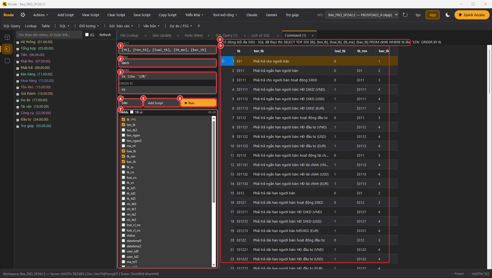

Trên ảnh: **①** SELECT (tự dựng theo cột đã tick) · **②** FROM · **③** WHERE / ORDER BY · **④** Top (mặc định 500) · **⑤** Add Script · **⑥** ▶ Run · **⑦** khung Fields (cột khoá có "(PK)") · **⑧** câu SQL đã thực thi · **⑨** lưới kết quả (chuột phải: Gen Insert / Gen Update).

1. Gõ **FROM** (có gợi ý tên bảng) → khung **Fields** liệt kê cột (cột khoá có "(PK)"). Tick cột để dựng lại SELECT (bỏ hết = `*`).
2. Nhập **WHERE**, **ORDER BY**, **Top** (mặc định 500; `0` = tất cả). `Enter` ở ô bất kỳ hoặc **▶ Run** để chạy.
3. FROM là bảng phân kỳ `xxx$000000` → Bcode tự UNION ALL mọi bảng kỳ thật.
4. Chuột phải lưới: **Gen Insert / Gen Update (dòng đã chọn)** (hỏi tên bảng đích và cột khoá; câu lệnh copy vào clipboard).
5. **Add Script**: đóng gói mọi dòng đang xem thành DELETE + INSERT (hỏi tên bảng đích).

### Lookup (`Ctrl+Shift+L`) — tìm object

- **DB:** App Data / Sys Data / Cả hai. Ô tên object + tick loại (Function, Store, Table, View, Trigger).
- Ô thứ hai tìm **nội dung** trong Function / Store / View / Trigger (từ 2 ký tự).
- Bên phải: **Show Search Text** · **Show Data** (Top 100, chỉ bảng) · **Show History**; **Mở trong Tab** để mở object sang tab SQL.

### Gen Update (Result) (`Ctrl+Shift+U`)

Sinh câu UPDATE cho **mọi dòng của bảng kết quả gần nhất** (SQL Query hoặc Command): hỏi tên bảng đích + cột khoá (vd `stt_rec` hoặc `ma_ct,ky`) → câu lệnh vào clipboard. Chỉ muốn vài dòng: chọn dòng → chuột phải → Gen Update (dòng đã chọn).

<a id="sql-object"></a>
## SQL Object, Ai đang dùng, So sánh object, Profiler

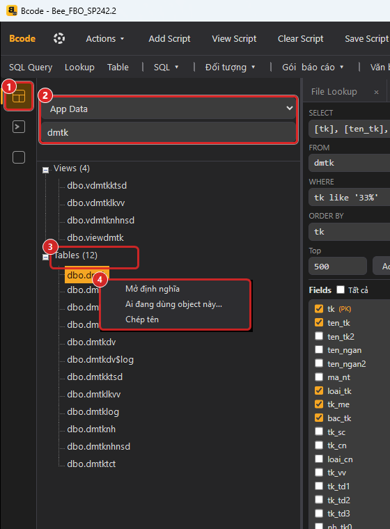

Trên ảnh: **①** mục SQL Object ở cột icon · **②** chọn database + ô lọc (gõ là lọc) · **③** nhóm Views / Tables / Stored Procedures… · **④** menu chuột phải: Mở định nghĩa · Ai đang dùng object này… · Chép tên.

| Công cụ | Mở | Dùng để |
|---|---|---|
| **Cây SQL Object** | Cột icon trái → SQL Object | Nhóm Tables / Views / Stored Procedures / Functions / Triggers (bảng phân kỳ được ẩn). Gõ vào ô lọc là lọc ngay (cây không tự tải khi ô trống). Double-click = mở định nghĩa ở tab SQL; chuột phải: Mở định nghĩa · Ai đang dùng object này… · Chép tên. |
| **Ai đang dùng** | `Ctrl+Alt+U` (trên tab mở từ cây SQL Object), hoặc `Ctrl+P` → chọn object → `Shift+Enter` | Liệt kê nơi dùng object: database App, Sys và file controller (Dir, Filter, Grid, Include, Options, Report). Chép danh sách / Quét lại. |
| **So sánh object** | `Ctrl+Shift+J` | So code procedure / view / function / trigger giữa 2 database (vd bản dev ↔ bản khách): lọc Khác nhau / Chỉ bên trái / Chỉ bên phải / Chỉ khác khoảng trắng / Mã hoá → chọn mục → **Sinh script ALTER** (Bcode chỉ sinh, không chạy). |
| **Compare Structure** | Thanh công cụ | So cấu trúc một bảng giữa 2 workspace (Chỉ có ở trái / phải, Khác nhau, Giống nhau). |
| **Change Owner** | `Ctrl+Shift+O` | Chuyển object sang schema khác (`ALTER SCHEMA TRANSFER`) — không hoàn tác từ Bcode được. |
| **Decrypt SQL Object** | Thanh công cụ (cần key) | Giải mã object bị mã hoá: cần quyền sysadmin và kết nối DAC (mỗi instance chỉ 1 kết nối DAC); luôn rollback. |
| **SQL Profiler** | `Ctrl+3` | Nhúng SQL Profiler thật vào tab: khai đường dẫn Profiler.exe, đăng nhập, chọn trace template → **▶ Bung & Đăng nhập**; **📋 Copy SQL Command** lấy câu SQL của dòng đang chọn. Trace lọc theo Database của dự án và theo **ID (ApplicationName) = u_id**: gõ user cần theo dõi (u_name) → **Tra u_id** (gõ tên mà chưa tra thì lúc bung Bcode tự tra). Ô **u_id** sửa / xoá được: bấm **✕** (hoặc xoá trống) khi ứng dụng không gắn ApplicationName = u_id → trace không lọc theo ID, template đã có filter ID cũng được gỡ (bản cũ giữ thành `.tdf.bak`); Tra u_id hoặc đổi tên user là lọc lại như cũ. Đang đứng trong cửa sổ Profiler vẫn dùng được phím tắt của Bcode (`Ctrl+Tab`, `Ctrl+W`, `Ctrl+Shift+<chữ>`…); các phím khác vẫn thuộc về Profiler. |

<a id="wcommand"></a>
## WCommand — cây menu ERP

Mở: biểu tượng **WCommand** ở cột icon bên trái (hoặc nút **WCommand** / `Ctrl+Shift+W`). Cây đọc bảng `wcommand` + `command` của **Sys Data**.

### Lọc cây

- Ô "Tìm theo tên menu, ID hoặc link..." (chế độ App: gõ xong bấm `Enter`). Đang lọc thì cây tự mở hết.
- Ô **(C)**: chỉ hiện menu customize (tên có "(C)" hoặc "(*)") kèm menu cha của chúng.
- **Refresh**: nạp lại cây từ database.

### Thao tác trên menu

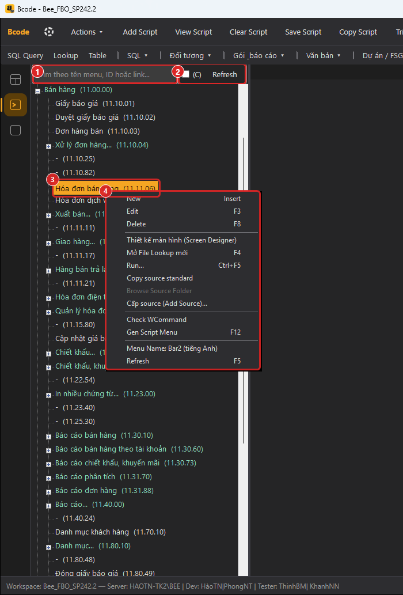

Trên ảnh: **①** ô lọc theo tên / ID / link · **②** ô (C) chỉ menu customize + Refresh · **③** menu đang chọn (double-click = mở File Lookup) · **④** menu chuột phải.

| Thao tác | Cách làm |
|---|---|
| Xem source của menu | **Double-click** menu lá → mở / dùng lại tab **File Lookup** của menu đó. Nếu tab đang chọn là **Gen Update** thì file của menu được nạp vào Gen Update. |
| Mở File Lookup thêm (đặt cạnh nhau so sánh) | `F4` hoặc chuột phải → **Mở File Lookup mới** |
| Thêm menu | `Insert` hoặc chuột phải → **New** (điền sẵn mọi thông tin của menu đang chọn + tự gợi ý WMenu Id / Menu Id còn trống) |
| Sửa / xoá | `F3` **Edit** · `F8` **Delete** (hỏi xác nhận) |
| Chạy menu trên web | `Ctrl+F5` hoặc **Run...** → mở `{Login WLink}/Main/{Link}` bằng trình duyệt mặc định |
| Chạy menu trong FSG FBO | `Ctrl+4` hoặc **Run trong FSG FBO** → mở tab FSG FBO, tự đăng nhập rồi vào đúng trang của menu (tab đã mở và đã đăng nhập thì vào menu luôn) |
| Sinh script menu | `F12` **Gen Script Menu** → cửa sổ "Script — {WMenuId}" (DELETE + INSERT cho wcommand và command, mỗi câu kết thúc GO) |
| Kiểm tra trùng | **Check WCommand** → hộp "Duplicate Menu" (tab "Not exists in Command" và "Difference Sysid" — sysid của wcommand khác của command; menu không khai sysid như menu nhóm, dòng kẻ "-" được bỏ qua) |
| Thiết kế màn hình | **Thiết kế màn hình (Screen Designer)** — chỉ bật khi menu có SysId |
| Lấy source chuẩn | **Copy source standard** / **Cấp source (Add Source)...** (xem [Cấp source](#cap-source)) |
| Đổi tên hiển thị | **Menu Name: Bar2 (tiếng Anh)** / **Menu Name: Bar (tiếng Việt)** — đổi cho cả cây WCommand và Mobile, được nhớ lại |
| Copy đường dẫn menu | `Ctrl+C` → copy dạng "Phải thu \ Tạo hóa đơn … (C)" |
| Xem yêu cầu QLYC của menu | Chuột phải → **Yêu cầu liên quan (QLYC)…** (phím: chưa gán, đặt ở Template → Phím tắt, nhóm Cây menu) → mở tab **Yêu cầu FSG** lọc sẵn các yêu cầu của **dự án đang chọn** liên quan menu đó (xem bên dưới) |
| Nạp lại | `F5` **Refresh** |

### Yêu cầu liên quan (QLYC)

Chuột phải một menu → **Yêu cầu liên quan (QLYC)…**: mở tab **Yêu cầu FSG** (Báo cáo yêu cầu FSG), bỏ các lọc khác và chỉ hiện yêu cầu (chỉ đọc) của dự án đang chọn liên quan menu đó. Chip **📌 Menu: … ✕** trên hàng lọc trạng thái cho biết đang lọc theo menu nào — bấm ✕ để bỏ. Cột **Liên quan** đầu bảng ghi lý do khớp; bấm ô Nội dung để mở khung chi tiết (có **🤖 AI tạo danh mục**).

- Dữ liệu: dùng yêu cầu đã kéo lưu trên máy (`%AppData%\Bcode\fsg-requirements.json`). Dự án chưa kéo lần nào thì Bcode tự kéo theo Mã dự án (cần mạng / VPN tới FSG; lỗi thì báo ở dòng trên bảng, sửa xong bấm **⟳ Kéo về**). Muốn cập nhật mới nhất: bấm **⟳ Kéo về** với Mã dự án = dự án đó.
- Mã dự án = **Project ID** của project (trống thì dùng tên project) — phải trùng `ma_da` trên FSG (Ctrl+F5 Synchronize project tự điền đúng).
- Cách khớp yêu cầu ↔ menu (`menu_id` của yêu cầu FSG chính là **WMenu Id** của cây, vd `09.30.03`), theo thứ tự hiện:
  1. **Đúng menu** — menu_id = WMenu Id của menu.
  2. **Menu con** — chuột phải menu nhóm (vd "Phải trả") thì lấy cả yêu cầu của mọi menu con / cháu.
  3. **Trùng tên menu** — tên menu của yêu cầu = Bar hoặc Bar2 (bỏ hoa / dấu, bỏ "(C)" "(*)") dù menu_id khác.
  4. **Nhắc trong nội dung** / **Đường dẫn trong nội dung** — yêu cầu gắn ở menu chung (`xx.00.00` hoặc menu cha) mà nội dung ghi trọn tên menu, hoặc tên menu nằm trên dòng "Đường dẫn: …".
- Không tìm được: yêu cầu gắn menu chung mà nội dung không ghi tên menu (hoặc ghi tắt / khác chữ); menu đã xoá khỏi wcommand; tên menu quá ngắn (dưới 2 từ / 10 ký tự) không dùng để dò nội dung; cây Mobile không có mục này.

### Form WCOMMAND - New / Edit

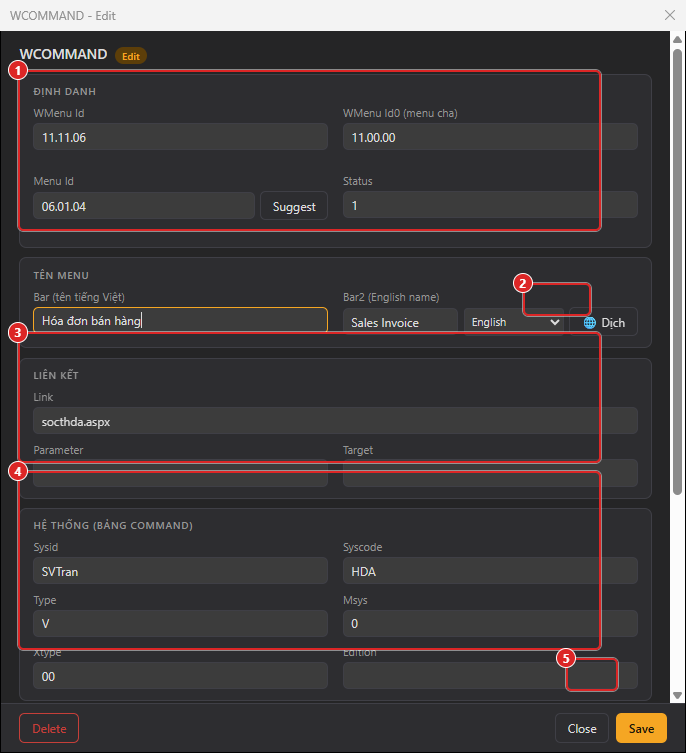

Trên ảnh: **①** Định danh (WMenu Id, menu cha, Menu Id + Suggest) · **②** 🌐 Dịch Bar → Bar2 · **③** Liên kết (Link, Parameter, Target) · **④** Hệ thống — bảng command (Sysid, Syscode, Type…) · **⑤** Save.

Form không chặn (vẫn bấm được cây): chọn menu khác trên cây là form nạp menu đó.

- **Định danh**: WMenu Id (+ **Suggest** — gợi ý id chưa tồn tại theo menu cha, chỉ hiện khi New), WMenu Id0 (menu cha), Menu Id (+ **Suggest**), Status.
- **Tên menu**: Bar (tên tiếng Việt), Bar2 (English name) + chọn ngôn ngữ + **🌐 Dịch** (Google dịch Bar sang Bar2 — nhớ kiểm tra lại rồi Save).
- **Liên kết**: Link, Parameter, Target. **Hệ thống (bảng command)**: Sysid, Syscode, Type, Msys, Xtype, Edition. **Bảng dữ liệu**: bảng m / d đọc từ file Dir (chỉ xem). **Biểu tượng**: Icon, Expl Icon (0-255), Icon Url.
- Nút **Save** · **Delete** · **Close**. Save ghi cả `wcommand` và `command` trong một transaction.

> **Lưu ý:** "WMenu Id '…' đã tồn tại" → bấm **Suggest** lấy id khác. Menu Id đã có → Bcode hỏi trước vì Save sẽ **ghi đè** dòng command cũ.

Menu loại APP mở form **COMMAND - Edit** (liệt kê mọi cột của bảng command, có Refresh Data / Save / New / Delete và danh sách `reports` bên dưới).

<a id="mobile"></a>
## Mobile — cây menu app mobile

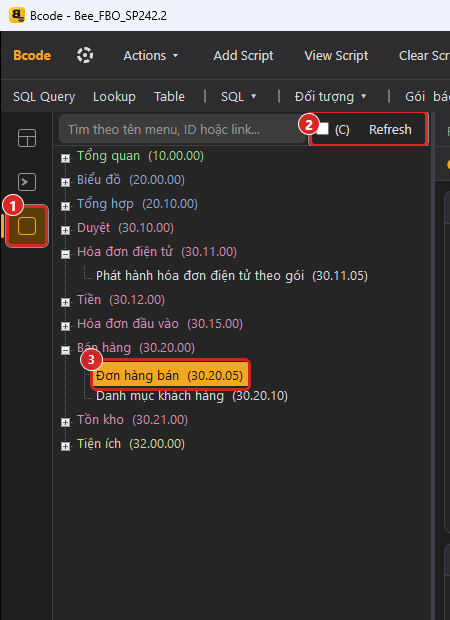

Trên ảnh: **①** mục Mobile ở cột icon · **②** ô (C) + Refresh · **③** menu mobile đang chọn.

Mở: biểu tượng **Mobile** ở cột icon trái (phím `left.mobile`, chưa gán mặc định — gán ở Template → Phím tắt). Cây đọc bảng **dvcommand** ở Sys Data (khoá `wmenu_id`, cha `wmenu_id0`).

- Thanh lọc, ô **(C)**, đổi tên Bar/Bar2 giống cây WCommand.
- Chuột phải: New · Edit · Delete · Mở File Lookup mới · Gen Script Menu · Menu Name · Refresh. (Không có Run, Thiết kế màn hình, Check WCommand.) New / Edit / Delete / Gen Script **chỉ sửa dvcommand**, không đụng bảng command.
- Form **DVCOMMAND - Edit** giống COMMAND - Edit, thêm ô Table Dir (bảng m) / Bảng d (Grid) và nút 🌐 Dịch cho Bar2.
- **Double-click** menu → tab "File Lookup · Mobile · {sysid}" — tìm file trong `App_Data\Controllers\Mobile\{Dir,Filter,Grid,Include}` của thư mục **Mobile Path**; `F4` mở thêm tab riêng.

> **Lưu ý:** Mobile Path trống thì Bcode đoán `<thư mục cha của Source Path>\MobileService`, rồi `Source Path\MobileService`. Không thấy → báo "chưa khai báo Mobile Path (Edit Project)…". Không có bảng dvcommand → cây hiện "(Không có bảng dvcommand ở Sys Data của workspace này, hoặc bảng rỗng)".

<a id="file-lookup"></a>
## File Lookup — tìm và xem source

Mở: nút **File Lookup** (`Ctrl+Shift+F`), hoặc double-click một menu trong cây WCommand. Cần workspace có **Source Path**.

### Thanh công cụ

1. **Path:** + **Load** — quét lại thư mục (xoá cache phân tích).
2. Chọn loại file (`.*`, `.f`, `.xml`, `.aspx`, `.xlsx`, `.rpt`) · **Only Show {đuôi}** · **SearchBox ▾** (mở khung tìm nội dung) · ô **Search...** (lọc tên file khi gõ).
3. **Copy to... (n)** · **Tick tất cả** · **Bỏ tick** · **Cấp source**.

### Các bước dùng

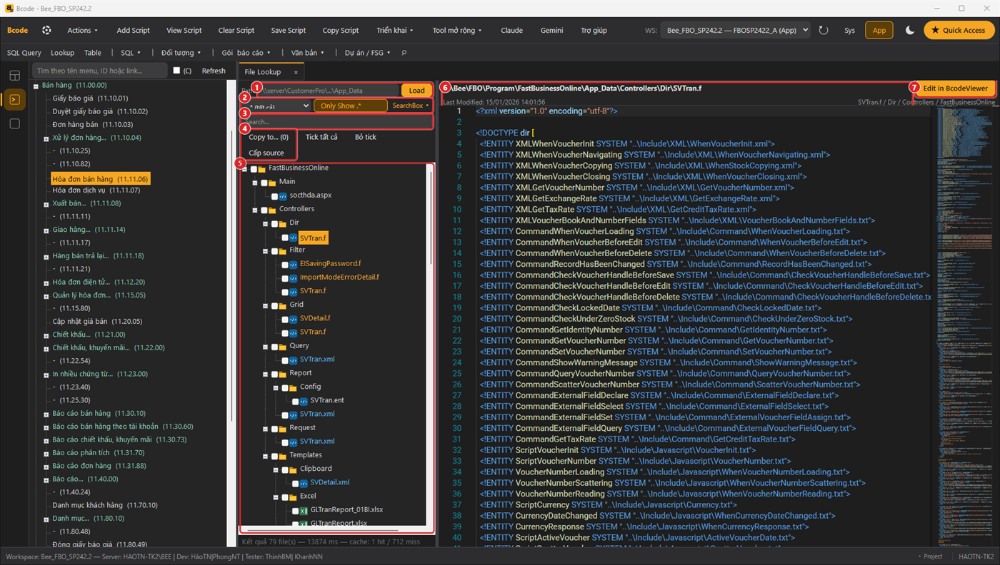

Trên ảnh: **①** Path + Load · **②** loại file · Only Show · SearchBox · **③** Search... (lọc tên file) · **④** Copy to · Tick tất cả · Bỏ tick · Cấp source · **⑤** cây file theo menu (đỏ = thiếu entity / include) · **⑥** đường dẫn + Last Modified · **⑦** **Edit in BcodeViewer**.

1. **Theo menu**: double-click menu ở cây WCommand → cây hiện trang Main + các file `App_Data\Controllers\*\<sysid>*` của menu, mở sẵn hết.
   **Duyệt tự do**: gõ Path rồi **Load**. (Đổi dự án xong cây chưa quét — chọn menu hoặc bấm Load.)
2. Bấm một file → khung xem trước (Monaco, chỉ đọc) bên phải, kèm "Last Modified". `F12` trên `&Entity;` để peek nội dung entity; `Ctrl+F` tìm trong file.
3. File **tô đỏ** = thiếu entity / include: chọn file để xem danh sách "✖ …" bị thiếu. Dòng trạng thái: "Kết quả n file(s) — ⚠ k file lỗi entity/include…".
4. **Edit in BcodeViewer** (hoặc double-click file) để sửa. Lần đầu Bcode hỏi đường dẫn BcodeViewer.exe. File `.rpt` / `.xlsx` mở bằng chương trình Windows.

### Tìm nội dung (SearchBox)

Nhập **Search in** (thư mục) + **String search**, tuỳ chọn File Type / Match Case / Show Pattern → **Search** (nút thành **Cancel** khi đang tìm). Quy tắc file nào được tìm chỉnh ở Template → **Tìm file**.

### Chuột phải trên file

Go to File/Folder · **Copy to...** (file đã tick) · Chuyển sang .frx (Excel → FRX / Crystal → FRX) · Copy path · Get Hash Source · **Cấp source (tự động theo phiên bản)...** · Cấp source thủ công (Add Source)... · **Clone files...** (đặt tên mới, có thể clone kèm file cùng tên, không ghi đè) · Delete file (không khôi phục được) · Refresh (`F5`).

Phím trong cây file: `F5` quét lại (giữ cache), `F4` nhân bản tab File Lookup hiện tại.

> **Lưu ý:** cache phân tích lưu theo dự án ở `%AppData%\Bcode\FileLookupCache` (xoá được nếu nghi cache cũ). File bỏ qua theo tên (mặc định `_bk, _copy, - copy`) đặt ở ⚙ Settings → **Cây menu: bỏ qua file theo tên (like)...**.

<a id="cap-source"></a>
## Cấp source, Copy to, Clone, File Reference

| Công cụ | Mở ở đâu | Dùng để |
|---|---|---|
| **Copy files to...** | File Lookup → tick file → **Copy to...** | Chép nhiều file sang thư mục / dự án khác: giữ cấu trúc thư mục con; file đích đã có → Bỏ qua / Ghi đè / Tự đổi tên (_1, _2…); đổi tên hàng loạt (Tiền tố / Hậu tố / Tìm → Thay). |
| **Cấp source (tự động theo phiên bản)** | File Lookup → **Cấp source** hoặc chuột phải file | Lấy đúng bản file chuẩn trong kho SourceCollection theo **Phiên bản** của dự án. Mỗi file gắn nhãn "đúng phiên bản / phiên bản khác / không tìm thấy / đã có / mới". Tick "Ghi đè file đã có ở đích" nếu muốn thay. |
| **Cấp source (Add Source)** | Chuột phải file / menu → Cấp source thủ công | Tìm theo mẫu tên (`;` ngăn cách, hỗ trợ `*` `?`), chọn Version, tick file, **OK — cấp source**. Lần đầu hỏi đường dẫn kho các phiên bản source. |
| **Copy source standard** | Cây WCommand → chuột phải menu | Chọn file chuẩn của menu, đổi tên hàng loạt rồi **Clone** sang dự án. |
| **File Reference** (`Ctrl+Shift+R`) | Thanh công cụ | Tìm mọi nơi tham chiếu một tên link / từ khoá trong App_Data; double-click kết quả để mở đúng dòng. |

> **Lưu ý:** kho SourceCollection chỉ được **đọc**; Bcode luôn hỏi trước khi ghi đè file ở đích. Đường dẫn kho chính / bổ sung khai ở Template → **Đường dẫn**.

<a id="gen-update"></a>
## Gen Update — đóng gói file cập nhật

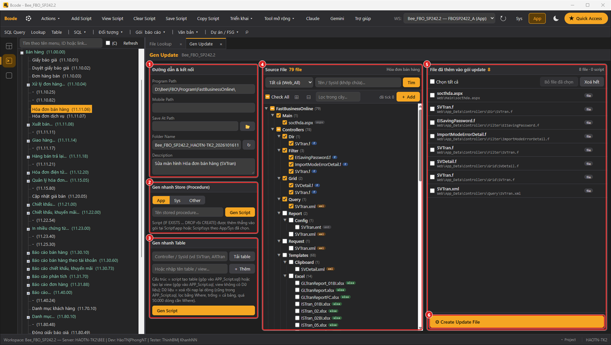

Trên ảnh: **①** Đường dẫn & kết nối (Save At Path, Folder Name, Description) · **②** Gen nhanh Store (Procedure) · **③** Gen nhanh Table · **④** Source File (cây file của menu, ＋ Add) · **⑤** File đã thêm vào gói update · **⑥** ⚙ Create Update File.

Mở: nút **Gen Update** (`Ctrl+Shift+G`). Cần Source Path.

1. **Đường dẫn & kết nối**: Program Path, Mobile Path, **Save At Path** (mặc định Working Path; 📂 mở thư mục), **Folder Name** (mặc định `{Mã dự án}_{TÊN MÁY}_{yyyyMMddHHmmss}`, ↻ tạo giờ mới), Description (ghi vào description.txt).
2. **Gen nhanh Store (Procedure)**: chọn App / Sys / Other, gõ tên procedure → **Gen Script** → script `IF EXISTS … DROP` rồi `CREATE` vào `Script\app` hoặc `Script\sys`.
3. **Gen nhanh Table**: gõ Controller/SysId → **Tải table**, hoặc gõ tên bảng → **＋ Thêm**. Mỗi bảng chọn DB, **Cấu trúc**, **Dữ liệu**, Where → **Gen Script** (gộp vào APP_Script.sql). Hơn 50.000 dòng bắt buộc nhập Where. Table **không bao giờ** bị DROP.
4. **Source File**: double-click menu ở cây WCommand (hoặc gõ tên → **Tìm**) → chọn nhóm (Web_Dir, Web_Grid, Web_Filter, Web_Report…), tick file → **＋ Add**. Khi nạp theo menu, Grid / Filter / Dir chỉ lấy file `.f`.
5. **File đã thêm vào gói update**: kiểm tra danh sách (Bỏ file đã chọn / Xoá hết) → **⚙ Create Update File** → "✔ Đã tạo N file tại: …" (Copy link / Mở thư mục).

Cấu trúc gói:

```
<Save At>\<Folder Name>\
  Script\app\*.sql   (hoặc APP_Script.sql)
  Script\sys\*.sql   (hoặc SYS_Script.sql)
  Web\App_Data\...   Web\Main\...   (giữ đường dẫn tương đối so với site)
  description.txt
```

> **Lưu ý:** object SQL bị mã hoá (encrypted) không lấy được script — gói chỉ ghi dòng nhắc. Lỗi hay gặp: "Chưa có file nào trong gói update", "Chưa nhập Save At Path / Folder Name", "Không tìm thấy stored procedure nào khớp…".

<a id="note"></a>
## Note và Note (New)

### Note (`Ctrl+Shift+E`)

Ghi chú tự do theo dự án: chọn / gõ tên note → **Mở**, gõ nội dung, **💾 Save**. Lưu ở `%AppData%\Bcode\Notes\<workspace>\<tên>.txt`.

### Note (New) — Advance Note (`Ctrl+Shift+4`)

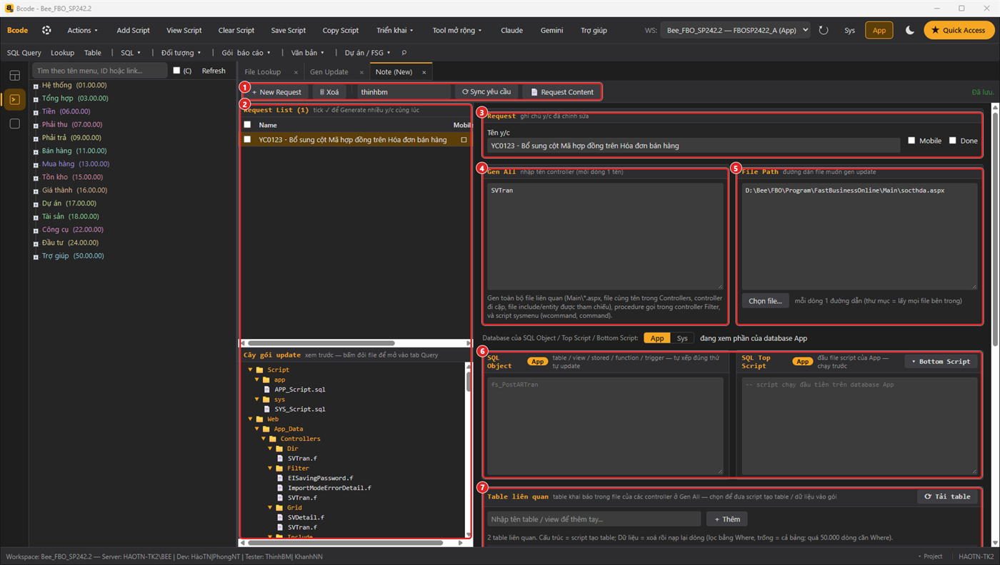

Trên ảnh: **①** ＋ New Request · Xoá · Tên lập trình + ⟳ Sync yêu cầu · Request Content · **②** Request List + Cây gói update · **③** tên yêu cầu (Mobile / Done) · **④** Gen All · **⑤** File Path · **⑥** SQL Object / SQL Top Script / Bottom Script · **⑦** Table liên quan.

Quản lý từng yêu cầu (request) và sinh gói update cho yêu cầu đó:

1. **⟳ Sync yêu cầu**: nhập Tên lập trình (ma_lt1) → kéo các yêu cầu của bạn trong dự án về (từ FSG). Hoặc **＋ New Request** để tạo tay.
2. Chọn yêu cầu ở **Request List** rồi khai: **Gen All** (controller, mỗi dòng một cái), **File Path** (mỗi dòng một đường dẫn; `Ctrl+V` file copy từ Explorer là dán đường dẫn), **SQL Object** / **SQL Top Script** / **Bottom Script** (chọn App / Sys), **Table liên quan** (⟳ Tải table, Cấu trúc / Dữ liệu / Where).
3. **🔍 Xem trước gói** → cây gói update (double-click file để mở trong tab Query); **▶ Mở tất cả script vào tab Query** để rà lại.
4. **Generate Update**: Save At Path, Folder Name, **Tách theo từng y/c** (mỗi yêu cầu một thư mục con) → **⚙ Generate Update**. Tick nhiều yêu cầu ở cột đầu danh sách để sinh chung.
5. **📄 Request Content** xem nội dung yêu cầu.
6. **🤖 AI tạo danh mục** (bản thử, `Ctrl+Alt+I` khi đang ở tab Note (New)): xem [AI tạo danh mục từ yêu cầu](#ai-danh-muc).

Dữ liệu lưu ở `%AppData%\Bcode\AdvanceNotes\<workspace>.json`.

<a id="ai-danh-muc"></a>
### AI tạo danh mục từ yêu cầu (bản thử)

Dùng khi yêu cầu là **tạo một danh mục mới** (màn hình thêm / sửa / xoá / tìm các mã của một bảng, có thể kèm lưới chi tiết). AI chỉ **điền sẵn** màn [Tạo nhanh danh mục](#tool-mo-rong) — không tự ghi file, không chạy SQL.

1. Ở **Note (New)**, Sync yêu cầu (hoặc tự nhập Request Content), chọn yêu cầu → bấm **🤖 AI tạo danh mục** (hoặc `Ctrl+Alt+I`; đổi phím ở Template → Phím tắt). Ở **Báo cáo yêu cầu FSG** (menu Triển khai): bấm ô Nội dung của 1 yêu cầu để mở khung chi tiết → **🤖 AI tạo danh mục** (hoặc `Ctrl+Alt+I`) — gửi mã YC + tên menu + nội dung + ghi chú.
2. Màn **Tạo nhanh danh mục** mở ra (đang mở thì dùng lại) với khung **🤖 AI tạo danh mục** ở trên: AI đọc nội dung yêu cầu + tên bảng / tên cột / kiểu cột của App Data (không gửi dữ liệu dòng nào), rồi điền Bảng, Controller, File Main, Key, Title (v/e), các cột (header, tick Grid / Dir / Lookup / Filter / Import, AutoComplete), bảng chi tiết nếu có.
3. Thiếu thông tin thì khung AI hiện **câu hỏi** — gõ trả lời (để trống = AI tự chọn) → **Gửi trả lời & hỏi lại AI**. **Hỏi lại AI** = hỏi lại với nội dung hiện có.
4. Bảng AI đề xuất **chưa có** trong App Data: cột lấy theo đề xuất của AI, khung AI có **script tạo bảng** (Copy script) — tự xem lại và chạy trước khi dùng danh mục; Bcode không chạy.
5. Kiểm tra lại các ô, **Xem XML**, rồi **Tạo file** như bình thường (hỏi trước khi ghi đè), sau đó **Tạo menu…** nếu cần.

Yêu cầu không phải tạo danh mục (sửa màn hình có sẵn, báo cáo, chứng từ...) thì khung AI báo "chưa hỗ trợ". Dùng **Claude (Anthropic) API key** (hoặc Gemini) nhập ở tab **SQL Query → ⚙ Tùy chọn → Copilot / AI** (dùng chung với Ctrl+I); mỗi lượt hỏi AI tốn token của key đó và được lưu ở **Lịch sử gợi ý AI** (loại "Danh mục").

**Chưa có API key** → Bcode tự **gợi ý theo cấu trúc Fast** (khung ghi "Luật Fast (không AI)", không gọi AI, không tốn token):
- Đọc tốt nhất câu dạng `Thêm danh mục <tên>: Mã, Tên, Khách hàng, Ngày hiệu lực, Ghi chú` (hoặc "… gồm …", hoặc gạch đầu dòng mỗi cột một dòng). Y/c FSG viết kiểu "Thêm (mới) (1) danh mục X … Thông tin khai báo / Gồm các trường: - Mã …: tự nhập - Mã tỉnh: Lookup từ danh mục …" cũng đọc được: mỗi gạch đầu dòng 1 cột, phần sau dấu ":" là mô tả (có "lookup / chọn từ danh mục …" thì gắn lookup); y/c trộn việc khác (thêm trường vào chứng từ, báo cáo…) thì chỉ lấy phần danh mục và ghi chú phần còn lại.
- Bảng mới đặt tên **`zdm` + chữ đầu các từ** để dễ phân biệt với bảng `dm…` chuẩn của Fast (hình thức bán hàng → `zdmhtbh`, mã `ma_htbh`, tên `ten_htbh`, `ten_htbh2`), luôn thêm `status` và các cột hệ thống `datetime0/2`, `user_id0/2`. Có API key thì AI cũng đặt theo tiền tố này. Ghi rõ tên bảng trong yêu cầu (vd "bảng `zdmhtbh`") thì theo đó — tên bảng chuẩn chỉ được nhắc trong mô tả (vd `dmvt.nh_vt9`) thì không tính. Đổi tiền tố: sửa `"NewCatalogTablePrefix"` trong `%AppData%\Bcode\settings.json` (lúc Bcode đã tắt).
- **Màn khai báo / cập nhật số liệu** (y/c kiểu `Thiết kế menu mới "Cập nhật dự toán", bao gồm các trường sau: + Đơn vị + Năm + …`): tên màn lấy từ menu ghi trong ngoặc kép; cụm "Lookup từ Danh mục X" chỉ là mô tả cột, không phải màn cần tạo. Màn không phải danh mục nên **không có mã - tên**: bảng = tiền tố bỏ `dm` + tên menu (Cập nhật dự toán → `zdutoan`), **khoá = các cột chiều** (đơn vị, năm, bộ phận, vật tư, nhóm phí, …, lần cập nhật — bỏ cột ghi "không bắt buộc") và khung AI **hỏi xác nhận khoá** (trả lời danh sách field để đổi), không tạo Lookup. Chỉ tiêu "theo 12 tháng / mỗi tháng" → 12 cột mỗi chỉ tiêu (`ns_dt01..12`, `sl_dt01..12`, `gia_dt01..12`, `ps_ndt01..12`, ẩn trên lưới) — trả lời "lưới" ở câu hỏi tương ứng để đổi thành lưới chi tiết theo tháng (bảng `zdutoanct`, khoá thêm `thang`).
- Cột khác tra theo tiêu đề: lookup thường dùng (Khách hàng → `ma_kh` / Customer, Vật tư → `ma_vt` / Item, Kho, Ngoại tệ, Bộ phận, Đơn vị → `ma_dvcs` / Unit…), rồi từ điển field của Bcode (header.xml, vd "Danh mục nhóm phí" → `nh_phi1` / ExpenseGroup), rồi danh mục cùng tên trong source; "Nhóm …" không tra được → `nh_xxx1`; không tra được thì đoán tên + kiểu và **hỏi lại** tên field. Kiểu: tiền ("Nhập số tiền") / số lượng / giá → `numeric(19,4)` như Fast, Năm / Lần cập nhật → `int`, Ngày → `smalldatetime`; cột có lookup lấy đúng kiểu cột mã của bảng nguồn (vd `dmnhphi.ma_nh varchar(8)`); "bắt buộc nhập" → không cho trống.
- "1 hoặc nhiều <X>" / "chi tiết" → có lưới chi tiết (bảng `<bảng>ct`, vd `zdmkbhct`, khoá `ma_xxx, line_nbr`); "import / nhập từ Excel" → bật Import.
- Bảng `dm…` đã có trong App Data → dùng đủ cột thật; source đã có danh mục cùng tên → hỏi có tạo màn mới không.
- Luật không hiểu câu văn tự do như AI — kiểm tra kỹ tên bảng / cột trước khi Tạo file. Nhập API key xong thì lần bấm sau dùng lại AI.

<a id="create-rpt"></a>
## Create RPT & XML, Excel → FRX, Tạo báo cáo

Ba công cụ này cần **key bản quyền** (xem [Key bản quyền](#key-ban-quyen)).

### Create RPT & XML (nút "Create *.rpt, *.xlsx")

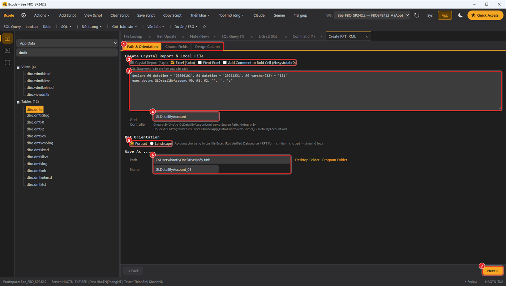

Trên ảnh: **①** 3 bước của trình hướng dẫn · **②** loại file: Excel / Pivot Excel · **③** SQL Statement (profiler của báo cáo) · **④** Grid Controller · **⑤** Rpt Orientation · **⑥** Save As (Path, Name) · **⑦** Next >.

Trình hướng dẫn 3 bước (**< Back** / **Next >** / **Create**). Cũng mở được từ tab **Pivot** của SQL Query ("Tạo file Excel pivot…").

1. **Path & Orientation**: chọn **Excel (*.xlsx)** hoặc **Pivot Excel** (Crystal *.rpt hiện chưa hỗ trợ — ô bị mờ), tuỳ chọn Add Comment to Bold Cell; dán **SQL Statement** (profiler của báo cáo) và **Grid Controller**; Portrait / Landscape; **Save As** (Path, Name).
2. **Choose Fields**: chọn bảng / field; sửa tham số profiler rồi **Chạy lại profiler** nếu cần.
3. **Design Column**: thiết kế Excel (Merge, Unmerge, kiểu ô, ẩn / hiện dòng cột, Hoàn tác / Làm lại, Vừa khít, Zoom), tab **Parameters & Report XML** (+ Biến, Re-Generate, Copy script) → **Create**.

Sau khi tạo: **Mở thư mục** hoặc **Đưa vào source…** (hiện diff, sao lưu file cũ vào `%AppData%\Bcode\Backups`, cảnh báo nếu file trên server vừa bị đổi).

### Excel → FRX

Nút **Excel → FRX** trên thanh công cụ, hoặc chuột phải file `.xlsx` / `.rpt` trong File Lookup → **Chuyển sang .frx**.

### Tạo báo cáo

Menu **Tool mở rộng → Tạo báo cáo** → cửa sổ riêng "Tạo báo cáo — {workspace}", 2 chế độ:

- **① Từ procedure có sẵn**: gõ tên procedure (vd `zrs_O067`) + Enter / **Nạp** → **▶ Chạy store** → **Tiếp: File & lưu ›** → **Menu…** / **Lưu vào source…** (có diff + sao lưu).
- **② Thiết kế từ bảng**: kéo thả bảng / cột kiểu Power BI để dựng báo cáo.

> **Lưu ý:** file Crystal Report (`.rpt`) có sẵn thì cập nhật cấu trúc bằng **Write Schema** của SQL Query (xem [Write Schema](#write-schema)).

<a id="trien-khai"></a>
## Menu Triển khai

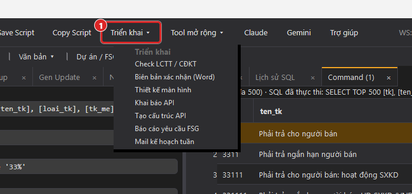

Nút **Triển khai ▾** trên thanh trên. Các công cụ này không có phím tắt mặc định (gán ở Template → Phím tắt, nhóm Công cụ).

| Mục | Dùng để / các bước |
|---|---|
| **Check LCTT / CĐKT** | Chỉ ra chỉ tiêu lưu chuyển tiền tệ / cân đối kế toán lệch ở đâu. Đính kèm bảng kê chứng từ, bảng cân đối phát sinh, báo cáo CĐKT, LCTT và file khai báo chỉ tiêu → chọn mẫu (**📚 Mẫu chuẩn TT99**, Import mẫu chỉ tiêu, SQL lấy bộ chỉ tiêu) → **▶ Kiểm tra**. Kết quả lọc được, **Lưu làm mẫu của khách**, Copy, Lưu .txt. |
| **Biên bản xác nhận (Word)** | Khai báo khách hàng (Bên A) + **Lưu KH**, hợp đồng, số biên bản & ngày, pháp nhân Fast (Bên B) → tick mẫu ở "Chọn mẫu để tạo" (Import / Export / ＋ Mẫu mới) → xem trước → **⬇ Xuất Word** hoặc **Xuất từng file…**. |
| **Thiết kế màn hình** | Mở BcodeScreenDesigner (thiết kế / xem trước màn hình Dir có dữ liệu mẫu) cho dự án hiện tại; từ cây WCommand thì mở thẳng controller của menu. Không thấy exe → khai ở Template → Đường dẫn. |
| **Khai báo API** | Khai báo & quản lý API chuẩn LT3: **＋ Mới từ mẫu LT3**, **Nhập Postman…**, **Xuất Postman…**; kết nối (địa chỉ gốc, tài khoản, mật khẩu — mã hoá theo máy) → **Lấy token**. Phím: `Ctrl+Shift+Enter` gửi, `Ctrl+S` lưu, `Ctrl+Shift+T` lấy token, `Ctrl+Shift+F` format, `Ctrl+Shift+K` validate. |
| **Tạo cấu trúc API** | Chọn bảng / cột → xuất tài liệu Word "TÀI LIỆU ĐẶC TẢ TỔNG HỢP API". |
| **Báo cáo yêu cầu FSG** | **Kéo** yêu cầu từ FSG (chỉ đọc): nhập Mã dự án → **⟳ Kéo về** (Enter); bộ phận, người, mã YC, nội dung, lập trình, triển khai nằm trong **Điều kiện kéo khác ▾** (gập lại thì hiện thành thẻ). **Lọc tại chỗ** trên dữ liệu đã kéo, không gọi lại FSG: ô **Tìm** (`Ctrl+F`; gõ tên người / dự án sẽ gợi ý lọc nhanh, ↓ Enter để chọn), nút **Dự án ▾ / Lập trình ▾ / Triển khai ▾ / Trạng thái ▾** (số yêu cầu đếm theo các lọc đang chọn), chip trạng thái (bấm = chỉ xem nhóm đó, bấm lại = tất cả, `Ctrl`+bấm = chọn nhiều), **⚠ Tới hạn**, **✕ Bỏ lọc**; lọc được nhớ cho lần mở sau. **Đã lưu ▾**: các dự án đã kéo — bấm 1 dự án để chỉ xem dự án đó, ✕ để bỏ dữ liệu đã lưu. Xem Chi tiết / Dashboard / Gợi ý ưu tiên (chỉ xét y/c Đã duyệt / Đang thực hiện; bảng trống thì ghi rõ đang lọc gì). Bấm ô Nội dung để mở khung chi tiết y/c → **🤖 AI tạo danh mục** (hoặc `Ctrl+Alt+I`) như ở Note (New) — xem [AI tạo danh mục](#ai-danh-muc). Từ cây WCommand: chuột phải menu → **Yêu cầu liên quan (QLYC)…** mở tab này lọc sẵn theo menu (xem [WCommand](#wcommand)). |
| **Mail kế hoạch tuần** | Mẫu mail theo dự án (＋ Mới / Nhân bản / Xoá mẫu), máy chủ SMTP dùng chung với Check Mail, **⟳ Tính theo hôm nay** điền ngày trong tuần → **✉ Gửi mail** / **💾 Lưu mẫu**. |

<a id="tool-mo-rong"></a>
## Menu Tool mở rộng

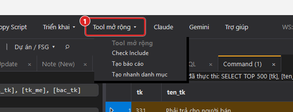

| Mục | Dùng để / các bước |
|---|---|
| **Check Include** | So khai báo INCLUDE / IGNORE, options, wcommand của dự án với catalog tính năng từng phiên bản: chọn thư mục Dự án, tick "Kiểm tra DB (options / wcommand)" → **▶ Phân tích**. Tab Tính năng / File Include; trạng thái Đúng khai báo / Chưa bật / Một phần / Khác mặc định. Nút **Sửa → X** sửa file include (giữ bản .bak). |
| **Tạo báo cáo** | Xem [Create RPT & XML, Excel → FRX, Tạo báo cáo](#create-rpt). Cần key. |
| **Tạo nhanh danh mục** | Sinh bộ file danh mục từ một bảng: nhập Bảng (Enter để nạp cột), Controller, File Main, Key, Order, cột tên (Lookup), Title / Subtitle (v/e) + **Dịch**, bảng chi tiết (tuỳ chọn) → **Xem XML** → **Tạo file** (`Ctrl+Enter`) → **Mở Dir trong BcodeViewer** / **Tạo menu…**. Mẫu nằm ở `Templates\fileSource\CreateList` cạnh Bcode.exe (sửa mẫu không cần build). |

<a id="tien-ich"></a>
## Tiện ích khác trên thanh công cụ

| Công cụ | Dùng để |
|---|---|
| **Clone danh mục** | Nhân một danh mục có sẵn thành danh mục mới: chọn bảng nguồn + thư mục mẫu + nơi lưu → khai Id, File Main, Bảng, Key, Title, đổi hậu tố cột (vd `_kh` → `_ncc`) → **Tạo file**. |
| **Compare Text** | So 2 file / 2 đoạn chữ: File 1, File 2 → **📄 Compare**; ◀ / ▶ nhảy giữa các khác biệt; ⧉ Float window. |
| **String Beauty** | Định dạng SQL / JSON / XML / JavaScript (kiểu Expanded / Compact, từ khoá viết hoa / thường) → **Beautify →** → Copy kết quả. |
| **Library...** | Thư viện script hay dùng (snippet) theo dự án: New / Save / Delete / Copy / **Insert vào Script Editor**. Gọi nhanh trong `Ctrl+P` bằng tiền tố `$`. |
| **Setup eInvoice (FE)** | Cấu hình hoá đơn điện tử: kết nối (link trung gian, CSDL Proxy), Portal Key từ mail, link portal, tài khoản → **Step 1: View UpdateKey Script** → **Step 2: Exec Insert in Server (SQL)** → **Cập nhật / Update Key**. Mật khẩu không được lưu. |
| **Check Mail** | Thử gửi mail: **⟳ Lấy từ Message.xml** (hoặc nhập Host / Port / tài khoản), người nhận → **⚡ Test kết nối** / **✉ Send**; xem log. Mật khẩu không được lưu. |
| **FSG FBO** | Mở web đăng nhập của dự án (Login WLink) và tự điền tài khoản — mở trong **tab** (mỗi dự án 1 tab, phím tắt `Ctrl+4`; mở lại = chuyển tới tab đó; `Ctrl+Tab` để qua lại). Mỗi dự án giữ phiên đăng nhập riêng: đăng nhập dự án này (kể cả ở 1 Bcode khác) không làm văng phiên của dự án kia. |
| **FSG Yêu cầu** | Cập nhật & tra cứu yêu cầu FSG — mở trong **tab** (1 tab, mở lại = chuyển tới tab đó). |
| **Create Processing**, **View Rpt in FEC** | Chưa làm (chỉ hiện form trống). |

### Hành động trong menu Actions / Settings

- **Clear Structure App** (Actions): xoá mọi file trong `{Source}\App_Data\Controllers\Structure\App` (hỏi xác nhận) — dùng khi site còn giữ cấu trúc bảng cũ.
- **Open Web.config** (Actions): mở file `web.config` ở gốc Source Path của dự án — bằng BcodeViewer nếu đã khai đường dẫn (Template → Đường dẫn), không thì mở trong một tab của Bcode. Gán phím được ở Template → Phím tắt ("Open Web.config"), gọi nhanh bằng `Ctrl+P`.
- **Refresh Web.config** (Actions): thêm một dấu cách vào web.config để IIS khởi động lại site.
- **Create Menu** (Actions): chạy thủ tục tạo menu cho dự án ngay (không hỏi lại).
- **Backup Database...** (⚙ Settings): chọn nơi lưu `.bak` → backup App Data (`WITH INIT, COMPRESSION`).
- Restore / Attach Database: chưa làm (chỉ hiện gợi ý T-SQL).

<a id="template"></a>
## Template giao diện, tỉ lệ, theme

### Giao diện (Template)

Mở: ⚙ Settings → **Giao diện (Template)...** (cả 2 chế độ đều là trang WebView2). Các tab:

| Tab | Chỉnh gì |
|---|---|
| Bố cục & font | Font gốc, cỡ chữ, font / màu từng vùng, vị trí nút |
| Theme & màu | Chọn theme cho ô Tối và ô Sáng (nút ☀/☾ đổi giữa 2 ô), **Nhập theme VS Code (.json / .vsix)**, đặt lại màu đã chỉnh. Theme nhập ở BcodeViewer cũng hiện ở đây. |
| Cấu trúc | Mật độ (Gọn / Vừa / Thoáng), bo góc, độ dày viền |
| Editor & lưới | Giãn dòng, minimap, số dòng, khoảng trắng, sọc lưới, màu chọn, cách hiện NULL |
| Cửa sổ | Vị trí / độ rộng cây, ẩn cây khi mở, khôi phục phiên, **Hiệu năng (máy cấu hình thấp)**, thanh tab trên / dưới, con trỏ chuột, **Ctrl+Tab** bấm nhanh, thanh công cụ xuống dòng / một dòng |
| **Phím tắt** | Đổi phím tắt (xem [Phím tắt](#phim-tat)) |
| HTML & CSS | CSS riêng cho mọi trang, chế độ thiết kế (nút ✎ trên từng trang), mở thư mục tuỳ chỉnh (`%AppData%\Bcode\ui\`) |
| Lịch sử SQL | Thư mục lưu lịch sử sửa object |
| Đường dẫn | BcodeScreenDesigner.exe, BcodeViewer.exe, kho SourceCollection (chính / bổ sung) |
| Tìm file | Quy tắc file được tìm nội dung (File Lookup) |
| Màu cây | Kiểu tô màu cây WCommand / File Lookup |

Nút dưới: **Áp dụng** (xem thử — "bấm Lưu để giữ lại") · **Lưu** · **Hủy** · **Mặc định** · Mở file JSON / Nạp lại từ file.

> **Lưu ý:** đóng Template mà chưa **Lưu** là các thay đổi đã Áp dụng bị **trả lại**. (Riêng Đường dẫn, Hiệu năng, Khôi phục phiên, CSS được lưu ngay.)

### Hiệu năng (máy yếu)

Template → Cửa sổ → **Hiệu năng**: Tự động (theo CPU / RAM) / Thấp / Trung bình / Cao. Mức Thấp dùng ít tiến trình hiển thị, không dựng sẵn tab SQL, **ngủ đông** tab SQL không dùng sau 15 phút (tab ngủ giữ nguyên nội dung, chỉ mất lịch sử Undo). Đổi "Tiến trình hiển thị" cần mở lại Bcode.

### Tỉ lệ giao diện

⚙ Settings → **Tỉ lệ giao diện...**: Tự động (khớp màn hình so với chuẩn 1600×900) hoặc 80 / 90 / 100 / 110 / 125 / 150 %. Kiểu bo góc / mật độ nhanh: ⚙ Settings → **Kiểu giao diện** (Mềm / Gọn / Thoáng / Vuông vức).

<a id="phim-tat"></a>
## Phím tắt và Settings phím tắt

### Đổi phím tắt

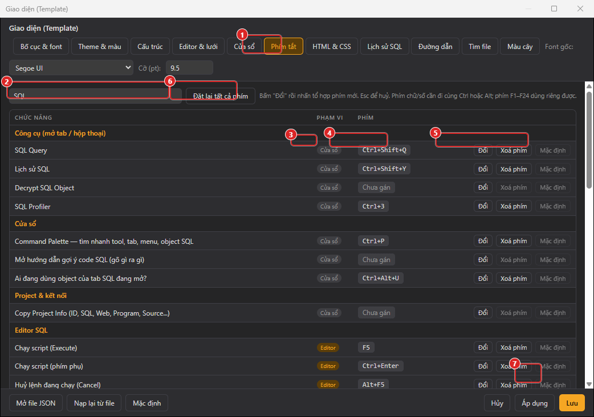

Trên ảnh: **①** tab Phím tắt · **②** ô tìm chức năng / phím · **③** phạm vi (Cửa sổ / Editor / Lưới Table / Cây menu) · **④** phím hiện tại · **⑤** Đổi · Xoá phím · Mặc định · **⑥** Đặt lại tất cả phím · **⑦** Lưu.

1. ⚙ Settings → **Giao diện (Template)...** → tab **Phím tắt**.
2. Ô "Tìm chức năng hoặc phím..." để tìm. Cột: Chức năng · **Phạm vi** (Cửa sổ = bấm ở đâu cũng được; Editor = trong editor SQL; Lưới Table; Cây menu) · Phím ("Chưa gán" = chưa có).
3. **Đổi** → bấm tổ hợp mới (`Esc` huỷ) · **Xoá phím** · **Mặc định**. Phím đã dùng cho chức năng khác → hỏi "Gán đè".
4. Bấm **Lưu** (không Lưu = không giữ). **Đặt lại tất cả phím** để về mặc định.

Quy tắc: phím chữ / số / dấu phải đi cùng `Ctrl` hoặc `Alt` (chỉ `F1`–`F24` dùng riêng được); không gán được `Ctrl+C/V/X/Z/Y/A`, `Alt+F4`, `Ctrl+Alt+Delete`, `Ctrl+Shift+Esc`. Mọi công cụ (kể cả trong menu Triển khai / Tool mở rộng) đều gán được phím ở nhóm **Công cụ**.

> **Lưu ý:** phím "Chuyển về tab trước" mặc định đang ghi sai thành `Ctrl+Shift+Bab` nên `Ctrl+Shift+Tab` chưa chạy — gán lại `Ctrl+Shift+Tab` ở tab Phím tắt nếu cần.

### Phím tắt mặc định của Bcode

**Công cụ**

| Phím | Công cụ | Phím | Công cụ |
|---|---|---|---|
| `Ctrl+Shift+Q` | SQL Query | `Ctrl+Shift+R` | File Reference |
| `Ctrl+Shift+L` | Lookup | `Ctrl+Shift+O` | Change Owner |
| `Ctrl+Shift+T` | Table | `Ctrl+Shift+U` | Gen Update (Result) |
| `Ctrl+Shift+C` | Command | `Ctrl+Shift+E` | Note |
| `Ctrl+Shift+W` | WCommand | `Ctrl+Shift+4` | Note (New) |
| `Ctrl+Shift+F` | File Lookup | `Ctrl+Shift+Y` | Lịch sử SQL |
| `Ctrl+Shift+G` | Gen Update | `Ctrl+Shift+J` | So sánh object |
| `Ctrl+3` | SQL Profiler | `Ctrl+F1` | Trợ giúp |

**Cửa sổ, tab, dự án**

| Phím | Tác dụng |
|---|---|
| `Ctrl+P` | Command Palette |
| `Ctrl+Shift+P` | Màn Projects |
| `Ctrl+O` | Choose Server (dự án khác → cửa sổ mới nếu đang có tab) |
| `Ctrl+F5` | Synchronize project (FSG) — trong cây WCommand: chạy menu |
| `Ctrl+Shift+N` | Cửa sổ Bcode mới |
| `Ctrl+Shift+H` | Ẩn / hiện cây bên trái |
| `Ctrl+1` | Đổi database App ↔ Sys |
| `Ctrl+4` | Mở FSG FBO (web đăng nhập của dự án, trong tab) — trong cây WCommand: mở FSG FBO, đăng nhập rồi vào menu đang chọn |
| `Ctrl+5` | Mở thư mục Program Path |
| `Ctrl+Alt+U` | Ai đang dùng object (tab SQL mở từ cây SQL Object) |
| `Ctrl+Tab` / giữ `Ctrl` + `Tab` | Tab kế / hộp chọn tab |
| `Ctrl+W` · `Ctrl+Shift+B` | Đóng tab · mở lại tab vừa đóng |
| `Alt+1` … `Alt+5` | Thả menu nhóm công cụ 1…5 |
| `Ctrl+Alt+Shift+A` · `Ctrl+Alt+Shift+V` | Add Script · View Script Cart |

**Editor SQL**

| Phím | Tác dụng |
|---|---|
| `F5` / `Ctrl+Enter` | Chạy (đoạn chọn hoặc cả script) |
| `Alt+F5` | Huỷ lệnh đang chạy |
| `F7` | Beauty |
| `F12` · `Ctrl+F12` | Xem nhanh object · mở object ở tab mới |
| `Ctrl+I` · `Alt+\` | AI sửa / sinh SQL · gọi gợi ý AI |
| `Ctrl+Alt+H` | Lưu vào Lịch sử SQL |
| `Alt+Z` | Wrap |
| `Ctrl+S` | Save file .sql |
| `Ctrl+R` | Ẩn / hiện khung kết quả |
| `Ctrl+F` | Tìm (Web: của Monaco; App: thanh tìm) |
| `F10` · `Ctrl+F10` · `Shift+F5` | Debug: bước kế · tới con trỏ · dừng |

**Lưới Table**: `F1` chi tiết dòng · `F3` khai báo nhanh danh sách · `F4` thêm · `F8` xoá · `Ctrl+I` nhân bản · `Ctrl+N` chèn sau · `Ctrl+'` copy giá trị · `Ctrl+0` NULL · `Ctrl+G` tới cột · `F5` tải lại.

**Cây WCommand**: `Insert` New · `F3` Edit · `F8` Delete · `F4` File Lookup mới · `F12` Gen Script Menu · `F5` Refresh · `Ctrl+F5` Run · `Ctrl+4` Run trong FSG FBO · `Ctrl+C` copy đường dẫn menu. Các nhánh đang bung được giữ nguyên khi chuyển sang mục khác (Object…) rồi quay lại, hoặc khi `F5`.

**Khai báo API**: `Ctrl+Shift+Enter` gửi · `Ctrl+S` lưu · `Ctrl+Shift+T` lấy token · `Ctrl+Shift+F` format · `Ctrl+Shift+K` validate.

<a id="key-ban-quyen"></a>
## Key bản quyền

Các tính năng sau cần key bản quyền gắn theo máy: **Decrypt SQL Object**, **Create RPT & XML**, **Excel → FRX**, **Tạo báo cáo**, **Báo cáo yêu cầu FSG** (kể cả chuột phải cây WCommand → Yêu cầu liên quan), **Thiết kế màn hình** (kể cả nút Design ở cây WCommand), **Khai báo API**, **Tạo cấu trúc API**, **Tạo nhanh danh mục** (kể cả 🤖 AI tạo danh mục) và **Clone danh mục**. Chưa có key thì mở các tính năng này sẽ hiện hộp nhập key.

1. ⚙ Settings → **Key bản quyền...** (hoặc bấm vào tính năng bị khoá — hộp key tự mở).
2. **Bước 1**: bấm **Copy mã máy** và gửi mã cho người cấp key. Mỗi máy có một mã riêng.
3. **Bước 2**: dán key nhận được (hoặc **Dán từ clipboard**) → **Xác nhận**. Chỉ cần dán một lần — key lưu ở `%AppData%\Bcode\license.key`.

Trạng thái: "✓ Đã kích hoạt trên máy này" / "✗ Chưa kích hoạt". "Key đã lưu không còn hợp lệ trên máy này" hoặc "Mã không đúng cho máy này" → gửi lại **Mã máy** hiện tại để xin key mới. **Xoá key đã lưu** để gỡ.

<a id="loi-thuong-gap"></a>
## Lỗi hay gặp (Bcode)

| Hiện tượng / thông báo | Nguyên nhân · cách xử lý |
|---|---|
| "Workspace hiện tại chưa khai báo Source Path (UNC). Vào File > Choose Server để thêm." | Dự án chưa có Source Path — vào ⚙ Settings → **Choose Server / Workspaces...** (hoặc `Ctrl+O` → Edit) khai đường dẫn UNC tới site. |
| Không khởi tạo được giao diện / trang trắng (WebView2) | Máy thiếu **WebView2 Runtime** — cài "WebView2 Runtime (Evergreen)" của Microsoft; hoặc dùng chế độ App. |
| Giao diện vỡ sau khi tuỳ chỉnh HTML / CSS | Giữ **Shift** khi mở Bcode (chế độ an toàn), rồi sửa / tắt tuỳ chỉnh ở Template → HTML & CSS. |
| Gợi ý không thấy bảng / procedure mới tạo | Bấm **⟳ Refresh database** cạnh ô WS. |
| `Ctrl+Shift+Tab` không chuyển tab | Phím mặc định đang sai — gán lại ở Template → Phím tắt "Chuyển về tab trước". |
| Debug từng bước không có | Chỉ có ở chế độ Web. |
| Write Schema báo thiếu Crystal runtime / PowerShell | Xem [Write Schema](#write-schema) → Yêu cầu và lỗi hay gặp. |
| Table không Save / Delete được | Bảng không có Primary Key, hoặc là bảng tổng hợp `$000000`, hoặc database đã đổi sau khi Load. |
| Add Script của Table cảnh báo mất dữ liệu | Đang xem đúng bằng giới hạn Top — đặt Top = 0 rồi Load lại. |
| Edit in BcodeViewer không mở | Chưa / sai đường dẫn BcodeViewer.exe — khai ở Template → Đường dẫn. |
| Thiết kế màn hình báo "Chưa thấy BcodeScreenDesigner.exe" | Khai đường dẫn ở Template → Đường dẫn (nút Tự dò). |
| Cây Mobile trống | Sys Data không có bảng dvcommand, hoặc chưa khai Mobile Path. |
| Tính năng hỏi key bản quyền | Xem [Key bản quyền](#key-ban-quyen). |
| Máy chậm, tốn RAM | Template → Cửa sổ → Hiệu năng = Thấp; hoặc dùng chế độ App. |

<a id="viewer"></a>
# Phần II — BcodeViewer

BcodeViewer (BcodeViewer.exe) là trình soạn file controller FCode (Dir / Grid / Filter / Report / Include… dạng XML có SQL và JavaScript nhúng bên trong) xây trên Monaco — cùng lõi với VS Code. Toàn bộ menu, thanh công cụ và cây file đều vẽ trong trang; phím tắt đổi được hết.

<a id="viewer-giao-dien"></a>
## Màn hình chính BcodeViewer

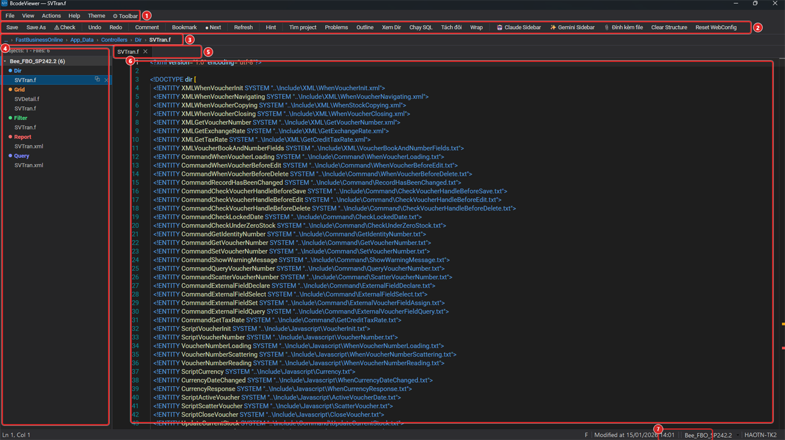

Trên ảnh: **①** thanh menu · **②** thanh công cụ · **③** đường dẫn (breadcrumb) · **④** cây file theo dự án · **⑤** thanh tab · **⑥** editor · **⑦** dự án của file (bấm để mở nhanh thư mục, Login WLink).

### Thanh menu

| Menu | Mục |
|---|---|
| **File** | New from Template… (`Ctrl+N`) · Mở nhanh file… (`Ctrl+P`) · Lịch sử file… (`Ctrl+Shift+H`) · Lịch sử cả dự án… · Settings… · Phím tắt… |
| **View** | Tìm trong project… (`Ctrl+Shift+F`) · Bảng Problems (`Ctrl+Shift+M`) · Xem trước Dir (`Alt+P`) · Outline (`Ctrl+Shift+U`) · Chạy SQL tại con trỏ (`Ctrl+Enter`) · Tách đôi khung soạn thảo (`Ctrl+\`) · Tìm nơi sử dụng (`Shift+F12`) · Show Vertical Tabpage (`Ctrl+B`) · Tự ẩn Menu/Toolbar |
| **Actions** | Clear Structure App · **Open Web.config** (mở web.config của site thành 1 tab, tô màu XML — giống Bcode) · Refresh Web.config |
| **Help** | Giới thiệu… · Log độ mượt (viewer-perf.log)… |
| **Theme** | Danh sách theme Tối / Sáng có sẵn · theme đã nhập · Nhập theme (VS Code .json / .vsix, Fcode .xml)… · Theo Windows (sáng/tối) |
| **⚙ Toolbar** | Tick để ẩn / hiện từng nút · Hiện tất cả · Sắp xếp / thêm nút… (chuột phải thanh công cụ cũng ra menu này) |

"Tự ẩn Menu/Toolbar": thanh trên tự ẩn, đưa chuột sát mép trên cửa sổ là hiện lại.

### Thanh công cụ (mặc định)

Save (`Ctrl+S`) · Save As · ⚠ Check (so `<fields>` với `<views>` của Dir/Grid) · Undo · Redo · Comment (`Ctrl+/`) · Bookmark · ● Next · Refresh (tải lại file từ đĩa) · Hint (Hint Code) · Tìm project · Problems · Outline · Xem Dir · Chạy SQL · Tách đôi · Wrap (`Alt+Z`) · 🤖 Claude Sidebar · ✨ Gemini Sidebar · 📎 Đính kèm file · Clear Structure · Reset WebConfig · Open WebConfig (mở web.config của site).

Dưới thanh công cụ là **đường dẫn** (breadcrumb) của file đang mở — bấm vào một đoạn để mở thư mục đó trong Explorer.

### Cây file bên trái (Projects)

- Dòng đầu: "Projects: N - Files: M". Mỗi dự án là một nhóm "Tên dự án (số file)", trong đó file chia theo thư mục Dir, Grid, Filter, Report, Command, XML, Config, Options, Upload, Include…
- Cây là **danh sách file đã mở gần đây** (tối đa 300 file), không phải toàn bộ ổ đĩa. Mở file mới không đẩy dự án lên đầu; chỉ dự án mới chèn lên trên. File chưa lưu có dấu " •".
- Bấm file = mở. `Ctrl`+bấm chọn nhiều file rồi `Ctrl+C` = copy đường dẫn. `Delete` = bỏ khỏi danh sách (không xoá file).
- Chuột phải file: Mở · Mở thư mục chứa file · Copy đường dẫn (.f nếu có) · Bỏ khỏi danh sách. Chuột phải dự án: Ẩn/Hiện file của dự án · Copy đường dẫn tất cả file · Bỏ tất cả file của dự án khỏi danh sách.
- `Ctrl+B` ẩn / hiện cây. Khi cây ẩn, thanh tab liệt kê mọi file của cây.

### Tab và thanh trạng thái

- Bấm chuột giữa để đóng tab; chuột phải tab: Đóng · Đóng các tab khác · Đóng tất cả · Mở ở khung tách · Copy đường dẫn · Mở thư mục chứa file.
- Thanh trạng thái: dòng/cột, ngôn ngữ, giờ sửa, trạng thái AI, và nút dự án (Login WLink, Program / Source / Working / Mobile path, Copy Project Info).

<a id="viewer-mo-file"></a>
## Mở, lưu file và lịch sử

### Mở file

1. **Từ Bcode**: tab File Lookup → chọn file → **Edit in BcodeViewer**. Lần đầu Bcode hỏi "Chọn BcodeViewer.exe" rồi nhớ lại (đổi ở Bcode: Template giao diện → Đường dẫn → BcodeViewer). File `.rpt` / `.xlsx` mở bằng chương trình Windows tương ứng.
2. **Mở nhanh** `Ctrl+P`: gõ vài chữ của tên file (vd `SVTran`, `grid vctck`) — tìm trong toàn bộ App_Data của dự án đang mở; mọi từ gõ vào phải có trong đường dẫn; tab gần đây xếp trước. `↑/↓`, `Enter`, `Esc`.
3. **Dòng lệnh**: `BcodeViewer.exe "<file>" "<tên dự án>"` (tên dự án có thể bỏ — Viewer tự suy từ Source Path của workspace Bcode, hoặc từ đường dẫn `<Dự án>\<FBISPxxx>\App_Data`, không ra thì xếp vào "#Other").
4. Viewer chỉ chạy **một bản** mỗi phiên Windows: mở thêm file từ Bcode / Explorer sẽ chuyển sang cửa sổ đang chạy và mở file ở tab mới.

### Lưu

- `Ctrl+S` → "Đã lưu file thành công". Encoding gốc được giữ nguyên (file `.f` UTF-16 vẫn là UTF-16).
- Mỗi lần lưu ghi thêm **lịch sử**: lịch sử máy này (`%AppData%\Bcode\history`, tối đa 50 bản/file) và **lịch sử chung của dự án** (`<thư mục dự án>\History\…`, ghi kèm máy, user, IP, giờ; tối đa 100 bản/file). Ghi lịch sử chung lỗi thì báo "Đã lưu file, nhưng KHÔNG ghi được lịch sử chung…".
- Đóng tab / thoát khi còn file chưa lưu: Viewer hỏi lưu hay bỏ.

### Lịch sử file (`Ctrl+Shift+H`)

- 3 tab: **File này** (lịch sử chung của file) · **Cả dự án** (lọc 1 / 7 / 30 ngày, lọc theo file / người / máy) · **Máy này**.
- Bên phải là so sánh "Bản đã chọn" ↔ "Hiện tại". Dòng "⚠ SỬA NGOÀI VIEWER" là bản bị sửa bằng công cụ khác.
- **Khôi phục bản này** chỉ đưa nội dung cũ vào editor — phải `Ctrl+S` mới ghi ra đĩa. "Dọn bản cũ…" xoá bản cũ hơn N ngày (luôn giữ bản mới nhất).

### File bị sửa từ nơi khác

Viewer kiểm tra file mỗi 4 giây. File đổi trên đĩa (người khác sửa, chép đè…) → hiện thanh báo "File này đã được thay đổi từ máy khác. Tải lại bản mới nhất?" với **Xem khác biệt** · **Reload** · ✕ (bỏ qua lần này).

> **Lưu ý:** nút **Refresh** trên thanh công cụ cũng đọc lại file từ đĩa — Viewer hỏi trước nếu đang có thay đổi chưa lưu.

<a id="viewer-intellisense"></a>
## IntelliSense — gợi ý code


Trên ảnh: **①** chữ vừa gõ · **②** danh sách gợi ý (Enter để chèn khối `<field>`).

Gợi ý có 4 lớp, lớp nào hợp ngữ cảnh con trỏ (XML / SQL / JavaScript) thì hiện:

1. **Hint Code + snippet**: thư viện snippet riêng (nút **Hint**), thư mục snippet dùng chung của nhóm (Settings → Template dùng chung) và snippet FCodeViewer. Gõ từ 2 ký tự của Prefix là hiện chữ mờ (ghost) — `Tab` để chèn và nhảy qua từng ô cần điền.
2. **Cấu trúc XML + từ điển field**: gợi ý thẻ / thuộc tính / giá trị học từ chính file và các file include.
   - Gõ `f.ma_kh` (hoặc `<f.ma_kh`) rồi `Enter` → chèn sẵn khối `<field>` có header v/e và `<items style="AutoComplete" …>` kèm field `ten_xx%l`. Có sẵn cho ma_kh, ma_gd, ma_kho, ma_vt, ma_vv, nh_kh1-3, nh_vt1-3 và mọi field trong từ điển header.xml; tên khác → field text mặc định.
   - `f.clientscript` → chèn `<clientScript>` với `onchange=onChange<Controller><Field>(this)`.
   - Chữ mờ cấu trúc: trong JS gõ `f.get`, `f.set`, `g.get`, `g.set`, `f.req`; trong XML gõ `<items`, `<item`, `<handle`, `<category`, `<script` → gợi ý cả khối. Trong `<views>` gợi ý `<field name="x"/>` cho field đã khai báo mà chưa có trong view nào.
   - Rê chuột lên `&Entity;` để xem nội dung; rê lên dòng design của Dir để xem độ rộng thật của biến.
3. **SQL schema**: khi con trỏ ở vùng SQL (`<command>`, `<action>`…) gợi ý tên bảng / cột của **workspace đang chọn trong Bcode**.
4. **AI ghost text** (tắt mặc định): bật ở Settings → AI → "Bật gợi ý AI khi gõ". Ngừng gõ khoảng 0,4 giây là gọi AI (tính phí theo API key). `Tab` nhận cả gợi ý, `Ctrl+→` nhận từng phần. Nhận trọn một gợi ý AI → Viewer mở hộp **Hint Code** điền sẵn đoạn đó để lưu thành hint nếu muốn.

Gợi ý thủ công: `Ctrl+Space`.

### AI viết / sửa code — `Ctrl+I`

1. (Tuỳ chọn) bôi đen đoạn cần sửa.
2. `Ctrl+I` → hộp "AI: Sinh code" (hoặc "AI: Sửa/Sinh code (có selection)").
3. Gõ yêu cầu, `Ctrl+Enter` (hoặc **Generate**) → kết quả hiện ở "Đề xuất từ AI".
4. **Insert** để thay đoạn đã chọn / chèn tại con trỏ.

`Ctrl+I` luôn dùng Claude và cần Anthropic API key trong Settings → AI; vẫn dùng được khi tắt ghost text.

> **Lưu ý:** prompt hệ thống của AI ghost text sửa được trong `Config\common.txt`, `xml.txt`, `sql.txt`, `js.txt`, `css.txt` cạnh BcodeViewer.exe — không cần build lại.

<a id="viewer-entity"></a>
## F12 / Peek entity và điều hướng

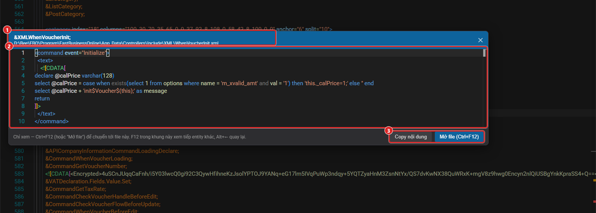

Trên ảnh: **①** tên entity + file khai báo · **②** nội dung (chỉ xem) · **③** Copy nội dung · Mở file (Ctrl+F12).

| Phím | Tác dụng |
|---|---|
| `F12` | **Xem trước** (peek) `&Entity;` hoặc đường dẫn file trong ngoặc kép tại con trỏ — mở cửa sổ nhỏ, vẫn đứng ở file hiện tại. Theo chuỗi include sâu tới 64 cấp. |
| `Ctrl+F12` | **Đi tới**: mở file / nhảy tới dòng khai báo entity. |
| `Ctrl`+bấm chuột | Nhảy tới khai báo **trong cùng file** (entity, `function X(`, `<view|action id>`, `<field name>`). |
| `F11` | Tới `function` của handler trên dòng hiện tại (vd `onchange="X(this)"`); không có thì nhảy tới `<script>`. |
| `Shift+F12` | Tìm nơi sử dụng từ tại con trỏ trong toàn project (khớp trọn từ, tối đa 2000 kết quả, hiện ở bảng Tìm kiếm). |
| `Ctrl+G` | Go to: cột trái là thẻ (fields, command, script, response, css, ENTITY), cột phải là chi tiết; `Enter` / double-click để nhảy. Mục hay dùng (command Inserted/Updated, `onChange$GridVoucherDetail`, `on$Voucher$ExecuteCommand`…) tô cam / đỏ. |
| `Ctrl+Shift+U` | Outline: ENTITY / View / Field / Command / Action / Function kèm số dòng, có ô lọc. |

Trong cửa sổ peek: **Mở nơi khai báo (Ctrl+F12)** · **Copy code**; `F12` tra tiếp entity bên trong, `Alt+←` quay lại, `Esc` đóng. Bôi đen nhiều entity rồi `F12` → xem "Một trang" hoặc "Từng entity" (◀ ▶ để chuyển, Copy entity này / Copy tất cả).

> **Lưu ý:** file include không biết file cha → Viewer báo; bấm `F12` lần nữa trong 8 giây để tìm trong toàn project.

### Menu chuột phải trong editor

- Con trỏ ở `<items controller="X">`: **Goto File: X** · **Clone file: X…**
- Goto Response Tag · Goto Command · Goto Function (`F11`) · Xem trước ENTITY / file (`F12`) · Đi tới ENTITY / file (`Ctrl+F12`)
- **Open File Config ▸** (Aggregation, List / Voucher Extend, Extender.ent, Notify, Message.xml, Comment.xml, Filter Config) · **Open Folder ▸** (Images / Options / Lookup / Templates)
- Chạy SQL tại con trỏ (`Ctrl+Enter`) · Debug SQL trong Bcode
- Create Function · Tạo `<action>` cho f.request · Lookup Regex · Convert to XML
- **Dịch caption (v → e)** (`Ctrl+Alt+T`): điền `e="..."` cho mọi thẻ có `v` mà `e` trống (trong vùng chọn hoặc cả file); sửa tay kết quả trước khi bấm **Áp dụng**; `Ctrl+Z` để hoàn tác. Engine dịch chọn ở Settings → AI (Google không cần key).
  - Dịch sang **English** thì Viewer tra **Từ điển dịch** trước, chỉ caption không có trong từ điển mới gửi Google/Gemini/Claude. Cột bên phải mỗi dòng cho biết bản dịch lấy từ đâu: *Từ điển* (từ bạn khai báo), *Có sẵn* (header.xml, HeaderDictionary.json, tiêu đề Bcode đã học), *Google*/*Gemini*/*Claude*.
  - **Lưu vào từ điển**: lưu các bản dịch của Google/AI và những ô bạn đã sửa tay vào Từ điển dịch — lần sau gặp caption đó sẽ dùng luôn, không gọi Google nữa. **Từ điển...** mở hộp Từ điển dịch.
- **Từ điển dịch (Việt → Anh)** (menu **Actions → Từ điển dịch...**, hoặc nút **Từ điển...** trong hộp Dịch caption; gán phím ở Settings → Phím tắt → *Từ điển dịch*): xem / thêm / sửa / xoá các cặp Việt → Anh của bạn rồi bấm **Lưu**.
  - So khớp không phân biệt hoa/thường, khoảng trắng thừa, dấu `:` `.` cuối; caption gõ **không dấu** ("Ma khach hang") vẫn khớp từ có dấu. Caption dài không có nguyên câu thì ghép theo cụm dài nhất có trong từ điển (vd "Mã" + "khách hàng" → "Customer Code"); còn từ nào chưa biết thì để Google dịch.
  - Từ của bạn luôn thắng từ có sẵn. Tick **Hiện cả từ có sẵn** để xem các từ có sẵn; bấm **Sửa** ở một dòng có sẵn để chép thành từ của bạn rồi sửa. Bỏ tick **Dùng từ có sẵn** / **ghép theo cụm** nếu chỉ muốn dùng đúng từ đã khai báo.
  - Ô **Thử dịch** (gõ rồi Enter) cho biết từ điển (đã lưu) sẽ dịch một caption ra sao. File lưu: `%AppData%\Bcode\viewer-translate-dict.json` (sửa tay được, Viewer tự nạp lại).
- **Clone file…**: nhập tên mới (mặc định tên cũ + "2"), có thể clone cùng các file cùng tên (vd `.f` + `.xml`), không bao giờ ghi đè.
- **Get Hash Source**: SHA-256 + ngày sửa của file và các file cùng tên trong site (để so bản giữa các máy).

<a id="viewer-problems"></a>
## Problems và tìm / thay trong project

### Bảng Problems (`Ctrl+Shift+M`)

Kiểm tra chạy nền khoảng 0,7 giây sau khi ngừng gõ; lỗi / cảnh báo gạch chân ngay trong code, dòng tóm tắt "✖ N lỗi ⚠ M cảnh báo" ở dưới — bấm để mở bảng. Các kiểm tra chính:

- Thẻ XML sai / chưa đóng, thuộc tính trùng, `id` trùng.
- Thiếu entity `&X;` / `%X;`, không mở được file ENTITY.
- Field khai báo trùng trong `<fields>`; view dùng `[x]` mà `<fields>` không có.
- `<item>` khai báo số biến không khớp; không tìm thấy hàm được gọi.
- `f.request` ↔ `<action>` không khớp (thiếu action, tham số gửi mà không dùng…).

Bấm một dòng để nhảy tới chỗ lỗi; `Ctrl`+bấm dòng thiếu entity để mở file liên quan.

### Tìm / thay trong project (`Ctrl+Shift+F`)

- Ô **Tìm…** + nút **Tìm**, ô **Thay bằng…** + **Thay tất cả**, tuỳ chọn **Aa** (phân biệt hoa thường), **ab|** (trọn từ), **.\*** (regex), ô **Lọc file** (vd `*.xml, *.sql`).
- Phạm vi: App_Data của file đang mở, tối đa 2000 kết quả. `Enter` chỉ tìm, không bao giờ thay.
- **Thay tất cả** hỏi xác nhận số vị trí / số file; bản cũ của mỗi file được lưu vào Lịch sử file trước khi ghi. File đang mở mà chưa lưu thì không cho thay.

<a id="viewer-dir-preview"></a>
## Xem trước Dir / mail mẫu (Alt+P)

`Alt+P` (hoặc nút **Xem Dir**) mở khung xem trước bên phải:

- File có `<view id="Dir">` hoặc `<view id="Grid">` → **xem trước Dir**: dựng lại form từ source (đã thay entity), chia tab theo category. File không có view đó → báo không hỗ trợ.
- File mail (Message.xml, hoặc file có `<action>` + `<body>`) → **xem trước mail / SMS**.

### Xem trước Dir

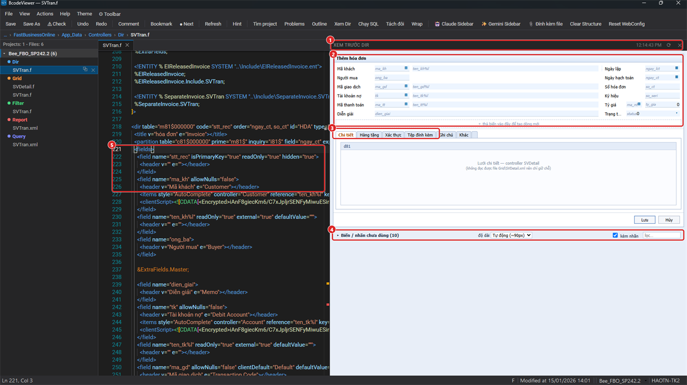

Trên ảnh: **①** khung Xem trước Dir (⟳ vẽ lại, ✕ đóng) · **②** form dựng từ `<fields>` / `<views>` · **③** tab theo category · **④** Biến / nhãn chưa dùng · **⑤** source tương ứng (bấm ô trên form để nhảy tới).

- Chỉ vẽ lại khi bố cục đổi (DOCTYPE, `<fields>`, `<views>`, `<title>`); sửa `<script>`, `<command>`… không vẽ lại. Nút ⟳ = vẽ lại ngay (xoá cache).
- Bấm một ô trên form → nhảy tới field đó trong code.
- `Ctrl`+bấm chọn nhiều ô; kéo ô để đổi chỗ trong dòng design (sửa thẳng vào source, `Ctrl+Z` để hoàn tác).
- Khay "Biến / nhãn chưa dùng": kéo biến vào form hoặc vào "＋ thả biến vào đây để tạo dòng mới".
- Chỉ là mô phỏng: không chạy script, không có dữ liệu, lưới chi tiết chỉ là khung giữ chỗ; nút Lưu / Hủy chỉ vẽ cho giống.

### Xem trước mail / SMS

- ⇄ đổi vị trí khung (phải → trái → cửa sổ nổi), ⟳ dựng lại (đọc lại cả file include).
- **Dữ liệu mẫu**: gõ `so_ct = PN001`; dòng chi tiết `ma_vt = A | B | C`. **Dữ liệu thật**: chạy câu master/detail của form trên database workspace (luôn rollback, chỉ đọc).
- Bấm header / biến để nhảy tới code; double-click chữ header để sửa rồi `Enter` ghi vào `<header v/e>`.
- Chọn bề rộng thử (Điện thoại 375px, Hộp thư hẹp 600px, rộng 900px) — có cảnh báo tràn ngang và CSS bị trình đọc mail bỏ.

<a id="viewer-sql"></a>
## Chạy SQL trong file (Ctrl+Enter)

1. Đặt con trỏ trong `<command>` / `<action>` / entity SQL (hoặc bôi đen đoạn cần chạy).
2. `Ctrl+Enter` (hoặc nút **Chạy SQL**). Viewer bỏ CDATA, thay `&Entity;` theo chuỗi include, đổi `&lt;`… thành ký tự thật.
3. Câu SELECT không tham số chạy ngay. Còn lại hiện hộp **Chạy SQL**:
   - "Chạy trên: <workspace>" — database là **workspace đang chọn trong Bcode** (Bcode chưa có workspace thì dùng Config.xml của FCode + mật khẩu khai ở Settings).
   - Nhập tham số (để trống = NULL; nhớ trong phiên), macro FCode (@@language, @@userID…).
   - **Chạy thử (bọc transaction rồi luôn rollback)** — tự tick khi câu lệnh có ghi.
   - Xem trước "Câu lệnh sẽ chạy (đã gộp entity)", rồi **Chạy** / **Debug trong Bcode** / **Hủy**.
4. Kết quả ở bảng **SQL** phía dưới: tối đa 500 dòng mỗi bảng, timeout 60 giây; dòng trạng thái báo thời gian, số dòng, "ĐÃ ROLLBACK" nếu chạy thử. **Copy kết quả** dán thẳng sang Excel; **Dừng** để huỷ khi chạy lâu.

> **Lưu ý:** mặc định Viewer **chặn câu ghi thật** (INSERT / UPDATE / DELETE / EXEC…): chỉ chạy thử rollback được. Muốn ghi thật: Settings → Gợi ý & chạy SQL → tick "Cho phép "Chạy SQL" thực thi câu ghi".

### Debug trong Bcode

Nút **Debug trong Bcode** (hoặc chuột phải → Debug SQL trong Bcode) dựng script độc lập (khai `declare @x … = N'...'` cho từng tham số) rồi gửi sang Bcode — Bcode mở một tab **SQL Query** mới với script đó để chạy / Debug từng bước. Bcode chưa mở → "Bcode chưa mở … — mở Bcode rồi thử lại."

### F5 — lưu rồi chạy menu của file

`F5` lưu file, tra `wcommand` (Sys Data) theo tên file (sysid hoặc link `<tên>.aspx`) rồi mở **trình duyệt mặc định** tới menu đó trên Login WLink của dự án (tự đăng nhập bằng tay). Không có menu → mở trang đăng nhập; chưa biết link web → khai Config.xml của FCode trong Settings.

<a id="viewer-tab"></a>
## Chuyển tab nhanh (Ctrl+Tab)

- `Ctrl+Tab` / `Ctrl+Shift+Tab`: tab kế / tab trước.
- **Giữ Ctrl khoảng 0,35 giây rồi bấm Tab** → hộp chọn tab: `↑/↓` hoặc `Tab` để chọn, thả Ctrl hoặc `Enter` để mở.
- Kiểu bấm nhanh chọn ở Settings → Bố cục → "Ctrl+Tab bấm nhanh": **Tab tới** (A → B → C, mặc định) hoặc **Tab song song** (A ⇄ B — qua lại 2 tab gần nhất, giống Bcode).
- `Ctrl+W` đóng tab, `Ctrl+\` tách đôi khung soạn thảo, `Ctrl+B` ẩn / hiện cây file.

<a id="viewer-settings"></a>
## Settings và phím tắt BcodeViewer

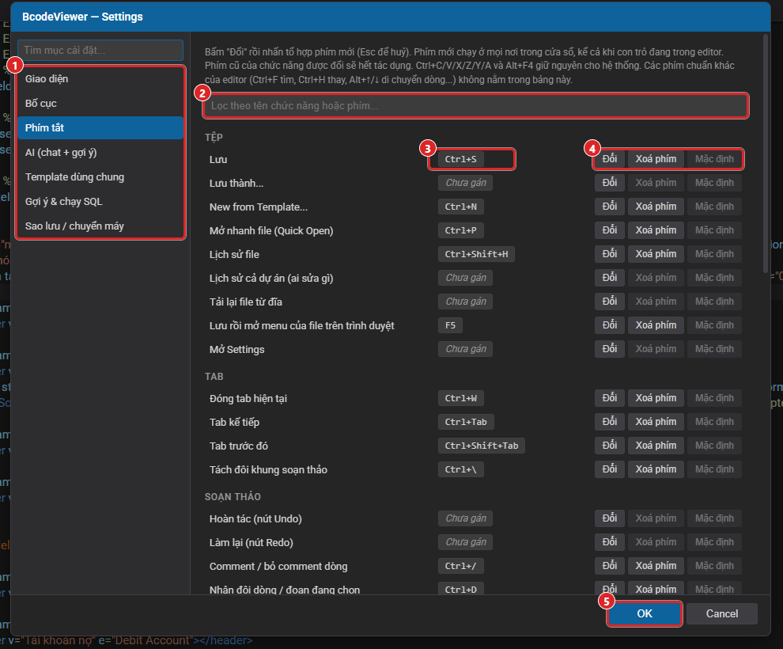

Trên ảnh: **①** các trang Settings · **②** lọc theo tên chức năng / phím · **③** phím hiện tại · **④** Đổi · Xoá phím · Mặc định · **⑤** OK để áp dụng.

Mở: **File → Settings…** (hoặc **File → Phím tắt…** để vào thẳng trang phím tắt). Có ô "Tìm mục cài đặt…"; mọi thay đổi chỉ áp dụng khi bấm **OK** (`Enter`), **Cancel** (`Esc`) bỏ hết.

| Trang | Nội dung chính |
|---|---|
| **Giao diện** | Phông chữ editor · Kiểu theme Fcode (.xml) · minimap · tự thu nhỏ cỡ chữ khi khung hẹp (cỡ nhỏ nhất) · Wrap · **Chế độ nhẹ (máy yếu)** Tự động / Bật / Tắt · vị trí khung Claude / Gemini (phải / dưới / trên) |
| **Bố cục** | Ẩn / hiện thanh menu, thanh công cụ, đường dẫn, thanh tab · **Ctrl+Tab bấm nhanh** · vị trí và độ rộng cây file · sắp xếp / ẩn / thêm nút thanh công cụ (kéo ☰, "+ Vạch ngăn", "+ Thêm nút") · đưa về mặc định |
| **Phím tắt** | Bảng mọi lệnh: **Đổi** (bấm tổ hợp mới, `Esc` huỷ) · **Xoá phím** · **Mặc định**; ô lọc theo tên / phím; "Đưa TẤT CẢ phím tắt về mặc định" |
| **AI (chat + gợi ý)** | Anthropic API key · Gemini API key · model chat · bật gợi ý AI khi gõ (tắt mặc định) · model / engine ghost text · engine dịch caption (Google / Gemini / Claude) |
| **Template dùng chung** | Thư mục chung (UNC / git) chứa `*.code-snippets`, `*.json` (snippet) và thư mục `files\` (mẫu file cho `Ctrl+N`) — Viewer chỉ đọc |
| **Gợi ý & chạy SQL** | Gợi ý tên bảng / cột (nút Test) · **Cho phép Chạy SQL thực thi câu ghi** (tắt mặc định) · Config.xml của FCode + mật khẩu SQL (dự phòng khi chưa có Bcode) |
| **Sao lưu / chuyển máy** | Xuất / Sao chép / Nhập cấu hình (không gồm API key, mật khẩu, đường dẫn) |

Quy tắc gán phím: phải kèm `Ctrl` hoặc `Alt` (chỉ `F1`–`F24` được dùng riêng); không gán được `Ctrl+C/V/X/Z/Y/A`, `Alt+F4`. Phím đã dùng cho lệnh khác → hỏi "Gán đè". Phím mới chạy ở mọi chỗ trong cửa sổ, kể cả trong editor.

### Hint Code và New from Template

- Nút **Hint**: thư viện snippet — tìm theo prefix / tag / mô tả / code; New · Save · Delete · Insert · Export… · Import… (`.code-snippets` / `.json`). Mỗi hint có Category (JS/SQL/XML/CSS), Prefix, Tag, Description, "Chỉ ở file" (vd `*\Grid\*`), "Hiện trong danh sách gợi ý khi gõ".
- **File → New from Template…** (`Ctrl+N`): chọn mẫu "Riêng" (`%AppData%\Bcode\templates`) hoặc "Chung" (thư mục chung `\files`) → **Tạo file** → chọn chỗ lưu → file mới mở ra.

### Theme

Menu **Theme**: hơn 30 theme có sẵn (Dark+, Dracula, One Dark Pro, Monokai, Light+, GitHub Light…), nhập theme VS Code (`.json` / `.vsix`) hoặc Fcode (`.xml`), hoặc "Theo Windows". Một bảng màu áp cho cả khung, editor và hộp thoại.

<a id="viewer-ai"></a>
## AI trong BcodeViewer

| Cách | Cần gì | Dùng khi |
|---|---|---|
| **🤖 Claude Sidebar / ✨ Gemini Sidebar** | Đăng nhập claude.ai / gemini trong khung (lưu đăng nhập riêng), **không cần API key** | Hỏi đáp, nhờ giải thích / viết code dài |
| **📎 Đính kèm file** | Một sidebar đang mở | Dán nội dung file đang mở vào ô chat |
| **`Ctrl+I`** | Anthropic API key | Sinh / sửa code ngay tại con trỏ |
| **AI ghost text** | Bật trong Settings → AI + API key | Gợi ý chữ mờ khi ngừng gõ (tính phí) |
| **Dịch caption** `Ctrl+Alt+T` | Google: không cần key | Điền tiếng Anh cho header — tra Từ điển dịch trước, không có mới gọi Google/AI |

Đóng khung AI là giải phóng bộ nhớ; thu nhỏ Viewer khi khung đang mở thì khung tạm ngủ. Vị trí khung chọn ở Settings → Giao diện.

<a id="viewer-bcode"></a>
## Liên kết BcodeViewer với Bcode

- **Workspace dùng chung**: Viewer đọc danh sách workspace và workspace đang chọn từ `%AppData%\Bcode\settings.json` do Bcode ghi — không cần khai lại kết nối. Đổi workspace trong Bcode thì gợi ý SQL / Chạy SQL của Viewer đi theo.
  - Gợi ý SQL + Chạy SQL: workspace **đang chọn trong Bcode**.
  - `F5` + thanh trạng thái: workspace **trùng tên dự án của file**.
  - Clear Structure / Open Web.config / Refresh Web.config: site của file đang mở (thư mục chứa App_Data), không có thì Source Path của workspace.
- **Bcode → Viewer**: File Lookup → Edit in BcodeViewer (mở file kèm tên dự án).
- **Viewer → Bcode**: Debug trong Bcode — gửi script sang tab SQL Query mới của Bcode (Bcode phải đang mở, cùng phiên Windows).

<a id="viewer-loi"></a>
## Lỗi hay gặp (BcodeViewer)

| Hiện tượng | Cách xử lý |
|---|---|
| Không có gợi ý bảng / cột, Chạy SQL báo lỗi kết nối | Mở Bcode, chọn đúng workspace (Bcode ghi settings.json); hoặc khai Config.xml + mật khẩu ở Settings → Gợi ý & chạy SQL. |
| Chạy SQL không ghi được dữ liệu | Mặc định chỉ chạy thử rollback — bật "Cho phép Chạy SQL thực thi câu ghi". |
| "Bcode chưa mở…" khi bấm Debug trong Bcode | Mở Bcode (cùng tài khoản Windows) rồi thử lại. |
| `F5` mở trang đăng nhập thay vì menu | Không có dòng wcommand nào có sysid / link trùng tên file. |
| Báo "Thiếu entity" sai với file include | File include chưa biết file cha: mở file cha trước, hoặc `F12` lần nữa để tìm toàn project. |
| Ctrl+I / ghost text không chạy | Chưa nhập API key (Settings → AI); ghost text còn phải bật riêng. |
| Viewer giật khi gõ / đổi tab | Bật **Chế độ nhẹ** (Settings → Giao diện); gửi file **Help → Log độ mượt** cho người phát triển. |

<a id="phu-luc"></a>
# Phụ lục

<a id="phim-tat-tong-hop"></a>
## Bảng phím tắt tổng hợp

Phím mặc định; cả hai chương trình đều đổi được (Bcode: ⚙ Settings → Giao diện (Template) → Phím tắt; BcodeViewer: File → Phím tắt…).

| Việc | Bcode | BcodeViewer |
|---|---|---|
| Tìm nhanh / mở nhanh | `Ctrl+P` Command Palette (tool, tab, menu, object, snippet) | `Ctrl+P` Quick Open (file) |
| Trợ giúp | `Ctrl+F1` (mở đúng mục của tab đang dùng) | — |
| Lưu | `Ctrl+S` (file .sql trong SQL Query) | `Ctrl+S` |
| Chạy SQL | `F5` / `Ctrl+Enter` (SQL Query) | `Ctrl+Enter` (SQL tại con trỏ) |
| Huỷ lệnh đang chạy | `Alt+F5` | nút **Dừng** |
| Xem nhanh định nghĩa | `F12` (object SQL) | `F12` (peek entity / file) |
| Mở định nghĩa | `Ctrl+F12` (object sang tab mới) | `Ctrl+F12` (file / nơi khai báo) |
| AI viết / sửa code | `Ctrl+I` (chế độ Web) | `Ctrl+I` |
| Gọi gợi ý | `Alt+\` (gợi ý AI) | `Ctrl+Space` |
| Định dạng code | `F7` Beauty | — |
| Wrap (tự xuống dòng) | `Alt+Z` | `Alt+Z` |
| Tab kế / hộp chọn tab | `Ctrl+Tab` / giữ `Ctrl` + `Tab` | `Ctrl+Tab` / giữ `Ctrl` + `Tab` |
| Tab trước | (gán lại — mặc định đang lỗi) | `Ctrl+Shift+Tab` |
| Đóng tab | `Ctrl+W` | `Ctrl+W` |
| Mở lại tab vừa đóng | `Ctrl+Shift+B` | — |
| Ẩn / hiện cây trái | `Ctrl+Shift+H` | `Ctrl+B` |
| Chạy menu trên web | `Ctrl+F5` (trong cây WCommand) | `F5` (lưu rồi mở menu của file) |
| Tìm trong toàn project | `Ctrl+Shift+F` mở File Lookup → SearchBox | `Ctrl+Shift+F` |
| Lịch sử | `Ctrl+Shift+Y` Lịch sử SQL · `Ctrl+Alt+H` lưu vào đó | `Ctrl+Shift+H` Lịch sử file |
| Debug SQL | `F10` · `Ctrl+F10` · `Shift+F5` | **Debug trong Bcode** (gửi sang Bcode) |
| Xem trước màn hình | — | `Alt+P` Dir / mail |

**Chỉ có ở Bcode**: `Ctrl+Shift+Q` SQL Query · `Ctrl+Shift+T` Table · `Ctrl+Shift+C` Command · `Ctrl+Shift+L` Lookup · `Ctrl+Shift+W` WCommand · `Ctrl+Shift+F` File Lookup · `Ctrl+Shift+G` Gen Update · `Ctrl+Shift+R` File Reference · `Ctrl+Shift+O` Change Owner · `Ctrl+Shift+U` Gen Update (Result) · `Ctrl+Shift+E` Note · `Ctrl+Shift+4` Note (New) · `Ctrl+Shift+Y` Lịch sử SQL · `Ctrl+Shift+J` So sánh object · `Ctrl+3` SQL Profiler · `Ctrl+Shift+P` Projects · `Ctrl+O` Choose Server · `Ctrl+F5` Synchronize · `Ctrl+Shift+N` cửa sổ mới · `Ctrl+1` App ↔ Sys · `Ctrl+4` FSG FBO · `Ctrl+5` Program Path · `Ctrl+Alt+U` Ai đang dùng · `Alt+1..5` nhóm công cụ · `Ctrl+Alt+Shift+A / V` Add / View Script · lưới Table `F1 F3 F4 F8 Ctrl+I Ctrl+N Ctrl+' Ctrl+0 Ctrl+G` · cây WCommand `Insert F3 F4 F8 F12 F5`.

**Chỉ có ở BcodeViewer**: `Ctrl+N` New from Template · `Ctrl+G` Go to tag · `F11` tới function · `Shift+F12` tìm nơi sử dụng · `Ctrl+Shift+M` Problems · `Ctrl+Shift+U` Outline · `Ctrl+\` tách đôi khung · `Ctrl+/` comment · `Ctrl+D` nhân đôi dòng · `Ctrl+Shift+D` thêm con trỏ ở chỗ giống tiếp theo · `Ctrl+Alt+T` dịch caption · `Ctrl+F` / `Ctrl+H` tìm / thay trong file · `Alt+↑/↓` di chuyển dòng · `F1` bảng lệnh Monaco.

<a id="du-lieu"></a>
## Dữ liệu lưu ở đâu

| Đường dẫn | Của | Nội dung |
|---|---|---|
| `%AppData%\Bcode\settings.json` | Bcode (Viewer đọc) | Danh sách dự án, kết nối, đường dẫn, thứ tự / nhóm công cụ |
| `%AppData%\Bcode\ui-template.json`, `ui\` | Bcode | Template giao diện, phím tắt đã đổi, CSS / HTML tuỳ chỉnh |
| `%AppData%\Bcode\session\` | Bcode | Phiên làm việc (tab đang mở) |
| `%AppData%\Bcode\query-history\`, `sql-history\` | Bcode | Lịch sử SQL, lịch sử sửa object |
| `%AppData%\Bcode\Notes\`, `AdvanceNotes\` | Bcode | Note, Note (New) |
| `%AppData%\Bcode\FileLookupCache\` | Bcode | Cache phân tích file / menu (xoá được) |
| `%AppData%\Bcode\Backups\` | Bcode | Bản sao lưu khi "Đưa vào source" |
| `%AppData%\Bcode\license.key` | Bcode | Key bản quyền |
| `%AppData%\Bcode\viewer-*.json`, `viewer-hints.json`, `viewer-recent-files.json` | BcodeViewer | Settings, phím tắt, Hint Code, danh sách file của cây; `viewer-translate-dict.json` = Từ điển dịch |
| `%AppData%\Bcode\history\` | BcodeViewer | Lịch sử file của máy này |
| `<thư mục dự án>\History\` | BcodeViewer | Lịch sử chung của dự án (ai sửa gì) |
| `<BcodeViewer.exe>\Config\*.txt` | BcodeViewer | Prompt AI ghost text |
| `<Bcode.exe>\Templates\` | Bcode | Mẫu file (Tạo nhanh danh mục, Tạo báo cáo, Clone danh mục, LCTT…) |
| `<Bcode.exe>\Help\HuongDanSuDung.md` | Bcode | Tài liệu này (tab Trợ giúp) |
| `<file>.rpt.bak` | Bcode | Bản gốc của file .rpt trước khi Write Schema cập nhật |
