<a id="huong-dan"></a>
# Hướng dẫn sử dụng Bcode & BcodeViewer

Tài liệu cho người triển khai / kiểm thử FastBusiness dùng **Bcode** (bộ công cụ quản trị, triển khai ERP) và **BcodeViewer** (trình soạn file controller FCode). Viết theo từng tính năng: mở ở đâu, làm từng bước thế nào, phím tắt, lưu ý và lỗi hay gặp.

Trong Bcode, tài liệu này mở bằng nút **Trợ giúp** trên thanh trên (hoặc `Ctrl+F1`). Bản gốc nằm ở `docs/HuongDanSuDung.md` của mã nguồn, chép kèm Bcode.exe thành `Help\HuongDanSuDung.md`.

**Mục lục**

- [Bắt đầu nhanh](#bat-dau)
- [Dùng tab Trợ giúp](#tro-giup)
- **Phần I — Bcode**
  - [Chế độ giao diện Web và App](#che-do-giao-dien)
  - [Chọn dự án / workspace](#du-an)
  - [Màn hình chính Bcode](#khung-chinh)
  - [SQL Query](#sql-query) · [Check Fields](#check-fields) · [Debug từng bước](#debug-sql) · [Lịch sử SQL](#lich-su-sql) · [Write Schema (.xsd / .rpt)](#write-schema)
  - [Table](#table) · [Lookup](#command-lookup) · [SQL Object, Ai đang dùng, So sánh](#sql-object)
  - [WCommand](#wcommand) · [Mobile](#mobile) · [File Lookup](#file-lookup) · [Cấp source, Copy to, Clone](#cap-source)
  - [Gen Update](#gen-update) · [Note và Note (New)](#note) · [BcodeNote (nhiều dự án)](#bcodenote) · [Create RPT & XML, Tạo báo cáo](#create-rpt)
  - [Menu Triển khai](#trien-khai) · [Menu Tool mở rộng](#tool-mo-rong) · [Tiện ích khác](#tien-ich)
  - [Template giao diện](#template) · [Phím tắt và Settings phím tắt](#phim-tat) · [Key bản quyền](#key-ban-quyen) · [Lỗi hay gặp](#loi-thuong-gap)
- **Phần II — BcodeViewer**
  - [Màn hình chính](#viewer-giao-dien) · [Mở, lưu file và lịch sử](#viewer-mo-file) · [IntelliSense](#viewer-intellisense)
  - [F12 / Peek entity và điều hướng](#viewer-entity) · [Problems, tìm / thay](#viewer-problems) · [Xem trước Dir (Alt+P)](#viewer-dir-preview)
  - [Chạy SQL](#viewer-sql) · [Check SQL](#viewer-check-sql) · [Ctrl+Tab](#viewer-tab) · [Settings và phím tắt](#viewer-settings) · [AI](#viewer-ai) · [Liên kết với Bcode](#viewer-bcode) · [Lỗi hay gặp](#viewer-loi)
- **Phụ lục**
  - [Bảng phím tắt tổng hợp](#phim-tat-tong-hop) · [Dữ liệu lưu ở đâu](#du-lieu)

<a id="bat-dau"></a>
## Bắt đầu nhanh

1. **Mở Bcode** → chọn chế độ giao diện (**Web** đầy đủ tính năng / **App** nhẹ) — xem [Chế độ giao diện](#che-do-giao-dien).
2. **Màn Projects**: chọn dự án → **Chọn**. Chưa có dự án: **＋ New** khai server, Sys Data / App Data, Source Path… hoặc `Ctrl+F5` đồng bộ từ FSG — xem [Chọn dự án](#du-an).
3. **Làm việc**:
   - Chạy SQL: `Ctrl+Shift+Q` → gõ script → `F5`.
   - Xem / sửa dữ liệu bảng: `Ctrl+Shift+T` → gõ tên bảng → `Enter`.
   - Tìm source của một menu: cột trái **WCommand** → double-click menu → tab File Lookup → **Edit in BcodeViewer**.
   - Đóng gói cập nhật: `Ctrl+Shift+G` (Gen Update) hoặc `Ctrl+Shift+4` (Note (New)).
   - Hỏi kiến thức Fast (khung báo cáo, danh mục, cấu trúc bảng, cách gọi hàm, quy ước): `Ctrl+Shift+M` → [Hỏi Fast](#hoi-fast).
4. Quên chức năng nằm đâu: `Ctrl+P` (Command Palette) rồi gõ tên.
5. Đang ở tab nào không biết dùng: bấm **Trợ giúp** (`Ctrl+F1`) — mở đúng mục của tab đó.

<a id="loi-mo-webview2"></a>
## Lỗi "Không khởi tạo được … (dùng WebView2)" khi mở Bcode

Mở Bcode hiện hộp **"Bcode — WebView2"** với dòng *"Unable to load DLL 'WebView2Loader.dll' or one of its dependencies: The specified module could not be found. (0x8007007E)"* — và giao diện (thanh trên / cây / thanh công cụ) không lên.

**Nguyên nhân** (gần như luôn là một trong hai): bản Bcode được **chép tay** sang máy này nhưng **thiếu thư mục con** `runtimes\win-x64\native\` (chứa `WebView2Loader.dll`), hoặc file đó bị **diệt virus xoá/khoá**. Đây **không** phải lỗi thiếu Microsoft Visual C++ Redistributable — `WebView2Loader.dll` chỉ phụ thuộc các thư viện có sẵn của Windows.

**Khắc phục trên máy bị lỗi:**

1. **Chép lại nguyên vẹn** cả thư mục Bcode từ bản phát hành, **giữ mọi thư mục con** — đừng chỉ chép các file lẻ cạnh `Bcode.exe`. Kiểm tra có file `Bcode\runtimes\win-x64\native\WebView2Loader.dll` (và từ bản này có thêm `WebView2Loader.dll` **ngay cạnh** `Bcode.exe`).
2. Nếu chép qua **mạng / USB / giải nén ZIP**: chuột phải `WebView2Loader.dll` → **Properties** → tích **Unblock** (bỏ chặn mark-of-the-web), rồi mở lại. Kiểm tra phần mềm **diệt virus** có cách ly file không.
3. Nên có sẵn **Microsoft Edge WebView2 Runtime** (Windows 10/11 thường đã có qua Edge; nếu thiếu, tải "WebView2 Runtime" Evergreen Bootstrapper từ trang Microsoft).

> Cách gọn nhất để không bao giờ gặp lỗi này: dùng đúng cơ chế **Cập nhật Bcode** (chép đủ thư mục) thay vì chọn tay vài file.

<a id="tro-giup"></a>
## Dùng tab Trợ giúp

Nút **Trợ giúp** trên thanh trên của Bcode (cả chế độ Web và App) hoặc `Ctrl+F1` mở tab **Trợ giúp**, dạng giống file trợ giúp CHM:

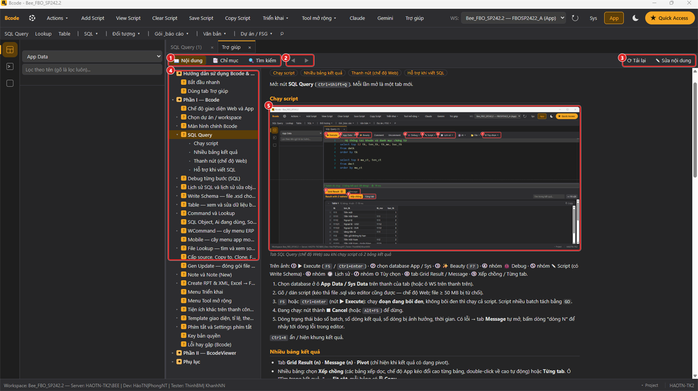

Trên ảnh: **①** Nội dung / Chỉ mục / Tìm kiếm · **②** ◀ ▶ lùi / tới · **③** ⟳ Tải lại · ✎ Sửa nội dung · **④** cây tính năng · **⑤** ảnh minh hoạ (bấm để phóng to).

- **Cột trái** có 3 trang:
  - **📖 Nội dung** — cây tính năng theo phần (Bcode / BcodeViewer / Phụ lục). Bấm tên tính năng để xem hướng dẫn; bấm ▸ để mở các mục con, bấm mục con để nhảy tới đúng đoạn.
  - **📑 Chỉ mục** — mọi mục xếp theo vần A–Z, gõ từ khoá để lọc.
  - **🔍 Tìm kiếm** (`Ctrl+F`) — tìm chữ trong toàn bộ hướng dẫn, gõ có dấu hay không dấu đều được (vd `phim tat`); kết quả xếp theo độ khớp, mở ra là chữ tìm được tô vàng.
- **Khung phải**: hướng dẫn của tính năng đang chọn. Bấm link trong bài để nhảy sang mục khác; ◀ ▶ (`Alt+←` / `Alt+→`) để lùi / tới.
- **Ảnh minh hoạ**: phần lớn tính năng có ảnh chụp màn hình thật, khung đỏ đánh số ①②③… khớp với dòng "Trên ảnh:" ngay dưới ảnh. Bấm vào ảnh để phóng to, bấm lần nữa hoặc `Esc` để đóng.
- Kéo vạch giữa 2 khung để đổi độ rộng cột trái.
- **Mở theo ngữ cảnh**: đang ở tab SQL Query, Table, File Lookup, Gen Update… mà bấm Trợ giúp / `Ctrl+F1` thì tab Trợ giúp mở thẳng mục của công cụ đó.
- **✎ Sửa nội dung**: mở file `Help\HuongDanSuDung.md` (cạnh Bcode.exe) để bổ sung ghi chú, cách dùng riêng của nhóm; sửa xong bấm **⟳ Tải lại**. Quy ước file: `#` = phần, `##` = một tính năng (một trang), `###` = mục con; dòng `<a id="ten-muc"></a>` ngay trên tiêu đề đặt mã mục để link `[chữ](#ten-muc)` trỏ tới; ảnh viết `` (một dòng riêng), file ảnh để trong thư mục `Help\images` cạnh file .md.

> **Lưu ý:** file trong thư mục Bcode.exe bị ghi đè khi cập nhật bản Bcode mới. Muốn giữ lâu dài, gửi phần bổ sung cho người phát triển để đưa vào `docs/HuongDanSuDung.md`.

<a id="bcode"></a>
# Phần I — Bcode

Bcode (Bcode.exe) là bộ công cụ quản trị / triển khai FastBusiness ERP: chạy SQL, sửa dữ liệu bảng, quản lý menu WCommand, tìm source, đóng gói cập nhật, tạo báo cáo… Mỗi cửa sổ Bcode làm việc với **một dự án** (workspace); mở thêm cửa sổ để làm song song nhiều dự án.

<a id="che-do-giao-dien"></a>
## Chế độ giao diện Web và App

Bcode có 2 chế độ, chọn lúc mở chương trình (hộp "Bcode — chọn chế độ giao diện"):

| | **Web / WebView2** | **App / WinForms** |
|---|---|---|
| Đặc điểm | Mỗi màn hình là một trang web trong WebView2 — **đầy đủ tính năng nhất** | Giao diện Windows tự vẽ — **nhẹ, mở nhanh, ít bộ nhớ** |
| Editor SQL | Monaco (giống VS Code): gợi ý code, AI `Ctrl+I`, ghost text, peek `F12`, Debug từng bước, tuỳ biến thanh nút | Scintilla: đủ tính năng như Web — gợi ý code (`Ctrl+Space`), AI `Ctrl+I`, ghost text (hiện thành khối chữ xám dưới dòng con trỏ, `Tab` nhận / `Esc` bỏ), peek `F12`, Debug từng bước, tuỳ biến thanh nút, Check Fields, kéo thả file `.sql` vào editor, `Ctrl+F` thanh tìm |
| Công cụ vẫn dùng WebView2 | — | Create RPT & XML, Tạo báo cáo, Tạo nhanh danh mục, Template giao diện, Báo cáo yêu cầu FSG, Biên bản xác nhận, Check Mail, Excel → FRX, Claude / Gemini, Trợ giúp (tự dựng khi mở, đóng tab là giải phóng) |

- Tick "Hỏi lại mỗi lần mở Bcode" để lần sau vẫn hỏi; bỏ tick thì vào thẳng chế độ đã chọn. Đóng hộp chọn = thoát Bcode.
- Đổi sau này: ⚙ Settings → **Chế độ giao diện: … — đổi...** → Bcode hỏi mở lại để áp dụng.
- Vào thẳng một chế độ không hỏi: chạy `Bcode.exe --web` hoặc `Bcode.exe --native` (`--app` cũng được).
- **Chế độ an toàn**: giữ phím **Shift** khi mở Bcode → bỏ qua CSS / HTML tự chỉnh của phiên đó (dùng khi tuỳ chỉnh giao diện làm hỏng trang). Bật / tắt lâu dài: Actions → **Tuỳ chỉnh giao diện web: …**.

<a id="du-an"></a>
## Chọn dự án / workspace

Mỗi dự án (workspace) gồm: kết nối SQL Server, 2 database **Sys Data** và **App Data**, các đường dẫn (Source Path, Program Path, Mobile Path, Working Path, API Path) và link web đăng nhập (Login WLink). Danh sách lưu ở `%AppData%\Bcode\settings.json` — BcodeViewer và Screen Designer đọc chung.

Mật khẩu SQL, mật khẩu web và API key trong file này được **mã hoá theo tài khoản Windows**: chỉ đúng tài khoản đó trên máy này đọc được. Chép `settings.json` sang máy (hoặc tài khoản) khác thì danh sách dự án vẫn dùng được, nhưng mật khẩu phải nhập lại ở **Edit** hoặc đồng bộ lại bằng `Ctrl+F5`. Thanh trạng thái có báo "⚠ Mật khẩu đã lưu được mã hoá trên máy / tài khoản Windows khác" khi chọn dự án gặp trường hợp này.

### Màn hình Projects

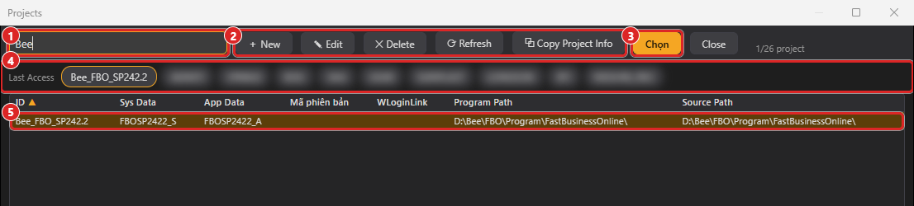

Trên ảnh: **①** ô lọc · **②** ＋ New / ✎ Edit / ✕ Delete / ⟳ Refresh / ⧉ Copy Project Info · **③** **Chọn** — vào dự án · **④** Last Access — dự án dùng gần đây · **⑤** dòng dự án (double-click = chọn).

Hiện tự động khi mở Bcode (trừ khi chạy với `--project <tên>`), hoặc `Ctrl+Shift+P` / Actions → **Projects...**.

1. Gõ vào ô "Gõ để lọc theo mã dự án (ID)..." — chỉ so khớp mã dự án (cột ID), không xét database / link / đường dẫn; nhiều từ thì mã phải chứa đủ các từ. Dải **Last Access** phía trên là 10 dự án dùng gần nhất, bấm để chọn ngay.
2. Chọn dòng → **Chọn** (hoặc `Enter` / double-click). `Esc` để đóng.
3. Nút khác: **＋ New** · **✎ Edit** · **✕ Delete** (chỉ xoá khỏi danh sách) · **⟳ Refresh** · **⧉ Copy Project Info** (copy ID, server, database, link, đường dẫn, phiên bản — không copy mật khẩu).
4. `Ctrl+F5` trên màn này = mở Edit Project kèm hộp **Synchronize** (đồng bộ từ FSG).

### Edit Project (Choose Server / Workspaces)

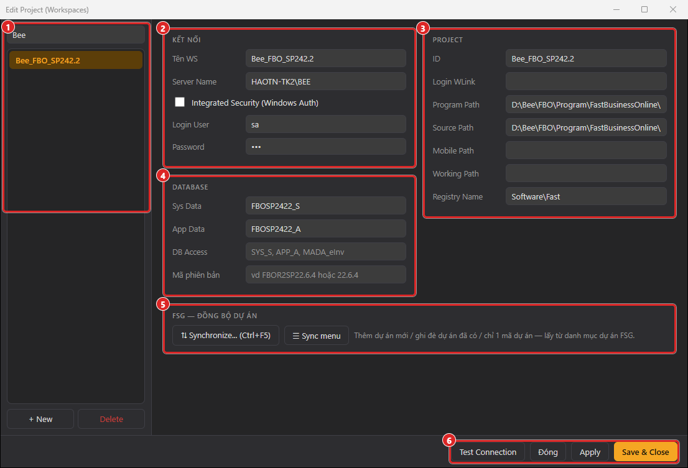

Trên ảnh: **①** danh sách dự án + ô lọc · **②** Kết nối SQL Server · **③** Project: ID, Login WLink, các đường dẫn · **④** Database: Sys Data, App Data, DB Access, Mã phiên bản · **⑤** đồng bộ từ FSG · **⑥** Test Connection · Đóng · Apply · Save & Close.

Mở: ⚙ Settings → **Choose Server / Workspaces...**, hoặc **＋ New / ✎ Edit** ở màn Projects. Cửa sổ "Edit Project (Workspaces)":

- **Kết nối**: Tên WS, Server Name, Integrated Security (Windows Auth) hoặc Login User / Password.
- **Project**: ID, Login WLink, Program Path, **Source Path** (đường dẫn UNC tới site, vd `\\server\...\FBISP23` — bắt buộc cho File Lookup, Gen Update), Mobile Path, Working Path, **API Path** (thư mục FastAPIService của dự án, vd `\\server\CustomerPro\FBI\MA_DA\FastAPIService` — **Khai báo API** đọc `Config\ColumnMappings.xml` trong đó để lấy form / trường theo dự án; trống = dùng chuẩn tài liệu LT3), Registry Name.
- **Database**: Sys Data, App Data, **DB Access** (các database khác hiện thêm trong ô WS trên thanh trên, vd `SYS_S, APP_A, MADA_eInv`), Mã phiên bản (dùng để chọn phiên bản trong kho source cho Cấp source / Sơ đồ phụ thuộc; viết liền số như `FBISP2422`, `FBIHRMSP2422` vẫn khớp kho `FBOR2SP24.2.2`, `FBISP228` khớp `…22.8`).
- **FSG — Đồng bộ dự án**: **⇅ Synchronize... (Ctrl+F5)** và **☰ Sync menu**.
- Nút **Test Connection** · **Apply** · **Save & Close** · **Đóng** (đóng mà chưa Save là bỏ thay đổi).

### Đồng bộ dự án từ FSG (`Ctrl+F5`)

Hộp **Synchronize** có 3 chế độ: **Thêm mới 1 mã dự án (ma_da)** · **Chỉ sync dự án mới** · **Overwrite tất cả** (hỏi xác nhận; mật khẩu web, Mobile Path, cấu hình Profiler được giữ). Kết quả "Thêm X, cập nhật Y, bỏ qua Z" — **phải bấm Apply / Save** mới lưu.

**Đối chiếu Web.config**: lấy dữ liệu từ QLYC xong, Bcode đọc `Web.config` trong **Program Path** của từng dự án (chỉ đọc, không sửa file) — key `sysDatabaseName`, connection string `sysConnectionString` / `appConnectionString` — rồi so **Server, User, Password, Sys Data, App Data**. Trường nào QLYC khai lệch thì **lấy theo Web.config** (cái site đang chạy thật dùng) và hiện hộp liệt kê dự án + trường đã thay (mật khẩu chỉ ghi chữ "Password", không hiện giá trị); dòng trạng thái có "Web.config: đọc được X/Y dự án trong … s".

- Web.config khai server cục bộ (`.\SQL2019`, `(local)`, `localhost`) được đổi thành máy chủ chứa Program Path (vd `172.168.5.14\SQL2019`).
- App Data: connection string thường để `Initial Catalog=%Database` (chọn lúc đăng nhập) nên không có tên; khi Sys Data đổi theo Web.config thì App Data suy lại theo quy ước `…_S` → `…_A`. Không suy được thì giữ theo QLYC và ghi "cần kiểm tra lại".
- Không có Program Path / không có Web.config (dự án dạng app) / thư mục không tới được → **giữ nguyên dữ liệu QLYC**. Mỗi file chờ tối đa 4 giây; máy chủ không trả lời thì bỏ qua các dự án còn lại trên máy đó.
- Tốc độ: 1 dự án thêm khoảng 0,05–0,2 giây. Chế độ hàng loạt đọc vài nghìn Web.config qua mạng (đo thật ~2900 dự án: 13–30 giây, tuỳ tải máy chủ) — dòng trạng thái hiện tiến độ "Đang đối chiếu Web.config x/y".

### Đổi dự án và nhiều cửa sổ

| Phím | Tác dụng |
|---|---|
| `Ctrl+Shift+P` | Màn Projects — chọn dự án khác ngay trong cửa sổ hiện tại. |
| `Ctrl+O` | Choose Server: cũng mở màn Projects; nếu cửa sổ **đang có tab** mà chọn dự án **khác** → mở **Bcode mới** vào thẳng dự án đó, cửa sổ cũ giữ nguyên tab. Không có tab thì đổi tại chỗ. |
| `Ctrl+Shift+N` | Mở thêm một cửa sổ Bcode (cùng chế độ giao diện), bắt đầu từ màn Projects. |

### Chọn database đang làm việc

- Ô **WS:** trên thanh trên liệt kê các database **của dự án hiện tại**: "<AppDB> (App)", "<SysDB> (Sys)" và từng database trong DB Access "<DB> (DB)" — chỉ ghi tên database, không kèm mã dự án. Chọn ô nào thì tab SQL Query / Table đang dùng chuyển theo.
- Nút **Sys** / **App** (hoặc `Ctrl+1` — Switch Database) đổi nhanh giữa 2 database chính.
- Nút **⟳** cạnh WS = **Refresh database**: nạp lại danh sách object / bảng / cột (dùng sau khi tạo bảng, procedure mới mà gợi ý chưa thấy).

### Khôi phục phiên làm việc

Khi mở lại một dự án có phiên cũ, Bcode hỏi "Khôi phục phiên làm việc": **Chỉ Query** / **Query + Table** / **Tất cả** / **Không khôi phục** (tick "Lần sau không hỏi nữa" để nhớ lựa chọn — đổi lại ở Template → Cửa sổ). Bật / tắt ở ⚙ Settings → **Khôi phục các tab khi mở lại Bcode**; chu kỳ tự lưu: **Tự lưu phiên mỗi N giây...**. `Ctrl+Shift+B` mở lại tab vừa đóng (nhớ 20 tab, giữ cả SQL).

<a id="khung-chinh"></a>
## Màn hình chính Bcode

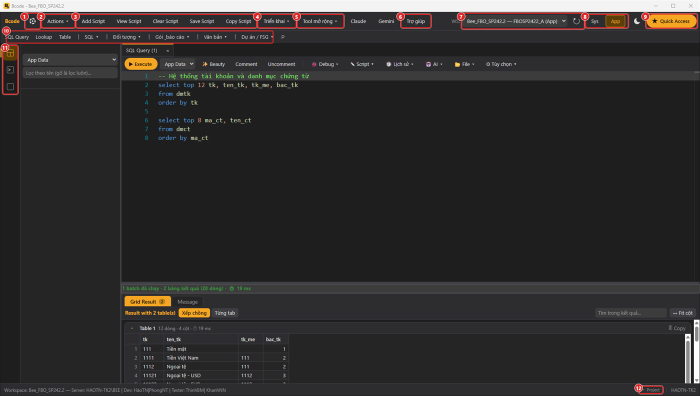

Trên ảnh: **①** ⚙ Settings · **②** Actions · **③** giỏ script: Add / View / Clear / Save / Copy Script · **④** menu Triển khai · **⑤** menu Tool mở rộng · **⑥** Trợ giúp · **⑦** ô WS chọn database + ⟳ Refresh database · **⑧** Sys / App · **⑨** Quick Access · **⑩** thanh công cụ (nút ghim + nhóm ▾, ⌕ = Command Palette) · **⑪** cột icon: SQL Object / WCommand / Mobile · **⑫** ▾ Project — mở nhanh thư mục, Copy Project Info.

<a id="thanh-tren"></a>
### Thanh trên

| Mục | Dùng để |
|---|---|
| ⚙ (bánh răng) | Menu **Settings**: Choose Server / Workspaces · Tỉ lệ giao diện · Khôi phục các tab · Tự lưu phiên · Claude/Gemini nhúng vào tab SQL Query · **Giao diện (Template)...** · Kiểu giao diện (Mềm / Gọn / Thoáng / Vuông vức) · Chế độ giao diện · Cây menu: bỏ qua file theo tên · Hướng dẫn gợi ý code SQL · **Key bản quyền** · Backup / Restore / Attach Database · Exit |
| **Actions ▾** | Choose Server (`Ctrl+O`) · Projects (`Ctrl+Shift+P`) · New Bcode window (`Ctrl+Shift+N`) · Switch Database (`Ctrl+1`) · SQL Profiler (`Ctrl+3`) · **SQL SMS (Mở SSMS)** · Open Program Path (`Ctrl+5`) · Script ▸ · **Tools ▸** (mọi công cụ kèm phím tắt) · **Tab & cửa sổ ▸** (Close Tab, Close All But This, Close Tabs to the Right, Close All Tab, Hide / Show cây menu, Tuỳ chỉnh giao diện web) · Clear Structure App · **Clear Structure ▸** (Clear App / Sys / Ext / Dir / Filter / Grid / Lookup · All · Open Structure Folder) · **Open Web.config** · Refresh Web.config · Create Menu |
| **Add / View / Clear / Save / Copy Script** | Giỏ script (Script Cart) — xem dưới |
| **Triển khai ▾**, **Tool mở rộng ▾** | Các công cụ triển khai và mở rộng (xem [Menu Triển khai](#trien-khai), [Menu Tool mở rộng](#tool-mo-rong)) |
| **Claude**, **Gemini** | Mở claude.ai / gemini trong một tab (đăng nhập bằng tài khoản web, không cần API key) |
| **Trợ giúp** | Tab hướng dẫn này — mở đúng mục của tab đang dùng (`Ctrl+F1`) |
| **WS:** · ⟳ · **Sys / App** | Chọn database, Refresh database (xem [Chọn dự án](#du-an)) |
| ☀/☾ | Đổi giao diện sáng / tối — Bcode nhớ lựa chọn, lần mở sau (cả chế độ App lẫn Web) vẫn đúng sáng / tối đã chọn; chưa chọn bao giờ thì mặc định tối |
| 🔔 (chuông) | **Thông báo y/c FSG**: số đỏ = số thông báo chưa xem; bấm để mở khung Thông báo (xem [Thông báo y/c FSG](#fsg-thong-bao)) |
| ★ **Quick Access** | Chọn nút nào hiện trên thanh công cụ |
| Nhãn phiên bản (góc phải, vd **Beta v2.0**) | Phiên bản Bcode đang chạy (rê chuột xem số đầy đủ) — báo lỗi / hỏi hỗ trợ thì kèm số này |

**Cập nhật Bcode:** mở Bcode khoảng 20 giây (sau đó cứ 4 giờ) Bcode tự đọc thư mục phát hành (mặc định `\\172.168.5.17\Users\HAOTN\Bcode\Bcode`); có bản mới thì hiện **thông báo ở góc dưới phải cửa sổ** (không tự tắt): **Xem** = mở hộp cập nhật, **Để sau** / ✕ = ẩn và nhắc lại sau 4 giờ (đóng hộp cập nhật mà chưa cập nhật cũng nhắc lại sau 4 giờ), và mục **Settings → Cập nhật Bcode — có bản mới…** hiện ra. Các báo khác của phần cập nhật (vd *Đã cập nhật Bcode lên …* lúc mở lại) chỉ hiện tạm trên thanh trạng thái khoảng 10 giây. Xem bản đang dùng: **Settings → About Bcode (phiên bản đang dùng)...** — phiên bản, build, ngày build, commit, nơi cài, thư mục phát hành, phiên bản .NET / WebView2 (Ctrl+C trong hộp để chép). Bấm vào để mở hộp **Cập nhật Bcode**: so bản đang dùng với bản mới (số phiên bản, build, ngày, commit) và danh sách **Có gì mới** (Sửa lỗi / Mới / Cải tiến). Bấm **Tải bản mới**: Bcode chỉ tải các file đã đổi về máy (có thanh tiến độ, tốc độ, thời gian còn lại, bấm *Dừng tải* được) và kiểm tra từng file — trong lúc tải vẫn làm việc bình thường. Tải xong chọn **Khởi động lại & cập nhật** (Bcode đóng, chép bản mới trong vài giây rồi tự mở lại) hoặc **Cài khi đóng Bcode** (cài lúc bạn tự đóng Bcode, không mở lại; huỷ hẹn bằng *Huỷ hẹn cài* trong cùng hộp). Mọi cửa sổ Bcode / Screen Designer chạy từ thư mục này phải đóng thì mới chép (BcodeViewer và Screen Designer có cơ chế cập nhật riêng — xem [Cập nhật BcodeViewer](#viewer-capnhat), [Cập nhật Screen Designer](#designer-capnhat); thư mục `ScreenDesigner\` cạnh Bcode.exe không bị cập nhật Bcode đụng tới). File bạn đã tự sửa trong thư mục Bcode (vd mẫu) được **giữ nguyên** — xem danh sách và tick *Ghi đè cả các file này* nếu muốn thay. Chép lỗi giữa chừng thì Bcode tự trả về bản cũ và báo lại lần mở sau. Báo *tải về sai mã kiểm tra (SHA-256) — đang được chép dở*: đợi ít phút rồi **Thử lại**; báo *không khớp mã kiểm tra ghi trong bcode-manifest.json — Thử lại sẽ không hết*: bản phát hành bị lệch, nhờ người phát hành chạy lại script phát hành (máy bạn chưa bị đổi gì). Bản mới có lỗi: **Quay lại bản trước** ở cuối hộp (bấm 2 lần để chắc; giữ 1 bản trước). Dữ liệu ở `%AppData%\Bcode` giữ nguyên; nhật ký ở `%AppData%\Bcode\update.log` (link *Nhật ký* trong hộp). Đổi thư mục: link *Đổi…* trong hộp, **Settings → Thư mục phát hành bản mới...** hoặc **Giao diện (Template) → Đường dẫn → Cập nhật Bcode** (nút *Mặc định* / *Tắt*; để trống = tắt kiểm tra). *Người phát hành:* build Release rồi chạy `tools\publish-release.ps1 -Dest <thư mục phát hành>` — lần đầu chép toàn bộ, các lần sau chỉ chép file đã đổi (so `bcode-manifest.json` trên server; thêm `-Full` để chép lại đủ khi file trên server bị sửa tay; file trên server thiếu / khác cỡ cũng tự chép lại); script chép dấu phiên bản sau cùng nên máy khác không tải phải bản chép dở. Trước khi chép, script kiểm SHA-256 mọi file của bản build với `bcode-manifest.json` của nó (lệch thì dừng, chưa đụng server, và in lệnh sinh lại manifest); sau khi chép, script đọc lại các file vừa chép trên server; file không ghi đè được (máy khác đang mở Bcode chạy thẳng từ thư mục phát hành, thiếu quyền ghi) thì dừng, báo tên file và chưa chép dấu phiên bản mới.

> **Lưu ý:** trong Actions có vài mục giữ chỗ chưa làm gì: SQL SMS, Refresh, Database, Document, Create Source, Get Key Data/Value.

### Cột icon bên trái

3 mục: **SQL Object** (cây object SQL — biểu tượng trụ database xanh), **WCommand** (cây menu ERP — biểu tượng thư mục vàng rẽ nhánh ra mục menu), **Mobile** (cây menu app Fast Mobile — biểu tượng điện thoại). Rê chuột lên biểu tượng để xem tên; mục đang mở có nền cam + vạch cam. `Ctrl+Shift+H` ẩn / hiện cả khung cây.

Kiểu cột icon chọn ở Template → Cửa sổ → Cây menu bên trái → **Cột biểu tượng**: **Dọc — sát cạnh cây** (mặc định, cột dọc bên trái cây) hoặc **Ngang — nằm trên cây** (3 nút xếp thành một hàng ngay trên ô chọn App Data, cây rộng hết khung bên dưới; nút đang chọn có vạch màu ở dưới). Sơ đồ bên phải đổi theo lựa chọn; bấm **Áp dụng** là đổi ngay, **Lưu** để giữ cho lần mở sau. Đi cùng **Vị trí** trái / phải và **Ẩn cây menu khi mở** như cũ, cả chế độ Web lẫn App.

### Thanh công cụ

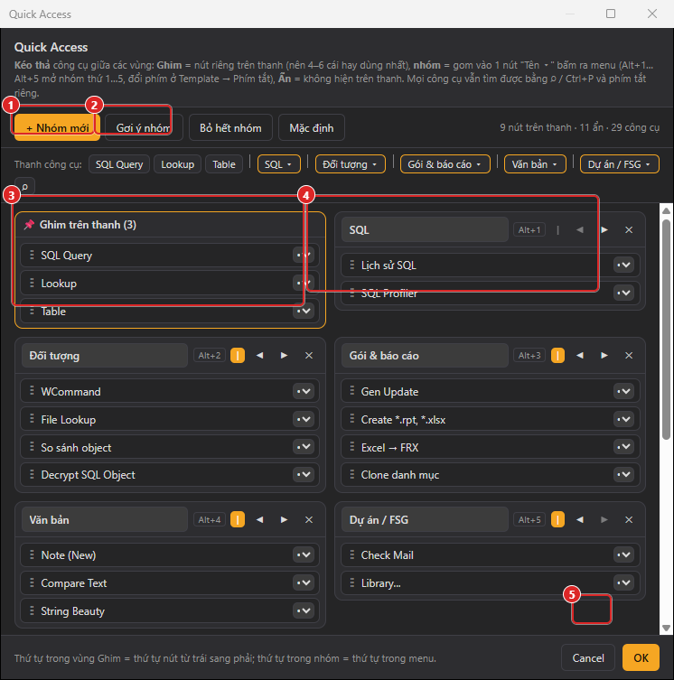

Trên ảnh: **①** ＋ Nhóm mới · **②** Gợi ý nhóm (chia sẵn) · **③** vùng 📌 Ghim trên thanh · **④** một nhóm (Alt+1…5 thả menu nhóm) · **⑤** OK để lưu.

Hàng nút dưới thanh trên, chia vùng bằng dấu "|": SQL (SQL Query, Lookup, Table, Command, Lịch sử SQL, SQL Profiler) · Object & source (WCommand, File Lookup, File Reference, Change Owner, So sánh object, Compare Structure) · Gói & báo cáo (Gen Update, Gen Update (Result), Create *.rpt *.xlsx, Excel → FRX, Clone danh mục…) · Văn bản (Note, Note (New), Compare Text, String Beauty) · Khác (Check Mail, Setup eInvoice, FSG Yêu cầu, FSG FBO, Library). Rê chuột lên nút để xem phím tắt.

**Quick Access** (★ trên thanh trên): kéo từng công cụ vào **📌 Ghim trên thanh** (nút riêng, nên 4–6 nút), vào **Nhóm** (gộp thành nút "Tên ▾"; `Alt+1`…`Alt+5` thả menu nhóm thứ 1…5) hoặc **🚫 Ẩn**. Nút **Gợi ý nhóm** chia sẵn nhóm SQL / Đối tượng / Gói & báo cáo / Văn bản / Dự án. Công cụ ẩn vẫn gọi được bằng phím tắt và `Ctrl+P`.

### Command Palette (`Ctrl+P`)

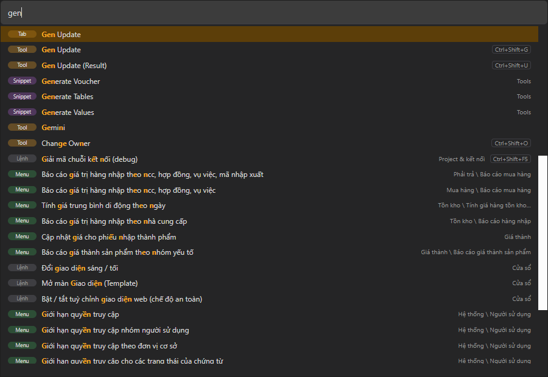

Ô tìm nhanh mọi thứ: tab đang mở, công cụ, lệnh, menu WCommand, object SQL, snippet. Gõ tiền tố để lọc: `>` công cụ / lệnh · `#` object SQL (đọc cache trên máy, không chạm database) · `@` menu WCommand · `$` snippet Library. `Enter` mở; `Shift+Enter` trên object SQL = "Ai đang dùng?"; `Esc` đóng.

### Tab

- `Ctrl+Tab` (`Ctrl+Shift+Tab` đi ngược) → **giữ Ctrl** thêm một chút (hoặc bấm `Tab` thêm lần nữa) thì hộp "Chuyển tab" hiện, sáng sẵn ở tab sẽ tới. Giữ Ctrl rồi bấm tiếp `Tab` / `↑ ↓` để chọn tab khác, **thả Ctrl là chuyển** (như Alt+Tab của Windows); `Enter` hoặc **bấm chuột** vào một tab trong hộp cũng chuyển (chỉ bấm mới chọn — rê chuột hay chuột nằm sẵn chỗ hộp hiện ra không đổi tab đang sáng); `Esc` / bấm ra ngoài để thôi. Bấm `Ctrl+Tab` nhanh rồi thả thì chuyển luôn, hộp không hiện — tới đâu tuỳ kiểu "Ctrl+Tab bấm nhanh" chọn ở Template → Cửa sổ: **Tab tới** (A → B → C) hoặc **Tab song song** (A ⇄ B, về tab vừa rời). Đổi phím `tab.next` / `tab.prev` sang tổ hợp không có Ctrl thì phím đó chuyển tab thẳng, không hiện hộp.
- `Ctrl+W` đóng tab (hỏi nếu chưa lưu) · `Ctrl+Shift+B` mở lại tab vừa đóng.
- Chuột phải tab: Pin Tab / Unpin Tab · Reopen Closed Tab · Close Tab · Close Other Tabs · Close Tabs to the Right · Close All Tabs (tab ghim không bị đóng hàng loạt).
- Chuột phải vùng trống thanh tab: **Tab đã đóng gần đây** và danh sách **Mở nhanh** các công cụ.

### Giỏ script (Script Cart)

- **Add Script** (`Ctrl+Alt+Shift+A`): ở tab Table → sinh script DELETE + nạp lại dữ liệu đang xem; ở tab SQL Query → lấy đoạn chọn (hoặc cả script) bọc header FCode + GO. Script được copy vào clipboard **và** thêm vào giỏ. Ở tab khác → chọn file `*.f;*.xml;*.sql` để thêm.
- **View Script** (`Ctrl+Alt+Shift+V`): xem giỏ "Script Cart (N files)". Giỏ trống thì cửa sổ vẫn mở với nội dung trống — dán script vào rồi **Save** được. Nội dung gõ / sửa tay trong cửa sổ **được giữ** khi đóng (Close, `Esc` hoặc nút X): mở View lại vẫn thấy, script Add thêm sau đó nối vào cuối; chỉ mất khi bấm **Clear** (trong cửa sổ hoặc **Clear Script**). **Clear Script**: xoá giỏ.
- **Save Script / Copy Script**: lưu / copy nội dung tab script đang mở.

### Thanh trạng thái

Bên trái: workspace + server đang dùng. Bên phải: **Login WLink** (bấm để mở web đăng nhập), nút **▾ Project** (mở nhanh thư mục Program / Source / Working / Mobile, **Copy Project Info**) và tên máy.

**Copy Project Info** ở đây chép ID, dòng `SQL: Server | User | Password | Sys Data | App Data`, link web và các đường dẫn để dán cho đồng nghiệp. Dòng SQL có **mật khẩu SQL** của dự án; dự án dùng Windows Authentication thì ô User ghi `Windows Authentication` và ô Password để trống. (Nút ⧉ Copy Project Info ở màn Projects thì không chép mật khẩu.)

<a id="sql-query"></a>
## SQL Query

Mở: nút **SQL Query** (`Ctrl+Shift+Q`). Mỗi lần mở là một tab mới.

### Chạy script

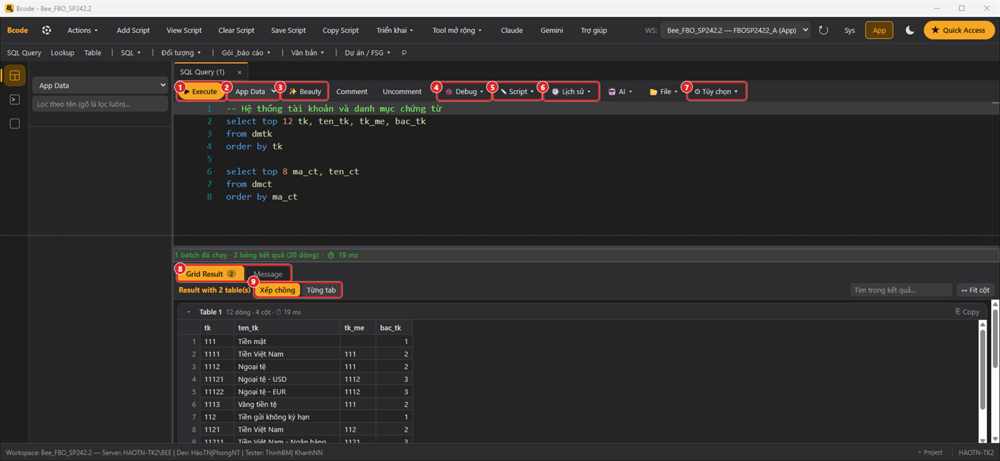

Trên ảnh: **①** ▶ Execute (`F5` / `Ctrl+Enter`) · **②** chọn database App / Sys · **③** ✨ Beauty (`F7`) · **④** nhóm 🐞 Debug · **⑤** nhóm ✎ Script (có Write Schema) · **⑥** nhóm 🕘 Lịch sử · **⑦** nhóm ⚙ Tùy chọn · **⑧** tab Grid Result / Message · **⑨** Xếp chồng / Từng tab.

1. Chọn database ở ô **App Data / Sys Data** trên thanh của tab (hoặc ô WS trên thanh trên). Tab SQL Query mới mở lấy sẵn database đang chọn ở ô WS (đang ở Sys thì tab mới là Sys Data). `Ctrl+2` đảo nhanh App ↔ Sys của riêng tab đang mở (đang ở editor, lưới kết quả hay thanh nút đều được), database trên thanh trên giữ nguyên; `Ctrl+1` thì đổi cả thanh trên lẫn tab.
2. Gõ / dán script (kéo thả file .sql vào editor cũng được — chế độ Web; file ≥ 50 MB bị từ chối). Mặc định gõ `'` chỉ ra một dấu (không tự chèn `'` đóng); muốn tự chèn như trước thì tick **Options… → Gõ ' tự chèn thêm ' đóng** (nhớ cho mọi tab, cả 2 chế độ). Ngoặc `( ) [ ] { }` và `"` luôn tự đóng (chỉ khi ngay sau con trỏ là khoảng trắng / cuối dòng / dấu đóng; nháy không tự đóng sau chữ); gõ dấu đóng vừa được tự chèn thì chỉ nhảy qua, `Backspace` giữa cặp vừa chèn xoá cả cặp; bôi đen rồi gõ `( [ { " '` vẫn bọc hai đầu.
3. `F5` hoặc `Ctrl+Enter` (nút **▶ Execute**): chạy **đoạn đang bôi đen**, không bôi đen thì chạy cả script. Script nhiều batch tách bằng `GO`.
4. Đang chạy: nút thành **■ Cancel** nền đỏ (hoặc `Alt+F5`) để dừng.
5. Dòng trạng thái báo số batch, số dòng kết quả, số dòng bị ảnh hưởng, thời gian. Có lỗi → tab **Message** tự mở (số thứ tự dòng, lỗi đỏ, PRINT màu nhấn, cảnh báo vàng, "(N rows affected)" mờ; ô **Wrap**, nút **Copy**), bấm dòng "Lỗi ở dòng N" (hoặc dòng "→ câu lệnh" ngay dưới) để nhảy tới dòng lỗi trong editor.
6. Script có `CREATE` / `ALTER PROCEDURE | FUNCTION | VIEW | TRIGGER` (không tính phần comment) thì sau khi chạy, **tên tab đổi thành tên object đó** (vd `dbo.stb_createBC1`; không ghi schema thì lấy `dbo.`) — mở nhiều tab vẫn biết tab nào đang sửa store nào. Script chỉ `EXEC` / `SELECT` thì giữ tên tab cũ.

`Ctrl+R` ẩn / hiện khung kết quả.

### Nhiều bảng kết quả

- Tab **Grid Result (n)** · **Message (n)** · **Pivot** (chỉ hiện khi kết quả có dạng pivot).
- Nhiều bảng: chọn **Xếp chồng** (các bảng xếp dọc, chế độ App kéo đổi cao từng bảng, double-click về cao tự động) hoặc **Từng tab**. Ô "Tìm trong kết quả..." (lọc dòng có ô chứa chữ gõ, giữ qua các lần chạy), **↔ Fit cột**, mỗi bảng có **⎘ Copy** và thời gian chạy ⏱ (cả 2 chế độ).
- Chọn nhiều ô số → hiện Average / Count / Sum (Web: thanh dưới lưới; App: cạnh nút Grid Result / Message). Chuột phải đúng **tên cột** → Sum / Max / Min / Avg value + màu chữ cột (cả 2 chế độ).
- Ô NULL hiện theo Template giao diện (NULL nghiêng / `[NULL]` / `—` / trống), ngày dạng `dd/MM/yyyy` (có giờ thì thêm `HH:mm:ss`) — cả 2 chế độ.
- Copy ô (cả chế độ Web lẫn App):
  - **1 ô** (`Ctrl+C`) = đúng giá trị gốc, không bọc ngoặc kép — copy JSON / script trong ô dán ra dùng được luôn.
  - **Nhiều ô** = dạng cột cách nhau bằng tab, dán thẳng vào Excel đúng cột. Ô có tab / xuống dòng (hoặc mở đầu bằng `"`) mới được bọc `"..."` để Excel giữ nguyên trong 1 ô, không vỡ dòng.
  - `Ctrl+Shift+C` = copy **tên cột** của ô đang chọn (chọn nhiều cột → các tên cách nhau dấu phẩy). Cần copy dữ liệu kèm dòng tiêu đề thì chuột phải → **Copy kèm tên cột**.
  - Chuỗi dài (HTML, XML, JSON, script… trong cột nvarchar(max) / xml / text): trên lưới chỉ hiện 4.000 ký tự đầu (đuôi `…`, nhị phân chỉ hiện vài byte đầu) cho lưới nhẹ, nhưng **copy luôn lấy đủ giá trị gốc** — Ctrl+C, Copy kèm tên cột, Copy cả bảng, nút ⎘ Copy đều vậy.
  - `Ctrl+F3` = **xem đủ giá trị ô** đang chọn (như FCode): mở cửa sổ xem chỉ đọc, tô màu theo nội dung (JSON / HTML / XML / SQL), `Ctrl+F` tìm, bôi đen copy được, `Esc` đóng. Cũng có ở chuột phải → **Xem đủ giá trị ô**. Đổi phím ở Template → Phím tắt → "Lưới kết quả SQL Query".
- Chuột phải ô: Copy (`Ctrl+C`) · Copy kèm tên cột · Copy cả bảng · Xem đủ giá trị ô (`Ctrl+F3`) · Goto Column (`Ctrl+G`, điền sẵn tên cột đang đứng) · Copy selected Column Name (`Ctrl+Shift+C`) · Copy All Column Name · Filter · Add Index Column Order · Generate Design Fields · Maxlength Column Content · Compare Column Content · Set Color Cell. Chuột phải tiêu đề cột: **Thống kê** Sum / Max / Min / Avg.
- **Generate Design Fields** (giống FCode): sinh khối `<fields>` + `<views><view id="Grid">` cho file Grid từ các cột của bảng kết quả, hiện trong hộp "Generate Design Fields In Grid" và copy sẵn vào clipboard. Quy tắc theo tên + kiểu cột:
  - Cột số → `type="Decimal"`, định dạng theo tên: tien/cp/dt/du → `@baseCurrencyAmountViewFormat` (có `_nt` → `@foreignCurrencyAmountViewFormat`), stt → `####`, ty_gia → `@exchangeRateViewFormat`, gia → `@baseCurrencyPriceViewFormat` / `@foreignCurrencyPriceViewFormat`, he_so/hs → `@coefficientViewFormat`, so_luong/sl/ton → `@quantityViewFormat`, ty_le/tl_ → `##0.00`, còn lại `### ### ### ##0.00`. Cột tiền, lượng, tồn, chênh lệch, đầu kỳ/cuối kỳ, t_*/tt* có thêm `aggregate="Sum"`.
  - Cột ngày → `type="DateTime" dataFormatString="@datetimeFormat"`; cột bit → `type="Boolean"` rộng 60; chữ ten_*/dien_giai/ghi_chu/note rộng 250; chữ ma_* → `@upperCaseFormat`; còn lại rộng 100.
  - so_ct/trang_thai/status → `align="right"` rộng 60; stt/dvt/ty_le rộng 60; stt_rec, sysorder, systotal, sysprint → `hidden="true"`; so_ct khi bảng có cả stt_rec và ma_ct → link mở chứng từ.
  - Tiêu đề `header v/e` lấy từ từ điển field Fast (header.xml); cột không có trong từ điển để `???`.
  - Cột là **khoá chính** của bảng nguồn có thêm `isPrimaryKey="true"` ngay sau `name` (đúng thứ tự file Grid của Fast); khoá nhiều cột thì đánh dấu đủ các cột có trong kết quả. Chỉ áp dụng khi kết quả lấy từ **1 bảng** và lần chạy (batch, giữa 2 dòng `GO`) ra đúng 1 bảng kết quả — vd `select * from dmku`. Join nhiều bảng, view, bảng #temp, nhiều SELECT trong cùng batch, EXEC procedure, kết quả khôi phục từ lần mở trước → sinh như cũ (không đánh dấu). Server SQL 2008 chỉ nhận ra với câu SELECT đơn (không có DECLARE/SET…). Bcode chỉ đọc cấu trúc câu lệnh (không chạy lại).
- Chuột phải ô → nhóm **Lưu ra file** (cả chế độ Web lẫn App, cả tab "Command Result" khi bật Result Tab):
  - **Xuất nhanh ra Excel (mở luôn)** (`Ctrl+E` khi con trỏ ở lưới kết quả): không hỏi nơi lưu — ghi file .xlsx vào thư mục tạm `%TEMP%\Bcode\Export` rồi mở ngay bằng Excel (file trong đó cũ hơn 7 ngày tự dọn; muốn giữ thì trong Excel bấm Save As).
  - **Save as Excel (.xlsx)…** · **Save as CSV…** (hỏi nơi lưu, chưa gán phím) — lưu **toàn bộ dòng** của bảng đang chuột phải, kể cả phần lưới không hiện hết (bảng rất lớn). Thứ tự và tên cột giữ như câu SELECT.
  - Chọn từ 2 dòng trở lên thì có thêm **Chỉ N dòng đã chọn → Excel / CSV** (theo đúng thứ tự đang hiện, mọi cột).
  - Hộp lưu file gợi ý tên theo tab + bảng + giờ (vd `SQL Query 2_Bảng 2_20261026_153012.xlsx`), nhớ thư mục lần trước. Lưu chạy nền, thanh trạng thái báo "Đang lưu… n / tổng dòng"; xong báo số dòng × số cột kèm link **Mở file** · **Mở thư mục**. File đang mở trong Excel thì Bcode báo, file cũ không bị hỏng.
  - **Excel**: dòng tiêu đề đậm, cố định + AutoFilter; số giữ kiểu số; ngày giữ kiểu ngày (`dd/mm/yyyy`, có giờ thì `dd/mm/yyyy hh:mm:ss`); chuỗi luôn là chữ nên mã `000123`, số điện thoại `0979…` không mất số 0 đầu; bit = 1/0; NULL = ô trống; số nguyên quá 15 chữ số (Excel làm tròn) ghi dạng chữ.
  - **CSV**: UTF-8 có BOM (Excel mở đúng tiếng Việt), dấu phẩy, ô có dấu phẩy / ngoặc kép / xuống dòng thì đặt trong ngoặc kép, NULL = ô trống, số dùng dấu chấm thập phân. Mở CSV bằng Excel thì Excel tự đoán kiểu theo cài đặt vùng của Windows (mất số 0 đầu, có thể hiểu sai dấu thập phân) — cần mở bằng Excel thì dùng Save as Excel.
  - Kết quả khôi phục khi mở lại Bcode / tab ngủ đông dậy không còn dữ liệu gốc → chạy lại truy vấn rồi lưu.
- Bật **Result Tab** (⚙ Tùy chọn) để mỗi lần chạy ra một tab kết quả riêng ("Command Result").
- Tab **Pivot** có nút **Tạo file Excel pivot…** (mở Create RPT & XML ở chế độ Pivot — cần key).
- Bcode nhận diện pivot theo thứ tự:
  1. `<pivot rowField columnField dataFields>` trong Grid controller của báo cáo (Source Path của workspace). Tên controller lấy từ lệnh `exec` cuối của script, bỏ tiền tố `rs_`; đọc được cả file controller `.xml` lẫn `.f`.
  2. Không đọc được controller thì đoán theo **quy tắc** trong file `pivot-rules.txt`. Mở file này ở **Settings → Pivot SQL Query: quy tắc đoán cấu trúc...**; chưa có file thì Bcode tạo từ mẫu mặc định.
- Mỗi dòng trong `pivot-rules.txt` là `khoá dòng | khoá cột | cột tiêu đề cột | field giá trị`. Ví dụ `ma_vt | ma_kho | ten_kho | so_luong, tien`.
  - Khoá dòng `*` = tự đoán: lấy cột chữ đầu tiên không phải cột hệ thống. Quy tắc `*` chỉ áp khi có thêm bảng định nghĩa kiểu Fast (cột `id`, `name` có dạng `so_luong$1`). Ví dụ có sẵn: `* | sysColumn`.
  - Lưu file rồi chạy lại script là áp dụng, không cần mở lại Bcode. Xoá file = quay về mẫu mặc định.

### Thanh nút (chế độ Web)

Mặc định ghim **▶ Execute**, ô database, **✨ Beauty**; còn lại gom nhóm:

| Nhóm | Mục |
|---|---|
| 🐞 Debug | Debug store/function · Debug từng bước (bật / tắt) |
| ✎ Script | Comment · Uncomment · Default Type (UPPER / lower Keyword — luôn đổi cả script, kể cả khi đang bôi đen; cả 2 chế độ) · **Write Schema** · Check Fields |
| 🕘 Lịch sử | 💾 Lưu lịch sử · Lịch sử sửa procedure / function |
| 🤖 AI | → Claude · → Gemini (gửi script sang tab AI) |
| 📂 File | Open · Save (file .sql) |
| ⚙ Tùy chọn | Suggest Param/Caret · Reset Connection · Result Tab · Wrap · Options… (Word Wrap, Gõ ' tự chèn thêm ' đóng, Copilot / AI, cỡ chữ) |

Chuột phải lên thanh → "Tùy chỉnh thanh SQL Query": kéo nút giữa Ghim / nhóm / Ẩn (áp cho mọi tab SQL). Toggle khác mặc định (mà không ghim) hiện thành chip trên thanh (cả 2 chế độ), vd **⚠ Giữ kết nối** khi tắt Reset Connection (kết nối được giữ giữa các lần chạy — transaction và bảng `#temp` còn nguyên).

Chế độ App: **▶ Execute**, ô database, **✦ Beauty**, Default Type, **Script ▾** (Comment, Uncomment, Beauty, UPPER/lower, Write Schema, Mở object dưới con trỏ ở tab mới), **Lịch sử ▾**, **File ▾**, **Tùy chọn ▾**.
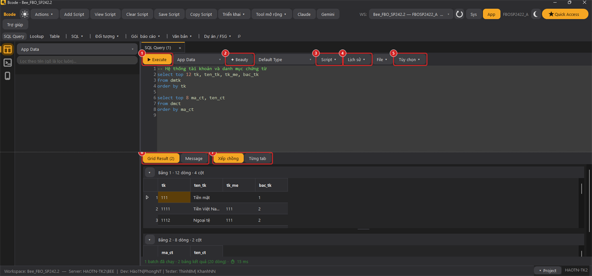

Trên ảnh: **①** ▶ Execute · **②** ✦ Beauty · **③** Script ▾ (Write Schema, Comment…) · **④** Lịch sử ▾ · **⑤** Tùy chọn ▾ · **⑥** Grid Result / Message · **⑦** Xếp chồng / Từng tab.


### Hỗ trợ khi viết SQL

| Phím / thao tác | Tác dụng |
|---|---|
| Gõ | Gợi ý bảng, cột, procedure, function, snippet theo database đang chọn. Bảng "gõ gì ra gì": ⚙ Settings → **Hướng dẫn gợi ý code SQL**. Mẫu Fast hay dùng (rút từ ~1.900 procedure FBO): `rsrep` / `rsrepq` / `rspivot` (khung báo cáo), `fcust` `fitem` `fsite`… (dòng lọc @Key), `part` (Partition$Execute), `bal…` (số dư), `tblcat` (CREATE TABLE danh mục chuẩn), `total` (dòng Tổng cộng), `dynf` (GetDynamicFields). |
| Gõ (ghost text Fast) | **Gợi ý theo cấu trúc Fast — không AI, không tốn token**: gõ tới đâu, chữ mờ gợi ý phần tiếp theo kiểu Fast, `Tab` nhận. Vd `IF @Customer <> ''` → ` SET @Key = @Key + ' and a.ma_kh like ''' + REPLACE(RTRIM(@Customer), …) + '%'''`; `EXEC FastBusiness$Partition$Execute ` → tham số; `GetCheckKey(` / `GetUnitFilter(` → tham số; `CREATE TABLE zdmxxx (` → đủ cột danh mục chuẩn + khoá; tên cột trong CREATE / ALTER ADD / `DECLARE @ma_kh` → kiểu hay dùng nhất của cột đó trong database; `CASE WHEN @Language = 'V' THEN ten_kh` → ` ELSE ten_kh2 END AS ten_kh`; `SET NOCOUNT ON` ↵ → `SET ANSI_NULLS OFF`; trước `END` cuối → `SET NOCOUNT OFF / SET ANSI_NULLS ON`. Tham số / dòng lọc lấy từ **ma trận kiến thức Fast** (cách viết hay gặp nhất theo từng routine + ngữ cảnh, rút từ 2.291 procedure/function thật): bỏ cách dùng biến mà store chưa khai báo, tự điền biến được gán trên dòng (vd `SET @Key2 = …GetCheckKey(` → `@Key2)`), dòng lọc theo văn phong dòng lọc ngay phía trên (alias, `CASE WHEN @Key = ''…`); chưa đủ chắc thì chỉ gợi ý phần đầu chắc chắn, không chắc thì **không gợi ý**. Ngoài các chỗ trên còn 2 lớp gợi ý chung ở **giữa dòng bất kỳ**: **theo chính file** — cả phần đã gõ của dòng trùng một đoạn đã có trong file, **phía trên hoặc phía dưới** con trỏ (bỏ qua hoa thường, xuống dòng, dấu phẩy đầu dòng), thì gợi ý phần viết tiếp ở chỗ đó: khớp càng dài gợi ý càng dài — 1 token, 3 token rồi 8 token (vd đã có `loai_kh = CASE WHEN loai_kh ='100000002' THEN '0'`, gõ `, loai_kh = case when loai_kh = '100000002' then ` → `'0'`; chèn `INSERT INTO #apiError SELECT TOP 1 'nh_kh1', N'Group1 not exists in master data' FROM ` phía trên dòng giống hệt → `#dmkh WHERE nh_kh1`; `Tab` rồi gợi ý tiếp); **ma trận đầu dòng** — vài token đầu dòng quen thuộc → phần còn lại (vd `LEFT JOIN dmkh b ON ` → `a.ma_kh = b.ma_kh`, `WHILE @@FETCH_STATUS = ` → `0 BEGIN`, `IF @UnitKey IS NOT NULL ` → `SET @Key = …`). `DECLARE @biến ` (cả biến sau dấu phẩy trong cùng dòng) → kiểu: biến cùng tên đã khai báo trong file → y kiểu đó, không thì kiểu hay dùng nhất của biến tên đó trong code Fast (vd `DECLARE @Key ` → `NVARCHAR(4000)`; kiểu theo chữ hoa / thường đang gõ); biến tên lạ (vd `@Beetest`) không đoán. Đo trên store chưa dùng để học: **đúng ~92% khi có gợi ý** (hàm Fast 90,6%, EXEC 90,6%, lọc 98%, song ngữ 98%, DECLARE 91,9%, giữa dòng bất kỳ 90%). **2 chế độ: dài (mặc định) / ngắn.** Đổi qua lại bằng `Alt+Shift+\` (gợi ý lại ngay theo chế độ mới, dòng trạng thái báo đang DÀI hay NGẮN) hoặc Tùy chọn → **Gợi ý Fast dài** (có dấu tick = dài; lưu cho mọi tab). *Ngắn* = chỉ gợi ý khi chắc ≥ 90%. *Dài* = gợi ý dài hơn, chấp nhận kém chắc hơn (không qua ngưỡng 90%, không gọi AI; không có gợi ý dài thì dùng gợi ý ngắn): lấy cả phần còn lại của dòng ở chỗ giống trong file (vd gõ lại `select top 0 5 as sysorder` → `, 1 AS sysprint, 1 AS systotal, a.stt_rec, …`), hoặc phần chung mà đa số chỗ giống cùng viết (vd `set @q = ` giữa các dòng `SET @q = @q + …` → `@q +`), hoặc kiểu hay gặp nhất của biến (biến mới chưa gặp, vd `declare @z` → kiểu của biến khai báo gần nhất phía trên), `if @customer` → cả điều kiện lọc theo mẫu các dòng IF xung quanh. **Ma trận token (gợi ý giữa dòng bất kỳ)**: ngoài các luật trên, Bcode học "sau mấy token này thường là token gì" từ toàn bộ store (mô hình n-gram 1–4 token, nội suy kiểu Kneser-Ney — đếm, không AI), trộn thêm cách viết của chính file đang sửa (tên biến / bảng riêng của file), rồi kéo dài gợi ý từng token tới khi không còn đủ chắc; không gợi ý biến chưa khai báo phía trên. Nhiều nguồn cùng có gợi ý thì lấy gợi ý dài nhất mà mỗi nguồn vẫn đủ ngưỡng. Đo trên store KOG (giữa dòng bất kỳ): chế độ ngắn gợi ý ở ~38% chỗ, đúng ~91% (trước đây ~16%); chế độ dài gợi ý ở ~62% chỗ, đúng ~63%. Ma trận token có sau khi bấm **Học dự án này** / **Học gợi ý Fast từ database này** bằng bản mới (dự án học bằng bản cũ thì dùng ma trận đi kèm Bcode cho tới khi học lại). **Dòng trống → câu tiếp theo**: vừa Enter xuống dòng trống, Bcode gợi ý cả dòng hay viết ngay sau dòng code phía trên trong store Fast thật (vd sau `IF @filterKey <> '' SET @Key = …` → `SET @Key = dbo.FastBusiness$Function$System$GetCheckKey(@Key)`); dòng đã có ngay bên dưới thì không gợi ý lại. Không có câu quen thuộc thì gợi ý theo **cấu trúc khối**: lùi lề (`Backspace` / `Shift+Tab`) về đúng cột của `BEGIN` chưa đóng → `END` (`BEGIN TRY` → `END TRY`; chữ thường nếu `begin` viết thường), sau `CLOSE c` → `DEALLOCATE c`; chế độ dài thêm sau `OPEN c` → `FETCH NEXT FROM c INTO …` (chép lệnh FETCH của c đã có phía trên), sau `WHILE …` → `BEGIN`. Đo trên store KOG: chế độ ngắn gợi ý ở ~14% dòng trống (trước 9%), đúng ~92%; chế độ dài đúng ~77% và gợi ý ở nhiều chỗ hơn. **Store anh em**: các cách trên đều không có gợi ý thì Bcode tìm 3 procedure / function trong database đang kết nối dùng nhiều bảng / cột / biến giống store đang viết nhất (cùng nghiệp vụ, bản chép z…) và lấy cách viết tiếp ở dòng giống bên đó — cả giữa dòng lẫn dòng trống. Chỉ đọc (SELECT `sys.sql_modules`), lần đầu dựng ở nền vài giây, 15 phút dựng lại một lần. Đo trên store KOG: chế độ ngắn gợi ý ở ~34% chỗ (trước ~24%), đúng ~91%, gợi ý đúng điền hộ ~14% số ký tự (trước ~4%); chế độ dài ~69% chỗ (trước ~46%). Gợi ý tính ở nền nên store dài không còn làm khựng khi gõ. **Ghép điều kiện lọc** (chỉ chế độ dài; cột của tham số lấy thêm từ Filter của Fast — tiêu đề tiếng Anh của ô lọc là tên tham số, vd `ma_kho` e="Site" ↔ `@Site`; đo trên KOG: ghép được 25 chỗ thay vì 15, đúng 17): `IF @Lot <> ''` với tham số chưa có trong ma trận → lấy dòng lọc gần nhất trong file làm khuôn (giữ like / =, RTRIM, '%', alias…), thay tên biến + cột của tham số (cột lấy từ chỗ dùng trong script, bảng biến chuẩn, từ điển field) — đo trên KOG đúng ~80% các chỗ ghép được; các cách ghép khác (mượn ô của tên cùng nghĩa, khuôn theo đuôi …List, dòng lọc chuẩn) đo dưới 20% nên không dùng. Tùy chọn → **Học gợi ý Fast từ database này (chỉ đọc)…**: học lại từ chính database đang kết nối (chỉ SELECT `sys.sql_modules`, 3–5 phút), tự chọn ngưỡng để đúng ≥ 90% (bảng kết quả báo cả **gõ hộ** = bao nhiêu % ký tự code thật được gợi ý đúng điền hộ — gợi ý 1 từ và gợi ý cả dòng đều tính "đúng" như nhau, con số này cho biết gợi ý giúp được bao nhiêu), lưu riêng `%AppData%\Bcode\ghost\<dự án>_app.json` và tra trước ma trận đi kèm. Chạy trước ghost text AI; tắt / bật: Tùy chọn → **Gợi ý theo cấu trúc Fast khi gõ (không AI)**. |
| `Ctrl+/` | Bật / tắt chú thích dòng `--` cho dòng hiện tại hoặc các dòng đang chọn (như VS Code) |
| `Ctrl+K` rồi `Ctrl+C` / `Ctrl+K` rồi `Ctrl+U` | **Comment** / **Uncomment** các dòng đang chọn (chuỗi phím như VS Code) |
| `Alt+Shift+A` | Chú thích khối `/* ... */` quanh đoạn chọn (bấm lần nữa để gỡ) |
| `F7` | **Beauty** — định dạng lại đoạn chọn (đoạn mới vẫn được bôi đen) / cả script; `Ctrl+Z` quay về đúng bản trước khi Beauty (Default Type, nạp bản từ Lịch sử cũng vậy) |
| `F12` | Xem nhanh (peek) object dưới con trỏ hoặc mọi tên trong đoạn chọn (tối đa 40): bảng → cấu trúc, procedure / function / view / trigger → code. Tìm database đang chọn trước, rồi database kia. Nhiều object: dải chip từng object (bấm để xem) hoặc nút **Gộp 1 trang**; `Ctrl+PgDn` / `Ctrl+PgUp` sang object kế / trước (cả 2 chế độ). Đứng trên **biến** `@x` thì khung peek hiện cả script, cuộn tới **chỗ khai báo** (tham số store hoặc `DECLARE`) trong lô hiện tại và tô xanh dòng đó. |
| `Ctrl+F12` | Mở object dưới con trỏ sang tab SQL Query mới |
| `Ctrl`+chuột phải lên tên procedure / function / view | Chèn định nghĩa của nó lên **đầu script** + `GO` (đã có thì nhảy tới); `Ctrl+Z` để bỏ. Lên tên **bảng** (`dmkh`, `dbo.dmkh`, `[dmkh]`) thì mở **cấu trúc bảng** (CREATE TABLE, khối DROP để trong comment) sang tab riêng như "Mở định nghĩa" ở cây SQL Object. Tìm database đang chọn của tab trước, không có mới tìm database kia |
| `Ctrl+I` | AI sửa / sinh SQL theo yêu cầu (gõ yêu cầu, `Ctrl+Enter` gửi, xem lại rồi **Insert**). Cần API key: ⚙ Options → Cấu hình Claude / Gemini API Key. |
| `Alt+\` | Gọi gợi ý AI (ghost text) ngay |
| `Alt+Shift+\` | Đổi gợi ý Fast dài ⇄ ngắn (mặc định dài) rồi gợi ý lại ngay — không AI |
| `Ctrl+Shift+M` | Mở **Hỏi Fast** — chat tra kiến thức Fast, không AI ([Hỏi Fast](#hoi-fast)) |
| `Ctrl+Alt+H` | Lưu đoạn chọn / script vào **Lịch sử SQL** |
| `Alt+Z` | Bật / tắt tự xuống dòng |
| `Ctrl+F` / `Ctrl+H` | Tìm / Tìm & thay thế (Thay = 1 chỗ rồi sang chỗ kế, **Thay hết** = 1 lần `Ctrl+Z` hoàn tác; không phân biệt hoa thường) |
| `Ctrl+Shift+D` | Thêm con trỏ ở chỗ giống tiếp theo — sửa nhiều chỗ một lúc; `Esc` bỏ các con trỏ phụ |
| `Ctrl` + lăn chuột / `Ctrl+0` | Phóng to / thu nhỏ chữ — ô `100%  −  +  Đặt lại` góc phải editor (gõ số % rồi `Enter`, 30–500) |
| Bấm lề trái | Đặt breakpoint (dùng cho Debug từng bước) |
| Check Fields | Đối chiếu danh sách field với **bảng kết quả đang chọn** (như FCode) — xem [Check Fields](#check-fields) bên dưới |

Chuột phải trong editor: snippet theo nhóm (Library), Cut / Copy / Paste, Beauty Format; khi có vùng chọn: **Change Field to:** MAX / MIN / SUM / COUNT / AVG, **Alias** (gắn / bỏ tiền tố a., b.…), ISNULL…; Hỏi AI (cả 2 chế độ; chế độ App có thêm Execute, Select All, Comment / Uncomment, Mở object dưới con trỏ ở tab mới).

> **Lưu ý:** `Ctrl` + lăn chuột (hoặc ⚙ Tùy chọn → Tăng / Giảm cỡ chữ) đổi cỡ chữ editor, `Ctrl+0` về mặc định.

<a id="check-fields"></a>
### Check Fields — field có khớp với bảng kết quả không

Dùng khi cần biết các field (của Grid, của yêu cầu…) có đúng tên cột mà câu SQL trả ra không — như nút Check Fields của FCode.

1. Chạy câu lệnh / procedure (`F5`) cho ra bảng kết quả.
2. Có **nhiều bảng**: bấm vào bảng cần kiểm (chế độ **Từng tab** thì lấy bảng đang hiện). Chỉ 1 bảng thì không cần.
3. Bấm **Check Fields** (Web: nhóm **✎ Script ▾**; App: nút trên thanh / nhóm Script) → ô **Fields** thả xuống dưới nút.
4. Dán danh sách field, ví dụ `ma_vt, ten_vt, ten_khach_hang`, rồi `Enter` hoặc ✓.

Bcode báo **Not matched (k/n)** kèm các field không có trong bảng và **Khớp m/n field**; khớp hết thì báo **Matched**.

- Tách field theo dấu phẩy, chấm phẩy, xuống dòng, Tab hoặc khoảng trắng (dán cả cột copy từ Excel được). Bỏ `[ ]`, nháy, dấu `~`, tiền tố bí danh (`a.ma_kh` → `ma_kh`); không phân biệt hoa thường.
- `ten_kh%l` = phải có cả `ten_kh` và `ten_kh2`.
- Dán **đường dẫn file Grid / Dir / Filter** (`.xml` / `.f`) thay cho danh sách → Bcode lấy các `<field name>` trong `<fields>` của file (bỏ `external="true"` và phần đã comment) để đối chiếu, kèm kiểm **kiểu**: `Decimal` / `Int` phải là cột số, `Date` / `DateTime` là cột ngày, `Boolean` là cột bit, còn lại là cột chuỗi.
- File Grid mà kết quả có nhiều bảng: Bcode tự lấy bảng theo `<dir id="N">` của file **Filter cùng tên** (N tính từ 0 — procedure trả 3 bảng 0, 1, 2 thì `id="1"` là bảng thứ 2), không cần bấm chọn bảng.
- Dòng **Kiểm bảng / cột trong script (SET NOEXEC ON)** dưới ô Fields giữ chức năng cũ của nút: kiểm mọi bảng / cột trong script có tồn tại mà không chạy thật.
- Ô Fields nhớ chữ đã gõ cho lần mở sau. Gán phím tắt: Template → Phím tắt → **Check Fields** (mặc định chưa có phím).

> **Lưu ý:** việc đối chiếu chỉ so tên cột của kết quả đã có trong Bcode — không chạy gì thêm xuống SQL Server, không ảnh hưởng tốc độ báo cáo. Chưa chạy gì thì báo "Chưa có bảng kết quả".

<a id="hoi-fast"></a>
## Hỏi Fast — chat tra kiến thức Fast (không AI)

Mở bằng `Ctrl+Shift+M` (đổi được trong Settings → Phím tắt) hoặc công cụ **Hỏi Fast**. Gõ câu hỏi bằng tiếng Việt (có dấu hay không đều được), Bcode tra trong kiến thức có sẵn — **không gọi AI, không tốn token**, trả lời ngay. Câu nào cần thêm thông tin thì hỏi lại bằng nút bấm. Đang ở tab **SQL Query** mà bật *Tùy chọn → Claude/Gemini nhúng vào tab SQL Query* thì Hỏi Fast mở **nhúng bên phải tab đó** (thanh đầu Claude · Gemini · Hỏi Fast · ✕, chuyển qua lại vẫn giữ cuộc hỏi; Chèn vào SQL Query chèn thẳng vào tab đó); tắt mục này thì mở thành tab riêng.

| Hỏi | Trả lời |
|---|---|
| `tạo báo cáo …` (vd *tạo báo cáo bảng kê xuất kho*) | Store báo cáo có sẵn trong database có tên giống yêu cầu, rồi hỏi lần lượt: loại báo cáo (bảng kê / tổng hợp / PIVOT) → bảng phân kỳ — chọn **1 hoặc nhiều** (đếm số store đang dùng mỗi bảng, vd `r00`, `r70`; nhiều bảng thì mỗi bảng 1 lần `Partition$Execute` vào cùng `#report`, cột kết quả là cột có ở mọi bảng) → tham số lọc (chọn nhiều: kho, khách, vật tư, tài khoản, số chứng từ từ – đến…) → thêm trường động / dòng tổng cộng / song ngữ. Kết quả: **khung store báo cáo** đủ tham số, `@UnitKey`, dòng lọc `@Key` theo cách viết hay gặp nhất, `#report` sysorder, `Partition$Execute`; cột kết quả lấy đúng cột có trong bảng (tổng hợp thì `SUM` cột tiền / số lượng). Kèm store thật giống nhất và cách gọi các hàm hay dùng. |
| **Save as** từ báo cáo có sẵn: chọn ở bước loại báo cáo, nút **Save as…** trên thẻ store, hoặc gõ `save as rs_rptStockCard` | Chọn store nguồn (câu hỏi chưa nêu báo cáo nào thì hiện các store báo cáo `rs_` / `zrs_` sửa gần đây; gõ 1 phần tên như `StockCard` hoặc tên tiếng Việt như *thẻ kho* để tìm — 1 store khớp thì lấy luôn, nhiều thì cho chọn) → nhập tên mới (gợi ý `zrs_…` / `…_Copy`) → toàn bộ định nghĩa store nguồn với dòng CREATE đổi sang tên mới. Chỉ đọc database — chạy script ở SQL Query mới tạo store; tên mới đã có thì báo trước. |
| `tạo danh mục …` | Hỏi tên + các cột → nút **Mở Tạo nhanh danh mục (theo luật Fast)** (điền sẵn theo luật, như nút ⚙ Theo luật Fast) hoặc chỉ lấy bảng: `CREATE TABLE` theo luật (ma_/ten_/ten_2, ghi_chu, status, datetime0/2, user_id0/2) **cộng đúng các cột bạn nhập** — gõ tên cột (`test`, `ten_test`) thì giữ nguyên, gõ tiêu đề (`Mã kho`, `ngày hiệu lực`) thì tra từ điển field / đặt tên theo luật (`ma_kho`, `ngay_hieu_luc`), kiểu theo tên cột. Tên bảng đã có (vd `dmvt`) thì ra `ALTER TABLE … ADD` cho các cột chưa có, không tạo lại bảng. |
| Tên bảng: `dmkh` · `hddt03` · `join r70 dmvt` · `xem cấu trúc bảng kho` · `join khách hàng và vật tư` | Cấu trúc bảng (cột, kiểu, khoá, identity, mô tả) + câu SELECT mẫu; 2 bảng thì câu **JOIN** theo khoá của bảng sau / cột mã chung. Gõ tên gốc của bảng phân kỳ (`hddt03`, `r70`) → bảng gộp `…$000000`; gõ tên tiếng Việt → bảng mà field "Mã …" tra cứu vào (kho → dmkho, khách hàng → dmkh). Đầu thẻ có **bảng này là gì / dùng làm gì**: chứng từ dùng bảng (dmct), danh mục của field nào, quy ước đặt tên Fast (dm, ph/ct, r, cd, hddt, sys, z…), bảng phân kỳ, và các store / view đang dùng bảng. |
| Tên hàm / store: `FastBusiness$System$GetSiteFilter`, `ff_…`, `rs_…` · `rs_rptStockCard làm gì` · `store nào dùng bảng hddt03` | Store có trong database: thẻ **tóm tắt** đầu tiên — menu gọi store, tham số, bảng đọc / ghi, cột `#report`, store / hàm gọi tới (đọc định nghĩa, chỉ đọc). Hỏi *store nào dùng bảng …* → danh sách store / function dùng bảng. Hàm: cách gọi hay gặp nhất kèm số lần (ma trận ghost text), nút mở định nghĩa, các store đang gọi nó. |
| `tra trường tài khoản đối ứng` · `trường ma_kho` | Trường trong từ điển field Fast (header.xml): tiêu đề Việt / Anh, kiểu, lookup. |
| `%Partition` · `%[ ]%` · `sysorder` · `@Key` · `song ngữ` · `số dư` · `quy ước fast` | Quy ước khi viết / chạy store Fast kèm mẫu code. Câu nêu rõ đối tượng thì chỉ hiện mẫu đúng đối tượng đó, vd *số dư đầu kỳ theo vụ việc* → chỉ mẫu `FastBusiness$Balance$Job`; *số dư cuối kỳ theo khách hàng* → mẫu Customer đã đổi sang `@DateTo`, loại số dư 2; *số dư vụ việc khách hàng* → `JobCustomer_new`. |
| `viết store …` · `function …` | Khung store / function + SQL động, cursor + store có sẵn liên quan. |
| Chi tiết 1 báo cáo / màn hình (đọc source Fast): *thẻ kho có những điều kiện lọc nào* · *mẫu in của báo cáo thẻ kho* · *chứng từ HD5 lưu ở bảng nào* · *màn hình phiếu nhập kho có những trường nào* | Đọc controller XML của dự án (`<Source Path>\App_Data\Controllers`: Filter / Grid / Report; lần đầu đọc ở nền, khoảng nửa phút qua ổ mạng — trong lúc đó dùng mẫu Fast đi kèm Bcode): thẻ tóm tắt báo cáo có **mẫu in**, **cột trên mẫu in**, **điều kiện lọc** (từ Filter; không có Filter thì suy từ tham số store: `@Site` → `ma_kho` → "Kho"); màn hình chứng từ / danh mục có **bảng lưu**, **mã chứng từ**, **các trường** (tiêu đề Việt). Gõ mã chứng từ (HD5, PN1…) → màn hình của chứng từ đó. |
| Đếm / liệt kê / thông tin dự án: *Có bao nhiêu danh mục trên chương trình* · *có bao nhiêu báo cáo* · *bao nhiêu store* · *liệt kê các loại chứng từ* · *có bao nhiêu bảng phân kỳ* · *dự án này dùng database nào* | Số thật từ database (chỉ đọc): danh mục / báo cáo / chức năng theo menu wcommand (Sys Data, đếm theo controller), loại chứng từ (dmct), store / function / view / trigger / bảng / bảng phân kỳ (sys.objects), người sử dụng, số trường trong từ điển field, số dự án khai báo trong Bcode; thẻ kèm câu SQL đã dùng (chèn / copy được) và nút **Liệt kê hết** / **Chỉ đếm**. *Dự án này dùng database nào* → server, App / Sys Data, mã phiên bản, đường dẫn của dự án đang chọn (không hiện mật khẩu). Hỏi số cột của 1 bảng (*bảng dmkh có bao nhiêu cột*) → thẻ cấu trúc bảng. |
| Câu khác — tên báo cáo / nghiệp vụ (vd *thẻ kho*, *Báo cáo tồn theo kho*, *Bảng cân đối kế toán theo đơn vị cơ sở*), tên mẫu code, tên bảng tiếng Việt | **Tìm chung có xếp hạng** (BM25) trên mọi kiến thức: menu báo cáo / chức năng trong Sys Data (tiêu đề tiếng Việt → store `rs_…` của báo cáo đó), store, mẫu code, quy ước, bảng (kèm tiêu đề field tra cứu vào bảng và tên chứng từ dùng bảng), field; cụm 2 từ khớp đúng được ưu tiên. Câu kiểu tên báo cáo có thêm nút **Dựng khung báo cáo này**. Chỉ câu muốn **tạo** (*tạo / làm / viết / dựng … báo cáo / danh mục / store*) mới vào luồng tạo; câu chỉ nhắc tên báo cáo / danh mục thì tìm cái có sẵn. |

Nút trên mỗi thẻ: **Chèn vào SQL Query** (chèn tại con trỏ của tab SQL Query dùng gần nhất — chưa có thì mở tab mới), **Mở tab SQL mới**, **Copy**, **Mở nội dung**, **Save as…** (store / function). Nút **App / Sys** trên đầu chọn database để tra bảng, store; **＋ Mới** = bắt đầu cuộc hỏi mới.

**Học dự án — dùng chung cho dự án sau.** Nút **📚 Học dự án này** đọc store của database đang chọn (chỉ đọc, 3–5 phút) rồi học: cặp JOIN giữa các bảng và điều kiện ON hay dùng, cột `#report` theo từng bảng phân kỳ, cột ngày truyền `Partition$Execute`, tham số hay có của store báo cáo, cùng ma trận ghost text của dự án (tự đo độ chính xác). Kiến thức gộp vào **kiến thức chung** (mặc định trên máy: `%AppData%\Bcode\fastask\`, `%AppData%\Bcode\ghost\_shared.json`; khai **Template → Đường dẫn → Thư mục kiến thức** là 1 thư mục mạng thì các máy dùng chung) — dự án sau chưa học vẫn dùng được: JOIN lấy đúng điều kiện đã học, khung báo cáo lấy cột `#report` và cột ngày hay dùng của bảng, bước chọn tham số lọc có thêm tham số hay có trong dự án.

**✎ Sửa.** Thẻ có code có nút **✎ Sửa**: sửa ngay trong thẻ → **💾 Lưu bản sửa** — các nút Chèn / Copy / Mở tab dùng bản sửa, và Bcode ghi nhớ như ✘ + gõ cách đúng (lần sau hỏi giống vậy hiện **Câu trả lời bạn đã sửa** đầu tiên; thẻ cách gọi hàm thì ghost text cũng dùng cách sửa).

**Xác nhận ✔ / ✘.** Cuối mỗi thẻ, bên phải hàng nút có **Kết quả này: ✔ Đúng · ✘ Chưa đúng**: ✔ thì lần sau hỏi tương tự thẻ đó lên đầu (ghi "Đã được xác nhận"); ✘ thì thẻ không hiện lại cho câu hỏi đó và Bcode hỏi cách đúng — gõ / dán vào ô chat: với cách gọi hàm (ô ma trận) thì cách bạn gõ được dùng **trước tiên** cho cả ghost text lẫn Hỏi Fast ở mọi dự án; với khung báo cáo / câu trả lời khác thì lần sau hỏi giống vậy hiện **Câu trả lời bạn đã sửa** đầu tiên. Xác nhận lưu ở `%AppData%\Bcode\fastask\feedback.json`.

**Dừng giữa chừng.** Đang trong luồng hỏi lại (tạo báo cáo, danh mục, save as, sửa câu trả lời) mà muốn thôi: gõ `bỏ qua`, `thôi`, `hủy`, `dừng`, `quit`, `cancel`… hoặc bấm **✕ Dừng** cạnh các nút chọn → Bcode ngừng luồng đó, câu hỏi tiếp theo được hiểu như câu mới.

**Bảng tra nạp thêm (📥 Nạp kiến thức).** Nút **📥 Nạp kiến thức** trên đầu Hỏi Fast nạp bảng tra Excel của nhóm — mỗi sheet có dòng tiêu đề với cột *Mã số* (hoặc *Mã lỗi*) và *Nội dung* (hoặc *Mô tả*), thêm *Nghiệp vụ*, *Mô hình*, *Ghi chú* / *Diễn giải* nếu có; dòng chỉ có 1 ô là tên nhóm. Lưu ở thư mục kiến thức (`fastask\notes\<tên file>.json`, không đưa vào repo); nạp lại cùng tên file = thay bản cũ; thư mục kiến thức dùng chung thì cả nhóm cùng thấy. Đã nạp sẵn: **lỗi hoá đơn điện tử (HĐĐT)** — mã lỗi Tổng cục Thuế 2021 / 2022, diễn giải lỗi TCT, lỗi phát hành token / HSM, huỷ, máy tính tiền (965 mục). Kiến thức hỏi đáp lấy từ **forum** (FRD / TK2 Help) **không còn dùng**: file / mục có tên forum, FRD hoặc kèm link bài forum bị bỏ qua khi nạp, nút 📥 cũng không nhận file tên forum. Hỏi: gõ mã lỗi (*lỗi 435*, *hddt 152*, *mã lỗi 20001 nmdctdtu*) → các mục của mã đó, mục khớp chữ còn lại lên đầu; hoặc nội dung (*chứng thư số hết hạn*, *hoá đơn treo không phát hành được*, *lỗi import hóa đơn mua hàng trong nước*) → mục / bài khớp nhất. Đo trên 15 câu thử: thẻ đầu đúng ~87%, trong 3 thẻ đầu ~93%.

**Hỏi về chính Bcode.** Hỏi Fast trả lời cả câu hỏi về chức năng của Bcode: *menu tra ảnh lỗi ở đâu*, *muốn chuyển excel sang frx*, *xem procedure được dùng ở đâu*, *so sánh object*, *sơ đồ phụ thuộc*, *khai báo api nằm ở đâu*, *phím tắt chạy script*, *bcode có những chức năng gì* (nút gợi ý **Chức năng Bcode**). Thẻ trả lời ghi **Ở đâu** (thanh công cụ / nhóm Quick Access / Triển khai ▾ / Tool mở rộng ▾ / ⚙ Settings / Actions ▾ / chuột phải trên cây…), **Cách mở** (nút, phím tắt hiện hành, `Ctrl+P`) và mô tả ngắn; nút **▶ Mở ngay** mở thẳng chức năng, **📖 Xem hướng dẫn** mở đúng mục Trợ giúp. Danh sách lấy từ chính Bcode lúc chạy (nút công cụ theo cách bạn đang sắp thanh công cụ, menu Settings / Actions, bảng phím tắt) và từ tài liệu Trợ giúp này, nên công cụ mới tự có mặt. Từ đồng nghĩa / viết tắt và mô tả thêm nằm ở `Templates\fastask\bcode-features.json` cạnh Bcode.exe (sửa không cần build). Câu muốn **tạo** báo cáo / danh mục vẫn đi luồng Fast như cũ, thẻ chức năng Bcode tương ứng (vd **Tạo báo cáo**, **Tạo nhanh danh mục**) thêm ở cuối.

**Tìm trong cuộc hỏi (`Ctrl+F`).** Mở thanh tìm ở đầu khung chat: gõ chữ cần tìm (có hoặc không dấu, không phân biệt hoa thường) → chữ khớp được tô màu, ô bên cạnh báo *n/m*; `Enter` / `Shift+Enter` (hoặc ▼ / ▲) sang kết quả kế tiếp / trước; `Esc` (hoặc ✕) đóng và bỏ tô màu.

**Lịch sử.** Mỗi cuộc hỏi tự lưu thành 1 phiên (tên = câu hỏi đầu, như Claude) — đóng tab không mất. **☰ Lịch sử** mở danh sách bên trái: bấm để mở lại và hỏi tiếp, 🗑 xoá từng phiên, **Xoá tất cả**.

> **Lưu ý:** Hỏi Fast chỉ ĐỌC database (danh sách bảng, store, cột). Khung store là điểm bắt đầu — sửa tên, cột kết quả rồi chạy thử trước khi dùng. Kiến thức lấy từ: mẫu code Fast, ma trận ghost text, database đang kết nối, từ điển field, luật danh mục, quy ước Fast.

<a id="debug-sql"></a>
## Debug từng bước (SQL)

Có ở cả **chế độ Web** lẫn **chế độ App** (cùng phím, cùng thanh Step / Continue / To cursor / Back / Tìm lỗi / SQL động / Stop). Chế độ App: nhóm 🐞 Debug mặc định ẩn trên thanh nút — bật lại ở **Options… → Tùy chỉnh thanh nút…** hoặc dùng thẳng phím.

### Bắt đầu

- **Cách 1 — debug script đang mở**: nhóm 🐞 Debug → bật **Debug từng bước**, rồi `F5`.
- **Cách 2 — debug store / function được gọi trong script**: 🐞 Debug → **Debug store/function** → hộp "Chọn store/function để debug" liệt kê các câu EXEC / gọi function (Dòng, Loại, Đối tượng, Câu gọi) → chọn → **Debug**. Bcode mở tab mới chứa code của object đó.
- Object có tham số → hộp "Debug từng bước — tham số": nhập giá trị dạng T-SQL (`'chuỗi'`, số, `NULL`); ô được điền sẵn từ câu EXEC, không có thì lấy DEFAULT → **Bắt đầu debug**.
- Script dạng `ALTER PROCEDURE …` + `GO` + đoạn gọi thử (vd chép từ SQL Profiler: `declare @0 …` / `select @0='20261028', @1=…` / `exec ten_store 'V', @0, @1, …, default`): Bcode tự tìm câu `exec` của đúng store đó sau `GO` và điền sẵn các ô — biến `@0`, `@1`… thay bằng giá trị gán trong `select` / `set` / `declare … =`, `default` (hoặc biến chưa gán) thì giữ DEFAULT của tham số. Khi debug, đoạn sau `GO` **không** chạy từng bước (chỉ dừng trong thân store); phần chuẩn bị trước câu `exec` — tạo / đổ bảng tạm (`select … into #$query`, `create table #…`, `insert #…`) kèm biến nó dùng — được chạy trước thân store, các câu `select` chỉ để xem kết quả thì bỏ qua.

### Trong khi debug

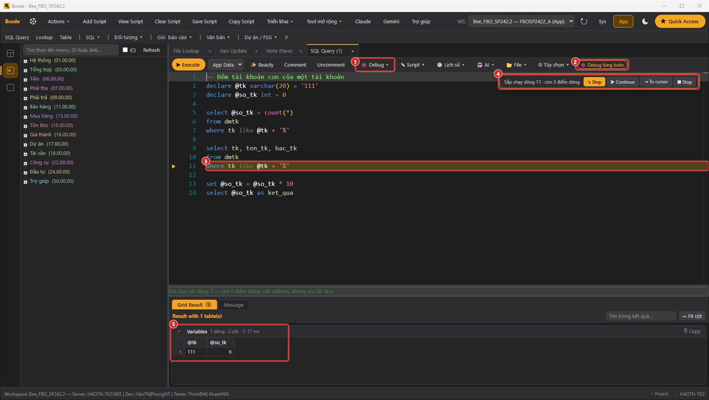

Trên ảnh: **①** nhóm 🐞 Debug (Debug store/function, Debug từng bước) · **②** chip "Debug từng bước" đang bật · **③** dòng sắp chạy (tô vàng) · **④** thanh Step / Continue / To cursor / Stop · **⑤** bảng **Variables**.

| Phím | Nút | Tác dụng |
|---|---|---|
| `F10` | ⤵ Step | Chạy tới điểm dừng kế |
| `F5` | ▶ Continue | Chạy tiếp tới breakpoint kế (hoặc hết) |
| `Ctrl+F10` | ⇥ To cursor | Chạy tới dòng con trỏ (con trỏ ở đoạn đã chạy qua thì lùi về đó) |
| `Ctrl+Shift+F10` | ⤴ Back | Lùi về điểm dừng trước (chạy lại từ đầu tới đó — vẫn rollback) |
| `Alt+Shift+F10` | 🧩 SQL động | Biến đang chứa câu SQL ghép (vd `@q` trước `EXEC FastBusiness$Partition$Execute` / `sp_executesql`) tại điểm dừng → mở tab mới: thay `r00$%Partition` → `r00$000000`, `%[ … ]%` → `( … )`, xuống dòng theo từ khoá, kiểm tra cú pháp (`SET PARSEONLY` — không chạy), dòng lỗi có `-- ✖`, kèm gợi ý "thừa / thiếu dấu nháy" khi 1 chuỗi `'…'` nuốt mất code. Nhiều biến thì chọn trong danh sách |
| `Alt+F10` | 🔍 Tìm lỗi | Tự tìm bước đầu tiên bị lỗi rồi dừng ở đó: chia đôi các điểm dừng (store 30 điểm dừng ≈ 6 lần chạy), mỗi lần đều rollback |
| `Shift+F5` | ⏹ Stop | Thoát debug |

- Dòng sắp chạy tô vàng; thanh nổi báo "Sắp chạy dòng N · còn M điểm dừng". Các dòng debug dừng được có **vạch vàng mờ ở lề** ngay khi bật debug.
- Bước bị lỗi: đoạn dòng của bước đó tô **đỏ** (✖ ở lề) — bước trước chạy được nên lỗi nằm trong đoạn này; thanh trạng thái ghi "Lỗi ở dòng …".
- Sửa code ngay trong lúc debug được, không phải tắt debug: tô đỏ mất ngay khi gõ, lần bấm `F10` / `F5` / 🔍 Tìm lỗi kế tiếp dựng lại debug từ code mới và chạy lại từ đầu (giữ giá trị tham số đã nhập).
- Giá trị biến hiện ở bảng **Variables** (và bảng có tên biến bảng); kết quả thật hiện thành "Kết quả i".

> **Lưu ý:** mỗi bước Bcode chạy lại script từ dòng 1 tới dòng đích trong `BEGIN TRAN` rồi **luôn ROLLBACK** — không thay đổi dữ liệu, nhưng script nặng sẽ chậm dần về cuối. Chưa hỗ trợ CTE, inline table function; không dừng được ở dòng IF / WHILE / ELSE chờ dòng sau hoặc dòng BEGIN trống.

<a id="lich-su-sql"></a>
## Lịch sử SQL và lịch sử sửa object

### Lịch sử SQL (`Ctrl+Shift+Y`)

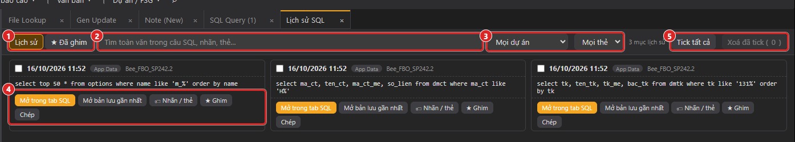

Trên ảnh: **①** tab Lịch sử / ★ Đã ghim · **②** tìm toàn văn · **③** lọc theo dự án / thẻ · **④** một mục: Mở trong tab SQL · Mở bản lưu gần nhất · 🏷 Nhãn / thẻ · ★ Ghim · Chép · **⑤** Tick tất cả / Xoá đã tick.

Kho câu SQL bạn chủ động lưu — **không tự lưu** mỗi lần chạy.

1. Ở tab SQL Query: **💾 Lưu lịch sử** (nhóm 🕘 Lịch sử) hoặc `Ctrl+Alt+H`.
2. Mở tab **Lịch sử SQL**: tab **Lịch sử** / **★ Đã ghim**, ô tìm toàn văn (câu SQL, nhãn, thẻ), lọc theo dự án / thẻ.
3. Mỗi mục: **Mở trong tab SQL** (chỉ mở, không chạy) · **Mở bản lưu gần nhất** · **🏷 Nhãn / thẻ** · **★ Ghim** · **Chép**.
4. Ghim: đặt Nhãn (tên dễ nhớ), Thẻ (cách nhau dấu phẩy), tuỳ chọn "chỉ hiện ở dự án …". Mục ghim có thêm **Mở với tham số lần trước**.
5. Tick nhiều mục → **Xoá đã tick**.

### Lịch sử sửa procedure / function

Mở: 🕘 Lịch sử → **Lịch sử sửa procedure / function** (hoặc ⚙ Options).

- Bcode **tự ghi** mỗi lần bạn chạy CREATE / ALTER PROCEDURE, FUNCTION, VIEW, TRIGGER (kèm bản BASELINE trước lần sửa đầu).
- Chọn dự án → lọc tên object → chọn phiên bản → so sánh với **Bản liền trước** / **Bản liền sau** / **Hiện tại (trong database)** (khung diff; `Alt+F5` / `Shift+Alt+F5` nhảy khác biệt).
- **Copy bản này** · **Khôi phục bản này** (đưa vào editor, không tự chạy) · **Mở thư mục lịch sử**.
- **Theo dõi ngoài Bcode**: cài DDL trigger + bảng log để ghi cả thay đổi làm bằng công cụ khác (SSMS…). **Cài / Cài lại / Cài cả hai / Gỡ** cần **Key Decrypt SQL Object** (xem [Key bản quyền](#key-ban-quyen)); chưa có key thì bấm nút sẽ hiện hộp nhập key, chỉ xem được trạng thái. Phần lịch sử sửa qua Bcode ở trên không cần key.

Thư mục lưu lịch sử đặt ở Template → **Lịch sử SQL**.

<a id="write-schema"></a>
## Write Schema — file .xsd cho Crystal Report và cập nhật file .rpt

Dùng khi sửa procedure báo cáo (thêm / bớt / đổi cột) và cần cập nhật cấu trúc dữ liệu của file Crystal Report.

### Tạo file .xsd

1. Ở tab SQL Query, chạy procedure báo cáo (`F5`) để có các bảng kết quả.
2. Chế độ Web: nhóm **✎ Script ▾ → Write Schema**. Chế độ App: **Script ▾ → Write Schema (.xsd cho Crystal Report từ bảng kết quả)...**.
3. Hộp lưu file: tên gợi ý = tên procedure vừa EXEC + `.xsd`; thư mục mặc định `<Source Path>\App_Data\Controllers\Templates\Rpt` (không có thì thư mục dùng lần trước).
4. Bcode ghi DataSet **NewDataSet** với các bảng **d1, d2, … dN** theo đúng thứ tự bảng kết quả (chỉ cấu trúc, không có dữ liệu) — cùng dạng các file `Templates\Rpt\*.xsd`.
5. Bcode hỏi "Cập nhật bảng trong file Crystal Report (.rpt) theo schema này luôn?" → **Yes** để sang bước dưới.

> **Lưu ý:** chưa chạy gì mà bấm Write Schema → "Chưa có bảng kết quả. Chạy script / procedure (F5) trước…". Bcode lấy kết quả của **lần chạy gần nhất** trong tab.

### Cập nhật bảng trong file .rpt

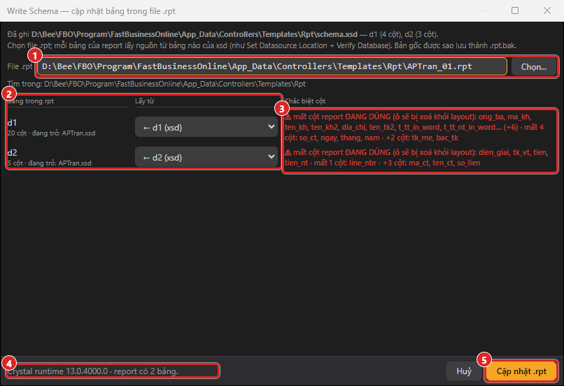

Trên ảnh: **①** chọn file .rpt (gõ để tìm / Chọn...) · **②** bảng trong rpt → lấy từ dN của xsd · **③** khác biệt cột — chữ đỏ = cột report đang dùng sẽ bị xoá · **④** trạng thái Crystal runtime · **⑤** **Cập nhật .rpt** (bản gốc lưu thành .rpt.bak).

Hộp "Write Schema — cập nhật bảng trong file .rpt" (giống Set Datasource Location + Verify Database của Crystal):

1. **File .rpt**: gõ tên để tìm — danh sách nạp sẵn các file .rpt trong `Templates\Rpt` (khớp đầu tên trước, rồi chứa); hoặc dán đường dẫn rồi `Enter`; hoặc **Chọn...**. File .rpt cùng tên xsd được chọn sẵn.
2. Bcode đọc report ("Crystal runtime … · report có N bảng, M subreport"), rồi hiện bảng ghép:
   - **Bảng trong rpt** (số cột, file đang trỏ) → **Lấy từ**: "(giữ nguyên)" hoặc "← dN (xsd)" (bảng cùng tên chọn sẵn).
   - Bảng xsd chưa có trong rpt: **Thêm vào rpt** / **Bỏ qua**.
   - Cột **Khác biệt cột**: "+n cột", "mất n cột" (cam), "cột giống hệt"; **chữ đỏ "⚠ mất cột report ĐANG DÙNG"** = cột đang đặt trên layout sẽ bị Crystal xoá khỏi report.
3. Có subreport → tick "Cập nhật cả subreport" để trỏ các bảng cùng tên trong subreport sang xsd mới.
4. **Cập nhật .rpt**. Nếu có cột đang dùng bị mất, Bcode hỏi lại lần nữa. Xong: "Đã cập nhật … ; bản cũ: <tên>.rpt.bak".

> **Lưu ý:** bản gốc luôn được sao lưu thành **`<tên>.rpt.bak`** cạnh file — muốn quay lại thì đổi tên file .bak.

**Khi báo lỗi ghi file (trước đây chỉ hiện "Access to the path … is denied"):**

- File .rpt đang để **Chỉ đọc (Read-only)**: Bcode hỏi "Bỏ Chỉ đọc rồi cập nhật?"; chọn **No** thì chưa cập nhật gì.
- Máy chủ không cho **tạo file mới** cạnh .rpt (share chỉ cho sửa file có sẵn, hoặc chặn đuôi `.bak`): Bcode sao lưu bản gốc vào `%AppData%\Bcode\rpt-backup\<giờ>_<tên>\` trên máy bạn rồi vẫn cập nhật; dòng kết quả ghi rõ chỗ sao lưu.
- **Không ghi đè được** .rpt (file đang mở trong Crystal Reports / Visual Studio, hoặc tài khoản chỉ có quyền đọc): file gốc **giữ nguyên**, thông báo nói rõ lý do, và bản đã cập nhật được để ở `%AppData%\Bcode\rpt-backup\<giờ>_<tên>\<tên> (đã cập nhật).rpt` — đóng chương trình đang mở file rồi bấm lại, hoặc chép tay file đó vào / nhờ người quản trị share cấp quyền ghi.

### Yêu cầu và lỗi hay gặp

- Máy cần cài **SAP Crystal Reports runtime 13 for .NET Framework** (bản 64-bit, `CRRuntime_64bit_13_0_x.msi`). Bcode gọi runtime qua **Windows PowerShell 5.1** có sẵn của Windows.
- "Máy chưa cài SAP Crystal Reports runtime…" → cài runtime rồi thử lại.
- "Không chạy được Windows PowerShell." → PowerShell 5.1 bị chặn / gỡ (kiểm tra chính sách máy).
- "Crystal Reports runtime không trả lời sau 3 phút." → file .rpt quá lớn hoặc runtime treo; đóng Crystal Designer nếu đang mở file đó rồi thử lại.
- "File .rpt không có bảng dữ liệu nào để lấy mẫu kết nối ADO.NET (XML)." → report chưa có bảng nguồn nào; thêm một bảng bằng Crystal Designer trước.

<a id="table"></a>
## Table — xem và sửa dữ liệu bảng

Mở: nút **Table** (`Ctrl+Shift+T`). Mỗi lần mở là một tab mới; tab đổi tên theo bảng sau khi nạp.

### Các bước

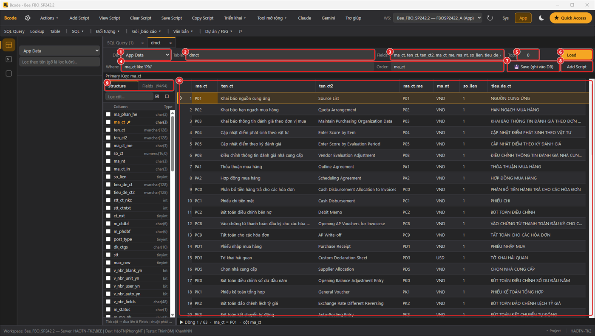

Trên ảnh: **①** DB · **②** ô Table (gợi ý tên bảng) · **③** Fields · **④** Where / Order · **⑤** Top (0 = tất cả) · **⑥** Load · **⑦** 💾 Save (ghi vào DB) · **⑧** Add Script · **⑨** khung Structure / Fields · **⑩** lưới sửa dữ liệu (F1, F3, F4, F8…).

1. Chọn **DB:** App Data / Sys Data.
2. Gõ tên vào ô **Table** — gợi ý hiện ngay: khớp đầu tên trước, rồi chứa; **bảng phân kỳ** (`d91$000000`, `d91$202501`…) xếp lên đầu theo thứ tự kỳ.
3. Chọn một gợi ý (bấm / `Enter` / `Tab`) → Bcode **chỉ nạp structure** (khung trái) — "Đã nạp structure — Enter / Load để tải dữ liệu". `Enter` ở ô Table (chọn gợi ý hoặc tải bảng) xong thì con trỏ **nhảy sang ô Where** như FCode.
4. Nhập (tuỳ chọn) **Fields** (mặc định `*`), **Where** (vd `ma_kh like 'KH%' and status = '1'`), **Order** (vd `ngay_ct desc`), **Top** (mặc định `0` = tất cả). Where / Order / Fields có gợi ý tên cột.
   - Ở ô **Where**, gõ tên một cột của bảng rồi `Enter` → Bcode chèn sẵn mẫu lọc theo kiểu cột (lấy từ khung Structure), con trỏ đứng đúng chỗ gõ giá trị (`|`): cột chuỗi `char` / `varchar` / `text` → `ma_ct like '%|%'`; cột unicode `nchar` / `nvarchar` / `ntext` → `ten_gd like N'%|%'`; cột số (`int`, `numeric`, `decimal`, `bit`, `money`…) → `user_id0 = |`; cột ngày (`datetime`, `smalldatetime`, `date`…) và `uniqueidentifier` → `datetime0 = '|'`. Gõ một phần tên (vd `ghi`) rồi chọn cột trong danh sách gợi ý bằng `Enter` hoặc bấm chuột → điền tên cột **và** chèn luôn mẫu (`ghi_chu like N'%|%'`); `Tab` chỉ điền tên cột.
   - Chữ trước con trỏ không phải tên cột (vd đã gõ xong `ma_ct = 'BPC'`) → `Enter` tải dữ liệu như cũ.
5. `Enter`, **Load** hoặc `F5` → tải dữ liệu. Bảng chỉ có ở database kia → Bcode tự chuyển DB.

Trên lưới hiện khoá chính ("Primary Key: …"); bảng không có khoá chính thì không lưu / xoá được an toàn.

### Menu của bảng

Khi gõ tên bảng hoặc tải bảng, dưới ô Where / Order hiện thêm dòng **Menu:** là màn hình dùng bảng đó. Ví dụ `i74$000000` → *Phiếu nhập kho (inctpnd.aspx)*, `dmkh` → *Danh mục khách hàng (arkh.aspx)*.

- **Bấm** vào một menu → cây **WCommand** bên trái được hiện ra, các nhánh cha mở sẵn và menu đó được chọn, giống như bấm chọn trên cây.
- Đưa chuột lên một menu để xem mã menu (wmenu_id), đường dẫn trên cây và nguồn tra được.
- Một bảng có thể ra nhiều menu, ví dụ cùng một danh mục khai ở nhiều phân hệ. Khi đó tên phân hệ hiện trong ngoặc vuông, như *Hóa đơn bán hàng [Bán hàng]*. Tên chỉ khác nhau ở dấu customize `(*)` / `(C)` cũng tính là trùng, ví dụ *Hóa đơn bán hàng (\*) [Bán hàng]* và *Hóa đơn bán hàng [Phải thu]*. Hai bản cùng một phân hệ thì ghi cả đường dẫn cha. Dòng hiện tối đa 4 menu, phần còn lại là "+N" (đưa chuột lên để xem).
- Cách tra: tên bảng bỏ đuôi kỳ (`$202601`, `$000000`, `$log`). Bcode tìm theo hai nguồn:
  - Bảng **dmct9** (chứng từ): cột c$ / m$ / d$ / i$ chứa tên bảng, cột url là trang aspx, rồi tìm menu có link trỏ tới trang đó.
  - Controller của menu trong Source Path: `Dir\<sysid>.f` khai `table="…"` (kể cả khai qua entity như `&Tag;`), cùng các Grid chi tiết mà Dir trỏ tới.
- Chữ mờ *(fxctcc1.aspx) — chưa thấy menu*: dmct9 có trang aspx nhưng cây WCommand không có menu nào trỏ tới trang đó. Không tra được gì thì dòng Menu không hiện.
- Kết quả được nhớ theo dự án. Bấm nút ⟳ (Refresh database) để tra lại sau khi sửa dmct9 hoặc source.

### Check Partitions Struct — kiểm cấu trúc bảng phân kỳ

Khi ô **Table** đang là bảng phân kỳ (`i74$000000`, `i74$202601`…), **chuột phải vào ô Table** → **Check Partitions Struct**. Bảng không phân kỳ thì chuột phải vẫn ra menu Cắt / Chép / Dán như cũ.

Bcode so mọi bảng cùng tiền tố (`i74$yyyymm`, kể cả kỳ đặc biệt như `$999999`) với bảng mẫu `i74$000000` (không có bảng mẫu thì so với bảng kỳ đầu tiên), theo DB đang chọn ở ô **DB:**. Bảng `$log` không được xét. Hộp kết quả gồm:

- Dòng đầu: **Tables are same structure** (chữ xanh) khi mọi bảng giống nhau, hoặc chữ đỏ "N/M bảng kỳ khác cấu trúc so với …".
- Lưới **Table | Description**: `OK` = giống bảng mẫu. Bảng khác thì tên bảng in đỏ, cột Description ghi rõ:
  - **Thiếu cột** / **Thừa cột**;
  - **Khác kiểu**: kiểu, độ dài, `null` / `not null` của bảng đó so với bảng mẫu;
  - **Khác thứ tự cột**: cùng bộ cột nhưng xếp khác. Lỗi này cũng cần sửa: tab Table đã tự xếp đúng cột (xem lưu ý dưới), nhưng câu SQL ghép các kỳ bằng UNION ALL theo vị trí cột (vd trong store chạy `FastBusiness$Partition$Execute`) thì lệch thứ tự là sai dữ liệu.
- **Copy** chép kết quả (Table / Description, cách nhau bằng Tab) để dán vào Excel. **OK** hoặc `Esc` để đóng.

Chỉ đọc cấu trúc (INFORMATION_SCHEMA), không sửa bảng nào. Muốn thêm hoặc sửa cột cho mọi kỳ, dùng chuột phải tab Structure → **Gen Add Column** / **Gen Alter Column**.

### Khung trái: Structure / Fields

- Tick cột để thay `*` trong ô Fields; ô "Lọc cột...", ☑ / ☐ tick hết / bỏ hết.
- Chuột phải tab Structure: **Gen Structure Table** · **Gen Add Column** · **Gen Alter Column** · **Gen Drop Column** (Add to Clipboard / Preview / Design) · **Render XML** (Dir / Grid XML từ cấu trúc bảng).
- Với bảng `xxx$000000`, script Gen Add / Alter / Drop Column chỉ thêm phần chạy trên các kỳ (`FastBusiness$Partition$Execute` trên `xxx$%Partition`) khi database có bảng kỳ thật `xxx$yyyymm`. Nếu chỉ có đúng `xxx$000000` (bảng không phân kỳ) thì chỉ sinh lệnh ALTER cho chính bảng đó.
- **Gen Add Column** sinh kèm câu `UPDATE ... WHERE <cột> IS NULL` để dòng cũ có giá trị mặc định: cột chuỗi = `''`, cột số = `0` (cột ngày / kiểu khác không update). Áp cho bảng chính, bảng `$log` và các kỳ. Gen Alter / Drop Column không có câu update.
- **Design** (ở Gen Structure Table / Gen Add / Alter Column) mở hộp **Add New Column** (bảng Name / Type / Length / Not NULL, **+ Thêm cột** thêm nhiều dòng) để thiết kế rồi OK sinh script:
  - Ô **Type** **gõ được**: gõ vài chữ để lọc danh sách (vd gõ `nv` ra `nvarchar`); kiểu hay dùng (`nvarchar`, `varchar`, `char`, `numeric`, `smalldatetime`) **in đậm và xếp đầu**; vẫn gõ được kiểu bất kỳ.
  - **Tự đoán Type theo tên cột** (chỉ khi bạn chưa tự chọn kiểu cho dòng đó — không đè lựa chọn tay) theo quy ước Fast: tên chứa `ma_` / `nh_` / `loai_` → `varchar(32)`; chứa `tien` / `so_luong` / `sl` / `thue`, bắt đầu `t_`, hoặc kết thúc `_nt` → `numeric(19,4)`; chứa `ngay` → `smalldatetime`. Tên khớp nhiều luật thì `numeric` được ưu tiên (vd `t_tien_nt`).

### Sửa dữ liệu kiểu Excel

- Sửa ô rồi **rời khỏi dòng là tự lưu** ("Đã tự động lưu N thay đổi lúc …"); dòng lỗi giữ dấu "!" đỏ. Với dòng đã có, sửa xong một ô (chữ hoặc checkbox) rồi `Tab` / `Shift+Tab` / bấm sang ô khác cùng dòng cũng **lưu luôn**, không cần xuống dòng. Dòng mới (dòng trống cuối lưới) vẫn chờ nhập xong rồi rời dòng mới lưu.
- **💾 Save (ghi vào DB)** ghi các thay đổi còn lại (hỏi xác nhận nơi ghi).
- Dán từ Excel (`Ctrl+V`) điền được nhiều ô.
- `Ctrl+V` một giá trị (không đang sửa ô) dán vào ô đang đứng; **chọn nhiều ô** rồi `Ctrl+V` thì dán cùng giá trị vào mọi ô đã chọn (hỏi xác nhận khi nhiều dòng). Copy từ Table giữ đúng NULL / trống: copy ô **trống** `''` rồi dán vào ô **Null** → ô thành `''`; copy ô Null thì dán ra Null.
- **Lỡ tay sửa** → `Ctrl+Z` (không đang gõ trong ô) hoàn tác thay đổi giá trị ô gần nhất, kể cả khi đã tự lưu: Bcode trả giá trị cũ rồi **tự lưu lại** vào DB. `Ctrl+Y` (hoặc `Ctrl+Shift+Z`) làm lại. Một thao tác (dán nhiều ô, Set NULL nhiều ô…) là một bước; giữ tối đa 200 bước, **Load lại thì mất lịch sử**. Không hoàn tác được thêm / xoá dòng. Đang gõ trong ô thì `Ctrl+Z` chỉ hoàn tác chữ trong ô đó. Có cả ở chuột phải lưới → **Undo / Redo**.
- **Bảng có cột identity** (vd `id int IDENTITY`, dòng trên lưới ghi "Identity: id — SQL Server tự sinh"): dòng mới (dán / thêm / chèn / nhân bản) để trống ô id, hiện chữ **(tự sinh)**. Khi lưu, Bcode không gửi id, SQL Server tự sinh, rồi Bcode đọc lại id thật lên lưới. Cột computed và rowversion (timestamp) không bao giờ được ghi; lưu xong Bcode đọc lại giá trị của chúng.
- **Giữ đúng id đã dán** (ví dụ chuyển dữ liệu giữa môi trường): lần đầu dán vào dòng mới mà có giá trị ở cột identity, Bcode hỏi **Yes** = giữ id (khi lưu dùng `SET IDENTITY_INSERT ON … OFF`) · **No** = để SQL Server tự sinh, không hỏi lại cho bảng này · **Cancel** = không dán. Hộp hỏi cảnh báo trước các id đã có trên lưới. Muốn đổi lại thì chuột phải lưới → **Giữ id khi dán ([id] — IDENTITY_INSERT)**; mở bảng khác thì tuỳ chọn về mặc định (tự sinh). Id đã có trong bảng sẽ báo lỗi ở dòng đó (dấu "!" đỏ), Bcode không ghi đè. Dòng có sẵn thì không bao giờ đổi id.

| Phím | Tác dụng |
|---|---|
| `F1` | Xem / sửa chi tiết dòng (mọi cột thành một form) |
| `F3` | Khai báo nhanh danh sách "a, b, c" trong các ô đang chọn |
| `Ctrl+F3` | **Sửa đủ nội dung ô** đang chọn (chuỗi dài HTML / XML / JSON / script không thấy hết trên lưới): mở form soạn có tô màu, sửa xong bấm **Lưu vào ô** (hoặc `Ctrl+S`) → ghi vào ô rồi tự lưu dòng như sửa trên lưới; `Esc` / Huỷ = bỏ. Ô không sửa được (cột tính toán / identity, nhị phân) thì chỉ xem. Cũng có ở chuột phải → **Sửa đủ nội dung ô...** |
| `F4` | Thêm dòng mới |
| `F8` | Xoá các dòng đang chọn (ghi ngay vào database, hỏi trước) |
| `Ctrl+I` | Nhân bản dòng |
| `Ctrl+N` | Chèn dòng mới sau dòng đang chọn |
| `Ctrl+'` | Copy giá trị ô đang chọn |
| `Ctrl+Shift+C` | Copy **tên cột** của ô đang chọn (chọn nhiều cột → các tên cách nhau dấu phẩy: `ma_vt, ten_vt`). `Ctrl+C` vẫn là copy dòng / ô như cũ |
| `Ctrl+0` | Đặt các ô đang chọn thành NULL |
| `Ctrl+G` | Goto Column (điền sẵn tên cột đang đứng, bôi đen — gõ là thay) |
| `F5` | Tải lại |

Chuột phải lưới: Add New · Delete · Copy Row · Paste · Clone Row · Insert New Row After · Copy One Value · Giữ id khi dán (chỉ hiện ở bảng có cột identity) · Alter Null Value · **Gen Insert (dòng đã chọn)** · **Gen Update (dòng đã chọn)** · Set Cells Value to NULL · Description Columns...

### Add Script — đóng gói dữ liệu bảng

Nút **Add Script** (hoặc `Ctrl+Alt+Shift+A`): sinh script DELETE + nạp lại **mọi dòng đang xem**, copy vào clipboard và thêm vào Script Cart.

Bảng **không có dòng dữ liệu nào** (Load ra 0 dòng): Add Script vẫn chạy — sinh **script cấu trúc bảng** như Gen Structure Table (`CREATE TABLE` đủ cột, IDENTITY, DEFAULT + khoá chính, index, trigger; câu DROP để trong chú thích) và thêm vào Script Cart.

Bảng có cột **identity** (vd `crApiConfig.id`): script tự giữ đúng id — `#data` lấy `[id] + 0 AS [id]` (không mang identity), câu nạp vào bảng thật bọc `SET IDENTITY_INSERT <bảng> ON` … `OFF` và ghi rõ danh sách cột. Cột computed / rowversion được bỏ khỏi script (không INSERT được). Bảng không có identity: script như cũ.

> **Lưu ý:** số dòng đang xem bằng đúng giới hạn Top → Bcode cảnh báo phần dữ liệu còn lại sẽ **mất** khi chạy script; đặt Top = 0 rồi Load lại. Bảng tổng hợp `$000000` chỉ để xem (gộp UNION ALL các kỳ) — không Save / xoá được. Chỉ khoá khi database có bảng kỳ thật `xxx$yyyymm` đi kèm (hoặc `xxx$000000` là view): bảng **không phân kỳ** — chỉ có đúng `xxx$000000` (vd nhiều bảng `cxx$000000`, `axx$000000`) — là bảng thật, sửa / Save / xoá / Add Script như bảng thường. Cột của bảng tổng hợp luôn theo bảng mẫu `xxx$000000` (đủ cột, đúng thứ tự CREATE TABLE, giống `SELECT * FROM xxx$000000` bên SQL Query): bảng kỳ lệch thứ tự cột vẫn ra đúng dữ liệu từng cột, kỳ thiếu cột thì cột đó để trống (NULL), cột chỉ bảng kỳ có thì không hiện. Database / workspace bị đổi sau khi tải → Bcode không ghi để tránh ghi nhầm; bấm Load lại.

<a id="command-lookup"></a>
## Lookup

Tab **Command** (dựng SELECT / FROM / WHERE) đã bỏ — dùng [SQL Query](#sql-query) hoặc [Table](#table). `Ctrl+Shift+C` giờ là copy tên cột ở lưới Table và lưới kết quả SQL Query.

### Lookup (`Ctrl+Shift+L`) — tìm object

- **DB:** App Data / Sys Data / Cả hai. Ô tên object + tick loại (Function, Store, Table, View, Trigger).
- Ô thứ hai tìm **nội dung** trong Function / Store / View / Trigger (từ 2 ký tự).
- Bên phải: **Show Search Text** · **Show Data** (Top 100, chỉ bảng) · **Show History**; **Mở trong Tab** để mở object sang tab SQL.
- Bấm vào khung script bên phải rồi: `Ctrl+A` chọn hết script (rồi `Ctrl+C` để chép) · `Ctrl+F` mở thanh tìm ở góc trên-phải khung (gõ là tìm, không phân biệt hoa thường; `Enter` / `F3` tìm tiếp, `Shift+Enter` / `Shift+F3` tìm lùi, `Esc` đóng — kết quả đang đứng được bôi đen sẵn). Đổi object khi thanh tìm đang mở thì đếm lại theo script mới.

### Gen Update (Result) (`Ctrl+Shift+U`)

Sinh câu UPDATE cho **mọi dòng của bảng kết quả gần nhất** (SQL Query): hỏi tên bảng đích + cột khoá (vd `stt_rec` hoặc `ma_ct,ky`) → câu lệnh vào clipboard. Chỉ muốn vài dòng: chọn dòng → chuột phải → Gen Update (dòng đã chọn).

<a id="sql-object"></a>
## SQL Object, Ai đang dùng, So sánh object, Profiler

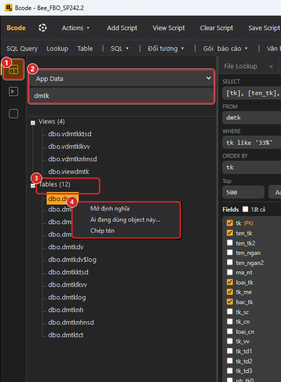

Trên ảnh: **①** mục SQL Object ở cột icon · **②** chọn database + ô lọc (gõ là lọc) · **③** nhóm Views / Tables / Stored Procedures… · **④** menu chuột phải: Mở định nghĩa · Mở ở SQL Query mới · Ai đang dùng object này… · Sơ đồ phụ thuộc… · Chép tên (ảnh chụp trước khi có mục "Mở ở SQL Query mới").

| Công cụ | Mở | Dùng để |
|---|---|---|
| **Cây SQL Object** | Cột icon trái → SQL Object | Nhóm Tables / Views / Stored Procedures / Functions / Triggers (bảng phân kỳ được ẩn). Gõ vào ô lọc là lọc ngay (cây không tự tải khi ô trống). Tick **Tìm trong nội dung (text)** dưới ô lọc: chữ gõ được tìm trong nội dung procedure / function / view / trigger (hỏi database, chờ ~0,5 s sau phím cuối hoặc `Enter`; bảng không có nội dung nên không hiện); bỏ tick về lọc theo tên. **Bấm 1 lần** (hoặc chọn rồi `Enter`) = xem object dạng **ALTER**; **double-click** = dạng **IF EXISTS … DROP → GO → CREATE** (chỉ nạp 1 lần, không nạp ALTER trước). Cả hai **nạp vào tab SQL Query đang dùng** chứ không mở thêm tab: tab đang chọn là tab trống hoặc tab object bạn chưa sửa gì thì nạp đè ngay vào đó (tên tab đổi theo object, `Ctrl+Z` lấy lại object trước); tab đang chọn không phải SQL Query, hoặc là tab bạn tự gõ / đã sửa, thì dùng tab SQL Query (trống / chưa sửa) xem gần nhất — không có mới mở tab mới. Tab bạn đã gõ / sửa không bao giờ bị nạp đè. Object đã có tab thì chỉ chuyển sang tab đó. Phím mũi tên chỉ di chuyển, không nạp. Chuột phải: **Mở dạng ALTER** (như bấm 1 lần) · **Mở ở SQL Query mới** (luôn mở tab mới, dạng ALTER) · Ai đang dùng object này… · Sơ đồ phụ thuộc… · Chép tên. Muốn cách cũ (mỗi object một tab, bấm 1 lần không mở): ⚙ Settings → bỏ tick **Cây SQL / Object: bấm 1 lần nạp vào tab đang dùng**. Bảng (bấm hay chuột phải → Mở định nghĩa) luôn là CREATE TABLE kèm khối IF EXISTS / DROP TABLE để sẵn trong comment `/* … */`; cột identity ghi đúng `IDENTITY(seed, bước tăng)` của bảng thật (vd `[id] bigint IDENTITY(1, 1) NOT NULL`). |
| **Ai đang dùng** | `Ctrl+Alt+U` (trên tab mở từ cây SQL Object), hoặc `Ctrl+P` → chọn object → `Shift+Enter` | Liệt kê nơi dùng object: database App, Sys và file controller (Dir, Filter, Grid, Include, Options, Report). Chép danh sách / Quét lại. |
| **Sơ đồ phụ thuộc** | Chuột phải object trên cây SQL Object, menu trên cây WCommand (hoặc file controller ở File Lookup) → **Sơ đồ phụ thuộc…** | Trái = **Được dùng bởi**, phải = **Dùng tới** (procedure / function / view / trigger / bảng), bấm một nút để xem tiếp; **Phân tích ảnh hưởng** dò ngược tới menu. Mỗi loại một **vùng có khung** (function / store / view / trigger / bảng riêng; file controller chia nhỏ theo thư mục Dir / Grid / Filter / Include / Options / Report). Nút **Dạng** (thanh trên) đổi cách thể hiện: **Nhánh cây** (mỗi bên một cột như ban đầu) ↔ **Lưới** (các vùng xếp nhiều cột cho ngắn lại, dễ tìm; bên rỗng nhường hết bề ngang cho bên kia) — lựa chọn được nhớ trên máy. Một bên có nhiều nút thì đường nối gom về một thân dọc cho cuộn / rê chuột không giật; rê chuột lên nút thì đường của nút đó sáng lên. Nút **Chép đường dẫn** (thanh trên, cạnh Phân tích ảnh hưởng) chép đường dẫn đầy đủ của **mọi file** đang hiện trong sơ đồ (cả 2 cột và nút ở giữa, theo ô lọc nếu đang lọc), mỗi dòng 1 đường dẫn — procedure / function / bảng / menu không có đường dẫn nên bỏ qua; không có file nào thì nút mờ. Loại object lấy theo database (`sys.objects`), kể cả procedure / function **mã hoá** (WITH ENCRYPTION) — các nút này có nhãn **mã hoá**; xem sơ đồ của object mã hoá thì "Dùng tới" chỉ gồm phụ thuộc SQL Server ghi sẵn (không đọc được nội dung). "Được dùng bởi" có cả procedure / function mã hoá gọi tới object (lấy theo phụ thuộc SQL Server ghi sẵn, nên không bắt được lời gọi nằm trong SQL động của chúng). File **bản sao / sao lưu** (tên có đuôi **Copy** / **Backup**, hoặc đuôi file **.bak**) bị **bỏ qua** — không lập chỉ mục, không giải mã, không đưa lên sơ đồ. File **.f mã hoá** của chương trình (khối lệnh `<Encrypted>`) mà **đã có file .xml cạnh nó trong dự án** thì dùng luôn bản .xml đó (không giải mã lại — đỡ phải chờ lập chỉ mục); chỉ file .f mã hoá **chưa có .xml cạnh** mới được xét theo bản **.xml trong kho source chuẩn** (Template → kho SourceCollection) đúng phiên bản của project — không có ở phiên bản đó thì lấy phiên bản thấp hơn gần nhất, như **Cấp source** nhanh của File Lookup; các nút này có nhãn xanh **source &lt;phiên bản&gt;**, bấm đúp = xem bản source (chỉ đọc). Phiên bản lấy theo **Mã phiên bản** đã khai của project (hoặc đoán theo tên thư mục source). Lần đầu Bcode dựng chỉ mục source chuẩn **chạy nền** vài phút: sơ đồ báo "Đang dựng…" kèm bước đang làm và **%** (cập nhật mỗi 3 giây), dựng xong thì **tự tải lại** — không cần bấm Làm mới; lần sau dùng ngay. Nếu khai **Đường dẫn FCode** (Template → Đường dẫn — ô này chỉ hiện khi máy có key Decrypt SQL Object) và máy có **license Fast**, Bcode còn **giải mã thẳng** chính file .f đó (đúng bản khách đang chạy) để đọc tên object — khi đó ghi "giải mã từ .f" thay cho "source &lt;phiên bản&gt;"; máy không có license thì tự quay về dò kho source chuẩn. Tên không có trong database đang xem: tra cả database kia (ghi "chỉ có ở Sys Data / App Data"); vẫn không thấy thì đoán theo cách gọi (`exec X` → procedure, `X(…)` → function, ghi "đoán là …"), không đoán được thì vào nhóm **Không xác định** (thường là bí danh bảng như `a`, `b`). |
| **So sánh object** | `Ctrl+Shift+J` | So code procedure / view / function / trigger giữa 2 database (vd bản dev ↔ bản khách): lọc Khác nhau / Chỉ bên trái / Chỉ bên phải / Chỉ khác khoảng trắng / Mã hoá → chọn mục → **Sinh script ALTER** (Bcode chỉ sinh, không chạy). |
| **Compare Structure** | Thanh công cụ | So cấu trúc một bảng giữa 2 workspace (Chỉ có ở trái / phải, Khác nhau, Giống nhau). |
| **Change Owner** | `Ctrl+Shift+O` | Chuyển object sang schema khác (`ALTER SCHEMA TRANSFER`) — không hoàn tác từ Bcode được. |
| **SQL Profiler** | `Ctrl+3` | Nhúng SQL Profiler thật vào tab: khai đường dẫn Profiler.exe, đăng nhập, chọn trace template → **▶ Bung & Đăng nhập**; **📋 Copy SQL Command** lấy câu SQL của dòng đang chọn; **🐞 Debug store** = lấy câu đó, tìm store được gọi (`exec rs_xxx …`), mở tab gồm định nghĩa store + `GO` + nguyên câu gọi rồi bật [Debug từng bước](#debug-sql) — tham số, biến `@0 @1…`, bảng tạm (`#$query`) tự lấy từ câu gọi (định nghĩa giữ `CREATE` nên lỡ bấm Execute cũng không đè store). Trace lọc theo Database của dự án và theo **ID (ApplicationName) = u_id**: gõ user cần theo dõi (u_name) → **Tra u_id** (gõ tên mà chưa tra thì lúc bung Bcode tự tra). Ô **u_id** sửa / xoá được: bấm **✕** (hoặc xoá trống) khi ứng dụng không gắn ApplicationName = u_id → trace không lọc theo ID, template đã có filter ID cũng được gỡ (bản cũ giữ thành `.tdf.bak`); Tra u_id hoặc đổi tên user là lọc lại như cũ. **Công cụ Ctrl+3** (Template → Cửa sổ → SQL Profiler): **SQL Profiler** (mặc định, nhúng Profiler.exe như trên) hoặc **SqlWatch** — mở tab "SqlWatch" đọc các câu SQL vừa chạy (SQL:BatchStarting / RPC:Starting / SP:Starting) theo nhịp từ DMV của server, chỉ cần quyền VIEW SERVER STATE, không tạo trace. Project = workspace đang chọn (đổi workspace khi chưa bắt thì đổi theo), theo dõi 3 database của dự án: Sys, App và eInv (database có "eInv" trong DB Access, chỉ khi có khai báo) — database không có trên server của workspace (vd eInv đặt ở server khác) thì bỏ qua và ghi ở thanh trạng thái "bỏ qua (không có trên server này)", không chặn việc bắt. **Lỗi tạm thời** lúc đang bắt (database OFFLINE / đang restore trên server, rớt mạng, hết giờ, server khởi động lại…) **không bật hộp lỗi và không dừng bắt**: thanh trạng thái hiện **⚠ lỗi đọc lúc …** rồi SqlWatch tự thử lại (cách 1 giây, lâu dần tới 30 giây), đọc lại được thì dòng ⚠ tự mất; lỗi được ghi vào [log lỗi của Bcode](#bao-loi) (F1 gửi được, cùng lỗi lặp lại chỉ ghi 1 lần mỗi 10 phút). Bấm **Bắt đầu** lúc không kết nối được server cũng chỉ báo trên thanh trạng thái (bấm lại để thử). Lỗi phải tự sửa (sai login / mật khẩu, thiếu quyền VIEW SERVER STATE…) vẫn hiện hộp lỗi và dừng như cũ. Database OFFLINE khác trên cùng server (không phải của dự án) không còn làm SqlWatch báo lỗi. **Login / Pass**: mặc định là tài khoản cài sẵn của SqlWatch; dùng bên khách hàng thì sửa lại rồi bấm Bắt đầu — Bcode nhớ theo dự án (mật khẩu lưu mã hoá), **Mặc định** = về tài khoản cài sẵn. **Bắt đầu / Tạm dừng / Dừng / Xóa lưới**, **Sự kiện ▾** chọn loại dòng, ô lọc Login chứa / **USER ID** (= ApplicationName mà Fast gắn bằng u_id người dùng, khớp đúng — gõ 11 không ra 110) / Nội dung chứa lọc ngay trên các dòng đã bắt; dòng **SP:Starting** hiện tên procedure đang chạy (vd `dbo.zrpt_69_new` khi chạy báo cáo) kể cả khi login không có quyền vào database của dự án (tên lấy từ nội dung procedure qua DMV; procedure mã hoá thì chỉ còn `#object_id`), bấm 1 dòng xem đủ câu ở khung **Chi tiết** (kéo thanh chia để đổi chiều cao), double-click để copy. **Chọn nhiều dòng** như SQL Profiler (Ctrl+click, Shift+click, kéo chuột, Shift+↑↓, Ctrl+A): khung Chi tiết, **Ctrl+C** và **Copy SQL Command** ghép câu của các dòng đã chọn theo thứ tự thời gian, mỗi câu cách nhau dòng `GO` (dòng SP:Starting lấy batch gọi nó — batch đó đã có trong chuỗi thì không lặp lại; tab SQL Query mở theo database của dòng sớm nhất); **Debug store** khi chọn nhiều dòng thì lấy dòng bấm sau cùng. Double-click thường chỉ chọn lại 1 dòng nên copy 1 câu. Như SQL Profiler: **📋 Copy SQL Command** chép câu của dòng đang chọn và mở tab SQL Query mới dán sẵn, chạy trên đúng database của dòng (cột Database là Sys / App của dự án đang mở; database khác như eInv thì theo ô WS) — nút có nền nổi xanh lá (#80d3a1) cho dễ thấy, đổi màu hoặc bỏ ở Template → Cửa sổ → SQL Profiler → **Nút Copy SQL Command** (**Mặc định** / **Bỏ** = nút thường; tab SqlWatch đang mở đổi theo ngay); **🐞 Debug store** tìm store được gọi, mở định nghĩa store + `GO` + câu gọi rồi bật Debug từng bước. Chọn dòng SP:Starting (`exec zrpt_65 @0, @1…`) thì hai nút lấy batch gần nhất cùng SPID có gọi đúng procedure đó (có `declare @0…; select @0=…`) để chạy được ngay; khung Chi tiết hiện đúng câu sẽ copy — cả declare lẫn exec, tiêu đề khung ghi "cả batch gọi <tên procedure>" và khung tự cuộn để thấy dòng `exec` (dòng trống liền nhau chỉ hiện 1 dòng; copy vẫn nguyên văn). Procedure chỉ bắt được tên (gọi kiểu RPC, hoặc gọi lồng bên trong procedure khác) thì dựng sẵn khung `declare @tham_số kiểu = NULL …` + `exec …` từ định nghĩa procedure để điền giá trị. SQL 2008 (không có `sys.dm_exec_input_buffer`) đọc câu client gửi bằng `DBCC INPUTBUFFER` (chỉ đọc, không tạo trace hay thay đổi gì trên server). Câu do chính công cụ gửi (ApplicationName bắt đầu bằng "Bcode" hoặc "FCode", và SqlWatch) không đưa lên lưới. Ô **USER ID** lọc ngay khi đọc trên server (chỉ đọc phiên của user đó — server đông người thì nhẹ hơn); dự án chưa lưu bộ lọc thì tự điền u_id của user đang theo dõi (ô "User cần theo dõi" của SQL Profiler, không có thì user đăng nhập web), xoá trống = mọi user. Bộ lọc (Login chứa, USER ID, Nội dung chứa, Sự kiện) **nhớ theo dự án**: đổi dự án / mở lại tab là có lại. Câu dài bao nhiêu cũng bắt đủ, không giới hạn độ dài — khung Chi tiết chỉ hiện 20.000 ký tự đầu (cuối có dòng `-- ... còn N ký tự nữa`), còn double-click dòng / **Ctrl+C** / **Copy SQL Command** / **Debug store** luôn lấy đủ cả câu; máy chủ SQL 2008 / 2012 chỉ cho đọc trực tiếp 4000 ký tự đầu của câu — SqlWatch tự tìm bản đầy đủ trong thống kê / plan cache của server (vẫn chỉ cần VIEW SERVER STATE). Để không làm nặng server, lúc đang bắt chỉ tìm ở chỗ nhẹ (tối đa 2 câu dài mỗi nhịp); bước quét plan cache (nặng trên server có nhiều câu) để tới khi **bấm dòng đó** hoặc **Copy / Ctrl+C / Debug store** mới chạy — trong lúc tìm thanh trạng thái báo "Đang tìm cả câu dài…", tìm xong khung Chi tiết tự hiện cả câu (đã **Dừng** bắt vẫn tìm được; mỗi lần copy tìm tối đa 20 dòng). Mỗi nhịp đọc chỉ hỏi các phiên có lệnh mới và chỉ đọc nội dung procedure đang chạy ở lần đầu thấy nó, nên server đông người cũng nhẹ. Trường hợp hiếm vẫn không tìm được thì cuối câu có dòng `-- ... cắt bớt` và **Copy SQL Command** báo **⚠ CÂU CHƯA ĐỦ** trên thanh trạng thái (câu đó chạy nguyên sẽ lỗi). Tab SqlWatch có **ô xanh ngọc hình con mắt** ở đầu tab, chữ tab cũng màu xanh ngọc cho dễ thấy; **chấm đỏ** trên icon = đang bắt, chấm xám = tạm dừng, không chấm = đã dừng. **Nhịp đọc** (góc phải hàng trên) là danh sách chọn **200 / 250 / 300 ms** — bao lâu SqlWatch hỏi server 1 lần; mặc định **200**, đổi lúc đang bắt thì áp ngay, Bcode nhớ lựa chọn cho lần sau (chung mọi dự án). SqlWatch không có trace nên mỗi phiên chỉ thấy **câu cuối cùng** client vừa gửi: ứng dụng gửi 2–3 câu liền nhau trong cùng 1 nhịp (thường gặp khi mở / lưu chứng từ) thì chỉ bắt được câu cuối — nhịp càng ngắn càng ít sót, nhưng không nhịp nào bắt đủ 100% như SQL Profiler; cần chắc chắn từng câu thì dùng SQL Profiler. Không đo được Duration / Reads / CPU. Màu theo theme sáng / tối của Bcode. **Chế độ mở** (Template → Cửa sổ → SQL Profiler): **Thủ công** (mặc định) = tự bấm **▶ Bung & Đăng nhập** (SqlWatch: **Bắt đầu**); **Tự động** = `Ctrl+3` bắt luôn — SqlWatch bấm **Bắt đầu** ngay (thanh lọc vẫn hiện); SQL Profiler bung Profiler luôn theo cấu hình đã lưu (Profiler.exe, đăng nhập, Trace Template, user theo dõi, lọc DatabaseName) và tự thu thanh cấu hình thành dải mỏng (bấm **▾ Hiện thanh Profiler** để mở lại; thiếu đường dẫn Profiler.exe thì thanh vẫn hiện để sửa). Tab đang mở mà Profiler đã đóng thì `Ctrl+3` bung lại; khôi phục phiên lúc mở Bcode không tự bung. Ô **Lọc DatabaseName** tự gợi ý `%mã dự án%` theo workspace (vd `%KOG%`) và sửa được: gõ giá trị khác (vd `%KOG_FBISP24%` hoặc đúng tên database) rồi Enter / rời ô — Bcode nhớ theo workspace (nhãn đổi thành "đã sửa"), nút **Copy** và filter DatabaseName khi **Bung & Đăng nhập** (template tự tạo, hoặc template đã có thì tự cập nhật filter, bản cũ giữ `.tdf.bak`) đều dùng giá trị này; `Esc` = bỏ phần đang gõ, để trống hoặc bấm **⟳** = về giá trị gợi ý. Đang đứng trong cửa sổ Profiler vẫn dùng được phím tắt của Bcode (`Ctrl+Tab`, `Ctrl+W`, `Ctrl+Shift+<chữ>`…); các phím khác vẫn thuộc về Profiler. Cần thêm chỗ cho Profiler: bấm **▴** (góc phải hàng trên) để ẩn thanh cấu hình — chỉ còn dải mỏng có dòng trạng thái và **▾ Hiện thanh Profiler** để hiện lại; Bcode nhớ ẩn / hiện cho lần sau. Cửa sổ trace bên trong Profiler tự phóng to kín vùng làm việc khi vừa mở (thu nhỏ / xếp lại bằng nút của chính cửa sổ đó thì Bcode để yên). |

<a id="wcommand"></a>
## WCommand — cây menu ERP

Mở: biểu tượng **WCommand** ở cột icon bên trái (hoặc nút **WCommand** / `Ctrl+Shift+W`). Cây đọc bảng `wcommand` + `command` của **Sys Data**.

- Sản phẩm dạng APP (FBFF…) không có `wcommand` (hoặc rỗng): cây dựng từ bảng `command` (`menu_id` / `menu_id0` / `bar`), như tab Command của FCode.
- Sản phẩm APP có kèm vài menu báo cáo web (vd BMT FF31: `wcommand` 13 dòng, `command` 1028 dòng): khi `command` nhiều gấp 4 lần `wcommand` trở lên, cây hiện **cả hai** — các nhóm của `command` trước, các nhóm menu web (`wcommand`) ở cuối. Trước đây chỉ hiện mấy nhóm web nên trông như thiếu menu.

### Lọc cây

- Ô "Tìm theo tên menu, ID hoặc link..." (chế độ App: gõ xong bấm `Enter`). Không phân biệt hoa thường, bỏ qua dấu cách thừa, gõ bằng bảng mã Unicode dựng sẵn hay tổ hợp đều được; gõ **không dấu** (`ngan hang`) thì khớp cả tên có dấu ("Duyệt UNC chuyển ngân hàng SMBC"). Đang lọc thì cây tự mở hết.
- Ô **(C)**: chỉ hiện menu customize (tên có "(C)" hoặc "(*)") kèm menu cha của chúng.
- **Refresh**: nạp lại cây từ database.
- Menu ở cấp gốc không có menu con thì không hiện (dòng mồ côi có cha không tồn tại, dòng `-`), **trừ nhóm gốc vừa tạo**: mã dạng `X.00.00`, cột cha `wmenu_id0` trống, có tên — vẫn hiện và tìm được để thêm menu con.

### Thao tác trên menu

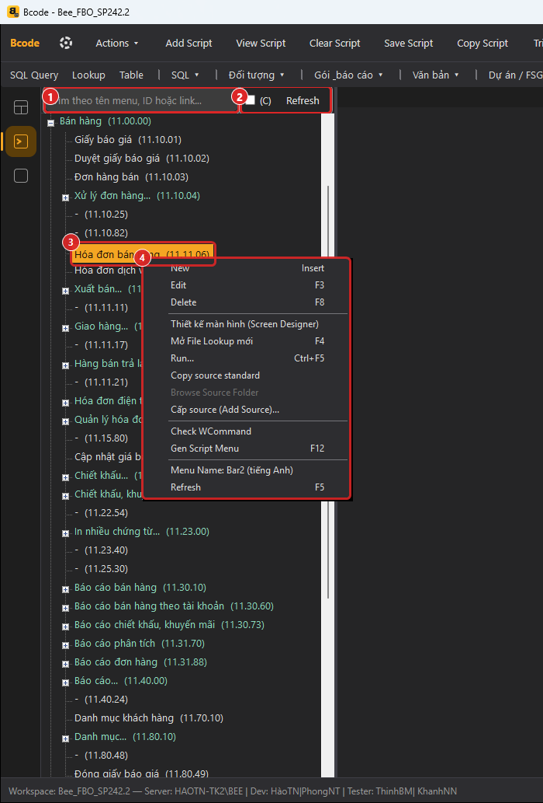

Trên ảnh: **①** ô lọc theo tên / ID / link · **②** ô (C) chỉ menu customize + Refresh · **③** menu đang chọn (double-click = mở File Lookup) · **④** menu chuột phải.

| Thao tác | Cách làm |
|---|---|
| Xem source của menu | **Double-click** menu lá → mở / dùng lại tab **File Lookup** của menu đó (tên tab đổi theo menu đang xem: "File Lookup · {sysid}"). Menu đã có tab riêng "File Lookup · {sysid}" (mở bằng `F4`) thì chuyển về tab đó. Nếu tab đang chọn là **Gen Update** thì file của menu được nạp vào Gen Update. |
| Mở File Lookup thêm (đặt cạnh nhau so sánh) | `F4` hoặc chuột phải → **Mở File Lookup mới** → tab "File Lookup · {sysid}" riêng cho menu đó. Menu đã có tab mở bằng `F4` (cùng dự án) thì chuyển về tab đó, không mở trùng; tab đã đóng hoặc đổi dự án thì mở tab mới |
| Thêm menu | `Insert` hoặc chuột phải → **New** (điền sẵn mọi thông tin của menu đang chọn + tự gợi ý WMenu Id / Menu Id còn trống) |
| Sửa / xoá | `F3` **Edit** · `F8` **Delete** (hỏi xác nhận) |
| Chạy menu trên web | `Ctrl+F5` hoặc **Run...** → mở `{Login WLink}/Main/{Link}` bằng trình duyệt mặc định |
| Chạy menu trong FSG FBO | `Ctrl+4` hoặc **Run trong FSG FBO** → mở tab FSG FBO, tự đăng nhập rồi vào đúng trang của menu. Dự án đã có tab FSG FBO đăng nhập rồi thì menu khác mở **thêm 1 tab mới** đi thẳng tới menu đó, dùng chung phiên đăng nhập (như nhiều tab Chrome, không đăng nhập lại); ấn lại đúng menu đã có tab thì chuyển sang tab đó và tải lại trang. Phiên hết hạn (bị đẩy về trang đăng nhập) thì tự đăng nhập lại rồi vào menu |
| Sinh script menu | `F12` **Gen Script Menu** → cửa sổ "Script — {WMenuId}" (DELETE + INSERT cho wcommand và command, mỗi câu kết thúc GO). Menu có **menu mẹ** thì hỏi trước *"Có muốn gen cả menu mẹ không?"*: **No** = chỉ gen menu đang chọn (như cũ) · **Yes** = hộp tick các menu mẹ (gốc trước) + menu đang chọn, tick sẵn hết — bỏ tick menu không cần rồi **Gen Script Menu** (`Space` tick / bỏ, `Enter` gen, `Esc` huỷ); script gom các menu đã tick theo thứ tự cha trước con, mỗi menu có dòng `-- Menu: …` · **Cancel** / `Esc` = thôi. Menu gốc thì không hỏi |
| Kiểm tra trùng | **Check WCommand** → hộp "Duplicate Menu" (tab "Not exists in Command" và "Difference Sysid" — sysid của wcommand khác của command; menu không khai sysid như menu nhóm, dòng kẻ "-" được bỏ qua) |
| Thiết kế màn hình | **Thiết kế màn hình (Screen Designer)** — chỉ bật khi menu có SysId |
| Khai field dạng lưới (triển khai) | **Mở dạng lưới (khai field)** — chỉ hiện khi bật Chế độ triển khai (chuột phải cây File Lookup), menu có SysId; xem [Lưới khai field](#luoi-field) |
| Lấy source chuẩn | **Copy source standard** / **Cấp source (Add Source)...** (xem [Cấp source](#cap-source)) |
| Đổi tên hiển thị | **Menu Name: Bar2 (tiếng Anh)** / **Menu Name: Bar (tiếng Việt)** — đổi cho cả cây WCommand và Mobile, được nhớ lại |
| Copy đường dẫn menu | `Ctrl+C` → copy dạng "Phải thu \ Tạo hóa đơn … (C)" |
| Xem yêu cầu QLYC của menu | Chuột phải → **Yêu cầu liên quan (QLYC)…** (phím: chưa gán, đặt ở Template → Phím tắt, nhóm Cây menu) → mở tab **Yêu cầu FSG** lọc sẵn các yêu cầu của **dự án đang chọn** liên quan menu đó (xem bên dưới) |
| Xem menu liên quan tới những gì | Chuột phải → **Sơ đồ phụ thuộc…** → tab sơ đồ: thẻ giữa ghi wmenu_id · menu_id · sysid · link; cột **Dùng tới** = menu con (menu nhóm), các file của menu đúng như File Lookup hiện (Dir / Grid / Filter / Query / Report / Upload…) và store / procedure / function / bảng / view có tên trong các file đó (ghi "trong &lt;file&gt;"). Bấm một nút để đi tiếp (vd bấm procedure xem nó dùng bảng nào, ai khác gọi nó). Tên object dò theo chữ trong file (lấy danh sách tên từ cây SQL Object) nên có thể thừa vài tên trùng từ thường như `entity`, `lookup`. Mỗi loại được **tách thành một vùng riêng có khung** cho dễ nhìn — function một vùng, store (procedure) một vùng, view / trigger / bảng riêng; **file controller còn chia nhỏ** theo thư mục: Dir · Grid · Filter · Include · Options · Report. Khi một bên có nhiều node, các vùng **xếp thành lưới nhiều cột** (thay vì một nhánh dọc dài) cho ngắn lại, dễ tìm; bên nào trống thì nhường hết bề ngang cho bên kia. |
| View Relative Tables (bảng liên quan của chứng từ) | Chuột phải menu **có mã chứng từ (syscode)** → **View Relative Tables** → tab "Table liên quan: {mã chứng từ}": **trái** = danh sách các **bảng chuẩn liên quan tới chứng từ** (giống FCode), chia **App Data** / **Sys Data**; **phải** = lưới dữ liệu (như tab Table). Đầu danh sách là mã chứng từ + dải huy hiệu tiền tố bảng c$ / m$ / d$ / i$ + URL (đọc từ `dmct9`). **Bấm một bảng = xem tại chỗ** (nạp vào lưới bên phải, đã lọc đúng chứng từ — vd `ma_ct = 'HDA'`); **bấm huy hiệu** (vd `m81$`) = xem bảng chứng từ đó tại chỗ như FCode (`m81$` → `m81$000000`, gộp các kỳ, lọc `ma_ct` của chứng từ nếu bảng có cột này); **chuột phải** (bảng hoặc huy hiệu) → **Mở sang tab mới** để mở sang tab Table riêng (còn có Chép tên bảng / Chép điều kiện). Kéo thanh chia giữa hai bên để đổi bề rộng danh sách; tab hẹp thì danh sách tự co để lưới vẫn đủ chỗ. Danh sách là tập bảng chuẩn (dmct, dmct0…, voucher, sysflowinfo, wcommand…) **đã lọc chỉ giữ bảng có thật** trong database. Mục menu chỉ hiện khi menu có syscode (chứng từ); menu nhóm / menu không chứng từ thì mờ. |
| Nạp lại | `F5` **Refresh** |

### Yêu cầu liên quan (QLYC)

Chuột phải một menu → **Yêu cầu liên quan (QLYC)…**: mở tab **Yêu cầu FSG** (Báo cáo yêu cầu FSG), bỏ các lọc khác và chỉ hiện yêu cầu (chỉ đọc) của dự án đang chọn liên quan menu đó. Chip **📌 Menu: … ✕** trên hàng lọc trạng thái cho biết đang lọc theo menu nào — bấm ✕ để bỏ. Cột **Liên quan** đầu bảng ghi lý do khớp; bấm ô Nội dung để mở khung chi tiết (có **🤖 AI tạo danh mục**).

- Dữ liệu: dùng yêu cầu đã kéo lưu trên máy (`%AppData%\Bcode\fsg-requirements.json`). Dự án chưa kéo lần nào thì Bcode tự kéo theo Mã dự án (cần mạng / VPN tới FSG; lỗi thì báo ở dòng trên bảng, sửa xong bấm **⟳ Kéo về**). Muốn cập nhật mới nhất: bấm **⟳ Kéo về** với Mã dự án = dự án đó.
- Mã dự án = **Project ID** của project (trống thì dùng tên project) — phải trùng `ma_da` trên FSG (Ctrl+F5 Synchronize project tự điền đúng).
- Cách khớp yêu cầu ↔ menu (`menu_id` của yêu cầu FSG chính là **WMenu Id** của cây, vd `09.30.03`), theo thứ tự hiện:
  1. **Đúng menu** — menu_id = WMenu Id của menu.
  2. **Menu con** — chuột phải menu nhóm (vd "Phải trả") thì lấy cả yêu cầu của mọi menu con / cháu.
  3. **Trùng tên menu** — tên menu của yêu cầu = Bar hoặc Bar2 (bỏ hoa / dấu, bỏ "(C)" "(*)") dù menu_id khác.
  4. **Nhắc trong nội dung** / **Đường dẫn trong nội dung** — yêu cầu gắn ở menu chung (`xx.00.00` hoặc menu cha) mà nội dung ghi trọn tên menu, hoặc tên menu nằm trên dòng "Đường dẫn: …".
- Không tìm được: yêu cầu gắn menu chung mà nội dung không ghi tên menu (hoặc ghi tắt / khác chữ); menu đã xoá khỏi wcommand; tên menu quá ngắn (dưới 2 từ / 10 ký tự) không dùng để dò nội dung; cây Mobile không có mục này.

### Form WCOMMAND - New / Edit

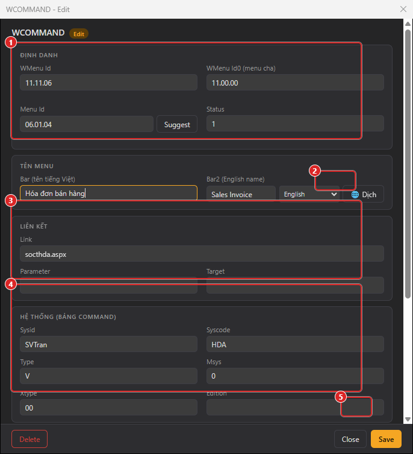

Trên ảnh: **①** Định danh (WMenu Id, menu cha, Menu Id + Suggest) · **②** 🌐 Dịch Bar → Bar2 · **③** Liên kết (Link, Parameter, Target) · **④** Hệ thống — bảng command (Sysid, Syscode, Type…) · **⑤** Save.

Form không chặn (vẫn bấm được cây): chọn menu khác trên cây là form nạp menu đó.

- **Định danh**: WMenu Id (+ **Suggest** — gợi ý id chưa tồn tại trong wcommand, chỉ hiện khi New), WMenu Id0 (menu cha), Menu Id (+ **Suggest**), Status.
  - Gợi ý WMenu Id **giữ nguyên phần đầu** của menu đang đứng trên cây (hoặc id đang gõ trong ô) và chỉ thay **2 ký tự cuối**: lấy mã trống đầu tiên theo thứ tự `01` → `99`, hết số thì `A1` … `Z1`, rồi `A2` … `Z2`, … `A9` … `Z9`. Vd đứng ở *Hóa đơn dịch vụ (07.10.08)* bấm New → `07.10.01` nếu còn trống (trước đây ra nhầm `07.81.01`).
  - New ở một nhóm (`07.00.00`), id đang gõ không đúng dạng `GG.SS.LL`, hoặc đổi menu cha sang nhóm khác → gợi ý theo menu cha như cũ (nhóm mới `GG.00.00` / `GG.SS.01` kế tiếp).
- **Tên menu**: Bar (tên tiếng Việt), Bar2 (English name) + chọn ngôn ngữ + **🌐 Dịch** (Google dịch Bar sang Bar2 — nhớ kiểm tra lại rồi Save).
- **Liên kết**: Link, Parameter, Target. **Hệ thống (bảng command)**: Sysid, Syscode, Type, Msys, Xtype, Edition. **Bảng dữ liệu**: bảng m / d đọc từ file Dir (chỉ xem). **Biểu tượng**: Icon, Expl Icon (0-255), Icon Url.
- Nút **Save** · **Delete** · **Close**. Save ghi cả `wcommand` và `command` trong một transaction. Save (New hoặc Edit) xong, Bcode tự **sync menu sang QLYC** chạy ngầm — giống **Actions > Create Menu** cho dự án đang chọn; không chờ, lỗi thì bỏ qua (không báo).

> **Lưu ý:** "WMenu Id '…' đã tồn tại" → bấm **Suggest** lấy id khác. Menu Id đã có → Bcode hỏi trước vì Save sẽ **ghi đè** dòng command cũ.

Menu loại APP mở form **COMMAND - Edit** (liệt kê mọi cột của bảng command, có Refresh Data / Save / New / Delete và danh sách `reports` bên dưới).

<a id="mobile"></a>
## Mobile — cây menu app mobile

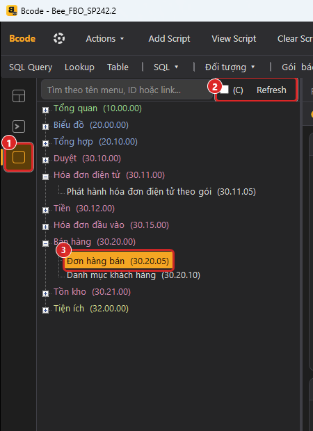

Trên ảnh: **①** mục Mobile ở cột icon · **②** ô (C) + Refresh · **③** menu mobile đang chọn.

Mở: biểu tượng **Mobile** ở cột icon trái (phím `left.mobile`, chưa gán mặc định — gán ở Template → Phím tắt). Cây đọc bảng **dvcommand** ở Sys Data (khoá `wmenu_id`, cha `wmenu_id0`).

- Thanh lọc, ô **(C)**, đổi tên Bar/Bar2 giống cây WCommand.
- Chuột phải: New · Edit · Delete · Mở File Lookup mới · Gen Script Menu · Menu Name · Refresh. (Không có Run, Thiết kế màn hình, Check WCommand.) New / Edit / Delete / Gen Script **chỉ sửa dvcommand**, không đụng bảng command.
- Form **DVCOMMAND - Edit** giống COMMAND - Edit, thêm ô Table Dir (bảng m) / Bảng d (Grid) và nút 🌐 Dịch cho Bar2.
- **Double-click** menu → tab "File Lookup · Mobile · {sysid}" — tìm file trong `App_Data\Controllers\Mobile\{Dir,Filter,Grid,Include}` của thư mục **Mobile Path**; `F4` mở thêm tab riêng.

> **Lưu ý:** Mobile Path trống thì Bcode đoán `<thư mục cha của Source Path>\MobileService`, rồi `Source Path\MobileService`. Không thấy → báo "chưa khai báo Mobile Path (Edit Project)…". Không có bảng dvcommand → cây hiện "(Không có bảng dvcommand ở Sys Data của workspace này, hoặc bảng rỗng)".

<a id="file-lookup"></a>
## File Lookup — tìm và xem source

Mở: nút **File Lookup** (`Ctrl+Shift+F`), hoặc double-click một menu trong cây WCommand. Cần workspace có **Source Path**.

Tab File Lookup (cả tab mở thêm bằng `F4` và tab Mobile) có **ô xanh dương hình thư mục + kính lúp** ở đầu tab, chữ tab cũng màu xanh dương (giống tab File Lookup của FCode) để dễ nhận ra giữa nhiều tab.

### Thanh công cụ

1. **Path:** + **Load** — quét lại thư mục (xoá cache phân tích).
2. Chọn loại file (`.*`, `.f`, `.xml`, `.aspx`, `.xlsx`, `.rpt`) · **Only Show {đuôi}** (đang lọc thì bấm sang menu khác ở cây WCommand vẫn giữ lọc; tắt bằng nút hoặc chọn `.*`) · **SearchBox ▾** (mở khung tìm nội dung) · ô **Search...** (lọc tên file khi gõ, tìm trong cả thư mục Path; `Enter` = lọc ngay). Máy yếu gõ bị khựng: Template → **Tìm file** → *Khi gõ vào ô Search* = **Ấn Enter mới tìm** — gõ không tìm, chỉ khi bấm `Enter` mới tìm (ô hiện chữ mờ "Search... (Enter để tìm)"; xoá trống rồi `Enter` = về danh sách / cây menu đầy đủ); tab File Lookup đang mở đổi theo ngay. Đang xem cây của 1 menu mà gõ Search thì tìm cả thư mục; xoá trắng ô Search → quay lại cây của menu vừa xem. Gõ đúng tên trang menu `.aspx` (vd `arcthd1.aspx`) thì cây hiện **toàn bộ file của menu dùng trang đó** (Main, Dir, Filter, Grid, Lookup, Report, Templates…) — y như bấm menu đó trên cây WCommand; thanh trạng thái ghi tên menu (nhiều menu cùng trang thì lấy menu đầu, ghi "+N menu khác"). Trang không có menu nào trên cây WCommand thì vẫn lọc tên file như thường.
3. **Copy to... (n)** · **Tick tất cả** · **Bỏ tick** · **Cấp source**.

### Các bước dùng

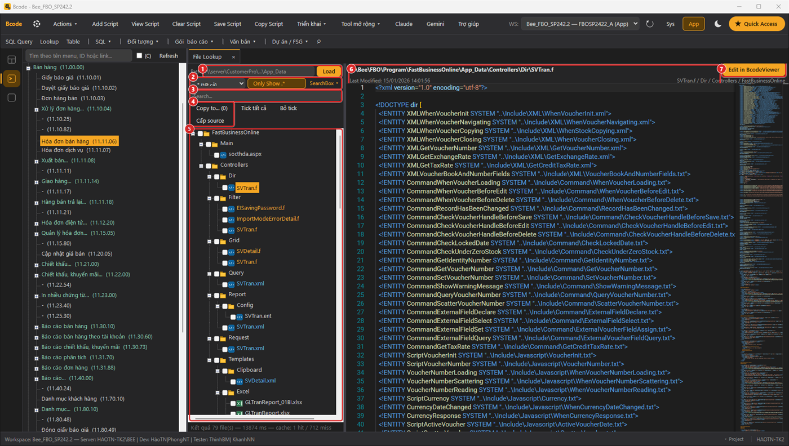

Trên ảnh: **①** Path + Load · **②** loại file · Only Show · SearchBox · **③** Search... (lọc tên file) · **④** Copy to · Tick tất cả · Bỏ tick · Cấp source · **⑤** cây file theo menu (đỏ = thiếu entity / include) · **⑥** đường dẫn + Last Modified · **⑦** **Edit in BcodeViewer**.

1. **Theo menu**: double-click menu ở cây WCommand → cây hiện trang Main + các file `App_Data\Controllers\*\<sysid>*` của menu, mở sẵn hết. Cùng các form liên quan dò như FCode: lưới con (`<items style="Grid" controller=…>`), form mở bằng `showForm(…)` (cả tên có `$`: `g.showForm('zduyetSMBC$Create')` → `Filter\zduyetSMBC$Create.f` / `.xml`; form mở ra lại mở form khác thì dò tiếp), tên ghép từ entity (`controller="&DiscountPromotion.Pre;DiscountPromotionGift"`, `showForm(']]>&Controller;<![CDATA[Filter')`), và thư mục **Lookup** (controller có đuôi `Lookup` như `&Identity;Lookup`, khai `@$relType = 'Lookup'`), thư mục **Report** đủ bộ in phiếu: file Report mà form in gọi tới (`controller="GLTranReport"` trong Report của GLTran → `Report\GLTranReport.xml`), include riêng trong `Report\Include` (`GLTranReportBI.xml`, `GLTranReportSql.txt`) và các mẫu `.rpt` / `.xlsx` của chúng (cả bản `_a` khi tên mẫu ghép entity). Include đọc như trình đọc XML: chỉ phần được gọi tới, bỏ khối `<![%X;[ … ]]>` khi X = IGNORE; entity khai sẵn trong `.ent` dùng chung mà file không gọi `&X;` thì không tính (vd `Include\CompactMode.ent` khai `ScriptGridShowFlowSRDetail` = `showForm('SRInvoiceFilter')`… chỉ `Grid\SRDetail` dùng → menu khác gọi `%CompactMode;` như Bảng cân đối phát sinh không còn kéo theo SRInvoice / SRIssue / SRPhysical / SRBill).
   **Duyệt tự do**: gõ Path rồi **Load**. (Đổi dự án xong cây chưa quét — chọn menu hoặc bấm Load.)
   File tạo **ngoài Bcode** — tạo tay trong Explorer, copy vào, biên dịch `Filter\X.xml` ra `X.f` bằng FCode / BcodeViewer, `git pull`, người khác deploy… — hiện ngay ở lần bấm menu (hoặc lần tìm) kế tiếp, kể cả file nằm trong thư mục mới; file bị xoá / đổi tên cũng tự mất khỏi cây. Không cần `F5`: mỗi lần lọc Bcode chỉ hỏi giờ sửa của các thư mục (rất nhanh) và chỉ đọc lại thư mục nào vừa thay đổi.
   > Share mạng: Windows có thể nhớ giờ thư mục vài giây, nên file người khác vừa tạo trên server có khi phải chờ chừng 10 giây mới hiện. `F5` trên cây (hoặc **Load**) vẫn quét lại toàn bộ như trước.
2. Bấm một file → khung xem trước (Monaco, chỉ đọc) bên phải, kèm "Last Modified". Khung theo theme sáng / tối của Bcode và đổi ngay khi đổi theme; theme BcodeViewer đang dùng cùng sáng / tối với Bcode thì tô màu y như BcodeViewer. `F12` trên `&Entity;` để peek nội dung entity — tìm trong cả cây Include của file (không giới hạn số cấp), kể cả F12 bên trong giá trị entity đang peek hay trong file .txt/.ent vừa mở ra từ F12 (vẫn thấy entity khai báo ở file Dir/Grid cha). Mở file xong Bcode đọc sẵn cây Include ở nền, các lần F12 sau gần như tức thì. **`Ctrl+F12`** = mở bằng **BcodeViewer** để sửa đúng file mà F12 sẽ đi tới: `&Entity;` SYSTEM / đường dẫn Include → file đó; entity giá trị → file khai báo nó; con trỏ ở chữ thường → chính file đang xem (cũng dùng được trong cửa sổ xem mở ra từ F12 và trong tab mở file; lần đầu chưa khai đường dẫn BcodeViewer thì Bcode hỏi BcodeViewer.exe; đổi phím ở Template → Phím tắt → "Khung xem file"); `Ctrl+F` tìm trong file; `Ctrl+G` hộp **Go to** giống hệt BcodeViewer (TAG fields / command / script / response / css / ENTITY — DETAIL, tô cam/đỏ command Inserted/Updated, `on$…$ExecuteCommand` / `ResponseComplete`, `onChange$Grid…`, cả trong hộp lẫn trong khung xem — chế độ Web và App như nhau).
3. File **tô đỏ** = thiếu entity / include: chọn file để xem danh sách "✖ …" bị thiếu. Dòng trạng thái: "Kết quả n file(s) — ⚠ k file lỗi entity/include…".
4. **Edit in BcodeViewer** (hoặc double-click file) để sửa. Lần đầu Bcode hỏi đường dẫn BcodeViewer.exe. File `.rpt` / `.xlsx` mở bằng chương trình Windows. Double-click khi **chưa** khai BcodeViewer thì file mở ở tab mới của Bcode: sửa xong bấm **`Ctrl+S`** để lưu (dòng trạng thái báo "Đã lưu …"). Bcode không ghi đè file trong kho SourceCollection, file `.f` đang mã hoá (`<Encrypted>`) hay file đặt Read-only — có hộp báo lý do.
5. **Cấp source nhanh**: chọn 1 file `.f` của Dir / Grid / Filter → dòng dưới đường dẫn hiện **View source <phiên bản>** (vd `View source FBOR2SP24`): phiên bản của dự án; dự án không có file đó thì tự lùi về **phiên bản thấp hơn gần nhất** có file (chữ màu cam + ↓). Rê chuột lên nhãn xem file nguồn (phiên bản + đường dẫn trong phiên bản), file đích và giải thích. Bấm vào nhãn để xem file .xml trong kho (chỉ đọc) — cửa sổ xem chỉ ghi `View source <phiên bản> · <đường dẫn trong phiên bản>`, không hiện đường dẫn ổ mạng của kho source (cũng vậy với View source ở hộp Cấp source / Add Source và sơ đồ phụ thuộc). Bấm **Cấp source** cạnh nhãn → hỏi xác nhận (báo rõ nếu sẽ ghi đè) rồi chép luôn file đó vào dự án. Nút **Cấp source** ở thanh trên vẫn mở hộp thoại cấp nhiều file như cũ.

### Tìm nội dung (SearchBox)

Nhập **Search in** (thư mục) + **String search**, tuỳ chọn File Type / Match Case / Show Pattern → **Search** (nút thành **Cancel** khi đang tìm). Quy tắc file nào được tìm chỉnh ở Template → **Tìm file** — mặc định File Type `*.*` **không** đọc file `.f` ở Dir / Filter / Grid (bản đã biên dịch, tìm chữ trong đó vô ích); gõ rõ `*.f` thì vẫn tìm. Luật này chỉ áp cho SearchBox, không ảnh hưởng cây file theo menu. Cột cây hẹp hoặc tỉ lệ giao diện lớn thì khung tự cao thêm (ô tick và nút Search xuống dòng), không bị cây file che.

### Chuột phải trên file

Go to File/Folder · **Copy to...** (file đã tick) · Chuyển sang .frx (Excel → FRX / Crystal → FRX) · Sơ đồ phụ thuộc… · **Xem bản giải mã (.f)…** (xem dưới) · Copy path · Get Hash Source · **Cấp source (tự động theo phiên bản)...** · Cấp source thủ công (Add Source)... · **Clone files...** (đặt tên mới, có thể clone kèm file cùng tên, không ghi đè) · **Rename...** (`F2`, đổi tên file — xem dưới) · **Delete file** (có tick thì xoá mọi file đã tick — xem dưới) · **Khôi phục file vừa xoá** · **Offline Design Excel File** (bật / tắt — xem dưới) · **Chế độ triển khai (khai field dạng lưới)** (bật / tắt; khi bật, file Dir / Grid / Filter / Report có thêm **Mở dạng lưới (khai field)** — xem [Lưới khai field](#luoi-field)) · Refresh (`F5`).

Phím trong cây file: `F2` đổi tên file đang chọn, `F5` quét lại (giữ cache), `F4` nhân bản tab File Lookup hiện tại (đang xem cây 1 menu: menu đó đã có tab riêng — kể cả chính tab đang bấm — thì chuyển về / ở lại tab đó, không tách tab trùng; chưa có thì mở tab riêng "File Lookup · {sysid}"), `Ctrl+C` copy đường dẫn.

**Xem bản giải mã (.f)…** (dịch ngược file controller `.f` có khối `<Encrypted>`): chuột phải file `.f` trên cây → cửa sổ xem nội dung đã giải, **chỉ xem** — không lưu, không ghi gì vào file hay thư mục dự án; Ctrl+F tìm, chọn chữ để copy, F12 tra entity như cửa sổ xem source. Mục này **chỉ hiện khi máy đã kích hoạt Key Decrypt SQL Object** (Settings → Key Decrypt SQL Object). Ngoài key, cần thêm:
- FCode đã cài (thư mục chứa `fsystem.dll`, khai ở Template → Đường dẫn → FCode; thường tự dò ra);
- **license Fast của chính máy này**: file `C:\Windows\<TênMáy>.c` do Fast cấp (trong FCode giữ Ctrl + bấm chuột giữa vào thông tin dự án để chép mã yêu cầu cấp key). File `.c` gắn với ổ cứng / tên máy — chép từ máy khác sang không dùng được.
Thiếu thứ nào thì cửa sổ báo rõ thiếu gì thay vì nội dung — kể cả khi license không khớp máy (cấp cho máy khác, hoặc Windows đã cài lại / nâng cấp sau khi cấp: license ghi kèm ngày cài Windows). Kiểm nhanh license: chạy `FDecrypt\Bcode.FDecrypt.exe --diag "<thư mục FCode>"` (cạnh Bcode.exe). File không có khối mã hoá thì hiện nguyên văn.

**Màu / chữ đậm của cây file**: chỉnh ở Template → **Màu cây** → khung "Cây File Lookup". Mặc định: `.f` cam, `.xml` xanh dương, thư mục và file khác theo màu chữ của theme, không in đậm. Muốn khác: chọn **Tự tô màu** rồi chọn màu từng dòng; tick **Đậm** cho loại cần nổi bật (vd thư mục, `.aspx`). Loại chưa có dòng: gõ đuôi (vd `.xlsx`) → **Thêm loại**; đuôi không khai báo theo dòng "File khác". **Trả về mặc định** bỏ hết màu tự chọn, chữ đậm và loại đã thêm. Bấm **Áp dụng** / **Lưu** — cây đang mở đổi ngay, áp cho cả chế độ App và Web. (Font / màu của khu vực **Thanh tab** ở tab Bố cục & font chỉ đổi chữ trên dải tab, không làm cây file hay nội dung tab đậm / đổi màu theo.)

**Copy đường dẫn nhiều file một lúc**: tick các file (bấm ô tick, hoặc giữ `Ctrl` + click vào tên file để tick / bỏ tick nhanh; `Ctrl` + click thư mục = tick / bỏ tick cả thư mục) → `Ctrl+C` → clipboard có đường dẫn đầy đủ của mọi file đã tick, mỗi dòng một file, theo thứ tự trên cây; dòng trạng thái báo "Đã copy N đường dẫn". Không tick file nào thì `Ctrl+C` copy đường dẫn dòng đang chọn (như chuột phải → Copy path). `Ctrl+C` chỉ có tác dụng khi con trỏ đang ở cây file — ở ô Path / Search / khung xem trước vẫn copy chữ như thường.

**Xoá nhiều file một lúc**: tick các file cần xoá → chuột phải → **Delete file (N file đã tick)** → Bcode hỏi một lần, liệt kê các file sẽ xoá (quá 20 file thì ghi "... và N file khác"). Chọn **Yes** là xoá hết, file read-only cũng xoá. File nào không xoá được (đang mở, không có quyền...) thì Bcode xoá tiếp các file còn lại rồi báo danh sách lỗi ở cuối. Xoá xong cây tự quét lại. Không tick file nào thì **Delete file** xoá đúng file đang chọn như trước.

**Khôi phục file xoá nhầm**: file trên ổ mạng (`\\server\...`) không vào Thùng rác, nên trước khi xoá Bcode chép một bản sao vào `%AppData%\Bcode\deleted-files`. Không chép được bản sao (file đang bị khoá...) thì Bcode **không xoá** file đó và báo trong danh sách lỗi. Xoá nhầm thì chuột phải trên cây file → **Khôi phục file vừa xoá (N file, giờ xoá)...** → Bcode liệt kê các file của lần xoá gần nhất, chọn **Yes** là chép trả về đúng chỗ cũ (giữ cả thuộc tính read-only). File đã có lại ở chỗ cũ thì giữ nguyên, không ghi đè. Bấm lần nữa = khôi phục lần xoá trước đó. Bản sao giữ **7 ngày** (đổi ở Template → **Tìm file** → *Giữ bản sao file đã xoá*; chọn "Không giữ" = xoá hẳn như trước), quá hạn tự dọn ở lần xoá sau. Mục này mờ khi không còn bản sao nào.

**Sửa mẫu in Excel mà FBO vẫn in được (Offline Design Excel File)**: mở thẳng file mẫu in `.xlsx` bằng Excel thì Excel khoá file, FBO in báo lỗi "file Excel đang được sử dụng". Chuột phải trên cây file → tick **Offline Design Excel File** (giống FCode; bấm lần nữa để tắt; Bcode nhớ lựa chọn). Khi bật, nhấn đúp (hoặc nút **Edit**) một file `.xlsx` / `.xls` / `.xlsm` nằm trong thư mục `Templates\Excel` → Bcode chép ra bản sao `%AppData%\Bcode\offline-excel\<dự án>\_Offline___<tên file>` rồi mở bản sao bằng Excel — file gốc không bị khoá, FBO in bình thường. Mỗi lần bấm **Save** trong Excel, khoảng 1–2 giây sau Bcode tự chép bản sửa về đè file gốc; dòng trạng thái của File Lookup báo "đã chép bản sửa về ...". An toàn dữ liệu:
- Lưu mà nội dung không đổi thì không ghi file gốc.
- File gốc bị người khác / chương trình khác sửa sau lúc bạn mở thì Bcode hỏi trước khi ghi đè (**No** = giữ file gốc, bản sửa của bạn vẫn nằm ở bản sao).
- Tắt Bcode lúc Excel còn mở rồi mới lưu thì lần sau mở lại file đó Bcode hỏi: **Yes** đưa bản sửa về file gốc, **No** bỏ bản sửa và chép lại từ file gốc, **Cancel** không làm gì.
- File gốc read-only / đang bị giữ không ghi được thì Bcode báo lỗi, bản sửa vẫn ở bản sao — lưu lại trong Excel để thử lại.

Nên giữ Bcode mở cho tới khi lưu xong trong Excel. File Excel ngoài thư mục `Templates\Excel` và mọi file khác vẫn mở như cũ.

### Đổi tên file (F2)

Chọn 1 file trên cây → `F2` (hoặc chuột phải → **Rename...**) → sửa tên ngay trên cây như Explorer (chỉ bôi đen phần tên, chừa đuôi) → `Enter` đổi tên thật trên đĩa, `Esc` huỷ. Chỉ đổi tên file, không đổi tên thư mục. Cả chế độ Web và App như nhau.

- **Không gõ đuôi** thì giữ đuôi cũ (`ARTran.xml` → gõ `ARTran2` → `ARTran2.xml`). Gõ đuôi khác thì Bcode hỏi: Yes = đổi đuôi · No = giữ đuôi cũ · Cancel = thôi.
- **Tên trùng** file đã có / **ký tự không hợp lệ** (`\ / : * ? " < > |`) → báo lỗi rồi mở lại ô sửa với chữ vừa gõ. File **đang bị khoá** (IIS, Visual Studio… đang mở) → báo rõ, không đổi gì.
- **Đổi tên cặp**: cùng thư mục có file cùng tên khác đuôi (`ARTran.xml` ↔ `ARTran.f`) → hỏi "Đổi tên luôn ARTran.f?" (mặc định **No**).
- Đổi xong: node trên cây, khung xem trước (nếu đang xem file đó) và các tab File Lookup khác cập nhật ngay, không quét lại thư mục.
- Bcode tìm nền trong `App_Data\Controllers` (Dir, Filter, Grid, Include, Options, Report) chỗ **còn nhắc tên cũ** ở dòng kiểu include / `controller="…"` / `SYSTEM "…"` / `showForm('…')` và hiện danh sách — **chỉ báo, không tự sửa**. Menu trong database (sysid của wcommand) cũng không tự đổi.

Phím `F2` đổi được ở Template → **Phím tắt** (nhóm "Cây file File Lookup").

> **Lưu ý:** cache phân tích lưu theo dự án ở `%AppData%\Bcode\FileLookupCache` (xoá được nếu nghi cache cũ). File bỏ qua theo tên (mặc định `_bk, _copy, - copy`) đặt ở ⚙ Settings → **Cây menu: bỏ qua file theo tên (like)...**.

<a id="luoi-field"></a>
## Lưới khai field — chế độ triển khai (giống FSD Studio)

Dành cho người triển khai: khai báo / sửa field của file Dir, Grid, Filter, Report trên **lưới** (mỗi field một dòng, mỗi thuộc tính một cột) thay vì sửa XML. Nhấn đúp file vẫn mở editor XML như cũ — lưới chỉ mở khi bạn chọn.

### Bật và mở

1. Mở File Lookup → chuột phải trên cây file → tick **Chế độ triển khai (khai field dạng lưới)** (bấm lần nữa để tắt; Bcode nhớ lựa chọn).
2. Chuột phải một file `.xml` / `.f` trong `Controllers\Dir`, `Grid`, `Filter`, `Report` (hoặc `Lookup`) → **Mở dạng lưới (khai field)**. Hoặc ở cây **WCommand**: chuột phải menu có SysID → **Mở dạng lưới (khai field)** (tìm file theo SysID trong `App_Data\Controllers` của dự án).
3. Tab **Lưới field · SysID** mở **cả bộ file của chứng từ** như FSD Studio: `[Dir] X`, các Grid con khai ở `<items style="Grid" controller="...">` của Dir / Filter, `[Filter] X` (và form lọc mở bằng `showForm('...')` đầu tiên trong Dir), `[Grid] X`, `[Report] X`. Mỗi loại ưu tiên đúng file bạn bấm, rồi `.xml`, rồi `.f`. Mở lại cùng bộ thì Bcode chuyển sang tab cũ.

### Các phần của tab

Từ trên xuống:
- **Hàng tab file**: bấm để đổi file; dấu `●` = file đó có thay đổi chưa lưu.
- **Thanh công cụ** (một hàng): **Fields (n)** / **Views (n)** · **＋ Thêm** · **Nhân bản** · **✕ Xoá** · **↑ / ↓** · **→ View** (chỉ Grid) · **Hoàn tác** · **Cột ▾** (chọn cột hiện / ẩn) · **XML** (hiện / ẩn khung XML bên phải) · **Load Data** (nạp lại file của tab đang xem từ đĩa) · **Reload All** (tìm và nạp lại cả bộ) · **Save** (có `●` khi còn thay đổi chưa lưu) · **View Script** (xem trước những dòng XML sẽ đổi so với file trên đĩa — mở tab chỉ đọc) · **Copy File** (chép file vào clipboard để dán vào Explorer / gói cập nhật) · **Mở XML** (mở file dạng XML trong một tab Bcode, `Ctrl+S` lưu); bên phải là ô **SysID** (gõ SysID khác rồi `Enter` để mở bộ khác cùng thư mục) và Voucher Code (khi mở từ cây WCommand).
- **Dòng Title**: 4 ô `titleV`, `titleE`, `subTitleV`, `subTitleE` — gõ rồi `Enter` / rời ô là ghi. File không có thẻ `<title>` / `<subTitle>` thì ô tô xám.
- **Dòng thông báo** (nền vàng nhạt, chỉ hiện khi có chuyện): field / file chỉ xem, `<fields>` nằm trong file include dùng chung, file có `<Encrypted>`, file đặt Read-only…
- **Lưới** (trái) + **khung XML** (phải): khung XML hiện XML của field (hoặc dòng view) đang chọn, tô màu như editor; sửa ngay trong khung rồi bấm **Áp dụng** (`Ctrl+Enter`) — phải là đúng một thẻ `<field>…</field>`.
- **Dòng trạng thái** dưới cùng: đường dẫn file (bấm = mở XML) và các file chưa lưu.

**Lưới Fields**: mỗi `<field>` một dòng, kẻ ô, xen màu dòng; cột **name** cố định khi cuộn ngang. Field nằm trong entity `&X;` (file include, kể cả include lồng nhiều tầng qua `%X;` → file `.ent` → `&Y;`) tô nền nhạt khác màu, cột **Nguồn** ghi `&X;` (rê chuột lên dòng xem đường dẫn file); sửa thì ghi vào chính file include đó. Cột theo loại file:
  - Dir / Filter: name, Nguồn, headerV, headerE, clientDefault, defaultValue, dataFormatString, align, categoryIndex, aliasName, type, rồi nhóm ô tick allowNulls, readOnly, disabled, hidden, inactivate, external, isPrimaryKey.
  - Grid: name, Nguồn, headerV, headerE, width, clientDefault, defaultValue, dataFormatString, align, aliasName, type, nhóm ô tick allowNulls, readOnly, hidden, inactivate, external, allowFilter, allowSorting, isPrimaryKey, rồi footerV, footerE.
  - Thuộc tính khác có trong file (rows, filterSource, maxLength…) tự thêm cột; thuộc tính chỉ có giá trị true / false (allowContain…) là ô tick, xếp liền nhóm ô tick. Tiêu đề các cột ô tick tô màu riêng để dễ nhận nhóm.
  - **Cột ▾**: tick / bỏ tick từng cột để hiện / ẩn; **Ẩn cột trống** (mặc định bật) tự ẩn cột không dòng nào có giá trị (trừ name, Nguồn, header, width, các ô tick chính); **Hiện tất cả cột**. Bcode nhớ lựa chọn cho lần sau.

**Views**: dòng `<field name>` (Grid) hoặc `<item value>` (Dir / Filter, cả trong `<category>`) của `<views>`, kể cả khi cả khối nằm trong entity (`<views>&FlowMultiFormView;</views>`) — sửa cột name / value, đổi thứ tự, xoá; dòng từ file include tô nền nhạt, cột Nguồn ghi entity.

Lưới, View Script và Mở XML đều mở thành tab trong Bcode, không bật cửa sổ riêng.

### Sửa trên lưới

- Gõ vào ô rồi `Enter` / rời ô là sửa ngay vào XML (chưa ghi đĩa). Ô trống = bỏ thuộc tính. Ô tick: bỏ tick allowNulls ghi `allowNulls="false"`, tick lại thì xoá thuộc tính (mặc định là true); các ô tick khác tick = `="true"`, bỏ tick = xoá thuộc tính.
- headerV / headerE / footerV / footerE ghi vào `<header v e>` / `<footer v e>`; field chưa có thẻ đó thì Bcode tự chèn.
- Đổi **name** thì Bcode sửa luôn chỗ gọi trong `<views>` của file đó (`<field name>` của Grid, `[tên]` trong `<item value>` của Dir / Filter).
- **Thêm** (`F4` / `Insert`): field mới ngay dưới dòng đang chọn (cùng file — kể cả file include), con trỏ vào ô name để gõ tên. **Nhân bản**: chép cả XML field đang chọn. **Xoá** (`F8`): field đang dùng trong views thì hỏi trước. **↑ / ↓** (`Alt+↑` / `Alt+↓`) hoặc **kéo tiêu đề dòng** (ô số thứ tự bên trái) để đổi thứ tự — khi kéo có vạch màu chỉ chỗ thả, rê sát mép trên / dưới thì lưới tự cuộn (chỉ trong cùng một file; kéo qua cả nhóm field của `&X;` được). **Thêm vào view** (`F7`, chỉ Grid): thêm `<field name>` vào cuối `<view>`. **Hoàn tác** `Ctrl+Z` (lùi từng bước tới lần lưu gần nhất).
- **Lưu** `Ctrl+S` / nút **Save**: ghi mọi file đã sửa (file chính và file include), **giữ nguyên định dạng, comment, thứ tự thuộc tính, DOCTYPE / entity và bảng mã gốc** (UTF-8 có / không BOM, file `.f` UTF-16) — chỉ đúng chỗ bạn sửa thay đổi. Trước khi ghi Bcode chép bản cũ vào `%AppData%\Bcode\field-grid-backup\<ngày-giờ>\` (giữ 30 ngày). File đã bị sửa ở nơi khác sau khi mở thì Bcode hỏi trước khi ghi đè. Đóng tab còn thay đổi chưa lưu thì Bcode hỏi.

### Không sửa được

Dòng chữ xám và dòng thông báo phía trên ghi lý do:
- File nằm trong kho source (đường dẫn kho ở Template), file không phải UTF-8 / UTF-16.
- Field nằm trong giá trị `<!ENTITY X "...">` khai ngay ở DOCTYPE, hoặc `&X;` không tìm được file: sửa ở file XML.

Sửa được nhưng có lưu ý (giống FSD Studio):
- File `.f` có khối `<Encrypted>` (mã hoá theo license máy của Fast): khối mã hoá **giữ nguyên từng ký tự**. Field chứa khối mã hoá (vd clientScript) vẫn sửa thuộc tính / header / thứ tự / xoá được trên lưới, chỉ khung XML của field đó là chỉ xem (không thay bằng XML gõ tay).
- File đặt thuộc tính **Read-only** (bản cài của khách hay đặt cho `.f`): vẫn sửa; khi lưu Bcode tạm gỡ Read-only, ghi, rồi đặt lại như cũ.

Lưới làm việc như nhau ở cả chế độ Web và App.

<a id="cap-source"></a>
## Cấp source, Copy to, Clone, File Reference

| Công cụ | Mở ở đâu | Dùng để |
|---|---|---|
| **Copy files to...** | File Lookup → tick file → **Copy to...** | Chép nhiều file sang thư mục / dự án khác: giữ cấu trúc thư mục con; file đích đã có → Bỏ qua / Ghi đè / Tự đổi tên (_1, _2…); đổi tên hàng loạt (Tiền tố / Hậu tố / Tìm → Thay). |
| **Cấp source (tự động theo phiên bản)** | File Lookup → **Cấp source** hoặc chuột phải file | Lấy đúng bản file chuẩn trong kho SourceCollection theo **Phiên bản** của dự án. Mỗi file gắn nhãn "đúng phiên bản / phiên bản khác / không tìm thấy / đã có / mới". Tick "Ghi đè file đã có ở đích" nếu muốn thay. Chọn 1 dòng rồi bấm **View source** (hoặc nhấn đúp dòng) để xem trước nội dung file .xml trong kho sắp được cấp — chỉ đọc, `Ctrl+F` tìm, `F12` mở file Include/entity ở **cửa sổ mới** (cửa sổ đang xem giữ nguyên) — file không có trong kho thì Bcode tìm tiếp trong **Program Path** của dự án đang chọn (dòng trên cùng ghi rõ), `Esc` đóng. Cửa sổ View source là cửa sổ riêng, có nút trên taskbar: `Alt+Tab` qua lại với Bcode được. |
| **Cấp source (Add Source)** | Chuột phải file / menu → Cấp source thủ công | Tìm theo mẫu tên (`;` ngăn cách, hỗ trợ `*` `?`), chọn Version, tick file, **OK — cấp source**. **View source** (hoặc nhấn đúp dòng) xem trước nội dung file sắp cấp. Lần đầu hỏi đường dẫn kho các phiên bản source. |
| **Copy source standard** | Cây WCommand → chuột phải menu | Chọn file chuẩn của menu, đổi tên hàng loạt rồi **Clone** sang dự án. Khi clone, nội dung bản mới cũng được đổi theo tên mới: `Controller="…"` ở trang Main, `controller=` / `Controller: '…'` / `reportFile=` / `templateFile=` / `g.showForm('…')` trong Grid, Report, Filter, Dir. Chỉ đổi những chuỗi ghi **đúng nguyên** tên file cũ (vd `rptA` → `rptB`) và chỉ áp cho file có trong danh sách clone; chữ hiển thị `v=` / `e=` không bị đổi tên. Ô **Tiêu đề mới V / E** điền sẵn tiêu đề hiện tại (lấy từ trang Main, không có thì từ `<title>` của Grid). Sửa hai ô này thì mọi cặp `v="tiêu đề cũ" e="…"` trong bản clone đổi sang tiêu đề mới, gồm trang Main và `<title>` của Grid/Dir. File gốc không bị sửa. File `.f` (đã mã hoá) chỉ copy nguyên, cần biên dịch lại từ `.xml` mới. |
| **File Reference** (`Ctrl+Shift+R`) | Thanh công cụ | Tìm mọi nơi tham chiếu một tên link / từ khoá trong App_Data; double-click kết quả để mở đúng dòng. |

> **Lưu ý:** kho SourceCollection chỉ được **đọc**; Bcode luôn hỏi trước khi ghi đè file ở đích. Đường dẫn kho chính / bổ sung khai ở Template → **Đường dẫn** (khung Kho source chỉ hiện trên máy đã nhập **key Decrypt SQL Object**).

**Thư mục kiến thức dùng chung** (Template → **Đường dẫn** → *Thư mục kiến thức (ghost text + Hỏi Fast)*): nơi lưu ma trận gợi ý đã học của các dự án (`ghost\`), kiến thức Hỏi Fast và các xác nhận ✔ / ✘ / bản sửa (`fastask\`). Để trống = trên máy này (`%AppData%\Bcode`). Khai cùng 1 thư mục mạng (vd `\\server\Bcode\knowledge`) cho các máy dùng Bcode: máy nào bấm **Học dự án này**, chấm ✔ ✘ hay sửa câu trả lời thì máy khác dùng luôn (file đổi là đọc lại). Đổi thư mục: kiến thức đang có được chép sang (không ghi đè file đã có, xác nhận ✔ ✘ thì gộp). Nút **Dùng máy này** = về mặc định. Lịch sử chat Hỏi Fast vẫn lưu riêng từng máy; thư mục mạng không với tới được thì tạm dùng thư mục trên máy (dòng trạng thái của ô báo ✘).

**Ổ C đầy — chuyển dữ liệu sang ổ khác**: gõ / **Chọn...** 1 thư mục ở ổ khác (vd `D:\BcodeData`) vào ô *Thư mục*, chỗ cũ còn dữ liệu thì hiện nút **Chuyển dữ liệu sang đây** kèm dung lượng (vd "Chỗ cũ còn 350 MB (1.234 file): C:\Users\…\AppData\Roaming\Bcode"). Bấm → hộp hỏi lại (từ đâu → đến đâu, bao nhiêu) → **Yes** thì chuyển hết `ghost\`, `fastask\` và `viewer\` của BcodeViewer (khi Viewer để trống ô thư mục riêng — dùng chung với Bcode) sang thư mục mới rồi **xoá ở chỗ cũ**. Lịch sử chat Hỏi Fast không chuyển (luôn ở máy này). Từng file chép xong (kiểm tra đủ dung lượng) mới xoá bản cũ; ổ mới đầy / mất mạng giữa chừng thì dừng, phần chưa chuyển vẫn nguyên ở chỗ cũ — bấm lại để chuyển tiếp. Chỗ mới đã có file cùng tên: xác nhận ✔ ✘ của Hỏi Fast thì gộp; giống hệt hoặc chỗ mới mới hơn thì bỏ bản cũ; chỗ cũ mới hơn thì thay; file xác nhận khác không gộp được thì giữ ở chỗ cũ và báo tên. Nên đóng BcodeViewer trong lúc chuyển. Kết quả hiện ngay dưới nút; chuyển xong hết thì nút tự ẩn. Bấm **Dùng máy này** sau đó thì nút hiện lại để chuyển ngược về máy này.

<a id="gen-update"></a>
## Gen Update — đóng gói file cập nhật

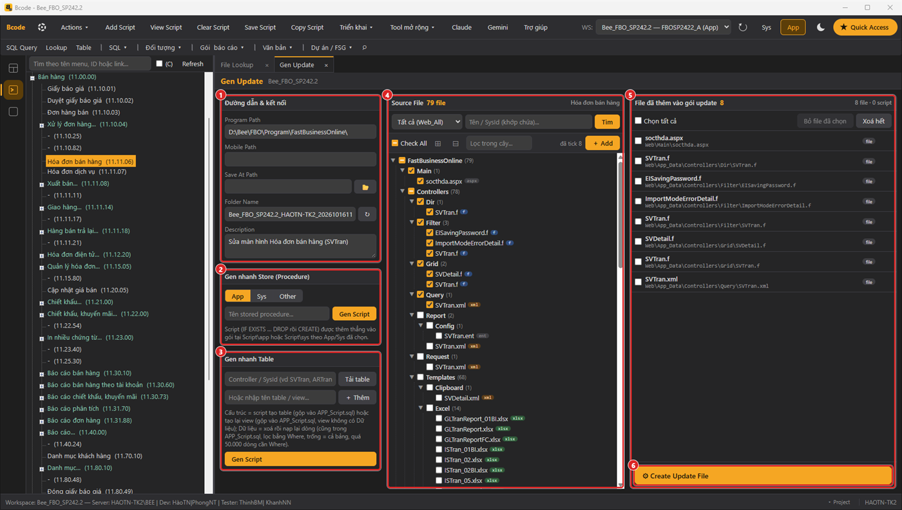

Trên ảnh: **①** Đường dẫn & kết nối (Save At Path, Folder Name, Description) · **②** Gen nhanh Store (Procedure) · **③** Gen nhanh Table · **④** Source File (cây file của menu, ＋ Add) · **⑤** File đã thêm vào gói update · **⑥** ⚙ Create Update File.

Mở: nút **Gen Update** (`Ctrl+Shift+G`). Cần Source Path.

1. **Đường dẫn & kết nối**: Program Path, Mobile Path, **Save At Path** (mặc định Working Path; 📂 mở thư mục), **Folder Name** (mặc định `{Mã dự án}_{TÊN MÁY}_{yyyyMMddHHmmss}`, ↻ tạo giờ mới), Description (ghi vào description.txt).
2. **Gen nhanh Store (Procedure)**: chọn App / Sys / Other, gõ tên procedure → **Gen Script** → script `IF EXISTS … DROP` rồi `CREATE`, gộp vào `Script\app\APP_Script.sql` hoặc `Script\sys\SYS_Script.sql` (danh sách vẫn hiện từng store để bỏ riêng được).
   **Gen nhanh Menu (wcommand)**: script `DELETE` + `INSERT` cho `wcommand` và `command` (đúng cột bảng của database đang chọn), gộp vào `Script\sys\SYS_Script.sql`. Có 3 cách đưa menu vào:
   - Gõ **WMenu ID / Controller / SysId** vào ô (nhiều cái cách nhau dấu phẩy) → **Gen Script Menu** (hoặc Enter).
   - Double-click 1 menu ở cây WCommand bên trái → WMenu ID được điền sẵn vào ô.
   - **☰ Chọn menu…**: mở hộp cây WCommand có ô lọc — gõ tên menu (không dấu cũng được, vd `phieu thu`), WMenu ID, link hoặc SysId; tick nhiều menu (tick nhóm = cả nhóm đang hiện) → **Gen Script Menu (N)** là gen luôn, ô nhận danh sách WMenu ID đã chọn. Phím: `↓` từ ô lọc xuống cây, `Space` tick / bỏ, `Enter` hoặc double-click 1 menu = gen ngay (chưa tick gì thì lấy menu đang đứng), `Esc` đóng. WMenu ID đang có trong ô được tick sẵn, ô lọc nhớ lần trước. Hộp lấy cây WCommand đã nạp ở bên trái (chưa có menu thì mở / `F5` cây WCommand trước); chỉ có menu bảng `wcommand`.
3. **Gen nhanh Table**: gõ Controller/SysId → **Tải table**, hoặc gõ tên bảng → **＋ Thêm**. Mỗi bảng chọn DB, **Cấu trúc**, **Dữ liệu**, Where → **Gen Script** (gộp vào APP_Script.sql). Hơn 50.000 dòng bắt buộc nhập Where. Table **không bao giờ** bị DROP.
4. **Source File**: double-click menu ở cây WCommand (hoặc gõ tên → **Tìm**) → chọn nhóm (Web_Dir, Web_Grid, Web_Filter, Web_Report…), tick file → **＋ Add**. Khi nạp theo menu, Grid / Filter / Dir chỉ lấy file `.f`. Ô **Lọc trong cây** chỉ ẩn bớt file — file đã tick vẫn giữ tick (và vẫn được Add) khi lọc / xoá lọc; **Check All** và `Ctrl+A` (bấm vào cây trước) tick / bỏ tick cả cây.
5. **File đã thêm vào gói update**: kiểm tra danh sách (Bỏ file đã chọn / Xoá hết; bỏ 1 file: nút ✕ trên dòng ở chế độ Web, `Delete` hoặc chuột phải → **Bỏ khỏi gói** ở chế độ App; `Ctrl+A` chọn hết) → **⚙ Create Update File** → "✔ Đã tạo N file tại: …" (Copy link / Mở thư mục).

Hai tuỳ chọn ở thẻ **Đường dẫn & kết nối** (nhớ cho lần sau, dùng chung với Note (New) và BcodeNote):

- **Gen vào đường dẫn mạng**: tạo gói xong thì chép thêm vào `<Đường dẫn mạng>\<TÊN MÁY>\` — mặc định `\\172.168.5.14\Send\`, sửa được ở ô **Đường dẫn mạng**. Thư mục tên máy chưa có thì Bcode tự tạo. Gói chép lên `\\172.168.5.14\...` thì kết quả hiện thêm **Link** web tải được, vd `http://dev.fast.com.vn/send/hungvd/PMT_HUNGVD_20261029214504.zip` (thư mục viết thường, tên file giữ nguyên) — nút **Copy link** chép link này để gửi; không có link web thì chép đường dẫn gói như trước. Note (New) cũng vậy.
- **Nén .zip khi gen lên mạng** (chỉ hiện khi tick ô trên): đưa lên mạng file `<Folder Name>.zip` (giải nén ra đúng thư mục gói) thay cho cả thư mục. Save At Path luôn chỉ có thư mục gói, không nén.
- Gói ở Save At Path luôn được tạo trước. Chép mạng lỗi (không có mạng / VPN, sai đường dẫn, không có quyền ghi; mạng không trả lời sau 15 giây) thì Bcode báo lỗi đỏ dưới kết quả, gói ở Save At Path vẫn giữ nguyên.

Cấu trúc gói:

```
<Save At>\<Folder Name>\
  Script\app\APP_Script.sql
  Script\sys\SYS_Script.sql
  Web\App_Data\...   Web\Main\...   (giữ đường dẫn tương đối so với site)
  description.txt
  note.txt          (chỉ Note (New) / BcodeNote, khi yêu cầu có 📝 Note)
```

File cấu hình dùng chung của site được đổi tên trong gói, thêm `__` ở đầu: `Web.config` → `__Web.config`, `MasterPage.master` → `__MasterPage.master`, `Options.xml` → `__Options.xml`, `Message.xml` → `__Message.xml` (cùng thư mục, không phân biệt hoa thường). Người triển khai phải tự xem / ghép, tránh chép đè nhầm bản đang chạy của khách. Áp dụng cho mọi gói: Gen Update, Note (New), BcodeNote; khung xem trước cũng hiện tên mới.

Script gộp giống Note (New): mỗi database 1 file, xếp table (cấu trúc → dữ liệu) → view → trigger / function / stored; mỗi đoạn mở đầu bằng dòng `-- ===== <nguồn> · <tên> =====` và kết thúc bằng `GO`.

> **Lưu ý:** object SQL bị mã hoá (encrypted) không lấy được script — gói chỉ ghi dòng nhắc. Lỗi hay gặp: "Chưa có file nào trong gói update", "Chưa nhập Save At Path / Folder Name", "Không tìm thấy stored procedure nào khớp…".

<a id="note"></a>
## Note và Note (New)

### Note (`Ctrl+Shift+E`)

Ghi chú tự do theo dự án: chọn / gõ tên note → **Mở**, gõ nội dung, **💾 Save**. Lưu ở `%AppData%\Bcode\Notes\<workspace>\<tên>.txt`.

### Note (New) — Advance Note (`Ctrl+Shift+4`)

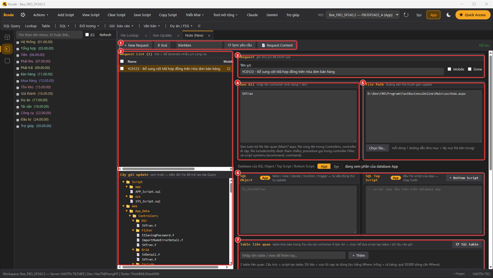

Trên ảnh: **①** ＋ New Request · Xoá · Tên lập trình + ⟳ Sync yêu cầu · Request Content · **②** Request List + Cây gói update · **③** tên yêu cầu (Mobile / Done) · **④** Gen All · **⑤** File Path · **⑥** SQL Object / SQL Top Script / Bottom Script · **⑦** Table liên quan.

Quản lý từng yêu cầu (request) và sinh gói update cho yêu cầu đó:

1. **⟳ Sync yêu cầu**: nhập Tên lập trình (ma_lt1) → kéo các yêu cầu của bạn trong dự án về (từ FSG). Hoặc **＋ New Request** để tạo tay.
2. Chọn yêu cầu ở **Request List** (ô **Lọc mã y/c** ngay trên danh sách: gõ một phần mã, nhiều mã cách nhau dấu cách / phẩy; `Enter` mở y/c đầu tiên khớp, `Esc` xoá lọc; ô tick ở tiêu đề chỉ tick các y/c đang hiện) rồi khai: **Gen All** (controller, mỗi dòng một cái), **File Path** (mỗi dòng một đường dẫn; `Ctrl+V` file copy từ Explorer là dán đường dẫn), **SQL Object** / **SQL Top Script** / **Bottom Script** (chọn App / Sys), **Table liên quan** (⟳ Tải table, Cấu trúc / Dữ liệu / Where).
   - Ô **Nhập tên table / view để thêm tay** nhận thêm cú pháp như ô SQL Data của FCode: **`bảng:điều kiện`**, vd `dmkh:ma_kh LIKE 'ABCD' and kh_yn = 1` → thêm dòng `dmkh`, tick sẵn **Dữ liệu**, **Where** = phần sau dấu `:` đầu tiên (điều kiện được chứa `:`). Script dữ liệu trong gói = `DELETE [dmkh] WHERE <điều kiện>` rồi nạp lại đúng các dòng thoả điều kiện; không có dòng nào khớp thì (như FCode) script chỉ còn `DELETE … WHERE <điều kiện>` — nơi chạy gói xoá các dòng đó — kèm dòng cảnh báo ⚠ ở Xem trước. `bảng:` (để trống điều kiện) = dữ liệu cả bảng; chỉ gõ tên bảng thì như cũ (thêm dòng, chưa tick gì).
   - Dán **nhiều dòng** (mỗi dòng một `bảng:điều kiện`) vào ô là thêm cả danh sách; một bảng lặp nhiều dòng thì điều kiện gộp bằng `OR`. Bảng đã có trong lưới thì chỉ cập nhật **Where** (giữ tick Cấu trúc / DB). View không nạp dữ liệu được nên không tick Dữ liệu.
3. **🔍 Xem trước gói** → cây gói update (double-click file để mở trong tab Query); **▶ Mở tất cả script vào tab Query** để rà lại.
4. **Generate Update**: Save At Path, Folder Name, **Tách theo từng y/c** (mỗi yêu cầu một thư mục con), **Done sau khi gen** (mặc định bật: gen xong tự đánh dấu Done các yêu cầu vừa gen; bỏ tick nếu muốn tự đánh dấu — nhớ cho lần sau) → **⚙ Generate Update**. Đánh dấu / bỏ Done bằng tay: bấm ô **Done** ngay trên dòng ở Request List (không cần mở yêu cầu) hoặc ô Done trong khung Request. Tick nhiều yêu cầu ở cột đầu danh sách để sinh chung. Có thêm **Gen vào đường dẫn mạng** và **Nén .zip khi gen lên mạng** (2 ô này hiện khi tick ô mạng) — giống hệt [Gen Update](#gen-update), nhớ chung cho cả Gen Update và BcodeNote.
   **Chỉ gen file ở ô File Path**: dưới ô File Path có **⚙ Gen update tất cả** (mọi đường dẫn trong ô) và **⚙ Gen update dòng đang chọn** (dòng đang đặt con trỏ; bôi đen nhiều dòng = các dòng đó) → tạo ngay gói **chỉ gồm các file đó** (thư mục = mọi file bên trong; không có Gen All, SQL Object, table, script, `note.txt`), dùng Save At Path / Folder Name / Gen vào đường dẫn mạng ở thẻ Generate Update. Gói được ghi vào **Đã gen trước đó** của yêu cầu nhưng **không** đánh Done.
   Gen xong (và ở danh sách **Đã gen trước đó** của yêu cầu) mỗi đường dẫn có **Copy link** · **Mở thư mục** · **🗑 Xoá** — Xoá hỏi lại rồi xoá hẳn thư mục gói ở Save At Path (không vào Recycle Bin) và bỏ link khỏi lịch sử, để gen lại. Bản đã chép lên đường dẫn mạng **không** bị xoá.
5. **📄 Request Content** xem nội dung yêu cầu (đi vào `description.txt` của gói, kèm tên yêu cầu).
   **📝 Note**: ghi lưu ý cho người triển khai (vd "ghép tay Web.config", "chạy script trước khi chép file") → Generate Update ghi ra `note.txt` trong thư mục gói. Mỗi yêu cầu có Note riêng (nút hiện ● khi yêu cầu đang chọn có Note); sinh chung nhiều yêu cầu thì `note.txt` gộp Note của từng yêu cầu, mỗi khối có `[Tên yêu cầu]` đứng đầu. Không có Note thì không tạo `note.txt`.
6. **⚙ Theo luật Fast** (`Ctrl+Alt+Shift+F`, không gọi AI), **🔎 AI phân tích** (`Ctrl+Alt+Shift+I`) và **🤖 AI tạo danh mục** (bản thử, `Ctrl+Alt+I` khi đang ở tab Note (New)): xem [AI tạo danh mục từ yêu cầu](#ai-danh-muc).
7. **👤 Note của: tôi ▾** (đầu thanh công cụ) — **xem note của người khác cùng dự án để gen thay**, vd A đã ghi note xong nhưng chưa gen update mà hôm nay nghỉ: B bấm nút này → danh sách người có note của dự án (tên máy · **lập trình** · sửa lần cuối · số y/c · số chưa xong, đọc từ thư mục `AdvanceNotes` của dự án ở luồng nền; mất mạng / dự án chưa có Working Path thì báo rõ) → chọn **A**. Nhiều người thì gõ vào ô **Lọc theo máy / tên lập trình…** ở đầu danh sách (Enter = chọn dòng đầu). "Lập trình" lấy từ dòng `Lập trình: …` mà **⟳ Sync yêu cầu** ghi vào nội dung y/c.
   - Note của A mở ở chế độ **CHỈ ĐỌC** (dải vàng "Đang xem note của …"): không sửa / thêm / xoá / Sync được, không xoá gói trong lịch sử của A — file note của A **không bao giờ bị ghi**.
   - **🔍 Xem trước gói** và **⚙ Generate Update** dùng được như note của mình (tick nhiều y/c, Tách theo từng y/c, Gen vào đường dẫn mạng…). Gói gen ra mang tên máy của B; lịch sử gen / cột Updated **không** ghi vào note của A.
   - **📥 Chép về note của tôi**: chép các y/c đã tick (không tick = y/c đang chọn) về note của B (hỏi xác nhận; mỗi y/c thành y/c mới tên `<tên> (từ A)`, chưa Done, không kèm lịch sử gen) để sửa tiếp.
   - **↩ Về note của tôi** (hoặc chọn **👤 Tôi** trong danh sách) để quay lại. Mở lại tab / đổi dự án cũng về note của mình.
8. **Chuột phải Request List** (trên dòng hoặc chỗ trống) — mở / gộp **một file note bất kỳ**: file `.json` của Bcode hoặc file `NoteX_<dự án>@<máy>.xml` của FCode (vd file người khác gửi, file chép về ổ D). Hộp chọn file mở sẵn ở thư mục update của dự án.
   - **📂 Mở file note… (xem, chỉ đọc)** — hiện các y/c trong file ở Request List (Name, Mobile, Begin, Done, Updated) và các khung File Path, Gen All, SQL Object, Top / Bottom Script, Table liên quan… như khi xem note người khác ở mục 7 (dải vàng, tên người theo tên file, vd `FTSBAOVQ [NoteX]`; dòng trạng thái ghi đường dẫn file). Vẫn Xem trước gói / Generate Update / 📥 Chép về note của tôi được. File không bao giờ bị ghi.
   - **📥 Gộp file note vào note của tôi…** — đồng bộ các y/c trong file **vào note của bạn**: hỏi xác nhận kèm số y/c **thêm mới / cập nhật / giống hệt (bỏ qua)**. Y/c mới giữ nguyên mã (id) của file, nên gộp lại cùng file lần sau sẽ **cập nhật** đúng y/c đó (lấy nội dung trong file, giữ lịch sử Generate của bạn) chứ không tạo bản trùng. Y/c chỉ có trong note của bạn giữ nguyên. Gộp xong về note của bạn và chọn y/c đầu tiên vừa gộp. Lưu ý: y/c đã gộp mà bạn sửa thêm, lần gộp sau từ file sẽ bị nội dung trong file ghi đè.

Dữ liệu lưu chung theo dự án: `<Working Path>\AdvanceNotes\<workspace>@<tên máy>.json` (mỗi máy một file, vd `\\172.168.5.14\CustomerUpdate\BMT_FBO\update\AdvanceNotes\BMT_FBO@MAY-A.json`; đổi thư mục ở Template → Đường dẫn). Dự án chưa có Working Path, hoặc không vào được server, thì lưu tạm `%AppData%\Bcode\AdvanceNotes\<workspace>.json` và tự đưa lên khi vào lại được. Nút **👥 Cả nhóm** xem note của mọi người cùng dự án, kể cả của bạn (note người khác chỉ đọc). Cột các gói update trong thư mục update của dự án ẩn mặc định — bấm **📦 Gói update** trên thanh trên để hiện / ẩn (nhớ cho lần sau). Bấm 1 y/c để xem chi tiết (khối dài như File Path chỉ hiện 8 dòng đầu, bấm **▾ xem đủ N dòng** để bung), với 3 nút:
- **⚙ Tạo gói update…** — **không tạo gói ngay**: dán y/c đó (Gen All, File Path, SQL Object, Top / Bottom Script, Table liên quan, Note…) vào Note (New) **của bạn** thành y/c `<tên> (từ <người kia>)`, chuyển sang tab Note (New), chọn sẵn y/c đó và tự bấm **🔍 Xem trước gói** — bạn xem gói còn thiếu gì, bổ sung (sửa được như y/c của mình), rồi mới bấm **⚙ Generate Update**. Bấm lại lần nữa thì mở lại bản đã dán (giữ phần bạn đã bổ sung, không tạo bản trùng); muốn lấy bản mới nhất của người kia thì xoá bản đã dán rồi bấm lại. Note của người kia **không** bị sửa.
- **📝 Xem ở Note (New)** — mở note của người đó ở tab Note (New) (chỉ đọc, xem mục 7 ở trên), chọn sẵn y/c — chỉ để xem.
- **＋ Chép về note của tôi**.

**Note của FCode (NoteX)**: người dùng phần mềm note khác (FCode) để file `NoteX_<dự án>@<máy>.xml` ngay trong thư mục update của dự án (vd `\\172.168.5.14\CustomerUpdate\CHOLDINGS\NoteX_CHOLDINGS@FTSBAOVQ.xml`). Bcode đọc luôn các file này (chỉ đọc, không bao giờ ghi) và hiện **cùng chỗ, cùng cách** như note JSON — ở danh sách **👤 Note của** của Note (New) và cột **Note của người khác** ở **👥 Cả nhóm** — với tên người là `<máy> [NoteX]` (vd `FTSBAOVQ [NoteX]`, để không lẫn với note JSON của cùng máy). Xem, Xem trước gói, Generate Update, Chép về note của tôi, Tạo gói update… dùng được như note JSON. Các ô được chuyển sang: *name* → tên y/c, *description* → Request Content, *controller* → Gen All, *file_path* → File Path, *sql_object* / *sql_script_top* / *sql_script_bottom* của dòng **App** và **Sys** → SQL Object / Top / Bottom Script của App và Sys, *sql_data* (`bảng: điều kiện` mỗi dòng) → Table liên quan có tick **Data** kèm điều kiện, *done_yn* → Done. Ô *sql_data* mà có người dán cả script SQL (không phải dạng `bảng: điều kiện`) thì **không** đưa vào gói — nội dung đó hiện ở ô **Note** của y/c (dòng `[NoteX — ô dữ liệu bảng … CHƯA đưa vào gói]`) để bạn tự chuyển sang Top / Bottom Script nếu cần.

Ở cột **Note của người khác**, mỗi người là một dòng tên (máy · 👤 lập trình · cập nhật · số y/c · số chưa xong): **bấm dòng tên để bung / thu gọn**, **⊞ Bung** / **⊟ Thu gọn** cho tất cả (nhiều người thì mặc định thu gọn; nhớ cho lần sau). Ô **Lập trình: (tất cả)** chọn 1 lập trình để chỉ hiện y/c của người đó (theo dòng `Lập trình: …` trong nội dung y/c; y/c không có dòng này tính theo lập trình chính của file note; file note toàn y/c tạo tay — không Sync từ QLYC — thì nằm ở mục **(chưa rõ lập trình — y/c tạo tay)**). Mở lại tab thì ô này về "(tất cả)". Đang lọc (chọn lập trình hoặc gõ ô lọc) thì người có kết quả luôn được bung. Note của chính máy bạn cũng có trong danh sách (nhóm đứng đầu, nhãn **tôi**); y/c của bạn chỉ có nút **⚙ Tạo gói update…** = mở thẳng y/c đó ở Note (New) + Xem trước gói (không chép).

<a id="ai-danh-muc"></a>
### AI tạo danh mục từ yêu cầu (bản thử)

Dùng khi yêu cầu là **tạo một danh mục mới** (màn hình thêm / sửa / xoá / tìm các mã của một bảng, có thể kèm lưới chi tiết). AI chỉ **điền sẵn** màn [Tạo nhanh danh mục](#tool-mo-rong) — không tự ghi file, không chạy SQL.

1. Ở **Note (New)**, Sync yêu cầu (hoặc tự nhập Request Content), chọn yêu cầu → bấm **🤖 AI tạo danh mục** (hoặc `Ctrl+Alt+I`; đổi phím ở Template → Phím tắt). Ở **Báo cáo yêu cầu FSG** (menu Triển khai): bấm ô Nội dung của 1 yêu cầu để mở khung chi tiết → **🤖 AI tạo danh mục** (hoặc `Ctrl+Alt+I`) — gửi mã YC + tên menu + nội dung + ghi chú.
2. Màn **Tạo nhanh danh mục** mở ra (đang mở thì dùng lại) với khung **🤖 AI tạo danh mục** ở trên: AI đọc nội dung yêu cầu + tên bảng / tên cột / kiểu cột của App Data (không gửi dữ liệu dòng nào), rồi điền Bảng, Controller, File Main, Key, Title (v/e), các cột (header, tick Grid / Dir / Lookup / Filter / Import, AutoComplete), bảng chi tiết nếu có.
3. Khung AI chia 2 cột: trái là **Bcode / AI hiểu** + ghi chú (cột tra theo từ điển hiện thành chip "tiêu đề → field"); phải là **câu hỏi cần trả lời**. Gõ trả lời (để trống = tự chọn hợp lý) → **Gửi trả lời & hỏi lại AI**. **✨ Hỏi lại AI** = hỏi lại với nội dung hiện có. Nút **▴** thu khung về 1 dòng để bảng cột rộng hơn (nhớ cho lần sau); có câu hỏi hoặc lỗi thì khung tự mở ra.
4. Bảng AI đề xuất **chưa có** trong App Data: cột lấy theo đề xuất của AI, khung AI có **script tạo bảng** (Copy script), tab **Script** cũng có script đó và cập nhật theo khi sửa / [thêm cột](#tao-nhanh-bang-moi) — tự xem lại và chạy trước khi dùng danh mục; Bcode không chạy.
5. Kiểm tra lại các ô, **Xem XML**, rồi **Tạo file** như bình thường (hỏi trước khi ghi đè), sau đó **Tạo menu…** nếu cần.

**⚙ Theo luật Fast (nhanh, không AI):** nút ở Note (New) và khung chi tiết Yêu cầu FSG (`Ctrl+Alt+Shift+F`) — mở Tạo nhanh danh mục và điền ngay theo luật Fast từ nội dung y/c, không cần API key, không tốn token (như bấm **⚙ Theo luật Fast** trong khung AI).

**🔎 AI phân tích (AI viết lại → bạn xác nhận → luật Fast tạo):** nút nằm cạnh **🤖 AI tạo danh mục** ở Note (New) và khung chi tiết Yêu cầu FSG (`Ctrl+Alt+Shift+I`, đổi ở Template → Phím tắt). AI **không** điền danh mục mà chỉ viết lại yêu cầu theo đúng mẫu câu luật Fast đọc chuẩn nhất:

```
Thêm danh mục mapping kho
Gồm các trường:
- Mã mapping kho: bắt buộc nhập
- Tên mapping kho: bắt buộc nhập
- Mã kho [ma_kho]: lookup từ danh mục kho, bắt buộc nhập
- Mã lô: lookup từ danh mục lô, không bắt buộc nhập
Chi tiết gồm: Mã vật tư [ma_vt], Số lượng
Cho phép import Excel
```

(màn khai báo số liệu: `Thiết kế menu mới "…", bao gồm các trường sau:` + các dòng `- …`). Khung AI ở Tạo nhanh danh mục hiện nội dung đó bên phải, kèm "AI hiểu" và các phần AI thấy phải làm tay. Sửa trực tiếp nếu cần — mỗi dòng `- ` là 1 cột; `[field]` (hoặc `[field kiểu]`, vd `[sku_hrv varchar(64)]`) chốt đúng tên field; mô tả dùng "lookup từ danh mục X", "bắt buộc nhập", "không bắt buộc nhập", "nhập số tiền / số lượng / ngày". Bấm **✓ Xác nhận & tạo theo luật Fast** (`Ctrl+Enter`) → luật Fast (không AI) điền danh mục từ đúng nội dung đó; **↻ Phân tích lại** = cho AI phân tích lại y/c gốc. Cần API key; chưa có key thì dùng **⚙ Theo luật Fast**. Cú pháp `[field]` và dòng `Chi tiết gồm:` cũng dùng được khi bạn tự viết Request Content.

Yêu cầu không phải tạo danh mục (sửa màn hình có sẵn, báo cáo, chứng từ...) thì khung AI báo "chưa hỗ trợ". Dùng **Claude (Anthropic) API key** (hoặc Gemini) nhập ở tab **SQL Query → ⚙ Tùy chọn → Copilot / AI** (dùng chung với Ctrl+I); mỗi lượt hỏi AI tốn token của key đó và được lưu ở **Lịch sử gợi ý AI** (loại "Danh mục").

**Chưa có API key** → Bcode tự **gợi ý theo cấu trúc Fast** (khung ghi "Luật Fast (không AI)", không gọi AI, không tốn token). Đã có key mà vẫn muốn dùng luật (AI quá tải / báo lỗi 503, không muốn tốn token hay gửi tên bảng ra ngoài) → bấm **Theo luật Fast** trong khung AI; các lượt **Gửi trả lời & điền lại** sau đó cũng đi theo luật, bấm **Hỏi lại AI** để quay lại dùng AI. Luật làm như sau:
- Đọc tốt nhất câu dạng `Thêm danh mục <tên>: Mã, Tên, Khách hàng, Ngày hiệu lực, Ghi chú` (hoặc "… gồm …", hoặc gạch đầu dòng mỗi cột một dòng). Y/c FSG viết kiểu "Thêm (mới) (1) danh mục X … Thông tin khai báo / Gồm các trường: - Mã …: tự nhập - Mã tỉnh: Lookup từ danh mục …" cũng đọc được: mỗi gạch đầu dòng 1 cột, phần sau dấu ":" là mô tả (có "lookup / chọn từ danh mục …" thì gắn lookup); y/c trộn việc khác (thêm trường vào chứng từ, báo cáo…) thì chỉ lấy phần danh mục và ghi chú phần còn lại.
- Bảng mới đặt tên **`zdm` + chữ đầu các từ** để dễ phân biệt với bảng `dm…` chuẩn của Fast (hình thức bán hàng → `zdmhtbh`, mã `ma_htbh`, tên `ten_htbh` — mã và tên bắt buộc nhập như Fast —, `ten_htbh2`; "Mã kho / Mã khách…" của danh mục "mapping kho" vẫn là cột tra cứu `ma_kho`, `ma_kh`, không nhầm thành mã của danh mục), luôn thêm `status` và các cột hệ thống `datetime0/2`, `user_id0/2`. Có API key thì AI cũng đặt theo tiền tố này. Ghi rõ tên bảng trong yêu cầu (vd "bảng `zdmhtbh`") thì theo đó — tên bảng chuẩn chỉ được nhắc trong mô tả (vd `dmvt.nh_vt9`) thì không tính. Đổi tiền tố: sửa `"NewCatalogTablePrefix"` trong `%AppData%\Bcode\settings.json` (lúc Bcode đã tắt).
- **Màn khai báo / cập nhật số liệu** (y/c kiểu `Thiết kế menu mới "Cập nhật dự toán", bao gồm các trường sau: + Đơn vị + Năm + …`): tên màn lấy từ menu ghi trong ngoặc kép; cụm "Lookup từ Danh mục X" chỉ là mô tả cột, không phải màn cần tạo. Màn không phải danh mục nên **không có mã - tên**: bảng = tiền tố bỏ `dm` + tên menu (Cập nhật dự toán → `zdutoan`), **khoá = các cột chiều** (đơn vị, năm, bộ phận, vật tư, nhóm phí, …, lần cập nhật — bỏ cột ghi "không bắt buộc") và khung AI **hỏi xác nhận khoá** (trả lời danh sách field để đổi), không tạo Lookup. Chỉ tiêu "theo 12 tháng / mỗi tháng" → 12 cột mỗi chỉ tiêu (`ns_dt01..12`, `sl_dt01..12`, `gia_dt01..12`, `ps_ndt01..12`, ẩn trên lưới) — trả lời "lưới" ở câu hỏi tương ứng để đổi thành lưới chi tiết theo tháng (bảng `zdutoanct`, khoá thêm `thang`).
- Tháng / năm / kỳ / quý luôn là **cột riêng kiểu int** (`thang`, `nam`, `ky`, `quy`); một dòng ghi chung như "Tháng / Năm", "Kỳ - Năm" được tách thành 2 cột.
- Cột khác tra theo tiêu đề, theo thứ tự: **field bạn đã sửa lần trước** cho đúng tiêu đề đó (xem dưới) → **field source dự án đang dùng** (Bcode đọc các file `App_Data\Controllers\Dir` của Source Path, vd "Ngày hiệu lực" → `ngay_hl`, kiểu lấy theo bảng thật; field chỉ 1–2 file dùng thì không thắng field chuẩn) → lookup thường dùng (Khách hàng → `ma_kh` / Customer, Vật tư → `ma_vt` / Item, Kho, Ngoại tệ, Bộ phận, Đơn vị → `ma_dvcs` / Unit…), rồi từ điển field của Bcode (header.xml, vd "Danh mục nhóm phí" → `nh_phi1` / ExpenseGroup), rồi danh mục cùng tên trong source; "Nhóm …" không tra được → `nh_xxx1`; không tra được thì đoán tên + kiểu và **hỏi lại** tên field. Kiểu: tiền ("Nhập số tiền") / số lượng / giá → `numeric(19,4)` như Fast, Năm / Lần cập nhật → `int`, Ngày → `smalldatetime`; cột có lookup lấy đúng kiểu cột mã của bảng nguồn (vd `dmnhphi.ma_nh varchar(8)`); "bắt buộc nhập" → không cho trống.
- "1 hoặc nhiều <X>" / "chi tiết" → có lưới chi tiết (bảng `<bảng>ct`, vd `zdmkbhct`, khoá `ma_xxx, line_nbr`); "import / nhập từ Excel" → bật Import.
- Bảng `dm…` đã có trong App Data → dùng đủ cột thật; source đã có danh mục cùng tên → hỏi có tạo màn mới không.
- Luật không hiểu câu văn tự do như AI — kiểm tra kỹ tên bảng / cột trước khi Tạo file. Nhập API key xong thì lần bấm sau dùng lại AI.

Khi dùng AI, Bcode cũng gửi kèm các field dự án / field bạn đã chốt khớp với cụm trong yêu cầu để AI đặt tên cột như dự án.

**Nhớ những gì bạn sửa:** lúc **Tạo file**, cột nào AI / luật gợi ý mà bạn đã đổi tên field, kiểu hoặc tra cứu thì Bcode ghi nhớ "tiêu đề gợi ý → field bạn chốt" (thanh trạng thái báo "Đã nhớ N cột…"). Lần sau gặp đúng tiêu đề đó, luật điền thẳng field này và AI được nhắc. Không có giao diện khai báo; muốn bỏ một mục thì sửa / xoá `%AppData%\Bcode\quicklist-fields.json` lúc Bcode đã tắt. Mã / tên / tên 2 / cột hệ thống của chính danh mục không được ghi nhớ.

**Kiểm tra theo chuẩn Fast trước khi Tạo file:** Bcode tự soát màn đang khai (AI, luật hay tự nhập đều vậy). Có lưu ý thì thanh dưới hiện nút **⚡ Chuẩn Fast** kèm số mục (**⚠ N dễ lỗi**, **N lưu ý**). Bấm nút để mở danh sách; bấm một dòng để nhảy tới ô / tab liên quan (`Esc` hoặc bấm ra ngoài để đóng). Các mục được soát:
- Bảng thiếu `datetime0/2`, `user_id0/2` (mẫu Fast gán khi thêm / sửa) hoặc thiếu `status` khi có Import (dễ lỗi).
- Mã nên là `ma_xxx` varchar, tên `ten_xxx`, có `ten_xxx2`; bảng mới đúng tiền tố.
- Cột tra cứu: bảng nguồn không có trong App Data, hoặc kiểu khác cột mã nguồn. Cột có tra cứu chuẩn mà đang là ô nhập thường.
- `type` không khớp kiểu SQL (numeric → Decimal, ngày → DateTime, bit → Boolean).
- Thiếu tiêu đề Việt / Anh.
- Field mới khác với field dự án đang dùng hoặc với lần bạn đã chốt cho cùng tiêu đề.
- Controller trùng một danh mục **khác** đã có trong source (`.xml` dùng bảng khác, hoặc `.f` cùng tên).
- Khoá chi tiết chỉ gồm cột liên kết; cột liên kết khác kiểu giữa danh mục và chi tiết.

Có mục dễ lỗi thì bấm **Tạo file** sẽ hỏi lại "Vẫn tạo file?". Các lưu ý nhỏ không chặn.

<a id="bcodenote"></a>
## BcodeNote — Note (New) cho nhiều dự án

**BcodeNote.exe** là chương trình riêng làm đúng việc của [Note (New)](#note) nhưng chuyển qua lại giữa **nhiều dự án** trong một cửa sổ, và có thêm bước **chọn menu cần gen** để điền sẵn các ô. Dữ liệu là **một** với Note (New) của Bcode (`%AppData%\Bcode\AdvanceNotes\<dự án>.json`): sửa ở bên nào thì mở bên kia cũng thấy.

Mở từ Bcode: menu **Tool mở rộng → Note (New) nhiều dự án**, hoặc nút **🗂 Nhiều dự án** trên thanh Note (New) — BcodeNote mở sẵn dự án Bcode đang chọn (gán phím ở Template → Phím tắt, mục "Note (New) nhiều dự án"). BcodeNote.exe nằm cạnh Bcode.exe (build project `src\BcodeNote.App` là tự chép sang); chưa có thì Bcode báo cần build.

Màn hình:
- **Bên trái, trên — Dự án**: các dự án đã khai ở Bcode (Projects), số bên phải = số y/c chưa Done. Gõ vào ô lọc (tên, ID, server); **⟳** đọc lại danh sách khi vừa thêm / sửa dự án ở Bcode; **▴** thu gọn danh sách.
- **Bên trái, dưới — Menu**: cây menu (wcommand) của dự án đang chọn. Gõ để lọc theo tên, link, sysid, wmenu_id (kết quả kèm đường dẫn menu cha); **⟳** tải lại cây từ database.
- **Bên phải**: đúng màn Note (New) của Bcode cho dự án đó — Request List, Tên y/c, Mobile / Done, Gen All, File Path (Chọn file…), SQL Object / SQL Top Script / Bottom Script (App / Sys), Table liên quan (Tải table), Xem trước gói, Generate Update (cả Gen vào đường dẫn mạng / Nén .zip như [Gen Update](#gen-update)), và các nút **Sync yêu cầu**, **Request Content**, **Theo luật Fast**, **AI phân tích**, **AI tạo danh mục**.

Làm việc:
1. Chọn dự án → Request List của dự án đó hiện ra (đổi dự án thì phần đang gõ được lưu vào dự án cũ trước).
2. Chọn hoặc tạo y/c (＋ New Request, ⟳ Sync yêu cầu) như ở Bcode.
3. Chọn menu cần gen ở cây bên trái → **✨ Gợi ý cho y/c đang mở** (hoặc bấm đôi vào menu). Hộp **Gợi ý theo menu** liệt kê, đã tick sẵn:
   - **Gen All**: controller của menu (sysid, hoặc `Controller=` của trang Main\*.aspx) — **không tick sẵn**: gợi ý điền thẳng từng file / object / script menu để bạn thấy và bỏ bớt. Tick vào nếu vẫn muốn ghi tên controller vào ô Gen All.
   - **File Path**: file của menu trong Source Path, dò như File Lookup — tick sẵn đúng các file Gen All sẽ đóng gói (Main\*.aspx, Report, Templates…; riêng Dir / Grid / Filter chỉ lấy bản `.f`).
   - **SQL Object**: procedure / function được `exec` trong Dir / Grid / Filter, xếp vào App hoặc Sys theo nơi tìm thấy (không thấy ở đâu thì không tick được).
   - **Script menu** (Sys): script DELETE / INSERT `wcommand` + `command` như **Gen Script Menu**, cho menu đang chọn và từng menu cha — điền vào **SQL Bottom Script** của **Sys**. Menu đang chọn và menu cha có `(C)` / `(*)` (làm riêng cho khách, đích thường chưa có) tick sẵn; tick Gen All thì menu đang chọn tự bỏ tick (Gen All đã tự sinh script menu theo controller). Bấm **Xem** để xem script.
   - **Table liên quan**: bảng có tên trong mọi file của menu (.f / .xml / .aspx / include JS / SQL…) — cùng cách dò với **Sơ đồ phụ thuộc** của Bcode, cột **Trong file** ghi bảng nằm ở file nào — cộng bảng khai `table=` ở Dir / Grid. Tick sẵn bảng của Dir và Grid chi tiết (đưa script **Cấu trúc** vào gói); các bảng khác vẫn hiện ở bảng Table liên quan để chọn sau (Dữ liệu, Where). Bảng chỉ có ở database Sys (command, entity…) chỉ hiện khi khai `table=`.
4. Bỏ / thêm tick → **Điền vào y/c** (`Ctrl+Enter`). Bcode Note chỉ **thêm** dòng chưa có, không xoá gì bạn đã nhập; chưa mở y/c nào thì tạo y/c mới đặt tên theo menu. Sửa lại các ô nếu cần rồi **Xem trước gói** / **Generate Update** như thường.

Lưu ý:
- Lần đầu gợi ý ở một dự án có thể mất khoảng nửa phút (đọc thư mục `Main` và source qua mạng); các lần sau nhanh nhờ cache dùng chung với Bcode.
- **Mở script vào tab Query** gửi script sang **Bcode đang mở** (tab SQL Query mới, đúng App / Sys). Bcode đang mở dự án khác thì đầu script có dòng cảnh báo — đổi đúng dự án (`Ctrl+O`) trước khi chạy. Bcode chưa mở thì các file `.sql` được lưu vào `%TEMP%\BcodeNote\<dự án>\` và mở thư mục đó.
- **Theo luật Fast / AI phân tích / AI tạo danh mục** mở màn Tạo nhanh danh mục của Bcode ngay trong Bcode Note (cần key bản quyền như ở Bcode), mỗi dự án một cửa sổ.
- Mở thẳng một dự án: `BcodeNote.exe --project <tên dự án>`. Dự án mở gần nhất, bề rộng khung trái lưu ở `%AppData%\Bcode\bcodenote.json`.
- Note (New) của Bcode ở chế độ Web tự thấy thay đổi từ Bcode Note khi bạn quay lại tab; ở chế độ App thì đóng / mở lại tab Note (New).

<a id="create-rpt"></a>
## Create RPT & XML, Excel → FRX, Tạo báo cáo

Ba công cụ này cần **key bản quyền** (xem [Key bản quyền](#key-ban-quyen)).

### Create RPT & XML (nút "Create *.rpt, *.xlsx")

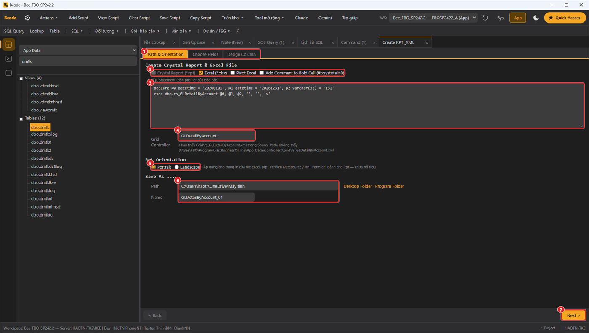

Trên ảnh: **①** 3 bước của trình hướng dẫn · **②** loại file: Excel / Pivot Excel · **③** SQL Statement (profiler của báo cáo) · **④** Grid Controller · **⑤** Rpt Orientation · **⑥** Save As (Path, Name) · **⑦** Next >.

Trình hướng dẫn 3 bước (**< Back** / **Next >** / **Create**). Cũng mở được từ tab **Pivot** của SQL Query ("Tạo file Excel pivot…").

1. **Path & Orientation**: chọn **Excel (*.xlsx)** hoặc **Pivot Excel** (Crystal *.rpt hiện chưa hỗ trợ — ô bị mờ), tuỳ chọn Add Comment to Bold Cell; dán **SQL Statement** (profiler của báo cáo) và **Grid Controller**; Portrait / Landscape; **Save As** (Path, Name). Path là gốc site (bấm **Program Folder**, hoặc thư mục nào có `App_Data\Controllers`) thì Create ghi thẳng vào đúng chỗ của site: `.xlsx` vào `App_Data\Controllers\Templates\Excel`, `.xml` vào `App_Data\Controllers\Report` (thiếu thư mục thì tự tạo; file cũ sao lưu vào `%AppData%\Bcode\Backups` trước khi ghi đè). Path khác (vd **Desktop Folder**) thì cả 2 file nằm chung trong thư mục đó, bản cũ giữ cạnh bên dạng `.bak`.
2. **Choose Fields**: chọn bảng / field; sửa tham số profiler rồi **Chạy lại profiler** nếu cần.
3. **Design Column**: thiết kế Excel (Merge, Unmerge, kiểu ô, ẩn / hiện dòng cột, Hoàn tác / Làm lại, Vừa khít, Zoom), tab **Parameters & Report XML** (+ Biến, Re-Generate, Copy script) → **Create**.

Sau khi tạo: **Mở thư mục** (thư mục chứa file .xlsx vừa tạo) hoặc **Đưa vào source…** (hiện diff, sao lưu file cũ vào `%AppData%\Bcode\Backups`, cảnh báo nếu file trên server vừa bị đổi; nút này ẩn khi đã Create thẳng vào Source Path của workspace).

### Excel → FRX

Nút **Excel → FRX** trên thanh công cụ, hoặc chuột phải file `.xlsx` / `.rpt` trong File Lookup → **Chuyển sang .frx**.

### Tạo báo cáo

Menu **Tool mở rộng → Tạo báo cáo** → cửa sổ riêng "Tạo báo cáo — {workspace}", 2 chế độ:

- **① Từ procedure có sẵn**: gõ tên procedure (vd `zrs_O067`) + Enter / **Nạp** → **▶ Chạy store** → **Tiếp: File & lưu ›** → **Menu…** / **Lưu vào source…** (có diff + sao lưu).
  - Khi **Nạp**, Bcode tự gợi ý giá trị thử: tham số có giá trị mặc định trong `CREATE PROCEDURE` lấy đúng mặc định đó (để trống ô = để procedure tự dùng mặc định); tháng / kỳ / năm / quý = tháng, năm, quý hiện tại; ngày = hôm nay. Nếu source dự án có Filter dạng `.xml` đang `exec` procedure này (hoặc bản `z…` của nó, vd `rptReceiptTransactionList.xml` gọi `zrs_rptReceiptTransactionList`), Bcode lấy luôn cách Filter đó truyền tham số: tham số được truyền hằng số (vd `@Form = 1`, `@Order = 'a.ma_kh'`) thành tham số hệ thống với đúng hằng đó. Filter `.f` đã mã hoá thì không đọc được.
  - **▶ Chạy store** gọi procedure bằng tham số đúng kiểu khai báo (không ghép chuỗi, nên giá trị có dấu nháy `'` vẫn chạy được), luôn trong transaction rồi **ROLLBACK**. Chạy được với mọi kiểu tham số: chuỗi, số (gõ quá lớn thì lấy giá trị lớn nhất của kiểu), bit, ngày (`yyyy-MM-dd` hoặc `dd/MM/yyyy`), giờ, guid, nhị phân `0x…`, xml, tham số OUTPUT, tham số kiểu bảng (bỏ trống, tức là bảng rỗng). Procedure trả nhiều kết quả, không trả kết quả nào, hoặc tự COMMIT / ROLLBACK đều không làm hỏng lần chạy thử.
  - Procedure ghép thẳng tham số chuỗi vào câu SQL động mà không kiểm tra rỗng thì để trống sẽ lỗi cú pháp. Ví dụ `rs_rptStockByReceipt` có `' order by ngay_ct, so_ct,' + @Order`: để trống thì lỗi `Incorrect syntax near ','`. Bcode tự điền giá trị cho những tham số như vậy, cả lúc **Nạp** lẫn lúc **▶ Chạy store**:
    - ghép vào cuối `ORDER BY` → truyền `(select null)` (không sắp thêm), tham số chuyển thành tham số hệ thống;
    - tên kiểu `@Order` / `@Sort` nhưng đưa sang chỗ khác (vd `FastBusiness$System$UpdateOrderField`) → một cột chính procedure order by / group by (ưu tiên của `#report`, vd `sysorder`), tránh cột đã có trên cùng dòng;
    - procedure tự so sánh tham số với hằng (`IF @Report = 'ma_phi'`, `@Form = '1'`, `IF @CalculateTransfer = 0`) → lấy hằng đầu tiên làm giá trị thử;
    - tham số ghép trước phép so sánh trong SQL động (`' + @Status + ' = ''1''`) → lấy hằng bên kia;
    - tham số số làm số chia (`tuoi / @PeriodCycle`) đang là 0 → 1.
    Tham số chỉ nhận giá trị trong danh sách riêng của store (vd `@Group` của báo cáo tài sản phải là `fa_so_the_ts`, `loai_ts`…) thì Bcode không đoán được, cần nhập tay.
    Có tự điền thì thanh trạng thái ghi rõ đã truyền gì. Tham số kiểu này còn để trống trong ô lọc thì báo cáo sinh ra vẫn lỗi khi chạy thật, nên hãy nhập giá trị hoặc bấm **⇣ Hệ thống** truyền hằng. Không đoán được thì thanh trạng thái báo **⚠** kèm tên tham số. Khi chạy lỗi, thông báo có số lỗi, nơi lỗi (dòng trong procedure, procedure con hay câu SQL động) và tên tham số nghi gây lỗi. Rê chuột lên thanh trạng thái để đọc hết thông báo dài.
- **② Thiết kế từ bảng**: kéo thả bảng / cột kiểu Power BI để dựng báo cáo.

> **Lưu ý:** file Crystal Report (`.rpt`) có sẵn thì cập nhật cấu trúc bằng **Write Schema** của SQL Query (xem [Write Schema](#write-schema)).

<a id="trien-khai"></a>
## Menu Triển khai

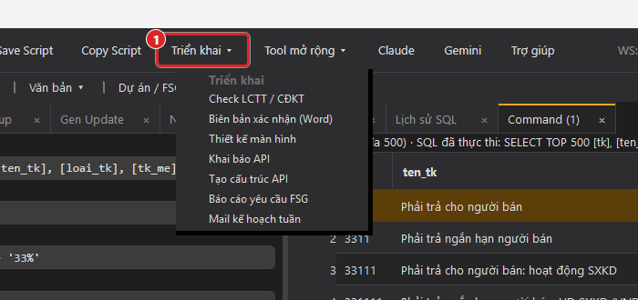

Nút **Triển khai ▾** trên thanh trên. Các công cụ này không có phím tắt mặc định (gán ở Template → Phím tắt, nhóm Công cụ).

| Mục | Dùng để / các bước |
|---|---|
| **Check LCTT / CĐKT** | Chỉ ra chỉ tiêu lưu chuyển tiền tệ / cân đối kế toán lệch ở đâu. Đính kèm bảng kê chứng từ, bảng cân đối phát sinh, báo cáo CĐKT, LCTT và file khai báo chỉ tiêu → chọn mẫu (**📚 Mẫu chuẩn TT99**, Import mẫu chỉ tiêu, SQL lấy bộ chỉ tiêu) → **▶ Kiểm tra**. Kết quả lọc được, **Lưu làm mẫu của khách**, Copy, Lưu .txt. |
| **Biên bản xác nhận (Word)** | Khai báo khách hàng (Bên A) + **Lưu KH**, hợp đồng, số biên bản & ngày, pháp nhân Fast (Bên B) → tick mẫu ở "Chọn mẫu để tạo" (Import / Export / ＋ Mẫu mới) → xem trước → **⬇ Xuất Word** hoặc **Xuất từng file…**. |
| **Thiết kế màn hình** | Mở BcodeScreenDesigner (thiết kế / xem trước màn hình Dir có dữ liệu mẫu) cho dự án hiện tại; từ cây WCommand thì mở thẳng controller của menu. Không thấy exe → khai ở Template → Đường dẫn. Screen Designer tự cập nhật riêng — xem [Cập nhật Screen Designer](#designer-capnhat). |
| **Khai báo API** | Khai báo & quản lý API chuẩn LT3 (giao diện kiểu Postman): **＋ Mới từ mẫu LT3**, **Nhập Postman…**, **Xuất Postman…**; kết nối (địa chỉ gốc, tài khoản, mật khẩu — mã hoá theo máy) → **Lấy token**. Ô **Xác thực** của Kết nối: `Authorization: <token>` / `Bearer <token>` (gọi getToken trước khi gửi) hoặc **Header tĩnh — không lấy token** (API tự mang header như `Authentication`, `TaxCode`). **Header chung** (ở Kết nối) gửi kèm mọi form. Mỗi form: thanh **METHOD + URL** (dán URL có `?a=1&b=2` thì tự tách sang tab Params; Enter ở ô Endpoint = Gửi; dòng `→ …` dưới thanh là URL đầy đủ sẽ gửi) và 4 tab: **Params** — bảng tham số query, nối vào URL; **Authorization** — *Kế thừa từ "Kết nối"* (mặc định, như trước), *Không xác thực*, *Bearer token*, *Basic auth*, *API key* (gửi ở header hoặc query) — khác "Kế thừa" thì không lấy token; **Headers** — header riêng của form (trùng tên với Header chung / Authorization thì form thắng), mục **Header tự thêm / kế thừa khi gửi** liệt kê header gửi kèm mà bảng không có; **Body** — none / form-data / x-www-form-urlencoded (bảng key–value) / raw (JSON, Text, XML, HTML, JavaScript — chọn Content-Type mặc định). Các bảng key–value: ô ✓ bật/tắt từng dòng (bỏ tick = giữ dòng nhưng không gửi), gõ vào dòng trống cuối để thêm, ✕ (App: **Xoá dòng** / phím Delete) để xoá, **Sửa dạng chữ** để sửa hàng loạt `Key: Value` (dòng `//` ở đầu = tắt). Giá trị bí mật (🔒 — header tên Authorization / Authentication / token / key… tự đánh dấu) lưu mã hoá theo máy: ô trống có chữ `•••••• (đã lưu…)` là giữ giá trị cũ, gõ là đổi, **👁** để giải mã xem / sửa; bấm 🔒 để bỏ / đánh dấu bí mật. **Kết quả**: status (vd `200 OK`), thời gian, kích thước + Content-Type, thông báo mã lỗi LT3; tab **Body** (Pretty tô màu JSON / Raw, Xuống dòng), **Bảng**, **Headers** (header phản hồi), **Request** (header đã gửi, che giá trị bí mật); **Chép** chép nội dung tab đang xem. **Nhập Postman**: có request getToken → lấy token như chuẩn LT3 (bỏ token cũ dán sẵn); không có getToken mà request tự mang header xác thực → tự chọn Header tĩnh; giữ header (cả dòng đang tắt), tham số query, body và kiểu raw của từng request; header giống nhau ở mọi request đưa lên Header chung; request khác máy chủ giữ URL đầy đủ. **Xuất Postman** giữ header, Params, Authorization riêng của form; có giá trị bí mật thì hỏi **Kèm giá trị** (file chứa thông tin đăng nhập dạng chữ — đừng chia sẻ) hay **Không kèm** (thay bằng biến collection để trống). Dự án lưu từ bản cũ mở bình thường (form cũ = Kế thừa, header cũ giữ nguyên). **Form theo dự án (ColumnMappings.xml)**: Project có **API Path** (Edit Project) thì Khai báo API đọc `<API Path>\Config\ColumnMappings.xml` (hoặc file ghi ở khoá `ColumnMappingXmlPath` trong Web.config của service) — chỉ đọc; Bcode chỉ ghi file này khi bạn chọn **Word ▾ → Nhập từ Word → Ghi vào ColumnMappings.xml** (có sao lưu, xem dưới). Project lấy theo **Mã dự án** của dự án API (khớp ID / tên WS); Mã dự án trống = Project đang mở. Dòng dưới danh sách form cho biết đang dùng mapping nào (bấm đường dẫn để mở file) hay chuẩn LT3 (kèm lý do: chưa khai báo API Path, không thấy file…). Khi có mapping: **＋ Mới từ mẫu LT3 / ＋ Từ mẫu LT3** liệt kê form của ColumnMappings.xml trước (dự án mới tick sẵn các form này), rồi form chuẩn LT3 chưa có trong mapping (vd GetData); form có `<ChildTables>` là chứng từ (`api/SyncVoucher`, mảng con theo tên ChildTable như `detail`, `tax`), không có là danh mục (`api/SyncData`). Form trùng tên với chuẩn thì mapping thắng. **Sinh JSON** (cạnh Kiểm tra) sinh body mẫu theo cấu hình form: mỗi `Param` một trường, giá trị `Default` nếu có, khoá cha của ChildTable = `{{key}}`, ngày = `{{today}}`, số = 0, chữ để trống (cột có `Parent` tự lấy từ cha nên không đưa vào); body đang có nội dung khác thì hỏi trước khi thay. **Kiểm tra** form theo mapping báo thêm như service: trường bắt buộc đang trống, tên trường sai hoa / thường, trường không có trong ColumnMappings.xml. **Tài liệu form** hiện bảng trường của mapping (kiểu SQL, bắt buộc, mô tả · cột · mặc định) và nút **Mở ColumnMappings.xml**. **Word ▾** (thanh trên): **Xuất Word từ ColumnMappings.xml của dự án…** (hoặc **…từ file XML khác…**) sinh tài liệu API `.docx` theo bố cục tài liệu API LT3 mẫu — phần Thông tin chung (địa chỉ gốc / getToken lấy theo dự án API đang mở, `api/SyncData` · `api/SyncVoucher`, cấu trúc body), bảng **Danh sách form**, rồi mỗi form một mục: tiêu đề = tên form, dòng *Mô tả / Endpoint / Bảng / Store*, bảng **Parameter · Field · Data Type · Length · Description · Require (Y/N) · Default · Note** (Note ghi `Parent: …` cho cột lấy từ cha, `DataType: …`), bảng chi tiết của chứng từ là mục *Chi tiết: &lt;tên&gt;* (+ *Bảng / ParentField / ChildField*), cuối mục **JSON Request Example**. **Tạo file Word mẫu để điền…** tạo file `.docx` trống cùng bố cục — phần *Hướng dẫn điền* + 2 form ví dụ (danh mục `setDanhMucMau`, chứng từ `setChungTuMau` có *Chi tiết: detail*), mỗi bảng chừa 6 dòng trống (thêm dòng: Tab ở ô cuối) — gửi người dùng / đối tác điền: đổi tiêu đề thành tên form thật, sửa *Bảng / Store*, điền bảng trường, xoá ví dụ không dùng, rồi nhập lại bằng mục dưới. **Nhập từ Word → ColumnMappings.xml…** đọc tài liệu Word theo mẫu đó (cũng nhận tài liệu viết tay cùng kiểu: tiêu đề cột tiếng Anh / Việt như *Parameter / Tham số*, *CRM Value / Field / Cột*, *Data Type / Kiểu*, *Length / Độ dài*, *Description / Mô tả*, *Require / Bắt buộc*, *Default / Mặc định*; tên form lấy ở tiêu đề gần nhất hoặc dòng "Hàm setXxx"; file `.doc` cũ mở bằng Word lưu thành `.docx` trước) rồi hiện bảng **xem trước** so với ColumnMappings.xml: mỗi form **Mới / Sửa / Giống**, từng thay đổi sẽ ghi (`+` cột mới, `~` cột đổi Field / kiểu / bắt buộc / mô tả / mặc định), cột chỉ có trong XML (giữ nguyên). Không bao giờ xoá: form / cột không có trong Word giữ nguyên, ô trống trong Word không xoá giá trị cũ. Form mới cần **table** + **store** — tài liệu không ghi thì điền ở bảng (gõ table thì store tự gợi ý `fs_sync_<bảng>`), thiếu thì không cho ghi (service bỏ qua form thiếu table / store). Tick form muốn nhận rồi: **Ghi vào ColumnMappings.xml** (hỏi lại; sao lưu file cũ thành `ColumnMappings.xml.bak_<ngày_giờ>` cùng thư mục; file vừa bị người khác sửa sau lúc nhập thì không ghi, nhập lại; chỉ các dòng thật sự đổi khác đi, phần còn lại của file giữ nguyên từng ký tự; ghi xong danh sách form tự nạp lại; service đọc mapping mới khi cache hết hạn / restart app pool — nên ghi ở môi trường test trước), **Lưu file XML…** (lưu bản đã ghép thành file khác, không đụng file dự án) hoặc **Chép XML** (chỉ các form đã chọn, để dán tay). Project chưa khai báo API Path thì chỉ Lưu file / Chép được. Phím: `Ctrl+Shift+Enter` gửi, `Ctrl+S` lưu, `Ctrl+Shift+T` lấy token, `Ctrl+Shift+F` format, `Ctrl+Shift+K` validate. |
| **Tạo cấu trúc API** | Chọn bảng / cột → xuất tài liệu Word "TÀI LIỆU ĐẶC TẢ TỔNG HỢP API". **Tên hàm API** tự đặt = `Set` + controller (Dir) của bảng đầu tiên, tìm trong Source Path của dự án (vd dmkh → `SetCustomer`); sửa tay được, **↻ Tự đặt** để đặt lại. Cột **Tên tiếng Việt** tự lấy tiêu đề field ở controller đó (không có thì lấy từ điển field FCode), sửa tay được. Tick **Bỏ database nguồn khi xuất Word** để xuất bản gửi đối tác: không có Bảng DB / Bảng nguồn / Cột CSDL, mỗi trường định nghĩa bằng Tên tiếng Việt. Danh sách API tự lưu theo dự án — đóng form mở lại vẫn còn. |
| **Báo cáo yêu cầu FSG** | **Kéo** yêu cầu từ FSG (chỉ đọc): nhập Mã dự án → **⟳ Kéo về** (Enter); bộ phận, người, mã YC, nội dung, lập trình, triển khai nằm trong **Điều kiện kéo khác ▾** (gập lại thì hiện thành thẻ). **Lọc tại chỗ** trên dữ liệu đã kéo, không gọi lại FSG: ô **Tìm** (`Ctrl+F`; gõ tên người / dự án sẽ gợi ý lọc nhanh, ↓ Enter để chọn), nút **Dự án ▾ / Lập trình ▾ / Triển khai ▾ / Trạng thái ▾** (số yêu cầu đếm theo các lọc đang chọn), chip trạng thái (bấm = chỉ xem nhóm đó, bấm lại = tất cả, `Ctrl`+bấm = chọn nhiều), **⚠ Tới hạn**, **✕ Bỏ lọc**; lọc được nhớ cho lần mở sau. **Đã lưu ▾**: các dự án đã kéo — bấm 1 dự án để chỉ xem dự án đó, ✕ để bỏ dữ liệu đã lưu của dự án đó; nút **🗑 Xoá tất cả** bỏ dữ liệu của mọi dự án (đang gõ ô tìm thì thành **🗑 Xoá N dự án khớp** — chỉ xoá các dự án đang khớp). Dữ liệu nằm ở `%AppData%\Bcode\fsg-requirements.json`. Xem Chi tiết / Dashboard / Gợi ý ưu tiên (chỉ xét y/c Đã duyệt / Đang thực hiện; bảng trống thì ghi rõ đang lọc gì). Bấm ô Nội dung để mở khung chi tiết y/c → **⚙ Theo luật Fast** (`Ctrl+Alt+Shift+F`), **🔎 AI phân tích** (`Ctrl+Alt+Shift+I`) hoặc **🤖 AI tạo danh mục** (`Ctrl+Alt+I`) như ở Note (New) — xem [AI tạo danh mục](#ai-danh-muc). Từ cây WCommand: chuột phải menu → **Yêu cầu liên quan (QLYC)…** mở tab này lọc sẵn theo menu (xem [WCommand](#wcommand)). Ô **Tự làm mới** (Tắt / 2 / 5 / 10 / 15 / 30 / 60 phút): kéo ngầm tự động theo điều kiện của lần **Kéo về** gần nhất — được nhớ cho lần mở sau và **vẫn chạy khi đã đóng tab** (đóng Bcode thì thôi); chọn **Tắt** để dừng. Thay đổi trên y/c của bạn được báo ở chuông 🔔 — xem [Thông báo y/c FSG](#fsg-thong-bao). |
| **Mail kế hoạch tuần** | Tab con **✎ Soạn mail**: mẫu mail theo dự án (＋ Mới / Nhân bản / Xoá mẫu), máy chủ SMTP dùng chung với Check Mail, **⟳ Tính theo hôm nay** điền ngày trong tuần → **✉ Gửi mail** / **💾 Lưu mẫu**. Tab con **📨 Đã gửi & phản hồi**: xem lại thư đã gửi, **🔍 Kiểm tra phản hồi**, Reply / Reply all, gửi lại — xem [bên dưới](#mail-da-gui). |

<a id="fsg-thong-bao"></a>
### Thông báo y/c FSG (chuông 🔔)

Khi tester / triển khai ghi chú hay ghi lỗi vào y/c trên QLYC (FSG), Bcode tự báo cho lập trình — không cần mở tab Báo cáo yêu cầu FSG.

- **Theo dõi gì:** các y/c có **Lập trình (ma_lt1) = tên lập trình của bạn** (ô Lập trình — dùng chung với Note (New)), ở các **dự án đã lưu** của Báo cáo yêu cầu FSG (đã “Kéo về” ít nhất 1 lần — xem **Đã lưu ▾**). Tuỳ chọn báo cả y/c bạn là **triển khai** (ma_nv1).
- **Báo khi:** ghi chú có **dòng mới** (bỏ qua dòng do chính bạn ghi), **đổi trạng thái**, **y/c mới giao cho bạn**, **đổi hạn hoàn thành**, **lỗi mới** (nhãn **Lỗi** màu đỏ: y/c có số lỗi `ierror` > 0 vừa có lỗi, số lỗi tăng hoặc nội dung cột **loi** đổi — dòng thông báo hiện nguyên nội dung lỗi). So với dữ liệu đã lưu lần trước theo mã dự án + mã YC; kéo xong Bcode cập nhật luôn các y/c đó vào dữ liệu đã lưu (tab Yêu cầu FSG đang mở tự vẽ lại).
- **Chạy ngầm:** mặc định mỗi **10 phút** (chỉnh được, tắt được), cả khi không mở tab; chỉ đọc FSG, không chặn giao diện. Mất mạng / VPN thì im lặng, lần sau thử lại (lỗi gần nhất ghi ở dòng trạng thái của khung). Mở nhiều cửa sổ Bcode thì chỉ 1 cửa sổ kéo, các cửa sổ khác dùng chung kết quả. “Kéo về” bằng tay ở tab Yêu cầu FSG cũng được so để không sót thay đổi.
- **Chuông 🔔** trên thanh trên (cạnh Quick Access, cả chế độ Web và App): số = thông báo chưa xem. Bấm → khung **Thông báo y/c FSG**: mỗi dòng gồm mã dự án · mã YC, loại thay đổi, ai ghi, tên menu, giờ phát hiện, nội dung mới. **Tất cả / Chưa xem** để lọc; **✓** ở cuối dòng hoặc **✓ Đã xem tất cả** để đánh dấu đã xem; **⟳ Kiểm tra ngay** kéo ngay không chờ chu kỳ.
- **Bấm 1 dòng** → mở tab **Yêu cầu FSG** + khung chi tiết của y/c đó (vẫn có **🤖 AI tạo danh mục**). Lọc đang che y/c đó thì Bcode bỏ lọc tại chỗ và gõ mã YC vào ô Tìm.
- **⚙ Cài đặt** (ngay trên khung): Bật thông báo · ô **Lập trình** · Kiểm tra mỗi … phút · loại thay đổi cần báo (Ghi chú mới / Đổi trạng thái / Y/c mới giao cho mình / Đổi hạn hoàn thành / **Lỗi mới**) · Báo cả y/c mình là triển khai · **Hiện thông báo Windows khi Bcode không ở trước** (bấm vào thông báo Windows để mở khung) · Xoá thông báo đã xem.
- Phím tắt mở / đóng khung: mục “Mở / đóng khung Thông báo y/c FSG” ở Template → Phím tắt (mặc định chưa gán). Cần key bản quyền như Báo cáo yêu cầu FSG.
- “Y/c mới giao” = y/c của bạn mà Bcode **chưa từng thấy** ở các lần kiểm tra trước (Bcode tự nhớ danh sách này, không phụ thuộc điều kiện lọc của lần “Kéo về”), và chưa xong — y/c ở trạng thái UP / OK / KL không bao giờ báo “mới giao”. Lần kiểm tra đầu tiên của mỗi dự án chỉ ghi nhớ, không báo.
- Lần đầu theo dõi: dự án lưu từ bản Bcode chưa lấy ghi chú thì không so ghi chú — tránh báo ồ ạt. Lịch sử + cài đặt lưu ở `%AppData%\Bcode\fsg-notify.json` (giữ 500 thông báo gần nhất).

<a id="mail-da-gui"></a>
### Mail kế hoạch tuần — Đã gửi & phản hồi

- **Lưu thư đã gửi:** mỗi thư gửi thành công được lưu bản đầy đủ (.eml) trong Bcode. Nút 📁 mở thư mục lưu thư. Thư Bcode gửi đi bằng SMTP **không tự vào thư mục Sent** của hộp thư. Muốn Outlook / webmail thấy thì tick **Chép thư đã gửi lên thư mục Sent của hộp thư** ở mục **Máy chủ mail (SMTP / IMAP)** (bật sẵn). Nếu chép lỗi, Bcode chỉ báo trong Kết quả; thư vẫn đã gửi.
- **IMAP:** khai ở mục **Máy chủ mail (SMTP / IMAP)** của tab Soạn mail. Host IMAP để trống thì dùng cùng host SMTP. Mặc định cổng **993 + SSL**; bỏ tick SSL thì dùng **143** STARTTLS. IMAP dùng cùng tài khoản và mật khẩu với SMTP, và luôn cần mật khẩu.
- **Nhớ mật khẩu:** tick **Nhớ mật khẩu** thì lần sau mở tab không phải nhập lại. Mật khẩu được mã hoá theo tài khoản Windows, chỉ máy này đọc được. Bỏ tick là xoá mật khẩu đã nhớ.
- **Danh sách Đã gửi:** mỗi dòng là 1 thư gốc. 💬 *n* = số phản hồi, *(m mới)* = số phản hồi chưa xem. Lọc theo dự án, tìm theo tiêu đề / người nhận. Chọn 1 thư thì ô **Chuỗi thư** hiện các thư cùng chuỗi theo thời gian: → thư Bcode gửi / trả lời, ← phản hồi nhận về. Bấm 1 dòng để xem nội dung. Chế độ App hiện nội dung dạng chữ; bấm **Mở .eml** để xem đủ định dạng bằng Outlook.
- **🔍 Kiểm tra phản hồi** (thanh dưới, ở tab Đã gửi): Bcode đăng nhập hộp thư, tìm ở INBOX các thư trả lời thư đã gửi từ Bcode rồi tải về. Thư Bcode chỉ đọc, không đánh dấu, không xoá. Phản hồi có dòng “đoán theo tiêu đề” là thư không mang thông tin trả lời mà chỉ khớp tiêu đề “Re: / TL: + tiêu đề gốc”. Mẫu tuần nào cũng cùng tiêu đề, nên loại này có thể bị gắn nhầm tuần.
- **↩ Reply / ↩ Reply all:** mở khung **Trả lời**, điền sẵn người nhận, tiêu đề “Re: …”, trích dẫn thư gốc và chữ ký của mẫu (bỏ tick **Kèm chữ ký của mẫu** nếu không muốn). Reply thư của chính mình = gửi tiếp cho người nhận cũ. Gõ nội dung → **✉ Gửi trả lời**. Bcode luôn hỏi xác nhận và hiện rõ người nhận. Thư trả lời nằm cùng chuỗi trong mục Đã gửi, nên phản hồi tiếp theo vẫn về đúng chuỗi.
- **⟳ Gửi lại:** gửi lại 1 thư Bcode đã gửi, cùng người nhận, tiêu đề và nội dung. Bcode hỏi xác nhận trước khi gửi. **Xoá** chỉ xoá bản lưu trong Bcode (thư gốc thì xoá cả chuỗi), không đụng hộp thư trên máy chủ.

<a id="tao-chung-tu"></a>
## Tạo chứng từ

Nhân bản một chứng từ có sẵn sang mã mới, gồm 6 bước. Mở từ menu **Tool mở rộng** → **Tạo chứng từ**, cần key bản quyền. Khung xem file và khung script tô màu XML, SQL giống BcodeViewer, theo theme đang dùng.

| Bước | Việc cần làm |
|---|---|
| **General** | Chọn chứng từ nguồn (nguồn không khai báo duyệt thì các ô Approve, Notify được ẩn, bấm **Nhập tay** để hiện lại); nhập mã, Title, SysID, tiền tố file mới (phải khác nguồn và chưa thuộc chứng từ nào). Chọn dùng chung bảng nguồn hoặc tạo bộ bảng mới. Bảng không phân kỳ (`phz29`, `ctz29`) cũng tạo được bộ bảng mới, sinh `ph{số}`, `ct{số}`... nhưng không có sysgendata và các kỳ; mặc định chọn dùng chung, muốn tạo mới thì chọn lại. Mã ngắn như `phdm`, `phhd` chỉ đổi bảng `ph`, `ct`, `i`. Bảng khác hai dạng này (`hddc`, `dmts`) chỉ dùng chung được. **Approve Type**, **Approve Controller**, **Notify Code** của nguồn đọc từ file Dir (`APVApprovalType`, `APVController`, `PostNotifyGroup`), không có file thì Approve Type lấy từ `gndmloaiduyet`. Bên đích, Approve Controller tự điền theo tiền tố mới; Notify Code để trống thì dùng chung nhóm thông báo của nguồn, nhập mã mới thì script chép thêm dòng `notifygroup`. Danh sách chứng từ lấy từ `wcommand`: các dòng có cả `sysid` và `syscode`. Source là đường mạng thì bấm **Quét source** để đọc danh sách. |
| **File Source** | File được nhóm theo thư mục (Dir, Filter, Grid...): bấm dòng thư mục để thu gọn, tick ở dòng thư mục để chọn cả nhóm, ô **Lọc theo tên file** để tìm nhanh. Tick file cần tạo, sửa tên đích nếu muốn. Bấm một dòng để mở khung xem nội dung sau khi đổi, **Đóng khung xem** để bảng rộng trở lại. Nút **Xem chứng từ** dựng màn hình Dir của chứng từ mới như Xem trước Dir (Alt+P) của BcodeViewer, từ các file đang tick, chưa ghi gì xuống đĩa; chỉ để xem, không kéo-thả được. File sao lưu (`... - Copy`, `_bk`) hiện nhưng không tick sẵn. Ô **Không chọn file .f** được tick sẵn: file `.f` bị ẩn khỏi danh sách và không được chép. Bỏ tick để thấy lại và chọn file `.f`, lựa chọn được nhớ cho lần sau. Không chọn file Dir của chứng từ (chứng từ chỉ có `.f`) thì có cảnh báo đỏ kèm nút **Hiện lại file .f**, chỉ áp dụng cho chứng từ đang làm; bấm Next lần đầu sẽ bị giữ lại, bấm lần nữa mới qua. Dòng bên dưới báo số file `.f` đang ẩn và số file không có bản `.xml` cùng tên, các file này sẽ không được chép. File đích trùng file nguồn thì không tạo được. |
| **File Reference** | Xem các dòng sẽ thêm vào file dùng chung cho chứng từ mới, ngay sau dòng của chứng từ nguồn. Bấm một file để mở khung xem bên phải: dòng thêm được tô xanh, khung tự nhảy tới chỗ đầu tiên, nút ▲ ▼ chuyển giữa các chỗ thay đổi. Mục **Entity giữ tên nguồn** (thu gọn, bấm để mở) liệt kê entity không đổi tên: dùng chung với controller khác hoặc định nghĩa nhiều dòng. Chứng từ có duyệt có thêm dòng **Action mail duyệt** cho biết id mới và các file `Include\XML\{tiền tố}ApprovalAction...xml` sẽ sinh, đăng ký vào `Options\Message.xml`, `Options\Comment.xml`. Phần **Controller / include dự án mà chứng từ gọi tới** được thu gọn sẵn, bấm tiêu đề để mở; chỉ cần khi mang chứng từ sang dự án khác. |
| **Sql Declaration** | Xem và sửa script App (AppScript) và Sys (SysScript). Chỉ sinh script, không chạy và không ghi ra file: bấm **Open** để mở sang tab SQL Query rồi tự chạy. Store riêng của chứng từ (post / unpost / duyệt / thông báo, ví dụ `zrs_PostZ08Authorize`) được đổi tên theo chứng từ mới trong file và có sẵn script tạo store mới (theo định nghĩa store nguồn) ở cuối script; store nguồn không có trong database thì chỉ ghi chú. Nút **Open** mở script đang xem sang tab SQL Query mới của Bcode, đúng database App hoặc Sys. Approve Type đích phải khác nguồn; bỏ trống hoặc chọn **Not Approval** thì không chép khai báo duyệt. Script chép loại duyệt, trạng thái, quyền, kiểu duyệt; người duyệt, người nhận và uỷ quyền không chép, cần khai lại cho loại duyệt mới. |
| **Wcommand** | Cây menu bên trái để chọn vị trí, mặc định cạnh menu của chứng từ nguồn: chọn 1 menu thì menu mới nằm cạnh nó, chọn 1 nhóm thì nằm trong nhóm đó. Bên phải hiện menu cha và thông tin menu sẽ tạo. **Tạo menu…** mở form WCOMMAND điền sẵn, chỉ ghi khi bấm Save. |
| **File Generation** | **Tạo file**: xuất gói `Web\...` (script SQL không ghi file — dùng nút **Open** ở bước Sql Declaration), hoặc ghi thẳng vào source của workspace (nút **Program Folder** chọn sẵn cách này). Bảng tóm tắt có số file `.f` đang ẩn, số entity giữ tên nguồn và dòng **Cảnh báo** nếu thiếu file Dir hoặc số bảng đã có trong database. |

Lưu ý:
- Lấy chứng từ từ dự án khác (**Save as from Other Project**) thì chỉ xuất gói được. Script và menu vẫn đọc từ database của workspace hiện tại, nên cần kiểm tra lại trước khi chạy.
- Dòng trạng thái ghi số chứng từ trong `wcommand` và số chứng từ có file Dir trong source. Chứng từ không có file vẫn chọn được, nhưng bước **File Source** báo không có gì để chép. Không đọc được `wcommand`, hoặc lấy từ dự án khác, thì Bcode liệt kê theo file Dir. Chứng từ có file mà không có menu thì không hiện trong danh sách, nhưng mã và SysID của nó vẫn được tính khi kiểm tra trùng.
- Lần đầu với một source, Bcode đọc toàn bộ `Controllers` ở nền (góc dưới hiện số file đã đọc); source trên đường mạng có thể mất vài phút. Kết quả lưu ở `%AppData%\Bcode\cache\voucher-clone`, các lần sau chỉ đọc file đã đổi. Đóng form giữa chừng thì phần đã đọc vẫn được giữ. Mở form là tự quét Source Path của workspace, kể cả đường mạng; bấm **Quét source** để đọc lại.
- Chứng từ có duyệt: tiêu đề mail đặt lại theo Title mới, nhưng câu thông báo trong action (như "Đơn hàng bán này đã được duyệt...") và store duyệt (`FastBusiness$APV$...`, `rs_Post...Authorize`) vẫn của chứng từ nguồn. Tạo bộ bảng mới thì cần kiểm tra store có ghi cứng bảng không.
- Chứng từ dùng chung màn duyệt với chứng từ khác (`CDTran` dùng `CPApproval`, `PITran` dùng `POApproval`): màn duyệt không được chép theo, cần tự xử lý.
- Khối `<Encrypted>` trong file được giữ nguyên, không đổi tên. Mã bên trong vẫn là của chứng từ nguồn, cần kiểm tra lại khi chứng từ mới dùng bảng khác.

<a id="tool-mo-rong"></a>
## Menu Tool mở rộng

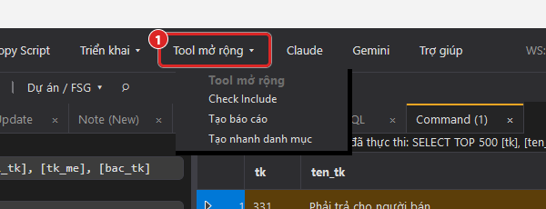

| Mục | Dùng để / các bước |
|---|---|
| **Check Include** | So khai báo INCLUDE / IGNORE, options, wcommand của dự án với catalog tính năng từng phiên bản: chọn thư mục Dự án, tick "Kiểm tra DB (options / wcommand)" → **▶ Phân tích**. Tab Tính năng / File Include; trạng thái Đúng khai báo / Chưa bật / Một phần / Khác mặc định. Nút **Sửa → X** sửa file include (giữ bản .bak). |
| **Tạo báo cáo** | Xem [Create RPT & XML, Excel → FRX, Tạo báo cáo](#create-rpt). Cần key. |
| **Mở SSMS** | Mở SQL Server Management Studio đăng nhập sẵn vào **database đang chọn ở ô WS** (App / Sys / database phụ) của workspace. Cũng có ở **Actions → SQL SMS (Mở SSMS)**; gán phím ở Template → Phím tắt ("Mở SSMS"), gọi nhanh bằng `Ctrl+P`. Bcode tự tìm SSMS.exe (bản mới nhất trong Program Files), không thấy thì hỏi 1 lần và nhớ. **Windows Authentication**: SSMS 21+ vào thẳng Object Explorer. **SQL Server Authentication**: SSMS bỏ tham số mật khẩu nên Bcode mở SSMS rồi **tự điền hộp Connect** — Server, Authentication, User, Password, Database, luôn tick **Trust Server Certificate** (SSMS mới mặc định Encrypt = Mandatory, server nội bộ dùng chứng chỉ tự ký) — rồi bấm **Connect**; SSMS không tự hiện hộp Connect lúc mở thì Bcode bấm *Connect Object Explorer…*. Kết quả báo ở thanh trạng thái. Trong lúc SSMS đang mở (10–30 giây) **đừng gõ phím** — cửa sổ SSMS giành focus, phím gõ dở có thể lọt vào hộp Connect (Bcode kiểm lại Server / User trước khi bấm Connect). Mật khẩu chuyển thẳng cho bước điền, không nằm trên dòng lệnh. |
| **Tạo nhanh danh mục** | Sinh bộ file danh mục từ một bảng: nhập Bảng (Enter để nạp cột), Controller, File Main, Key, Order, cột tên (Lookup), Title / Subtitle (v/e) + **Dịch**, bảng chi tiết (tuỳ chọn) → **Xem XML** → **Tạo file** (`Ctrl+Enter`) → **Mở Dir trong BcodeViewer** / **Tạo menu…**. Mẫu nằm ở `Templates\fileSource\CreateList` cạnh Bcode.exe (sửa mẫu không cần build). Gõ tên **bảng chưa có** = tạo bảng mới; **+ Thêm cột** để thêm trường — script ở tab **Script**, xem [bên dưới](#tao-nhanh-bang-moi). |
| **Tạo chứng từ** | Nhân bản chứng từ có sẵn sang mã mới, xem [Tạo chứng từ](#tao-chung-tu). Cần key. |
| **Note (New) nhiều dự án** | Mở **BcodeNote.exe** vào dự án đang chọn: Note (New) chuyển qua lại nhiều dự án, chọn menu để gợi ý Gen All / File Path / SQL Object / Table liên quan. Dùng chung dữ liệu với Note (New). Xem [BcodeNote](#bcodenote). |

<a id="tao-nhanh-bang-moi"></a>
### Tạo nhanh danh mục: bảng mới, thêm cột, tab Script

- **Bảng mới:** gõ ở ô **Bảng** một tên chưa có trong App Data (vd `zdmabc`) rồi Enter / **Nạp cột**. Bcode báo "bảng mới" và điền sẵn cột chuẩn của danh mục FBO: `ma_abc` (khoá), `ten_abc`, `ten_abc2`, `status`, `datetime0/2`, `user_id0/2` (mã = tên bảng bỏ tiền tố `zdm` / `dm`). Đang có cột của một bảng khác (vừa nạp `dmkh` rồi gõ tên mới) thì Bcode **giữ nguyên cột đó** làm cấu trúc bảng mới (clone) — muốn bỏ thì bấm **Dùng cột chuẩn** ở thanh thông báo. Bảng chi tiết mới: dựng sẵn cột khoá danh mục + `line_nbr`.
- **+ Thêm cột** (cạnh Gợi ý header): mở hộp Add New Column như tab Table — nhập tên, kiểu, độ dài, Not NULL (thêm được nhiều dòng). Cột thêm mang chữ **mới** trong bảng cột, có **✎** (sửa tên / kiểu / độ dài / Not NULL) và **✕** (xoá). Cột thêm được tick Grid / Dir / Import, đặt header, AutoComplete và đi vào các file XML như mọi cột khác. Bảng mới thì mọi cột đều là cột "mới".
- **Tab Script** (chỉ hiện khi có bảng mới hoặc cột thêm): bảng mới → `CREATE TABLE` theo các cột đang khai (kiểu, độ dài, NOT NULL, khoá chính = ô Key, khoá ghép được); clone thì kèm câu chép dữ liệu từ bảng nguồn để trong chú thích. Bảng có sẵn → `ALTER TABLE … ADD` cho từng cột thêm (cột NOT NULL có `DEFAULT 0` / `''` như Design → Add Column). Có cả phần bảng chi tiết. Script tự cập nhật khi sửa cột. Nút **Copy**, **Add Script** (thêm vào Script Cart như Add Script trên thanh trên, kèm copy clipboard), **Mở SQL Query** (tab SQL Query mới trên App Data). **Bcode không tự chạy script** — xem lại rồi chạy trước khi dùng danh mục.
- **Tên bảng trong file XML:** mọi file sinh ra (Dir, Grid, Lookup, Filter, Import, Upload, lưới chi tiết) khai đúng tên bảng mới. Nếu thư mục mẫu (Nâng cao → Thư mục mẫu) là mẫu tự sửa / chép từ danh mục có sẵn còn ghi cứng tên bảng cũ (`table="dmdemo"`, `<!ENTITY Tag "dmdemo">` + `table="&Tag;"`, `<baseTable value="…">`, câu SQL `from / delete / update … dmdemo`), Bcode đổi các chỗ đó sang bảng mới (bảng chi tiết cũ → bảng chi tiết mới); mẫu chuẩn dùng `[#TABLE#]` nên không có gì phải đổi.
- **Tạo file** lưu cả cột thêm vào cấu hình — lần sau nạp lại bảng (kể cả bảng mới chưa chạy script), **Khôi phục** lấy lại đủ các cột đó.

<a id="tien-ich"></a>
## Tiện ích khác trên thanh công cụ

| Công cụ | Dùng để |
|---|---|
| **Clone danh mục** | Nhân một danh mục có sẵn thành danh mục mới: chọn bảng nguồn + thư mục mẫu + nơi lưu → khai Id, File Main, Bảng, Key, Title, đổi hậu tố cột (vd `_kh` → `_ncc`) → **Tạo file**. |
| **Compare Text** | So 2 file / 2 đoạn chữ: chọn File 1, File 2 (hoặc dán thẳng vào 2 khung) → **📄 Compare**. Hai khung được **tô màu cú pháp** như khi xem file: **Tô màu: Tự nhận** đoán ngôn ngữ theo nội dung dán / gõ / file (SQL, XML / FCode — SQL/JS trong CDATA cũng có màu, C#, JavaScript, JSON), đoán sai thì chọn hẳn ngôn ngữ ở ô đó (**Text** = không tô); tên ngôn ngữ hiện trên đầu mỗi khung. Màn so sánh: bên trái tô **đỏ** (bản cũ), bên phải tô **xanh** (bản mới) — nền nhạt cả dòng khác, nền đậm đúng những **từ khác nhau** trong dòng sửa; lề ghi số dòng gốc kèm dấu **~** (sửa), **−** (chỉ có bên trái), **+** (chỉ có bên phải); dòng xám = dòng trống chèn cho 2 bên thẳng hàng. Lăn một bên thì bên kia lăn theo. Thanh dọc sát mép phải = toàn bộ văn bản thu nhỏ (vạch đỏ / xanh = chỗ khác, khung mờ = đoạn đang thấy) — bấm vào vạch để nhảy tới. **◀ / ▶** (hoặc `F8` / `Shift+F8` khi đang đứng trong khung so sánh) nhảy giữa các khác biệt, dòng đang đứng có mũi tên ở lề; thanh trên ghi "Khác biệt 3/12 (~ dòng sửa, + dòng thêm, − dòng xoá · số cụm)". **✎ Sửa lại** quay về 2 khung nhập; ⧉ Float window. |
| **String Beauty** | Định dạng SQL / JSON / XML / JavaScript (kiểu Expanded / Compact, từ khoá viết hoa / thường) → **Beautify →** → Copy kết quả. |
| **Library...** | Thư viện script hay dùng (snippet) theo dự án: New / Save / Delete / Copy / **Insert vào Script Editor**. Gọi nhanh trong `Ctrl+P` bằng tiền tố `$`. |
| **Setup eInvoice (FE)** | Cấu hình hoá đơn điện tử (cùng cách tính như tool *Setup HDDT* của Fast): nhập mã dự án (mặc định = ID của project đang vào, tự đổi khi đổi project ở ô WS), sản phẩm, **đơn vị** (`ma_kn` — bấm / gõ vào ô để chọn từ danh mục đơn vị cơ sở `dmdvcs` của database App đang chọn, kèm tên đơn vị; gõ tay mã khác vẫn được), mã doanh nghiệp, Portal Key (mặc định khoá Portal Fast), link portal, tài khoản + **mật khẩu portal** (bắt buộc — `pass_hddt` được mã hoá từ mật khẩu này mỗi lần chạy). **Nhớ riêng từng dự án**: các ô được nhớ theo mã dự án (lưu khi bấm Step 1 / Step 2 / Cập nhật / Clear); đổi sang project khác ở ô WS thì cả trang nạp lại theo dự án đó. Dự án chưa cài lần nào thì các ô riêng của khách (đơn vị, mã doanh nghiệp, nhóm dịch vụ, tài khoản portal) để **trống** — không mang số của dự án khác sang — chỉ điền sẵn hằng số chung của Fast (sản phẩm `FBO`, Portal Key, Link Portal, Link trung gian) và tick sẵn **Nhóm dịch vụ riêng** (ProxyCode trống). **Nhiều đơn vị cơ sở**: khai **lần lượt từng đơn vị** (mỗi đơn vị có mã DN / tài khoản portal riêng) — nhập đơn vị 05 + thông tin của nó → chạy, rồi đổi sang 22 → chạy…; script chỉ xoá / ghi dòng `tkhddt`, `tkhddtdv` của đúng đơn vị đó (giữ `serial_cert` đã có), đơn vị đã khai giữ nguyên; `dmstthddt`, `ekey`, `edmsp`, `edmkh` (`client_code = '*'`) là 1 dòng chung cho cả project; `edmkh` không bị xoá / sửa — đã có dòng của dự án thì bỏ qua, chưa có mới thêm. **Clear cấu hình HĐĐT** = xoá HẾT dữ liệu (mọi đơn vị) các bảng `dmstthddt`, `tkhddt`, `tkhddtdv`, `dmkysohddt`, `dmkieuphhddt` của App Data, và `tkhddt`, `edmsp`, `ekey`, `edmkh` của database Proxy khi tick nhóm dịch vụ riêng — để cài lại từ đầu (có hỏi xác nhận; không gọi API, không đổi options). **Khoá RSA**: cặp khoá cố định như tool *Setup HDDT* — ghi vào `ekey` / `dmstthddt` / `edmkh` và gửi lên service `UpdateProxy` cùng một bộ (thân request gửi service giống hệt tool VB). **Nhóm dịch vụ riêng**: không tick = nhóm chung của Fast `005500` (ô ProxyCode khoá, không cần CSDL Proxy); tick = nhập mã nhóm riêng + **CSDL / Database Proxy** (mặc định `{Mã dự án}_eInv`, vd dự án `VIAGS_FE` → `VIAGS_FE_eInv`, tự đổi theo ô Mã dự án trừ khi đã gõ tay giá trị khác; project có khai database `…_eInv` trong *DB Access* thì lấy database đó; sửa tay được). **Step 1: View UpdateKey Script** = xem / copy script (App setting; thêm Proxy setting khi nhóm riêng) · **Step 2: Exec Insert in Server (SQL)** = chạy App setting (`dmstthddt`, `tkhddt`, `tkhddtdv`, `dmkysohddt` — hình thức ký số: `kieu_ky_so` = 1 khi ký token (không tick Ký HSM) / 0 khi HSM, `dmkieuphhddt` — kiểu phát hành: `kieu_ph` = 0, options `m_sd_hddt` = 1, `m_ky_hddt` = 0 khi Ký HSM / 1 khi không) vào App Data, và Proxy setting (`tkhddt`, `edmsp`, `ekey`, `edmkh`) vào database Proxy khi nhóm riêng — có hỏi xác nhận; đang chọn database eInv `(DB)` ở ô WS thì Step 2 dừng, chọn lại database `(App)` · **Cập nhật / Update Key** = làm hết một lần: gọi API `UpdateProxy` ở Link trung gian (mặc định `https://dev.fast.com.vn/Fast-EInvoice-Crypto/Fast-Api.asmx/UpdateProxy`; link cũ đuôi `/UpdateKey` hoặc `http://dev.fast.com.vn/…` tự đổi), API báo thành công thì chạy luôn script như Step 2 (có hỏi xác nhận; mỗi script chạy trong 1 transaction, lỗi giữa chừng thì không ghi gì). Mật khẩu không được lưu. |
| **Check Mail** | Thử gửi mail: **⟳ Lấy từ Message.xml** (hoặc nhập Host / Port / tài khoản), người nhận → **⚡ Test kết nối** / **✉ Send**; xem log. Mật khẩu không được lưu. |
| **FSG FBO** | Mở web đăng nhập của dự án (Login WLink) và tự điền tài khoản — mở trong **tab** (phím tắt `Ctrl+4`; mở lại = chuyển tới tab đó; `Ctrl+Tab` để qua lại). Từ cây WCommand, `Ctrl+4` ở nhiều menu của cùng dự án mở nhiều tab, mỗi tab 1 menu, chung một phiên đăng nhập. Vì dùng chung phiên: đăng xuất / hết hạn / đổi tài khoản ở 1 tab thì các tab khác của dự án đó cũng theo (mở menu lại bằng `Ctrl+4` sẽ tự đăng nhập lại); mỗi tab tốn thêm RAM như 1 tab Chrome. Mỗi dự án giữ phiên đăng nhập riêng: đăng nhập dự án này (kể cả ở 1 Bcode khác) không làm văng phiên của dự án kia. **Xem tên field**: rê chuột lên ô nhập, tiêu đề cột, nút grid hoặc tiêu đề hộp lọc → tooltip hiện tên field (vd `ma_kh`), tên bảng của grid hoặc tên file filter; **Shift+click** để copy tên (góc trái hiện "Đã copy: …"). Ô bị khoá (xám, không bấm được) thì giữ chuột yên trên ô 1 giây là tự copy. Rê chuột vào form chi tiết thì `stt_rec` của dòng đang mở hiện ngay dưới tiêu đề form. Bấm `F12` khi đang ở trang web → **DevTools** (Elements, Console, Network…) mở ngay bên phải trang như Chrome, kéo thanh chia để đổi rộng; `F12` lần nữa (ở trang hoặc trong DevTools) để đóng. Đổi phím ở Template giao diện → Phím tắt (mục "FSG FBO"); bỏ trống phím thì F12 mở DevTools thành cửa sổ riêng như trước. |
| **FSG Yêu cầu** | Cập nhật & tra cứu yêu cầu FSG — mở trong **tab** (1 tab, mở lại = chuyển tới tab đó). |
| **Create Processing**, **View Rpt in FEC** | Chưa làm (chỉ hiện form trống). |

### Hành động trong menu Actions / Settings

- **Clear Structure App** (Actions): xoá mọi file trong `{Source}\App_Data\Controllers\Structure\App` (hỏi xác nhận) — dùng khi site còn giữ cấu trúc bảng cũ.
- **Clear Structure ▸** (Actions): menu con để xoá cache cấu trúc từng thư mục con của `{Source}\App_Data\Controllers\Structure` — **Clear App / Sys / Ext / Dir / Filter / Grid / Lookup** (mỗi mục xoá mọi file nằm thẳng trong thư mục đó, không xoá thư mục con, hỏi xác nhận như Clear Structure App). Lúc mở menu con Bcode đọc thư mục Structure thật: mục nào không có thư mục thì mờ đi; thư mục khác Fast sinh thêm cũng tự hiện thành mục "Clear <tên>". **All**: xoá file trong **mọi** thư mục con đang có (hỏi 1 lần, liệt kê các thư mục; báo số file đã xoá từng thư mục) — không đụng file nằm thẳng trong Structure. **Open Structure Folder**: mở thư mục Structure bằng Explorer. Mọi mục gán phím được ở Template → Phím tắt (nhóm Project & kết nối: "Clear Structure Sys"…, "Clear Structure All", "Open Structure Folder"; mặc định chưa gán).
- **Open Web.config** (Actions): mở file `web.config` ở gốc Source Path của dự án — bằng BcodeViewer nếu đã khai đường dẫn (Template → Đường dẫn), không thì mở trong một tab của Bcode. Gán phím được ở Template → Phím tắt ("Open Web.config"), gọi nhanh bằng `Ctrl+P`.
- **Refresh Web.config** (Actions): thêm một dấu cách vào web.config để IIS khởi động lại site.
- **Create Menu** (Actions): chạy thủ tục tạo menu cho dự án ngay (không hỏi lại).
- **Backup Database...** (⚙ Settings): chọn nơi lưu `.bak` → backup App Data (`WITH INIT, COMPRESSION`).
- Restore / Attach Database: chưa làm (chỉ hiện gợi ý T-SQL).

<a id="template"></a>
## Template giao diện, tỉ lệ, theme

### Giao diện (Template)

Mở: ⚙ Settings → **Giao diện (Template)...** (cả 2 chế độ đều là trang WebView2). Các tab:

| Tab | Chỉnh gì |
|---|---|
| Bố cục & font | Font gốc, cỡ chữ, font / màu từng vùng, vị trí nút |
| Theme & màu | Chọn theme cho ô Tối và ô Sáng (nút ☀/☾ đổi giữa 2 ô), **Nhập theme VS Code (.json / .vsix)**, đặt lại màu đã chỉnh. Theme nhập ở BcodeViewer cũng hiện ở đây. |
| Cấu trúc | Mật độ (Gọn / Vừa / Thoáng), bo góc, độ dày viền |
| Editor & lưới | Giãn dòng, minimap, số dòng, khoảng trắng, sọc lưới, màu chọn, cách hiện NULL |
| Cửa sổ | Vị trí / độ rộng cây, ẩn cây khi mở, khôi phục phiên, **SQL Profiler: công cụ Ctrl+3 (SQL Profiler / SqlWatch) + chế độ mở Thủ công / Tự động**, **Hiệu năng (máy cấu hình thấp)**, thanh tab trên / dưới, con trỏ chuột, **Ctrl+Tab** bấm nhanh, thanh công cụ xuống dòng / một dòng |
| **Phím tắt** | Đổi phím tắt (xem [Phím tắt](#phim-tat)) |
| HTML & CSS | CSS riêng cho mọi trang, chế độ thiết kế (nút ✎ trên từng trang), mở thư mục tuỳ chỉnh (`%AppData%\Bcode\ui\`) |
| Lịch sử SQL | Thư mục lưu lịch sử sửa object |
| Đường dẫn | BcodeScreenDesigner.exe, BcodeViewer.exe, kho SourceCollection (chính / bổ sung) + đường dẫn FCode — khung này chỉ hiện khi máy có **key Decrypt SQL Object**, **Báo lỗi** (link Google Sheet lỗi, URL Apps Script, URL forum TK2 Help — xem [Log lỗi và gửi lỗi](#bao-loi)) |
| Tìm file | Ô Search của File Lookup: **Gõ là tìm luôn** (mặc định) / **Ấn Enter mới tìm** (máy yếu); quy tắc file được tìm nội dung (Search Box); **Giữ bản sao file đã xoá** (Delete file của File Lookup): không giữ / 1 / 3 / **7 ngày (mặc định)** / 14 / 30 ngày |
| Màu cây | Kiểu tô màu cây WCommand / File Lookup · **định dạng cây File Lookup theo loại file**: mỗi dòng (Thư mục, `.f`, `.xml`, File khác + loại tự thêm như `.aspx`, `.xlsx`, `.js`, `.sql`…) có ô màu (khi chọn "Tự tô màu") và ô **Đậm** (ở mọi chế độ) · **Trả về mặc định** |

**Sắp xếp nút (tab Bố cục & font):** khung **Thanh trên** chứa mọi nút giữa Actions và ô WS (Add / View / Clear / Save / Copy Script, Triển khai, Tool mở rộng, Claude, Gemini, Trợ giúp) — kéo để đổi thứ tự, bấm một nút để đổi chữ / font / màu. Kéo một nút từ khung **Thanh công cụ** (hoặc **Ẩn**) lên **Thanh trên** để nút đó nằm trên thanh trên thay vì thanh công cụ; kéo xuống lại để trả về. Nhóm của Quick Access không đổi: công cụ đã nằm trong nhóm vẫn hiện trong menu nhóm.

Nút dưới: **Áp dụng** (xem thử — "bấm Lưu để giữ lại") · **Lưu** · **Hủy** · **Mặc định** · Mở file JSON / Nạp lại từ file.

> **Lưu ý:** đóng Template mà chưa **Lưu** là các thay đổi đã Áp dụng bị **trả lại**. (Riêng Đường dẫn, Hiệu năng, Khôi phục phiên, CSS được lưu ngay.)

> **Font tiếng Việt mã cũ** (TCVN3 `.VnArial`, `.VnTime`…; VNI `VNI-Times`, `VNI-Helve`…) không vẽ được chữ Unicode — trước đây chọn chúng làm tên tab hiện "FSG FBO ã TFE_TEST" thay cho "FSG FBO · TFE_TEST", dấu × đóng tab và các chữ à/á/ú… cũng sai. Bcode tự vẽ bằng font Unicode cùng dáng: `.VnArial`/`VNI-Helve` → Arial, `.VnTime`/`VNI-Times` → Times New Roman, `.VnCourier` → Courier New, còn lại → Segoe UI (Template vẫn lưu đúng font đã chọn).

### Hiệu năng (máy yếu)

Template → Cửa sổ → **Hiệu năng**: Tự động (theo CPU / RAM) / Thấp / Trung bình / Cao. Mức Thấp dùng ít tiến trình hiển thị, không dựng sẵn tab SQL, **ngủ đông** tab SQL không dùng sau 15 phút (tab ngủ giữ nguyên nội dung, chỉ mất lịch sử Undo). Đổi "Tiến trình hiển thị" cần mở lại Bcode.

### Tỉ lệ giao diện

⚙ Settings → **Tỉ lệ giao diện...**: Tự động (khớp màn hình so với chuẩn 1600×900) hoặc 80 / 90 / 100 / 110 / 125 / 150 %. Kiểu bo góc / mật độ nhanh: ⚙ Settings → **Kiểu giao diện** (Mềm / Gọn / Thoáng / Vuông vức).

<a id="phim-tat"></a>
## Phím tắt và Settings phím tắt

### Đổi phím tắt

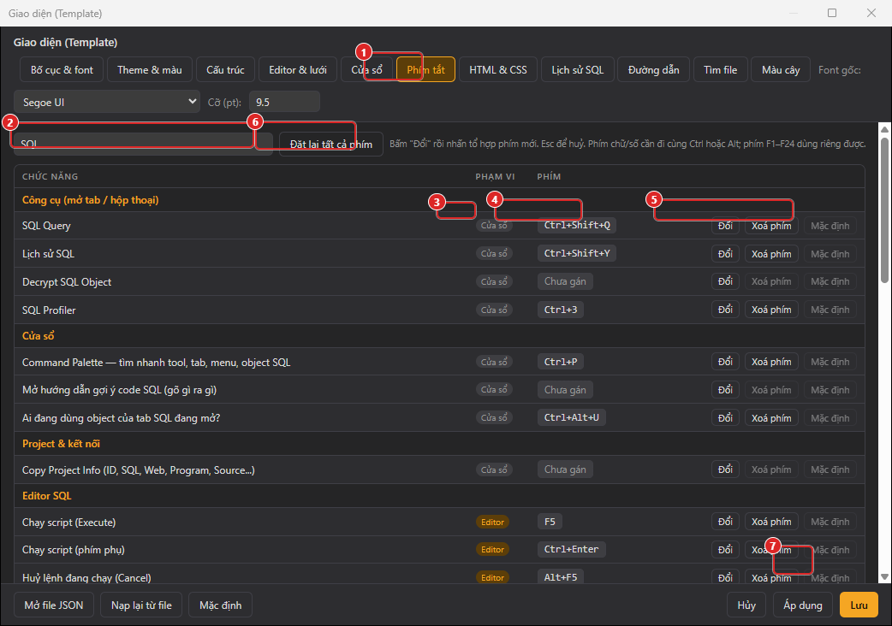

Trên ảnh: **①** tab Phím tắt · **②** ô tìm chức năng / phím · **③** phạm vi (Cửa sổ / Editor / Lưới Table / Cây menu) · **④** phím hiện tại · **⑤** Đổi · Xoá phím · Mặc định · **⑥** Đặt lại tất cả phím · **⑦** Lưu.

1. ⚙ Settings → **Giao diện (Template)...** → tab **Phím tắt**.
2. Ô "Tìm chức năng hoặc phím..." để tìm. Cột: Chức năng · **Phạm vi** (Cửa sổ = bấm ở đâu cũng được; Editor = trong editor SQL; Lưới Table; Cây menu) · Phím ("Chưa gán" = chưa có).
3. **Đổi** → bấm tổ hợp mới (`Esc` huỷ) · **Xoá phím** · **Mặc định**. Phím đã dùng cho chức năng khác → hỏi "Gán đè".
4. Bấm **Lưu** (không Lưu = không giữ). **Đặt lại tất cả phím** để về mặc định.

Quy tắc: phím chữ / số / dấu phải đi cùng `Ctrl` hoặc `Alt` (chỉ `F1`–`F24` dùng riêng được); không gán được `Ctrl+C/V/X/Z/Y/A`, `Alt+F4`, `Ctrl+Alt+Delete`, `Ctrl+Shift+Esc`. Mọi công cụ (kể cả trong menu Triển khai / Tool mở rộng) đều gán được phím ở nhóm **Công cụ**.

> **Lưu ý:** phím "Chuyển về tab trước" mặc định đang ghi sai thành `Ctrl+Shift+Bab` nên `Ctrl+Shift+Tab` chưa chạy — gán lại `Ctrl+Shift+Tab` ở tab Phím tắt nếu cần.

### Phím tắt mặc định của Bcode

**Công cụ**

| Phím | Công cụ | Phím | Công cụ |
|---|---|---|---|
| `Ctrl+Shift+Q` | SQL Query | `Ctrl+Shift+R` | File Reference |
| `Ctrl+Shift+L` | Lookup | `Ctrl+Shift+O` | Change Owner |
| `Ctrl+Shift+T` | Table | `Ctrl+Shift+U` | Gen Update (Result) |
| `Ctrl+Shift+W` | WCommand | `Ctrl+Shift+E` | Note |
| `Ctrl+Shift+F` | File Lookup | `Ctrl+Shift+4` | Note (New) |
| `Ctrl+Shift+G` | Gen Update | `Ctrl+Shift+Y` | Lịch sử SQL |
| `Ctrl+3` | SQL Profiler | `Ctrl+Shift+J` | So sánh object |
| `Ctrl+F1` | Trợ giúp | | |

`Ctrl+Shift+C` không mở công cụ nào: ở lưới Table và lưới kết quả SQL Query là copy tên cột (xem dưới).

**Cửa sổ, tab, dự án**

| Phím | Tác dụng |
|---|---|
| `Ctrl+P` | Command Palette |
| `Ctrl+Shift+P` | Màn Projects |
| `Ctrl+O` | Choose Server (dự án khác → cửa sổ mới nếu đang có tab) |
| `Ctrl+F5` | Synchronize project (FSG) — trong cây WCommand: chạy menu |
| `Ctrl+Shift+N` | Cửa sổ Bcode mới |
| `Ctrl+Shift+H` | Ẩn / hiện cây bên trái |
| `Ctrl+1` | Đổi database App ↔ Sys |
| `Ctrl+2` | Tab SQL Query: đảo ô database của riêng tab đang mở App ↔ Sys (thanh trên giữ nguyên) |
| `Ctrl+4` | Mở FSG FBO (web đăng nhập của dự án, trong tab) — trong cây WCommand: mở FSG FBO, đăng nhập rồi vào menu đang chọn (menu khác cùng dự án = thêm tab, chung phiên đăng nhập) |
| `Ctrl+5` | Mở thư mục Program Path |
| `Ctrl+Alt+U` | Ai đang dùng object (tab SQL mở từ cây SQL Object) |
| `Ctrl+Tab` · `Ctrl+Shift+Tab` | Chuyển tab kế / tab trước (bấm nhanh rồi thả: chuyển luôn) — giữ Ctrl thì hiện hộp chọn tab, bấm Tab để chọn, thả Ctrl để chuyển |
| `Ctrl+W` · `Ctrl+Shift+B` | Đóng tab · mở lại tab vừa đóng |
| `Alt+1` … `Alt+5` | Thả menu nhóm công cụ 1…5 |
| `Ctrl+Alt+Shift+A` · `Ctrl+Alt+Shift+V` | Add Script · View Script Cart |
| `F1` (chỉ khi vừa có lỗi) | Gửi lỗi gần nhất lên Google Sheet / forum TK2 Help — lúc không có lỗi chờ gửi, `F1` vẫn làm việc cũ (vd chi tiết dòng ở lưới Table). Xem [Log lỗi và gửi lỗi](#bao-loi) |

**Editor SQL**

| Phím | Tác dụng |
|---|---|
| `F5` / `Ctrl+Enter` | Chạy (đoạn chọn hoặc cả script) |
| `Alt+F5` | Huỷ lệnh đang chạy |
| `F7` | Beauty |
| `F12` · `Ctrl+F12` | Xem nhanh object · mở object ở tab mới |
| `Ctrl+I` · `Alt+\` | AI sửa / sinh SQL · gọi gợi ý AI |
| `Ctrl+Alt+H` | Lưu vào Lịch sử SQL |
| `Alt+Z` | Wrap |
| `Ctrl+S` | Save file .sql |
| `Ctrl+R` | Ẩn / hiện khung kết quả |
| `Ctrl+E` | Lưới kết quả: xuất nhanh cả bảng ra Excel (thư mục tạm, mở luôn). Save as Excel / Save as CSV (hỏi nơi lưu): tự gán phím trong Template → Phím tắt |
| `Ctrl+Shift+C` | Lưới kết quả: copy tên cột của ô đang chọn (nhiều cột → cách nhau dấu phẩy) |
| `Ctrl+F3` | Lưới kết quả: xem đủ giá trị ô đang chọn (chuỗi dài bị cắt trên lưới) trong cửa sổ chỉ đọc |
| `Ctrl+F` | Tìm (Web: của Monaco; App: thanh tìm) |
| `F10` · `Ctrl+F10` · `Shift+F5` | Debug: bước kế · tới con trỏ · dừng |

**Lưới Table**: `F1` chi tiết dòng · `F3` khai báo nhanh danh sách · `Ctrl+F3` sửa đủ nội dung ô · `F4` thêm · `F8` xoá · `Ctrl+I` nhân bản · `Ctrl+N` chèn sau · `Ctrl+'` copy giá trị · `Ctrl+Shift+C` copy tên cột · `Ctrl+0` NULL · `Ctrl+G` tới cột · `F5` tải lại.

**Cây WCommand**: `Insert` New · `F3` Edit · `F8` Delete · `F4` File Lookup mới · `F12` Gen Script Menu · `F5` Refresh · `Ctrl+F5` Run · `Ctrl+4` Run trong FSG FBO · `Ctrl+C` copy đường dẫn menu. Các nhánh đang bung được giữ nguyên khi chuyển sang mục khác (Object…) rồi quay lại, hoặc khi `F5`.

**Khung script tab Lookup**: `Ctrl+A` chọn hết · `Ctrl+F` tìm (`Enter` / `F3` tiếp, `Shift+Enter` / `Shift+F3` lùi, `Esc` đóng).

**Cây file File Lookup**: `F2` đổi tên file · `F5` quét lại · `F4` nhân bản tab File Lookup · `Ctrl+C` copy đường dẫn các file đã tick (không tick thì dòng đang chọn) · `Ctrl` + click tick / bỏ tick nhanh.

**Khung xem file** (xem trước File Lookup, cửa sổ xem mở từ F12, tab mở file): `F12` đi tới / peek entity · `Ctrl+F12` mở bằng BcodeViewer đúng file F12 sẽ đi tới (con trỏ ở chữ thường → chính file đang xem) · `Ctrl+S` lưu (chỉ tab mở file — khi chưa khai BcodeViewer) · `Ctrl+F` tìm · `Ctrl+G` Go to.

**Khai báo API**: `Ctrl+Shift+Enter` gửi · `Ctrl+S` lưu · `Ctrl+Shift+T` lấy token · `Ctrl+Shift+F` format · `Ctrl+Shift+K` validate.

<a id="key-ban-quyen"></a>
## Key bản quyền

Các tính năng sau cần key bản quyền gắn theo máy: **Create RPT & XML**, **Excel → FRX**, **Tạo báo cáo**, **Tạo chứng từ**, **Báo cáo yêu cầu FSG** (kể cả chuột phải cây WCommand → Yêu cầu liên quan), **Thiết kế màn hình** (kể cả nút Design ở cây WCommand), **Khai báo API**, **Tạo cấu trúc API**, **Tạo nhanh danh mục** (kể cả 🤖 AI tạo danh mục) và **Clone danh mục**. Chưa có key thì mở các tính năng này sẽ hiện hộp nhập key.

**Key Decrypt SQL Object** là key riêng (⚙ Settings → **Key Decrypt SQL Object...**, lưu ở `%AppData%\Bcode\license-decrypt.key`; key chung ở trên không thay được): mở **Decrypt SQL Object** và **Cài / Gỡ** theo dõi ở [Lịch sử sửa → Theo dõi ngoài Bcode](#lich-su-sql). Cách xin và dán key giống các bước dưới.

1. ⚙ Settings → **Key bản quyền...** (hoặc bấm vào tính năng bị khoá — hộp key tự mở).
2. **Bước 1**: bấm **Copy mã máy** và gửi mã cho người cấp key. Mỗi máy có một mã riêng.
3. **Bước 2**: dán key nhận được (hoặc **Dán từ clipboard**) → **Xác nhận**. Chỉ cần dán một lần — key lưu ở `%AppData%\Bcode\license.key`.

Trạng thái: "✓ Đã kích hoạt trên máy này" / "✗ Chưa kích hoạt". "Key đã lưu không còn hợp lệ trên máy này" hoặc "Mã không đúng cho máy này" → gửi lại **Mã máy** hiện tại để xin key mới. **Xoá key đã lưu** để gỡ.

<a id="bao-loi"></a>
## Log lỗi và gửi lỗi (F1)

**Log lỗi.** Mọi lỗi của Bcode được ghi vào `%AppData%\Bcode\error.log` (file quá 2 MB đổi thành `error.old.log`), mỗi lỗi một khối: thời gian, phiên bản, **dự án** đang mở, **chức năng** đang dùng (tab + loại công cụ, hoặc hộp thoại đang bật), nơi lỗi hiện ra, thông điệp + stack trace. Mật khẩu / key trong chuỗi kết nối được che thành `***` (tên server, database giữ nguyên để biết lỗi ở đâu). Lỗi được ghi khi:

- lỗi chưa được xử lý (vẫn hiện hộp lỗi .NET như trước — Tiếp tục / Thoát), lỗi trong tác vụ nền;
- lỗi trong lúc xử lý thao tác trên các trang (thanh công cụ, hộp thoại, tab công cụ);
- lỗi đã được báo cho bạn: hộp thông báo biểu tượng lỗi (✖ đỏ), hộp thông báo / dòng trạng thái / dòng báo trên trang có kèm thông điệp lỗi.

Không ghi: lỗi SQL của chính script bạn chạy trong khung **Message** của SQL Query (sai cú pháp, sai tên bảng…), thao tác Huỷ. Vừa ghi một lỗi thì thanh trạng thái báo `⚠ Đã ghi log lỗi: … — bấm F1 để gửi lỗi`.

**Gửi lỗi — `F1`.** Trong **15 phút** sau khi có lỗi (chưa gửi), bấm `F1` ở bất kỳ đâu trong Bcode — kể cả ngay lúc hộp báo lỗi đang mở — Bcode hiện nội dung sẽ gửi (thời gian, máy, người dùng Windows, dự án, chức năng, chi tiết lỗi) và hỏi **Có / Không**. Trả lời xong (Có hay Không) hoặc quá 15 phút thì `F1` trở lại việc cũ (chi tiết dòng ở lưới Table, `F1` của editor…). Gửi lại lỗi cũ: `Ctrl+P` → "Gửi lỗi gần nhất…". Đổi phím: Template → **Phím tắt** → *Gửi lỗi gần nhất* (nhóm Cửa sổ).

**Khai nơi nhận** (⚙ Settings → Giao diện (Template) → **Đường dẫn** → *Báo lỗi*, lưu ngay, file `%AppData%\Bcode\error-report.json`):

| Ô | Dùng để |
|---|---|
| **Link Google Sheet lỗi** | Link mở sheet — mặc định là sheet lỗi chung của nhóm (`https://docs.google.com/spreadsheets/d/1c7j31sOt4leZsOYH4rHLghaHSnB_p-Nu3bPL466xUdg/edit`); đổi sang sheet khác hoặc xoá trắng (= không dùng sheet) tuỳ ý. Nút **Mở** mở sheet. Chỉ khai ô này thì `F1` **chép 1 dòng lỗi vào clipboard và mở sheet** — bấm ô cột A của dòng trống đầu tiên rồi `Ctrl+V` (9 cột: Thời gian, Phiên bản, Máy, Người dùng, Dự án, Chức năng, Nguồn, Lỗi, Chi tiết). |
| **URL nhận tự động (Apps Script …/exec)** | Gửi thẳng vào sheet không cần dán. Google Sheet **không nhận ghi qua link mở sheet**, nên cần gắn một đoạn Apps Script: bấm **Chép mã Apps Script** → mở sheet → *Tiện ích mở rộng → Apps Script* → dán thay toàn bộ → Lưu → *Triển khai → Tùy chọn triển khai mới* → loại **Ứng dụng web**, *Thực thi với tư cách*: Tôi, *Ai có quyền truy cập*: **Bất kỳ ai** → Triển khai → chép **URL ứng dụng web** (đuôi `/exec`) vào ô này → **Gửi thử** (sheet có thêm 1 dòng "Gửi thử"). |
| **URL forum TK2 Help** | Gửi cả về forum TK2 Help (endpoint nhận lỗi công khai, không cần đăng nhập). Bcode POST cùng gói JSON như Apps Script: `time, version, machine, user, project, feature, source, message, detail` + `app` ("Bcode"), `title` ("[Bcode lỗi] …"), `content` (toàn văn để đăng bài); forum trả mã 2xx là tính gửi được. URL dạng `http://<máy chủ>/TK2_HELP/forum/api/bcode-error` (chỉ nhận từ mạng nội bộ, tối đa 10 lần / phút / máy). Forum đăng thành câu hỏi của **bcode-bot** ở chuyên mục *Lỗi Bcode*; cùng lỗi (chức năng + nguồn + thông điệp) đã có câu hỏi chưa giải quyết thì thêm bình luận vào câu hỏi đó. Hộp kết quả hiện link bài và hỏi mở bài. Lưu ý: **Gửi thử** cũng tạo 1 câu hỏi thật trên forum. |
| **File log** | Đường dẫn `error.log` + nút **Mở log**. |

Khai cả URL Apps Script lẫn forum thì `F1` gửi tới cả hai và báo ✔ / ✘ từng nơi; gửi tự động thất bại mà có link sheet thì Bcode hỏi chép + mở sheet để dán tay.

<a id="loi-thuong-gap"></a>
## Lỗi hay gặp (Bcode)

| Hiện tượng / thông báo | Nguyên nhân · cách xử lý |
|---|---|
| "Workspace hiện tại chưa khai báo Source Path (UNC). Vào File > Choose Server để thêm." | Dự án chưa có Source Path — vào ⚙ Settings → **Choose Server / Workspaces...** (hoặc `Ctrl+O` → Edit) khai đường dẫn UNC tới site. |
| Không khởi tạo được giao diện / trang trắng (WebView2) | Máy thiếu **WebView2 Runtime** — cài "WebView2 Runtime (Evergreen)" của Microsoft; hoặc dùng chế độ App. |
| Thanh trạng thái báo "WebView2: thư mục dữ liệu chính đang bị trình duyệt WebView2 khác giữ — phiên này dùng hồ sơ tạm WebView2-1…" (bản cũ: hộp lỗi "The requested resource is in use. (0x800700AA)") | Trình duyệt WebView2 của lần mở trước chưa thoát hẳn (vừa tắt đã mở lại, hoặc Bcode trước bị treo / tắt cưỡng bức), hoặc một Bcode khác đang mở. Bcode tự chờ vài giây rồi thử lại; vẫn bận thì dùng tạm hồ sơ `%AppData%\Bcode\WebView2-<số>` để vẫn mở được — dữ liệu lưu trong các trang của Bcode có thể phải làm lại cho phiên đó. Đóng hết Bcode rồi mở lại để về hồ sơ chính; hồ sơ tạm cũ được tự dọn. Chi tiết ghi ở `%AppData%\Bcode\webview2.log`. |
| Giao diện vỡ sau khi tuỳ chỉnh HTML / CSS | Giữ **Shift** khi mở Bcode (chế độ an toàn), rồi sửa / tắt tuỳ chỉnh ở Template → HTML & CSS. |
| Gợi ý không thấy bảng / procedure mới tạo | Bấm **⟳ Refresh database** cạnh ô WS. |
| `Ctrl+Shift+Tab` không chuyển tab | Phím mặc định đang sai — gán lại ở Template → Phím tắt "Chuyển về tab trước". |
| Debug từng bước không thấy nút (chế độ App) | Nhóm 🐞 Debug đang ẩn trên thanh — **Options… → Tùy chỉnh thanh nút…** để hiện, hoặc dùng phím (`F10`, `Ctrl+F10`, `Shift+F5`…). |
| Write Schema báo thiếu Crystal runtime / PowerShell | Xem [Write Schema](#write-schema) → Yêu cầu và lỗi hay gặp. |
| Table không Save / Delete được | Bảng không có Primary Key, hoặc là bảng tổng hợp `$000000` có bảng kỳ `$yyyymm` đi kèm (bảng `$000000` không phân kỳ thì Save được), hoặc database đã đổi sau khi Load. |
| Add Script của Table cảnh báo mất dữ liệu | Đang xem đúng bằng giới hạn Top — đặt Top = 0 rồi Load lại. |
| Edit in BcodeViewer không mở | Chưa / sai đường dẫn BcodeViewer.exe — khai ở Template → Đường dẫn. |
| Thiết kế màn hình báo "Chưa thấy BcodeScreenDesigner.exe" | Khai đường dẫn ở Template → Đường dẫn (nút Tự dò). |
| Cây Mobile trống | Sys Data không có bảng dvcommand, hoặc chưa khai Mobile Path. |
| Tính năng hỏi key bản quyền | Xem [Key bản quyền](#key-ban-quyen). |
| Máy chậm, tốn RAM | Template → Cửa sổ → Hiệu năng = Thấp; hoặc dùng chế độ App. |
| Gửi lỗi (`F1`) báo "Máy nhận trả về trang HTML" | Web app Apps Script chưa để *Ai có quyền truy cập: Bất kỳ ai*, hoặc URL không phải đuôi `/exec` — triển khai lại (xem [Log lỗi và gửi lỗi](#bao-loi)). |
| `F1` ở lưới Table mở hộp "Gửi lỗi" thay vì chi tiết dòng | Vừa có lỗi chưa gửi (15 phút): trả lời Có / Không là `F1` về như cũ; hoặc đổi phím Gửi lỗi ở Template → Phím tắt. |

<a id="viewer"></a>
# Phần II — BcodeViewer

BcodeViewer (BcodeViewer.exe) là trình soạn file controller FCode (Dir / Grid / Filter / Report / Include… dạng XML có SQL và JavaScript nhúng bên trong) xây trên Monaco — cùng lõi với VS Code. Toàn bộ menu, thanh công cụ và cây file đều vẽ trong trang; phím tắt đổi được hết.

<a id="viewer-giao-dien"></a>
## Màn hình chính BcodeViewer

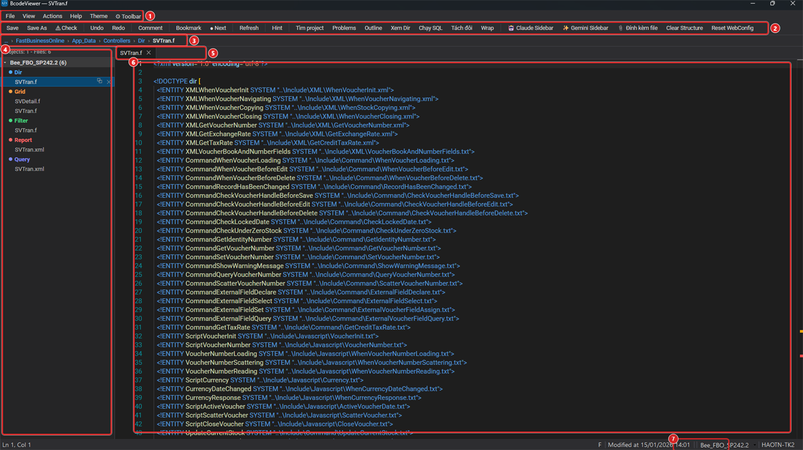

Trên ảnh: **①** thanh menu · **②** thanh công cụ · **③** đường dẫn (breadcrumb) · **④** cây file theo dự án · **⑤** thanh tab · **⑥** editor · **⑦** dự án của file (bấm để mở nhanh thư mục, Login WLink).

### Thanh menu

| Menu | Mục |
|---|---|
| **File** | New from Template… (`Ctrl+N`) · Mở nhanh file… (`Ctrl+P`) · Lịch sử file… (`Ctrl+Shift+H`) · Lịch sử cả dự án… · Settings… · Phím tắt… |
| **View** | Tìm trong project… (`Ctrl+Shift+F`) · Bảng Problems (`Ctrl+Shift+M`) · Xem trước Dir (`Alt+P`) · Outline (`Alt+O`) · Chạy SQL tại con trỏ (`Ctrl+Enter`) · Tách đôi khung soạn thảo (`Ctrl+\`) · Tìm nơi sử dụng (`Shift+F12`) · Show Vertical Tabpage (`Ctrl+B`) · Tự ẩn Menu/Toolbar |
| **Actions** | Clear Structure App · **Clear Structure ▸** (Clear App / Sys / Ext / Dir / Filter / Grid / Lookup · All · Open Structure Folder — như Bcode: mục không có thư mục thì mờ, thư mục lạ tự thêm; gán phím ở Settings → Phím tắt, nhóm Công cụ) · **Open Web.config** (mở web.config của site thành 1 tab, tô màu XML — giống Bcode) · Refresh Web.config |
| **Help** | Giới thiệu… · Kiểm tra bản BcodeViewer mới… ([Cập nhật BcodeViewer](#viewer-capnhat)) · Log độ mượt (viewer-perf.log)… |
| **Theme** | Danh sách theme Tối / Sáng có sẵn · theme đã nhập · Nhập theme (VS Code .json / .vsix, Fcode .xml)… · Theo Windows (sáng/tối) |
| **⚙ Toolbar** | Tick = ghim (hiện) / bỏ ghim từng nút, nhóm và nút trong nhóm · Hiện tất cả · **Nút chưa ghim** ▸ (chạy ngay nút đang ẩn) · Kiểu nút ▸ · Vị trí thanh ▸ · Nhóm mới… · Gợi ý nhóm… · Tuỳ chỉnh thanh công cụ… · Khôi phục mặc định (chuột phải chỗ trống của thanh công cụ cũng ra menu này) |

"Tự ẩn Menu/Toolbar": thanh trên tự ẩn, đưa chuột sát mép trên cửa sổ là hiện lại.

Góc phải thanh menu có nút **💡 Hint** (bóng đèn) — mở Hint Code (thư viện snippet), như nút Hint ở góc phải của Bcode; luôn hiện, không phụ thuộc ghim / nhóm của thanh công cụ.

### Thanh công cụ (mặc định)

Save (`Ctrl+S`) · Save As · ⚠ Check (so `<fields>` với `<views>` của Dir/Grid) · Undo · Redo · Comment (`Ctrl+/`) · Bookmark · ● Next · Refresh (tải lại file từ đĩa) · Hint (Hint Code) · Tìm project · Problems · Outline · Xem Dir · Chạy SQL · Tách đôi · Wrap (`Alt+Z`) · 🤖 Claude Sidebar · ✨ Gemini Sidebar · 📎 Đính kèm file · Clear Structure · Reset WebConfig · Open WebConfig (mở web.config của site).

Đầu bên phải thanh công cụ là ô **cỡ chữ** `100%  −  +  Đặt lại` (gõ số % rồi Enter, hoặc `Ctrl` + lăn chuột). Ẩn thanh công cụ (Settings → Bố cục, hoặc *Tự ẩn Menu/Toolbar*) thì ô này ẩn theo — `Ctrl` + lăn chuột vẫn đổi cỡ chữ.

Dưới thanh công cụ là thanh **File Path**: đường dẫn **đầy đủ** của file đang mở, từ máy chủ (`\\172.168.5.14`, tô màu cam) tới tên file (đậm). Bấm vào một đoạn để mở thư mục đó trong Explorer; bấm nhãn **File Path** để copy cả đường dẫn. Đường dẫn dài hơn bề ngang thì lăn chuột trên thanh để cuộn ngang (mặc định cuộn sẵn tới tên file).

### Tuỳ biến thanh công cụ (ghim, nhóm, vị trí)

Giống Quick Access + nhóm công cụ của Bcode. Chưa chỉnh gì thì thanh y như danh sách mặc định ở trên.

- **Bỏ ghim / ghim**: chuột phải 1 nút → **Bỏ ghim**, hoặc bỏ tick ở menu **⚙ Toolbar**. Nút bỏ ghim không hiện trên thanh nhưng vẫn chạy được: ⚙ Toolbar → **Nút chưa ghim** ▸, menu chính và phím tắt của nó.
- **Nhóm nút**: chuột phải 1 nút → **Chuyển vào nhóm** → *Nhóm mới…* (đặt tên; tên bắt đầu bằng 1 ký hiệu như "🛠 Công cụ" thì kiểu "Chỉ icon" chỉ hiện ký hiệu). Nhóm hiện thành nút **Tên ▾** — bấm để thả menu các nút trong nhóm. `Alt+1` … `Alt+5` mở nhóm thứ 1…5 tính từ trái (trong menu: ↑/↓ + Enter hoặc gõ số 1–9 để chọn); đổi / thêm phím (tới nhóm thứ 9) ở Settings → Phím tắt → *Thanh công cụ*. Chuột phải 1 mục trong menu nhóm: đưa ra thanh, chuyển sang nhóm khác, lên / xuống, bỏ ghim. Chuột phải nút nhóm: đổi tên, **Tách nhóm** (đưa các nút ra thanh), **Xoá nhóm** (bỏ ghim các nút).
- **Gợi ý nhóm** (như nút cùng tên ở Quick Access của Bcode): ⚙ Toolbar / chuột phải thanh → *Gợi ý nhóm (chia sẵn theo chức năng)…* — ghim Save, Check, Undo, Redo, Xem Dir, Chạy SQL, Wrap; các nút còn lại vào 5 nhóm 📄 Tệp · ✎ Soạn · 🔍 Xem · 🤖 AI · 🌐 Site (`Alt+1`…`Alt+5`). Settings → Bố cục cũng có nút **Gợi ý nhóm** (nạp vào bản nháp, bấm OK mới áp dụng). Sửa tiếp tuỳ ý sau đó; không vừa ý thì Khôi phục mặc định.
- **Kéo thả trên thanh**: giữ chuột kéo 1 nút / nhóm / vạch ngăn sang chỗ khác (vạch xanh = chỗ thả); thả vào **giữa** nút nhóm = cho nút vào nhóm. Bấm Esc khi đang kéo để huỷ.
- **Kiểu nút**: Chữ (mặc định) · Icon + chữ · Chỉ icon (tên nút hiện ở tooltip). **Vị trí thanh**: Trên — dưới thanh menu (mặc định) · Cùng hàng với thanh menu · Dưới cùng cửa sổ. Chọn ở chuột phải thanh công cụ hoặc Settings → Bố cục.
- **Settings → Bố cục** có danh sách đầy đủ: kéo ☰ đổi thứ tự (thả lên nửa dưới dòng nhóm ▦ = cho vào nhóm), tick ghim, sửa tên nhóm ngay trên dòng, ✕ bỏ nhóm, "+ Nhóm mới", "+ Vạch ngăn", "+ Thêm nút" cho bất kỳ chức năng nào của bảng phím tắt.
- **Khôi phục mặc định**: ⚙ Toolbar / chuột phải thanh → *Khôi phục mặc định* (hoặc Settings → Bố cục → "Đưa toolbar về mặc định"). Cấu hình lưu theo người dùng trong `%AppData%\Bcode\viewer-settings.json`, giữ qua các lần mở lại và đi kèm Settings → Sao lưu / chuyển máy.

### Cây file bên trái (Projects)

- Dòng đầu: "Projects: N - Files: M". Mỗi dự án là một nhóm "Tên dự án (số file)", trong đó file chia theo thư mục, xếp cố định: Dir → Filter → Grid → Lookup → Report → Template → Command → XML → Config → Options → Upload → Include → thư mục khác (ABC).
- Trong một thư mục, file xếp theo ABC; **kéo thả** một file lên / xuống để đổi chỗ (vạch màu nhấn chỉ chỗ sẽ thả). Chỉ kéo được trong cùng thư mục — sang thư mục khác, ra ngoài cây hoặc nhả chuột ngoài cây thì không đổi gì. Thứ tự được nhớ cho lần mở sau; file mới mở thêm vào thư mục đã sắp xếp thì đứng sau các file đã kéo.
- Cây là **danh sách file đã mở gần đây** (tối đa 300 file), không phải toàn bộ ổ đĩa. Mở file mới không đẩy dự án lên đầu; chỉ dự án mới chèn lên trên. File chưa lưu có dấu " •".
- Bấm file = mở. `Ctrl`+bấm chọn nhiều file rồi `Ctrl+C` = copy đường dẫn. `Delete` = bỏ khỏi danh sách (không xoá file).
- Nhận biết file đang làm: dòng file **đang hiện trên editor** có nền màu nhấn, vạch trái dày và chữ đậm; dự án chứa nó (và thư mục Dir / Grid… của nó) cũng có nền + vạch màu nhấn — các dự án khác chỉ có vạch xám, kể cả khi dự án đang thu gọn. File **đang mở ở tab khác** có chấm nhỏ "●" trước tên.
- Mỗi file có icon tròn mang chữ cái đầu của thư mục (**D** = Dir, **F** = Filter, **G** = Grid, **R** = Report…) cùng màu thư mục, và vạch dọc cùng màu bên trái — biết ngay file thuộc nhóm nào. Icon **tô đặc** = file đang mở thành tab; viền rỗng = chỉ nằm trong danh sách. **Bỏ đánh dấu** (đóng tab mà vẫn giữ file trong cây): bấm vào icon tô đặc, hoặc rê chuột lên dòng file → nút **○** (khác **✕** là bỏ file khỏi danh sách); file chưa lưu thì hỏi như đóng tab. Dòng dự án ghi tên đậm, số file mờ.
- Rê chuột lên dòng dự án → nút **✕** = **đóng dự án**: đóng mọi tab đang mở của dự án rồi bỏ hết file của dự án khỏi cây (không xoá file trên đĩa). File chưa lưu được đưa lên màn hình rồi hỏi như khi đóng tab thường; chọn huỷ thì dừng và chưa bỏ file nào khỏi cây. Dòng **thư mục** (Dir, Grid…) cũng có nút **✕** tương tự: đóng các tab rồi bỏ các file của riêng thư mục đó khỏi cây (chuột phải thư mục: Đóng mọi tab đang mở của thư mục này · Bỏ các file của thư mục khỏi danh sách).
- Chuột phải file: Mở · Mở thư mục chứa file · Copy đường dẫn (.f nếu có) · Bỏ khỏi danh sách. Chuột phải dự án: Ẩn/Hiện file của dự án · Đóng mọi tab đang mở của dự án này (chỉ đóng tab, file vẫn ở trong cây) · Copy đường dẫn tất cả file · Bỏ tất cả file của dự án khỏi danh sách (như nút ✕).
- `Ctrl+B` ẩn / hiện cây. Khi cây ẩn, thanh tab liệt kê mọi file của cây. Khi cây **đang hiện**, thanh tab trên editor được ẩn (cây đã đánh dấu file đang mở / đang xem); chỉ file đang mở mà cây không liệt kê mới còn tab. Muốn giữ thanh tab như cũ: Settings → Bố cục → bật **"Vẫn hiện thanh tab khi đang hiện cây file bên trái"**.

### Tab và thanh trạng thái

- Bấm chuột giữa để đóng tab; chuột phải tab: Đóng · Đóng các tab khác · Đóng tất cả · Mở ở khung tách · Copy đường dẫn · Mở thư mục chứa file.
- Thanh trạng thái: dòng/cột, ngôn ngữ, giờ sửa, trạng thái AI, và nút dự án (Login WLink, Program / Source / Working / Mobile path, Copy Project Info — dòng SQL có cả user và mật khẩu SQL như bên Bcode).

<a id="viewer-mo-file"></a>
## Mở, lưu file và lịch sử

### Mở file

1. **Từ Bcode**: tab File Lookup → chọn file → **Edit in BcodeViewer**. Lần đầu Bcode hỏi "Chọn BcodeViewer.exe" rồi nhớ lại (đổi ở Bcode: Template giao diện → Đường dẫn → BcodeViewer). File `.rpt` / `.xlsx` mở bằng chương trình Windows tương ứng.
2. **Mở nhanh** `Ctrl+P`: gõ vài chữ của tên file (vd `SVTran`, `grid vctck`) — tìm trong toàn bộ App_Data của dự án đang mở; mọi từ gõ vào phải có trong đường dẫn; tab gần đây xếp trước. `↑/↓`, `Enter`, `Esc`.
3. **Dòng lệnh**: `BcodeViewer.exe "<file>" "<tên dự án>"` (tên dự án có thể bỏ — Viewer tự suy từ Source Path của workspace Bcode, hoặc từ đường dẫn `<Dự án>\<FBISPxxx>\App_Data`, không ra thì xếp vào "#Other").
4. Viewer chỉ chạy **một bản** mỗi phiên Windows: mở thêm file từ Bcode / Explorer sẽ chuyển sang cửa sổ đang chạy và mở file ở tab mới.

### Lưu

- `Ctrl+S` → "Đã lưu file thành công". Encoding gốc được giữ nguyên (file `.f` UTF-16 vẫn là UTF-16).
- Mỗi lần lưu ghi thêm **lịch sử**: lịch sử máy này (`%AppData%\Bcode\history`, tối đa 50 bản/file) và **lịch sử chung của dự án** (`<thư mục dự án>\History\…`, ghi kèm máy, user, IP, giờ; tối đa 100 bản/file). Ghi lịch sử chung lỗi thì báo "Đã lưu file, nhưng KHÔNG ghi được lịch sử chung…".
- Đóng tab / thoát khi còn file chưa lưu: Viewer hỏi lưu hay bỏ.

### Lịch sử file (`Ctrl+Shift+H`)

- 3 tab: **File này** (lịch sử chung của file) · **Cả dự án** (lọc 1 / 7 / 30 ngày, lọc theo file / người / máy) · **Máy này**.
- Bên phải là so sánh "Bản đã chọn" ↔ "Hiện tại". Dòng "⚠ SỬA NGOÀI VIEWER" là bản bị sửa bằng công cụ khác.
- **Khôi phục bản này** chỉ đưa nội dung cũ vào editor — phải `Ctrl+S` mới ghi ra đĩa. "Dọn bản cũ…" xoá bản cũ hơn N ngày (luôn giữ bản mới nhất).

### File bị sửa từ nơi khác

Viewer kiểm tra file mỗi 4 giây. File đổi trên đĩa (người khác sửa, chép đè…) → hiện thanh báo "File này đã được thay đổi từ máy khác. Tải lại bản mới nhất?" với **Xem khác biệt** · **Reload** · ✕ (bỏ qua lần này).

> **Lưu ý:** nút **Refresh** trên thanh công cụ cũng đọc lại file từ đĩa — Viewer hỏi trước nếu đang có thay đổi chưa lưu.

<a id="viewer-intellisense"></a>
## IntelliSense — gợi ý code


Trên ảnh: **①** chữ vừa gõ · **②** danh sách gợi ý (Enter để chèn khối `<field>`).

Gợi ý có 5 lớp, lớp nào hợp ngữ cảnh con trỏ (XML / SQL / JavaScript) thì hiện:

1. **Hint Code + snippet**: thư viện snippet riêng (nút **Hint**), thư mục snippet dùng chung của nhóm (Settings → Template dùng chung) và snippet FCodeViewer. Gõ từ 2 ký tự của Prefix là hiện chữ mờ (ghost) — `Tab` để chèn và nhảy qua từng ô cần điền.
2. **Cấu trúc XML + từ điển field**: gợi ý thẻ / thuộc tính / giá trị học từ chính file và các file include.
   - Gõ `f.ma_kh` (hoặc `<f.ma_kh`) rồi `Enter` → chèn sẵn khối `<field>` có header v/e và `<items style="AutoComplete" …>` kèm field `ten_xx%l`. Có sẵn cho ma_kh, ma_gd, ma_kho, ma_vt, ma_vv, nh_kh1-3, nh_vt1-3 và mọi field trong từ điển header.xml; tên khác → field text mặc định.
   - `f.clientscript` → chèn `<clientScript>` với `onchange=onChange<Controller><Field>(this)`.
   - Chữ mờ cấu trúc: trong JS gõ `f.get`, `f.set`, `g.get`, `g.set`, `f.req`; trong XML gõ `<items`, `<item`, `<handle`, `<category`, `<script` → gợi ý cả khối. Trong `<views>` của **Grid / Lookup** gợi ý `<field name="x"/>` cho field đã khai trong `<fields>` mà chưa có trong view nào (Dir / Filter đặt field bằng `<item value="…">` nên không gợi ý kiểu này). File import (Upload) cũng vậy với khối cột Excel `<template><fields row="…">`: dòng trống trong khối đó gợi ý cả khối `<field name="x" width="…"><text v="…" e="…"/></field>` cho field nhập kế tiếp (có `column`) chưa có cột — tiêu đề theo từ điển header.xml, field `allowNulls="false"` thêm `starColor` như các cột bắt buộc khác; `Tab` là khai xong.
   - Rê chuột lên `&Entity;` để xem nội dung; rê lên dòng design của Dir để xem độ rộng thật của biến.
   - **Note thuộc tính field**: gõ thuộc tính trong `<field …>` / `<items …>` thì mỗi mục trong danh sách kèm mô tả tiếng Việt + các giá trị hợp lệ (vd `allowNulls` — `false` = bắt buộc nhập, `true` = được để trống); gõ trong dấu `"` của giá trị thì các giá trị có ghi ý nghĩa. Rê chuột lên tên hoặc giá trị thuộc tính cũng hiện ghi chú đó. Có sẵn **định nghĩa của Fast** cho ~60 thuộc tính hay dùng (type, width, readOnly, external, defaultValue, clientDefault, dataFormatString, categoryIndex, inactivate, filterSource…; `<items>`: style, controller, reference, key, check, information, new; file import: column, insertValue, updateValue, check, errorCode…) — soạn từ thống kê source Fast + form khai field của FCode; thuộc tính chưa rõ nghĩa ghi rõ "chưa rõ".
   - Xem / sửa / thêm note riêng: menu **Actions → Note thuộc tính field...** (gán phím ở Settings → Phím tắt → *Note thuộc tính field*; đang đứng trên 1 thuộc tính thì hộp lọc sẵn thuộc tính đó). Lọc theo tên / mô tả / giá trị, theo thẻ, theo loại file; **Thêm note** hoặc **Sửa** 1 dòng → điền mô tả + giá trị (mỗi dòng `giá trị = ý nghĩa`), chọn loại file áp dụng (Mọi loại file / Grid / Dir / Filter / Import…) → **Ghi vào danh sách** → **Lưu**. Sửa định nghĩa của Fast = tạo note của bạn cùng tên (thắng bản Fast; xoá note thì quay về bản Fast). Note lưu ở `<Thư mục kiến thức>\viewer\field-notes.json` — đặt Thư mục kiến thức chung (Settings → Gợi ý & Hỏi Fast) thì cả nhóm dùng chung.
   - **Khai field xong tự sinh dòng view** (tắt mặc định — bật ở Settings → **Gợi ý & Hỏi Fast** → *Khai field xong tự sinh dòng `<field name="…"/>` trong `<views>`*): ở file **Grid / Lookup**, gõ xong 1 `<field name="X" …>` mới trong `<fields>` (đóng thẻ, con trỏ rời khỏi thẻ đó) mà `<views>` chưa có X thì Viewer tự thêm `<field name="X"/>` vào `<view>` — đúng thứ tự khai báo (sau dòng view của field khai ngay trước), cùng thụt lề với các dòng sẵn có, góc trên báo "Đã thêm …". `Ctrl+Z` bỏ đúng dòng vừa thêm. Sửa tên field vừa khai (vd `ma_k` → `ma_kh`) thì dòng view đổi tên theo. Field thiếu sẵn trong file cũ không tự thêm (dùng **⚠ Check** / gợi ý chữ mờ); Dir / Filter (view dạng `<item value="mặt nạ: [x]">`) không tự thêm.
3. **Gợi ý theo cấu trúc Fast (không AI, bật sẵn)** — chữ mờ ở cuối dòng khi gõ XML controller, JavaScript, ASPX; chạy trên máy, không gọi mạng. Học từ source Fast mẫu đi kèm, source của dự án đang mở (đọc ở nền lần đầu, nhớ 7 ngày) và source Fast các phiên bản (xem dưới). `Tab` nhận.
   - Trong khối `<field name="ma_kh">`: dòng trống gợi ý `<header v="…" e="…">` hay dùng của field đó; gõ `<items` gợi ý nguyên `style="AutoComplete" controller="Customer" reference="ten_kh%l" …` theo cách khai thật hay gặp nhất.
   - Gõ xong `<field name="X"` → phần thuộc tính còn lại theo đúng loại file và đúng mục (trong `<views>` của Grid chỉ là tham chiếu ` />`, trong `<fields>` mới là thuộc tính khai báo): cách khai field X hay gặp (vd file import: ` column="A" allowNulls="false" upperCase="true" resource="master" check=…`), không có thì theo khai báo đặc thù của chính file — field đó đã khai trong file thì chép đúng cách khai đó (kể cả `check`), không thì theo các dòng `<field>` gần nhất trong cùng khối (vd ` column="." resource="master"/>`); khối cột Excel trong `<template>` của file import tính riêng. Gõ `name ="x"` (có dấu cách) hay để sẵn ` >` sau con trỏ vẫn gợi ý. Khi chữ mờ này đã sẵn, danh sách thuộc tính không tự bật đè lên (`Ctrl+Space` vẫn mở); file import / clipboard có bộ thuộc tính riêng (column, resource, check, errorCode…), xếp theo số lần dùng trong file.
   - Dòng giống trong chính file (khai nhiều field cùng kiểu), cụm token hay gặp (`f.getItemValue('…')`, `<field name=`, `<asp:Content …>`…).
   - Gõ `</` (hoặc `</dow` dở) → đóng đúng thẻ đang mở gần nhất chưa đóng (vd `download>`), theo cấu trúc file chứ không đoán — đo đúng 99,9%. Bỏ qua thẻ trong comment / CDATA, thẻ tự đóng `/>` và `<br>`, ``… của ASPX.
   - Nhiều nguồn cùng có gợi ý thì lấy nguồn **hay đúng nhất ở đúng loại chỗ đó** — theo bảng đo sẵn trên file mẫu (vùng XML / JS / SQL / ASPX, dòng trống, gõ dở tên… × mức chắc của từng nguồn); 2 nguồn đúng ngang nhau thì lấy gợi ý **dài hơn**. Đo: chế độ ngắn đúng 94% → 95% và gõ hộ được 28% → 33% số ký tự còn lại của dòng; chế độ dài gõ hộ 30% → 35%, đúng giữ nguyên (trước đây lấy nguồn có độ tin cao nhất — các nguồn tính độ tin khác nhau nên hay chọn gợi ý ngắn; trước nữa lấy gợi ý dài nhất — hay bị 1 gợi ý dài mà sai đè lên).
   - Trong đoạn `<script>` (JS) và SQL trong CDATA: thêm **ma trận đầu dòng** (vài từ đầu dòng → phần còn lại hay viết, vd `f.getItemValue(` → `'ma_kh')`) và **ma trận dòng tiếp theo** (vừa Enter → cả dòng hay viết sau dòng phía trên) — cùng cách với gợi ý SQL của Bcode nhưng học từ chính JS / SQL trong source Fast (SQL trong controller viết khác stored procedure: dùng thẳng ma trận SQL của Bcode chỉ đúng 33%). Chế độ ngắn: JS 19–31% → 49–52% chỗ có gợi ý, SQL 31–36% → 41–52%, vẫn đúng ≥ 90%.
   - Với XML / ASPX, 2 ma trận đó khoá thêm **2 thẻ cha gần nhất** (kèm `event` của `<command>`): cùng đầu dòng `<item` nhưng trong `<command event="Loading">` hay trong `<views>` gợi ý khác nhau.
   - **File anh em**: dòng của 3 file cùng loại trong dự án (Dir / Grid… có nhiều tên field trùng nhất với file đang sửa — vd SOTran ↔ SVTran) dùng như "theo chính file".
   - **Nhiều nguồn cùng đồng ý** một phần đầu → phần đó được tin hơn từng nguồn (chủ yếu giúp chế độ dài đúng hơn).
   - **Gõ dở 1 tên** (hàm, biến, thành viên, thẻ, thuộc tính, cột SQL): chữ mờ hoàn tất tên đó theo các tên **trong chính file** bắt đầu đúng phần đã gõ — dòng càng gần và cùng ngữ cảnh (cùng `f.` / `o.parentForm.` phía trước) càng được tin; tên hầu như luôn được gọi thì kèm `(`. Vd giữa các dòng `f.setItemControlBehavior(…)`, gõ `f.setIt` → `emControlBehavior(`. Sau `function `: chỉ gợi ý tên đã được gọi (vd `onchange="onChange$Voucher$X(this)"`) mà chưa có hàm — hàm đã khai rồi thì không gợi ý lại. Dropdown đang mở mà chữ mờ ra **đúng tên mục đang chọn** (vd `setItemControlBehavior`) thì dropdown tự đóng để chữ mờ hiện (`Tab` nhận `setItemControlBehavior(`, chế độ dài còn kèm tham số hay dùng); chữ mờ ra tên khác thì giữ dropdown. Ở dòng `function …` chữ mờ luôn được ưu tiên (dropdown ở đó chỉ là các từ trong file, hay chọn sẵn hàm đã khai). Đã tự chọn trong dropdown (`↑` / `↓` / `PageUp` / `PageDown`, cuộn chuột trên dropdown) thì dropdown **không tự đóng nữa** cho tới khi nó đóng — vd gõ `f.re`, `↓` tới `request` (đúng tên chữ mờ đoán) vẫn giữ dropdown, `Enter` / `Tab` chèn mục đang chọn. Phân biệt hoa thường: gõ `onchange$…` sẽ không ra `onChange$…` (dropdown `Ctrl+Space` vẫn lọc không phân biệt). Chỗ gõ dở tên có ngưỡng riêng, đo trên nửa file mẫu không dùng để học: JS chế độ ngắn có gợi ý ~94% chỗ, đúng ~94% (dài ~96% / ~92%); XML ~99,7% / ~98%; SQL trong CDATA ~92% / ~93%; file import (đo trên source Fast) ~97% / ~95%.
   - **Học từ người dùng, dùng chung cả nhóm**: mỗi lần nhận gợi ý (`Tab`, hoặc tự gõ đúng hết) hay bỏ qua (gõ khác đi, Enter sang dòng khác khi chưa hết), ô ma trận sinh ra nó được chỉnh — hay bị bỏ qua (khoảng 3 lần) thì thôi gợi ý, hay được nhận thì chắc hơn. Settings → **Gợi ý & Hỏi Fast** → **Thư mục kiến thức chung**: đặt 1 thư mục mạng cả nhóm dùng — ma trận học từ source mọi dự án được gộp thành **kiến thức chung** (dự án chưa mở lần nào vẫn có gợi ý theo cách viết của các dự án khác), phản hồi của mọi người cộng lại (mỗi máy 1 file `viewer\ghost\feedback\<máy>.json`). Trống = dùng Thư mục kiến thức của Bcode. Dòng dưới ô cho biết đang dùng thư mục nào, bao nhiêu dự án, tỷ lệ gợi ý được nhận. **Ổ C đầy**: gõ / **Browse...** thư mục ở ổ khác vào ô rồi bấm **Chuyển dữ liệu sang đây** (ngay dưới) → hộp hỏi lại (dung lượng, từ đâu → đến đâu) → **Chuyển**: cả `viewer\` (ghost, ask, versions — phần lớn nhất, có thể vài trăm MB) được chuyển sang thư mục mới, xoá ở chỗ cũ, thư mục mới **lưu luôn** vào Settings (không cần bấm OK); lịch sử chat Hỏi Fast vẫn ở máy này. Cách chuyển giống bên Bcode (từng file chép xong mới xoá; dừng giữa chừng thì không đổi thư mục, bấm lại để chuyển tiếp; file phản hồi `feedback` trùng tên thì giữ ở chỗ cũ và báo tên).
   - **Ngắn** (mặc định) chỉ hiện chỗ đủ chắc — đo trên nửa file mẫu không dùng để học: có gợi ý ở **~89% chỗ, đúng ~92%** (bản trước các cải tiến này: 76% / 91%). **Dài** (`Alt+Shift+\` hoặc Settings → Gợi ý & Hỏi Fast) hiện nhiều và dài hơn: **~97% chỗ, đúng ~86%** (trước: 91% / 66%). Khai thư mục source Fast các phiên bản thì phủ thêm: đo trên source Fast mới nhất, ngắn 48% → 59% chỗ (đúng ~92%), dài 73% → 80% chỗ (đúng ~67%); riêng file import (Upload) chế độ ngắn 10–41% → 53–94% chỗ, đúng ≥ 92%.
   - Tắt / bật: Settings → **Gợi ý & Hỏi Fast** → "Gợi ý theo cấu trúc Fast khi gõ".
4. **SQL schema**: khi con trỏ ở vùng SQL (`<command>`, `<action>`…) gợi ý tên bảng / cột của **workspace đang chọn trong Bcode**.
5. **AI ghost text** (tắt mặc định): bật ở Settings → AI → "Bật gợi ý AI khi gõ". Ngừng gõ khoảng 0,4 giây là gọi AI (tính phí theo API key). `Tab` nhận cả gợi ý, `Ctrl+→` nhận từng phần. Nhận trọn một gợi ý AI → Viewer mở hộp **Hint Code** điền sẵn đoạn đó để lưu thành hint nếu muốn.

Gợi ý thủ công: `Ctrl+Space`.

### AI viết / sửa code — `Ctrl+I`

1. (Tuỳ chọn) bôi đen đoạn cần sửa.
2. `Ctrl+I` → hộp "AI: Sinh code" (hoặc "AI: Sửa/Sinh code (có selection)").
3. Gõ yêu cầu, `Ctrl+Enter` (hoặc **Generate**) → kết quả hiện ở "Đề xuất từ AI".
4. **Insert** để thay đoạn đã chọn / chèn tại con trỏ.

`Ctrl+I` luôn dùng Claude và cần Anthropic API key trong Settings → AI; vẫn dùng được khi tắt ghost text.

> **Lưu ý:** prompt hệ thống của AI ghost text sửa được trong `Config\common.txt`, `xml.txt`, `sql.txt`, `js.txt`, `css.txt` cạnh BcodeViewer.exe — không cần build lại.

<a id="viewer-entity"></a>
## F12 / Peek entity và điều hướng

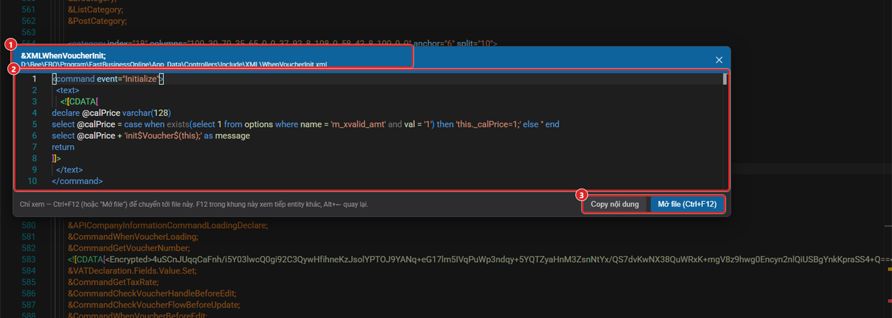

Trên ảnh: **①** tên entity + file khai báo · **②** nội dung (chỉ xem) · **③** Copy nội dung · Mở file (Ctrl+F12).

| Phím | Tác dụng |
|---|---|
| `F12` | **Xem trước** (peek) `&Entity;` hoặc đường dẫn file trong ngoặc kép tại con trỏ — mở cửa sổ nhỏ, vẫn đứng ở file hiện tại. Theo chuỗi include sâu tới 64 cấp. Trên tên field trong `<views>`: peek **sửa được** khai báo field đó (xem mục dưới). Trên tên action trong `f.request('GetUserID', 'UserID', […])` (hoặc chữ `request`): peek khối `<action id="GetUserID">` ở `<response>` — file này trước, không có thì các file include. |
| `Ctrl+F12` | **Đi tới**: mở file / nhảy tới dòng khai báo entity / `<action id>` của `f.request`. |
| `Ctrl`+bấm chuột | Nhảy tới khai báo **trong cùng file** (entity, `function X(`, `<view|action id>`, `<field name>`). |
| `F11` | Tới `function` của handler trên dòng hiện tại (vd `onchange="X(this)"`); không có thì nhảy tới `<script>`. |
| `Shift+F12` | Tìm nơi sử dụng từ tại con trỏ trong toàn project (khớp trọn từ, tối đa 2000 kết quả, hiện ở bảng Tìm kiếm). |
| `Ctrl+G` | Go to: cột trái là thẻ (fields, command, script, response, css, ENTITY), cột phải là chi tiết; `Enter` / double-click để nhảy. Mục hay dùng tô cam / đỏ (cả trong hộp lẫn ngay trong editor): command Inserted (cam) / Updated (đỏ); `on$<đối tượng>$ExecuteCommand` (đỏ) và `on$<đối tượng>$ResponseComplete` (cam) của mọi đối tượng — `on$Voucher$…`, `on$GridVoucherDetail$…`, lưới chi tiết khác; `onChange$Grid…` (cam). |
| `Alt+O` | Outline: ENTITY / View / Field / Command / Action / Function kèm số dòng, có ô lọc. (Trước đây là `Ctrl+Shift+U` — phím đó nay dùng để viết hoa.) |
| `Ctrl+Shift+F12` | **Xem XML đầy đủ** (View → Xem XML đầy đủ, chuột phải → Xem XML đầy đủ): mở tab **chỉ đọc** `<tên>.full.xml` = file đang mở sau khi thay hết `&Entity;` và nội dung các file include `SYSTEM` (bỏ phần `<!DOCTYPE … ]>`), lặp tới khi không còn entity — chính là XML mà FBO đọc (như tool *ToolsViewXml* / View XML của FSD Studio; đã so 200 controller với trình đọc XML .NET: giống hệt). `&Tên;` trong `<!-- -->` và `<![CDATA[ ]]>` giữ nguyên như trình đọc XML. Đầu tab là chú thích: số chỗ đã thay và danh sách entity **không thay được** kèm lý do (không có khai báo trong chuỗi include / không đọc được file) — đó là lỗi FBO sẽ gặp khi mở màn hình; entity tự gọi lại chính nó thì báo dừng. Tab không sửa được, đóng không hỏi lưu; `Ctrl+S` lưu ra file khác nếu cần. Đổi phím ở Phím tắt (nhóm Điều hướng). |

F12 trên ký tự có sẵn của XML (`&lt;` `&gt;` `&amp;` `&quot;` `&apos;`, `&#123;`) hay từ khoá khai báo (`<!ENTITY`, `SYSTEM`…) chỉ báo ngay "không phải entity" — không còn đi tra cả project.

Trong cửa sổ peek: **Mở nơi khai báo (Ctrl+F12)** · **Copy code**; `F12` tra tiếp entity bên trong, `Alt+←` quay lại, `Esc` đóng. Bôi đen nhiều entity rồi `F12` → xem "Một trang" hoặc "Từng entity" (◀ ▶ để chuyển, Copy entity này / Copy tất cả).

> **Lưu ý:** file include không biết file cha → Viewer báo; bấm `F12` lần nữa trong 8 giây để tìm trong toàn project.

### F12 trên field trong `<views>` — sửa khai báo field ngay tại chỗ

Đang ở phần `<views>`, đặt con trỏ lên một field — `<field name="ma_kh" …/>` (Grid / Lookup) hoặc `[ma_kh]` trong `<item value="…">` (Dir / Filter) — rồi bấm `F12`: khung peek hiện **đúng khối khai báo** `<field name="ma_kh">…</field>` ở `<fields>` phía trên (tiêu đề ghi số dòng), không phải cuộn lên tìm.

- **Sửa được, ăn thẳng vào file**: khung là chính file đang mở (chỉ ẩn các dòng khác), nên sửa ở đây file đổi ngay (dấu • chưa lưu, Problems kiểm lại như thường). `Ctrl+S` lưu ngay trong khung. Gõ thêm dòng (Enter ở cuối) thì khung dài theo.
- **Gợi ý như khi gõ bình thường**: dropdown thuộc tính field + note, Hint Code (dấu cách), Gợi ý Fast / ghost text (`Tab` nhận), AI ghost, hover — y như editor chính.
- `Ctrl+Z` hoàn tác phần đã sửa trong khung; lùi tới lúc mở khung thì dừng (muốn lùi tiếp: đóng khung rồi `Ctrl+Z` ở editor). `Esc`: lần đầu đóng dropdown / chữ mờ, lần sau đóng khung — con trỏ vẫn ở chỗ cũ trong `<views>`.
- `Ctrl+F12` (trong khung hoặc ngay trên tên field ở `<views>`) / nút **Tới nơi khai báo**: đóng khung, nhảy tới khai báo ở editor chính. `F12` trên `&Entity;` trong khung xem tiếp entity như peek thường, `Alt+←` quay lại.
- Để không sửa nhầm phần bị ẩn: con trỏ / bôi đen (kể cả `Ctrl+A`) chỉ trong khối field; `Backspace` ở đầu khối, `Delete` ở cuối khối, `Alt+↑/↓` ở mép khối và Tìm / Thay (`Ctrl+F` / `Ctrl+H`) không dùng trong khung.
- **Field khai trong `&Entity;`**: `<fields>` chỉ có `&ddFields;` (file include `ddFields.txt`) hay entity giá trị trong DOCTYPE → `F12` vẫn lần ra đúng khối `<field>` trong file / entity đó (theo thứ tự trong `<fields>`, lồng tới 4 cấp). Khai báo ở file include thì file đó được **mở ngầm thành tab** (không chuyển tab đang xem): sửa trong khung → tab đó có dấu chưa lưu, `Ctrl+S` trong khung lưu chính file đó; `Ctrl+F12` / **Mở file tại khai báo** chuyển sang tab đó đúng chỗ.
- **Trong khung peek entity**: vd `F12` trên `&ddViews;` (chỉ có các dòng `<field name="d_ma_td1"/>`) rồi `F12` tiếp trên một field trong khung đó → mở peek sửa được khai báo của field ấy (ở `ddFields.txt`…); `Alt+←` quay lại khung `&ddViews;`.
- Bỏ qua khai báo nằm trong `<!-- -->` / CDATA. Không tìm thấy ở `<fields>` (kể cả qua entity) → Viewer báo.

### Menu chuột phải trong editor

- Con trỏ ở `<items controller="X">`: **Goto File: X** · **Clone file: X…**
- Goto Response Tag · Goto Command · Goto Function (`F11`) · Xem trước ENTITY / file / field (`F12`) · Đi tới ENTITY / file / field (`Ctrl+F12`) · **Xem XML đầy đủ** (`Ctrl+Shift+F12`)
- **Open File Config ▸**, giống menu của FCode, đường dẫn tính từ gốc site (thư mục trên App_Data của file đang mở; chưa mở file thì lấy Source Path của workspace). File không có thì báo rõ đường dẫn:
  - **Aggregation ▸**: List / Dir / Report / SubReport / Voucher, lần lượt là `App_Data\Controllers\Grid\Config\Aggregation.l` / `.d` / `.xml` / `.q` / `.v`.
  - **List Extend ▸** / **Voucher Extend ▸**: các file `List.*` / `Voucher.*` trong `Grid\Config\Include`, kèm `Include\Field.ent`.
  - **List** (`List\List.xml`) · **Post** (`Post\Post.xml`) · **Extender.ent** · **Notify** (`Notify\Notify.xml`). Nếu có `Include\Extender.<tên file đang mở>` hay `Notify\<tên file>.xml` thì hiện thêm mục mở thẳng file đó.
  - **Message.xml** · **Comment.xml** · **Options.xml** · **TemplateMail.xml** (trong `Options`) · **Lookup Config** (`Lookup\Config\Config.xml`) · **Filter Config** (`Filter\Config\Initialize.xml`) · **MasterPage.master** (`Main\MasterPage.master`).
- **Open Folder ▸** (Images / Options / Lookup / Templates)
- Chạy SQL tại con trỏ (`Ctrl+Enter`) · Debug SQL trong Bcode
- Create Function · Tạo `<action>` cho f.request · Lookup Regex · Convert to XML
- **Dịch caption (v → e)** (`Ctrl+Alt+T`): điền `e="..."` cho mọi thẻ có `v` mà `e` trống (trong vùng chọn hoặc cả file); sửa tay kết quả trước khi bấm **Áp dụng**; `Ctrl+Z` để hoàn tác. Engine dịch chọn ở Settings → AI (Google không cần key).
  - Dịch sang **English** thì Viewer tra **Từ điển dịch** trước, chỉ caption không có trong từ điển mới gửi Google/Gemini/Claude. Cột bên phải mỗi dòng cho biết bản dịch lấy từ đâu: *Từ điển* (từ bạn khai báo), *Có sẵn* (header.xml, HeaderDictionary.json, tiêu đề Bcode đã học), *Google*/*Gemini*/*Claude*.
  - **Lưu vào từ điển**: lưu các bản dịch của Google/AI và những ô bạn đã sửa tay vào Từ điển dịch — lần sau gặp caption đó sẽ dùng luôn, không gọi Google nữa. **Từ điển...** mở hộp Từ điển dịch.
- **Từ điển dịch (Việt → Anh)** (menu **Actions → Từ điển dịch...**, hoặc nút **Từ điển...** trong hộp Dịch caption; gán phím ở Settings → Phím tắt → *Từ điển dịch*): xem / thêm / sửa / xoá các cặp Việt → Anh của bạn rồi bấm **Lưu**.
  - So khớp không phân biệt hoa/thường, khoảng trắng thừa, dấu `:` `.` cuối; caption gõ **không dấu** ("Ma khach hang") vẫn khớp từ có dấu. Caption dài không có nguyên câu thì ghép theo cụm dài nhất có trong từ điển (vd "Mã" + "khách hàng" → "Customer Code"); còn từ nào chưa biết thì để Google dịch.
  - Từ của bạn luôn thắng từ có sẵn. Tick **Hiện cả từ có sẵn** để xem các từ có sẵn; bấm **Sửa** ở một dòng có sẵn để chép thành từ của bạn rồi sửa. Bỏ tick **Dùng từ có sẵn** / **ghép theo cụm** nếu chỉ muốn dùng đúng từ đã khai báo.
  - Ô **Thử dịch** (gõ rồi Enter) cho biết từ điển (đã lưu) sẽ dịch một caption ra sao. File lưu: `%AppData%\Bcode\viewer-translate-dict.json` (sửa tay được, Viewer tự nạp lại).
- **Clone file…**: nhập tên mới (mặc định tên cũ + "2"), có thể clone cùng các file cùng tên (vd `.f` + `.xml`), không bao giờ ghi đè.
- **Get Hash Source**: SHA-256 + ngày sửa của file và các file cùng tên trong site (để so bản giữa các máy).

<a id="viewer-problems"></a>
## Problems và tìm / thay trong project

### Bảng Problems (`Ctrl+Shift+M`)

Kiểm tra chạy nền khoảng 0,7 giây sau khi ngừng gõ; lỗi / cảnh báo gạch chân ngay trong code, dòng tóm tắt "✖ N lỗi ⚠ M cảnh báo" ở dưới — bấm để mở bảng. Các kiểm tra chính:

- Thẻ XML sai / chưa đóng, thuộc tính trùng, `id` trùng.
- Thiếu entity `&X;` / `%X;`, không mở được file ENTITY.
- Field khai báo trùng trong `<fields>`.
- **Field chưa khai báo** (báo **lỗi**, có số dòng): `<views>` của Grid còn `<field name="x"/>`, hay view của Dir / Filter còn `[x]`, mà `<fields>` (kể cả các file ENTITY được include) không còn field `x` — vd xoá field `systotal` khỏi `<fields>` nhưng quên xoá `<field name="systotal"/>` trong `<view id="Grid">`. Field đã rào trong `<!-- -->` coi như đã xoá; dòng view đã rào thì bỏ qua. Nếu `<fields>` có ENTITY chưa đọc được (thiếu file / mất mạng) thì chỉ báo cảnh báo.
- Cảnh báo: `code="…"` của Dir, `code` / `name` / `order` của Lookup, `f.getItem('x')`… trỏ tới field không khai báo. Tên field viết trơn trong `f.request(…, ['x'])` cũng vậy — trừ file Grid (ở đó `f` là form cha, field nằm ở file Dir) và khi `<fields>` có ENTITY chưa đọc được.
- `<item>` khai báo số biến không khớp; không tìm thấy hàm được gọi.
- `f.request` ↔ `<action>` không khớp (thiếu action, tham số gửi mà không dùng…).

Bấm một dòng để nhảy tới chỗ lỗi; `Ctrl`+bấm dòng thiếu entity để mở file liên quan.

Lưu (`Ctrl+S`) **không bị chặn** khi còn lỗi, nhưng thông báo lưu sẽ ghi thêm "— nhưng còn N lỗi trong Problems (Ctrl+Shift+M)" để khỏi tưởng file đã sạch.

### Tìm / thay trong project (`Ctrl+Shift+F`)

- Ô **Tìm…** + nút **Tìm**, ô **Thay bằng…** + **Thay tất cả**, tuỳ chọn **Aa** (phân biệt hoa thường), **ab|** (trọn từ), **.\*** (regex), ô **Lọc file** (vd `*.xml, *.sql`).
- Phạm vi: App_Data của file đang mở, tối đa 2000 kết quả. `Enter` chỉ tìm, không bao giờ thay.
- Lần tìm **đầu tiên** trong 1 dự án phải đọc hết file qua mạng (vd ~11.000 file: khoảng 40 giây); Viewer nhớ nội dung lại nên các lần sau chỉ còn dưới 1 giây — chỉ file mới / đã sửa (theo kích thước + giờ sửa) mới đọc lại. Bản nhớ lưu ở `%LocalAppData%\BcodeViewer\searchcache` (xoá thư mục này là quét lại từ đầu), mở lại Viewer vẫn dùng được. F12 / Shift+F12 khi phải tra cả project cũng dùng bản nhớ này.
- **Thay tất cả** hỏi xác nhận số vị trí / số file; bản cũ của mỗi file được lưu vào Lịch sử file trước khi ghi. File đang mở mà chưa lưu thì không cho thay.

<a id="viewer-dir-preview"></a>
## Xem trước Dir / mail mẫu (Alt+P)

`Alt+P` (hoặc nút **Xem Dir**) mở khung xem trước bên phải:

- File có `<view id="Dir">` hoặc `<view id="Grid">` → **xem trước Dir**: dựng lại form từ source (đã thay entity), chia tab theo category. File không có view đó → báo không hỗ trợ.
- File mail (Message.xml, hoặc file có `<action>` + `<body>`) → **xem trước mail / SMS**.

### Xem trước Dir

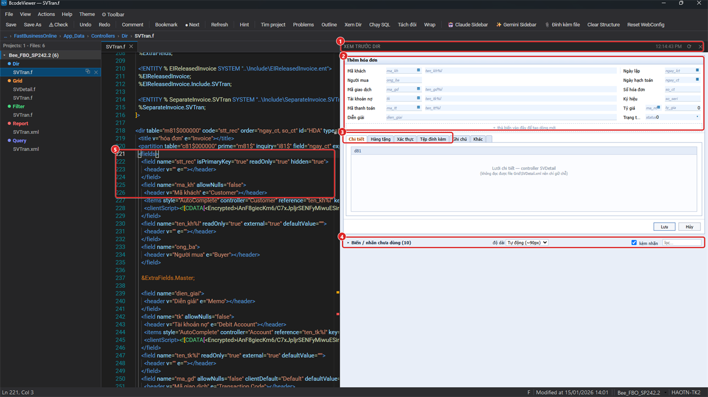

Trên ảnh: **①** khung Xem trước Dir (⟳ vẽ lại, ✕ đóng) · **②** form dựng từ `<fields>` / `<views>` · **③** tab theo category · **④** Biến / nhãn chưa dùng · **⑤** source tương ứng (bấm ô trên form để nhảy tới).

- Chỉ vẽ lại khi bố cục đổi (DOCTYPE, `<fields>`, `<views>`, `<title>`); sửa `<script>`, `<command>`… không vẽ lại. Nút ⟳ = vẽ lại ngay (xoá cache).
- Bấm một ô trên form → nhảy tới field đó trong code.
- `Ctrl`+bấm chọn nhiều ô; kéo ô để đổi chỗ trong dòng design (sửa thẳng vào source, `Ctrl+Z` để hoàn tác).
- Khay "Biến / nhãn chưa dùng": kéo biến vào form hoặc vào "＋ thả biến vào đây để tạo dòng mới".
- Chỉ là mô phỏng: không chạy script, không có dữ liệu, lưới chi tiết chỉ là khung giữ chỗ; nút Lưu / Hủy chỉ vẽ cho giống.

### Dòng thiết kế `<item value="mặt nạ: [biến], ...">` ngay trong code

Không cần mở Alt+P, trong `<views>` của file Dir/Grid:

- **Mặt nạ** (dãy `1` / `0` / `-` trước dấu `:`) ứng với các cột của dòng bề rộng: `1` = mở 1 ô mới, các `0` liền sau = ô đó kéo dài thêm cột (colspan), `-` = cột trống. Biến thứ n ứng với chữ `1` thứ n.
- **Trỏ chuột vào một biến** (`[ma_kh]`, `[ten_kh%l]`, `[x].Label`…): hover cho biết bề rộng, Header V/E và dòng **Cờ** — biến ứng với vị trí nào trong mặt nạ, giá trị ở đó (vd `vị trí 2–3 = 10`), kèm mặt nạ có ngoặc `[ ]` quanh phần của biến.
- Chuột hoặc con trỏ soạn thảo đứng trên một biến → các chữ số của nó trong mặt nạ được **tô khung**; ngược lại đứng trên một chữ số → biến tương ứng được tô. Cách ghép giống hệt Xem trước Dir.
- **Khung viền đứt / "Cờ: không xác định"**: dòng có `&entity;` chèn thêm phần tử lúc chạy (vd `&DetailTaxFormViewAccountLine;` hoặc `[x]&ddDir2Views;` đứng trước biến, hay entity nằm giữa mặt nạ) — vị trí chỉ tính theo phần viết trực tiếp, lúc chạy có thể lệch. Biến thừa so với số chữ `1` → "Cờ: không có" (Xem trước Dir bỏ qua biến đó).

### Xem trước mail / SMS

- ⇄ đổi vị trí khung (phải → trái → cửa sổ nổi), ⟳ dựng lại (đọc lại cả file include).
- **Dữ liệu mẫu**: gõ `so_ct = PN001`; dòng chi tiết `ma_vt = A | B | C`. **Dữ liệu thật**: chạy câu master/detail của form trên database workspace (luôn rollback, chỉ đọc).
- Bấm header / biến (hoặc ô bảng, link chứa nó, chip ở dòng **Biến dữ liệu**) để nhảy tới code: header → `<field name>`, biến → `{!biến}` đầu tiên trong `<action>` của form. Form nằm ngay trong file đang mở → chọn ở editor chính. Form nạp qua `&entity;` từ **file include** (vd `&BI.ApprovalMessageAction;` → `Include\XML\BIModeApprovalActionMessage.xml`) → mở **khung peek sửa được** trên khối `<action>` ở file đó, bôi sẵn chỗ cần tới (như `F12` field: file include mở ngầm thành tab, `Ctrl+S` trong khung lưu file đó, `Ctrl+F12` mở file tại con trỏ, `Esc` đóng).
- Double-click chữ header để sửa rồi `Enter` ghi vào `<header v/e>` (chỉ với form nằm ngay trong file đang mở).
- Chọn bề rộng thử (Điện thoại 375px, Hộp thư hẹp 600px, rộng 900px) — có cảnh báo tràn ngang và CSS bị trình đọc mail bỏ.

<a id="viewer-sql"></a>
## Chạy SQL trong file (Ctrl+Enter)

1. Đặt con trỏ trong `<command>` / `<action>` / entity SQL (hoặc bôi đen đoạn cần chạy).
2. `Ctrl+Enter` (hoặc nút **Chạy SQL**). Viewer bỏ CDATA, thay `&Entity;` theo chuỗi include, đổi `&lt;`… thành ký tự thật.
3. Câu SELECT không tham số chạy ngay. Còn lại hiện hộp **Chạy SQL**:
   - "Chạy trên: <workspace>" — database là **workspace đang chọn trong Bcode** (Bcode chưa có workspace thì dùng Config.xml của FCode + mật khẩu khai ở Settings).
   - Nhập tham số (để trống = NULL; nhớ trong phiên), macro FCode (@@language, @@userID…).
   - **Chạy thử (bọc transaction rồi luôn rollback)** — tự tick khi câu lệnh có ghi.
   - Xem trước "Câu lệnh sẽ chạy (đã gộp entity)", rồi **Chạy** / **Debug trong Bcode** / **Hủy**.
4. Kết quả ở bảng **SQL** phía dưới: tối đa 500 dòng mỗi bảng, timeout 60 giây; dòng trạng thái báo thời gian, số dòng, "ĐÃ ROLLBACK" nếu chạy thử. **Copy kết quả** dán thẳng sang Excel; **Dừng** để huỷ khi chạy lâu.

> **Lưu ý:** mặc định Viewer **chặn câu ghi thật** (INSERT / UPDATE / DELETE / EXEC…): chỉ chạy thử rollback được. Muốn ghi thật: Settings → Gợi ý & chạy SQL → tick "Cho phép "Chạy SQL" thực thi câu ghi".

<a id="viewer-check-sql"></a>
### Check SQL — chạy câu SQL rồi đối chiếu cột với `<fields>` của Grid

Giống **Check Fields** của SQL Query bên Bcode nhưng làm ngay trên file Grid đang mở: biết cột procedure / câu SQL trả ra có khớp `<fields>` của Grid không.

1. Mở file Grid → **⚠ Check** (Check Field) → nút **▶ Check SQL** trên đầu bảng (hoặc gán phím cho "Check SQL" ở Settings → phím tắt).
2. Dán câu SQL trả dữ liệu cho Grid, ví dụ `exec rs_… @ngay_ct1 = '20260101', …` (Viewer nhớ câu đã dán theo từng file trong phiên). `Ctrl+Enter` = chạy.
3. **Bảng số (tính từ 0)** tự lấy theo `<dir id="N">` của file **Filter cùng tên** — procedure trả 3 bảng 0, 1, 2 thì `id="1"` là bảng thứ 2. Không có Filter thì mặc định 0, sửa tay được.
4. Câu lệnh chạy bằng đúng phần **Chạy SQL** ở trên: có EXEC / ghi thì hiện hộp Chạy SQL, mặc định **chạy thử (rollback)** — dữ liệu không đổi. Kết quả vẫn hiện ở bảng **SQL** phía dưới.
5. Hộp kết quả: **Not matched** (field trong `<fields>` không có trong bảng), **Sai kiểu** (`Decimal` / `Int` phải là cột số, `Date` / `DateTime` cột ngày, `Boolean` cột bit, còn lại cột chuỗi), và **Cột SQL không khai báo trong `<fields>`** (chỉ để tham khảo). Khớp hết thì báo **Fields matched**. Nút **Copy** chép cả nội dung; **⛶ Phóng to** (hoặc bấm đúp tiêu đề hộp) mở hộp gần cả cửa sổ, bấm lại để thu về.

Quy tắc như FCode: không phân biệt hoa thường; `ten_xx%l` phải có `ten_xx` và `ten_xx2`; field `external="true"` và phần đã comment không tính.

### Debug trong Bcode

Nút **Debug trong Bcode** (hoặc chuột phải → Debug SQL trong Bcode) dựng script độc lập (khai `declare @x … = N'...'` cho từng tham số) rồi gửi sang Bcode — Bcode mở một tab **SQL Query** mới với script đó để chạy / Debug từng bước. Bcode chưa mở → "Bcode chưa mở … — mở Bcode rồi thử lại."

### F5 — lưu rồi chạy menu của file

`F5` lưu file, tra `wcommand` (Sys Data) theo tên file (sysid hoặc link `<tên>.aspx`) rồi mở menu đó trên Login WLink của dự án (tự đăng nhập bằng tay). Không có menu → mở trang đăng nhập; chưa biết link web → khai Config.xml của FCode trong Settings.

Chọn cách mở ở Settings → **Mở web (F5)** → **Mở bằng**:

| Lựa chọn | F5 làm gì |
|---|---|
| Trình duyệt mặc định của máy (mặc định) | Mở trang bằng trình duyệt mặc định. |
| Google Chrome / Microsoft Edge | Mở bằng đúng trình duyệt đó, với hồ sơ đang dùng. Máy chưa cài thì dùng trình duyệt mặc định. |
| Bcode — tab FSG FBO (như Ctrl+4 trên cây menu) | Gửi file sang Bcode. Bcode tự chọn đúng dự án, tra menu của file rồi chạy y như `Ctrl+4` trên cây menu: tự đăng nhập; menu đã có tab FSG FBO thì chuyển tới tab đó và nạp lại, chưa có thì mở tab mới dùng chung phiên đăng nhập. Bcode phải đang mở, chưa mở thì Viewer báo "Bcode chưa mở". |

Khi mở bằng trình duyệt (3 lựa chọn đầu):

- `F5` lần đầu: Chrome / Edge đang mở thì trang thành 1 tab trong cửa sổ đang mở (dùng luôn phiên đăng nhập sẵn có), chưa mở thì trình duyệt tự bật.
- `F5` lần sau cho **cùng file**: chuyển tới **đúng tab đã mở** cho trang đó, đưa cửa sổ trình duyệt lên trước rồi nạp lại trang (BcodeViewer gõ lại địa chỉ + Enter, nên trang ASPX không bị hỏi "gửi lại biểu mẫu"). Không mở thêm tab. Tab đó đang ở trang khác (vd bị đẩy về trang đăng nhập) thì được đưa về lại trang menu.
- Tab đã đóng thì mở tab mới. Mở lại BcodeViewer thì Viewer quên các tab cũ, chỉ nhận lại tab nào đang hiện đúng trang đó.
- Dùng được với trình duyệt họ Chromium (Chrome, Edge, Cốc Cốc, Brave…). Firefox vẫn mở tab mới mỗi lần.
- Tắt ở Settings → **Mở web (F5)** → bỏ tick "Dùng lại tab đã mở cho trang đó" = mỗi lần `F5` mở 1 tab mới như cũ.

> **Lưu ý:** BcodeViewer tìm và chọn tab qua UI Automation của Windows (cách trình đọc màn hình dùng) rồi gõ phím vào thanh địa chỉ. Đang gõ dở ở chỗ khác thì đợi trang mở xong rồi gõ tiếp. Cửa sổ trình duyệt không đưa lên trước được thì Viewer không gõ phím, chỉ bấm nút Tải lại của trình duyệt.

<a id="viewer-tab"></a>
## Chuyển tab nhanh (Ctrl+Tab)

- `Ctrl+Tab` / `Ctrl+Shift+Tab` bấm rồi thả ngay: chuyển sang tab kế / tab trước (không hiện hộp).
- **Bấm `Ctrl+Tab` rồi giữ Ctrl** (khoảng 0,4 giây) — hoặc giữ Ctrl trước rồi bấm Tab — → hộp chọn tab giống FCodeViewer: 2 cột **Header** (thư mục\tên file, vd `Dir\Customer.xml`) và **Path** (đường dẫn đầy đủ); dòng đầu **Previous:** là file vừa rời; bên dưới là mọi file của cây, chia nhóm theo dự án + thư mục site (`KOG \\172.168.5.14\CustomerPro\FBI\KOG\FBISP24`). Vẫn giữ Ctrl: `Tab` / `Shift+Tab`, `↑/↓` hoặc **lăn chuột** để chọn (lúc hộp đang mở, Ctrl+lăn chuột không zoom cửa sổ), **thả Ctrl** để mở; `Enter` / bấm chuột cũng mở; `Esc` để thôi. Chữ mờ = file chưa mở (chọn là mở), ● = chưa lưu.
- Kiểu bấm nhanh chọn ở Settings → Bố cục → "Ctrl+Tab bấm nhanh": **Tab tới** (A → B → C, mặc định) hoặc **Tab song song** (A ⇄ B — qua lại 2 tab gần nhất, giống Bcode).
- `Ctrl+W` đóng tab, `Ctrl+\` tách đôi khung soạn thảo, `Ctrl+B` ẩn / hiện cây file.

<a id="viewer-settings"></a>
## Settings và phím tắt BcodeViewer

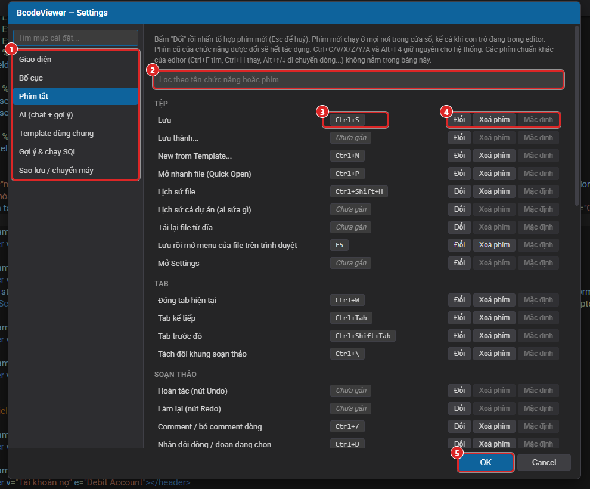

Trên ảnh: **①** các trang Settings · **②** lọc theo tên chức năng / phím · **③** phím hiện tại · **④** Đổi · Xoá phím · Mặc định · **⑤** OK để áp dụng.

Mở: **File → Settings…** (hoặc **File → Phím tắt…** để vào thẳng trang phím tắt). Có ô "Tìm mục cài đặt…"; mọi thay đổi chỉ áp dụng khi bấm **OK** (`Enter`), **Cancel** (`Esc`) bỏ hết.

| Trang | Nội dung chính |
|---|---|
| **Giao diện** | Phông chữ editor · Kiểu theme Fcode (.xml) · **Đánh dấu từ trùng** — double-click (hoặc đứng con trỏ trên) một tên thì mọi chỗ cùng tên được tô nền + viền và có vạch trên thanh cuộn: Đậm vàng cam (mặc định) / Đậm màu tự chọn / Nhạt theo theme · minimap · tự thu nhỏ cỡ chữ khi khung hẹp (cỡ nhỏ nhất) · Wrap · **Tự chèn dấu `'` đóng** — mặc định tắt: gõ `'` chỉ ra một dấu (cả trong thuộc tính XML lẫn SQL / JS trong CDATA); tick thì gõ `'` ra `''` như Monaco gốc. Ngoặc `( ) [ ] { }` và nháy kép `"` không bị ảnh hưởng; bôi đen rồi gõ `'` vẫn bọc hai đầu · **Chế độ nhẹ (máy yếu)** Tự động / Bật / Tắt · vị trí khung Claude / Gemini (phải / dưới / trên) |
| **Bố cục** | Ẩn / hiện thanh menu, thanh công cụ, đường dẫn, thanh tab · **Ctrl+Tab bấm nhanh** · vị trí và độ rộng cây file · thanh công cụ: vị trí (trên / cùng hàng menu / dưới), kiểu nút (chữ / icon + chữ / chỉ icon), sắp xếp / ghim / nhóm / thêm nút (kéo ☰, "+ Nhóm mới", "+ Vạch ngăn", "+ Thêm nút") · đưa về mặc định |
| **Phím tắt** | Bảng mọi lệnh: **Đổi** (bấm tổ hợp mới, `Esc` huỷ) · **Xoá phím** · **Mặc định**; ô lọc theo tên / phím; "Đưa TẤT CẢ phím tắt về mặc định" |
| **Gợi ý & Hỏi Fast** | Gợi ý theo cấu trúc Fast khi gõ (bật mặc định) · Gợi ý Fast dài · Khai field xong tự sinh dòng view (tắt mặc định — xem [IntelliSense](#viewer-intellisense)) · thư mục source Fast các phiên bản + **Học lại ngay** — xem [Hỏi Fast trong BcodeViewer](#viewer-hoi-fast) |
| **AI (chat + gợi ý)** | Anthropic API key · Gemini API key · model chat · bật gợi ý AI khi gõ (tắt mặc định) · model / engine ghost text · engine dịch caption (Google / Gemini / Claude) |
| **Template dùng chung** | Thư mục chung (UNC / git) chứa `*.code-snippets`, `*.json` (snippet) và thư mục `files\` (mẫu file cho `Ctrl+N`) — Viewer chỉ đọc |
| **Gợi ý & chạy SQL** | Gợi ý tên bảng / cột (nút Test) · **Cho phép Chạy SQL thực thi câu ghi** (tắt mặc định) · Config.xml của FCode + mật khẩu SQL (dự phòng khi chưa có Bcode) |
| **Sao lưu / chuyển máy** | Xuất / Sao chép / Nhập cấu hình (không gồm API key, mật khẩu, đường dẫn) |

**Viết hoa / viết thường**: bôi đen rồi bấm `Ctrl+Shift+U` → chữ đang chọn thành CHỮ HOA (mọi vùng chọn, kể cả khi đang nhiều con trỏ; không bôi đen thì viết hoa từ đang đứng ở con trỏ); `Ctrl+Z` để hoàn tác. Viết thường (*Viết thường phần đang chọn*) chưa có phím mặc định — `Ctrl+Shift+L` đang là "chọn mọi chỗ giống" của editor — tự gán ở trang Phím tắt nếu cần.

Quy tắc gán phím: phải kèm `Ctrl` hoặc `Alt` (chỉ `F1`–`F24` được dùng riêng); không gán được `Ctrl+C/V/X/Z/Y/A`, `Alt+F4`. Phím đã dùng cho lệnh khác → hỏi "Gán đè". Phím mới chạy ở mọi chỗ trong cửa sổ, kể cả trong editor.

### Hint Code và New from Template

- Nút **Hint**: thư viện snippet — tìm theo prefix / tag / mô tả / code; New · Save · Delete · Insert · Export… · Import… (`.code-snippets` / `.json`). Mỗi hint có Category (JS/SQL/XML/CSS), Prefix, Tag, Description, "Chỉ ở file" (vd `*\Grid\*`), "Hiện trong danh sách gợi ý khi gõ".
- **File → New from Template…** (`Ctrl+N`): chọn mẫu "Riêng" (`%AppData%\Bcode\templates`) hoặc "Chung" (thư mục chung `\files`) → **Tạo file** → mở ngay một tab **chưa đặt tên** (`Untitled-1.xml`…) có sẵn nội dung template để gõ tiếp, không phải chọn chỗ lưu trước (như file mới của FCode). `${FileName}` / `${Name}` lấy theo tên file template.
  - Tab chưa đặt tên luôn có dấu ● (chưa lưu). `Ctrl+S` / Save / `F5` mới hỏi nơi lưu; lưu xong tab đổi thành file thật (F5 mở web tiếp). Cancel lần nữa thì tab giữ nguyên, chưa lưu.
  - Đóng tab đó thì hỏi "bỏ thay đổi?" như file chưa lưu. Thoát BcodeViewer → **Lưu** thì hỏi nơi lưu cho từng tab chưa đặt tên; Cancel thì cửa sổ không đóng.
  - Khi chưa lưu: không có Lịch sử file, báo file đổi ngoài, Refresh, Clone file, Get Hash Source. F12 chỉ tìm được entity khai báo ngay trong file, Problems chỉ kiểm lỗi trong file (chưa dò file include).

### Theme

Menu **Theme**: hơn 30 theme có sẵn (Dark+, Dracula, One Dark Pro, Monokai, Light+, GitHub Light…), nhập theme VS Code (`.json` / `.vsix`) hoặc Fcode (`.xml`), hoặc "Theo Windows". Một bảng màu áp cho cả khung, editor và hộp thoại.

<a id="viewer-hoi-fast"></a>
## Hỏi Fast trong BcodeViewer (không AI)

Khung chat bên phải tra kiến thức **source Fast** — không gọi AI, không cần API key. Mở: `Ctrl+Shift+J`, nút **💬 Hỏi Fast** trên thanh công cụ, hoặc View → Hỏi Fast.

Hỏi được:

| Hỏi về | Ví dụ |
|---|---|
| Controller | "controller AIDetail lưu bảng nào", "màn hình Hóa đơn dịch vụ trả lại khai ở file nào" — bảng, mã chứng từ, phân kỳ, field, entity, toolbar, sự kiện, mẫu in |
| Field | "field ma_kh khai báo lookup thế nào" — tiêu đề v/e, `<items>` hay dùng, khối `<field>` mẫu, các controller có field đó |
| Lookup | "lookup Customer khai báo thế nào" — các field dùng, khai báo hay gặp |
| Entity / include | "include nào khai báo DetailTax", "entity XMLStandardDetailToolbar trỏ tới đâu" |
| Toolbar, JS | "nút Export trên toolbar khai thế nào", "ví dụ js hàm load$GridVoucherDetail$" |
| Quy ước | "cách khai báo entity", "bảng phân kỳ khai báo thế nào", "clientScript viết thế nào" |
| Import / dán từ Excel | "import SVTran lưu vào bảng nào", "SVTran nhập từ excel bắt đầu từ dòng mấy", "field import ma_kh kiểm tra thế nào", "cách khai báo import danh mục từ excel" — khai báo ở `Templates\Upload` (gốc `<import>`: loại List / Voucher, dòng bắt đầu, bảng gốc, bảng tạm, field + điều kiện kiểm tra + mã lỗi, thông báo lỗi) và `Templates\Clipboard` |
| Lịch sử phiên bản | "AIDetail sửa gì ở SP22.5", "field loai của AIDetail thêm từ bản nào", "bản SP23 sửa những file nào" (cần khai thư mục source Fast các phiên bản — xem dưới) |
| File đang mở | thêm chữ "này": "controller này lưu bảng nào" |

Mỗi thẻ trả lời: **Chèn** (đoạn code vào editor tại con trỏ), **Copy**, **Mở file**, **✔ Đúng** (lần sau đưa thẻ lên đầu), **✘ Chưa đúng** (lần sau bỏ thẻ này), **✎ Sửa** (gõ câu trả lời đúng — lần sau hỏi câu giống sẽ hiện đầu tiên). "Kết quả khác" bên dưới để xem các thẻ gần đúng. Nút 🕘 = lịch sử các phiên hỏi đáp, ＋ = phiên mới, `Ctrl+F` trong khung = tìm trong cuộc trò chuyện (không dấu, `Enter` / `Shift+Enter`, `Esc`).

Đo trên bộ câu hỏi chuẩn: 130 câu về mẫu Fast đi kèm — đúng ngay thẻ đầu **97%**, trong 3 thẻ đầu **98%**; 197 câu khi đã học source Fast các phiên bản (gồm 39 câu lịch sử phiên bản, 30 câu import) — **91%** / **96%** (riêng câu import 93% / 97%).

### Source Fast theo phiên bản

Settings → **Gợi ý & Hỏi Fast** → "Thư mục các phiên bản": chọn thư mục chứa các gói source Fast theo bản (`FBOR1`, `FBOR2SP01` … `FBOR2SP24.2.2`, mỗi thư mục chỉ chứa file đổi của bản đó, dưới `App_Data\Controllers\…` và `Main\…`). Viewer quét ở nền theo thứ tự bản (lần đầu ~1–2 phút cho 60 bản), so từng file với lần trước — field / thuộc tính / entity / hàm JS / command / action / nút toolbar, và với khai báo import (`Templates\Upload`, `Templates\Clipboard`) cả `<setting>` (loại, dòng bắt đầu, bảng…) và thông báo lỗi `<var>` — thêm, bỏ hay sửa — rồi:

- Hỏi Fast trả lời được lịch sử sửa từng controller và từng bản;
- bản mới nhất của mọi file được học thêm cho gợi ý Fast và Hỏi Fast.

Kết quả lưu ở **Thư mục kiến thức** dùng chung với Bcode (Bcode → Template → Đường dẫn), thư mục con `viewer\`; thư mục bản không đổi thì lần sau chỉ đọc lại. Thêm bản mới → tự học lại; muốn học lại ngay: nút **Học lại ngay** (cũng học lại source dự án đang mở).

<a id="viewer-ai"></a>
## AI trong BcodeViewer

| Cách | Cần gì | Dùng khi |
|---|---|---|
| **🤖 Claude Sidebar / ✨ Gemini Sidebar** | Đăng nhập claude.ai / gemini trong khung (lưu đăng nhập riêng), **không cần API key** | Hỏi đáp, nhờ giải thích / viết code dài |
| **📎 Đính kèm file** | Một sidebar đang mở | Dán nội dung file đang mở vào ô chat |
| **`Ctrl+I`** | Anthropic API key | Sinh / sửa code ngay tại con trỏ |
| **AI ghost text** | Bật trong Settings → AI + API key | Gợi ý chữ mờ khi ngừng gõ (tính phí) |
| **Dịch caption** `Ctrl+Alt+T` | Google: không cần key | Điền tiếng Anh cho header — tra Từ điển dịch trước, không có mới gọi Google/AI |

Đóng khung AI là giải phóng bộ nhớ; thu nhỏ Viewer khi khung đang mở thì khung tạm ngủ. Vị trí khung chọn ở Settings → Giao diện.

<a id="viewer-bcode"></a>
## Liên kết BcodeViewer với Bcode

- **Workspace dùng chung**: Viewer đọc danh sách workspace và workspace đang chọn từ `%AppData%\Bcode\settings.json` do Bcode ghi — không cần khai lại kết nối. Đổi workspace trong Bcode thì gợi ý SQL / Chạy SQL của Viewer đi theo.
  - Gợi ý SQL + Chạy SQL: workspace **đang chọn trong Bcode**.
  - `F5` + thanh trạng thái: workspace **trùng tên dự án của file**.
  - Clear Structure / Open Web.config / Refresh Web.config: site của file đang mở (thư mục chứa App_Data), không có thì Source Path của workspace.
- **Bcode → Viewer**: File Lookup → Edit in BcodeViewer (mở file kèm tên dự án).
- **Viewer → Bcode**: Debug trong Bcode — gửi script sang tab SQL Query mới của Bcode (Bcode phải đang mở, cùng phiên Windows).

<a id="viewer-capnhat"></a>
## Cập nhật BcodeViewer

BcodeViewer có cơ chế cập nhật **riêng**, không đi theo Bcode: thư mục phát hành riêng (mặc định `\\172.168.5.17\Users\HAOTN\Bcode\Bcodeviewer`), hộp và cách làm giống hệt [Cập nhật Bcode](#thanh-tren).

1. Mở Viewer khoảng 20 giây (sau đó cứ 4 giờ) Viewer tự đọc thư mục phát hành. Có bản mới thì hiện **thông báo ở góc dưới phải cửa sổ** (không tự tắt): **Xem** = mở hộp cập nhật, **Để sau** / ✕ = ẩn và nhắc lại sau 4 giờ (đóng hộp cập nhật mà chưa cập nhật cũng nhắc lại sau 4 giờ), và mục **Help → Cập nhật BcodeViewer — có bản mới…**. Muốn kiểm tra ngay: **Help → Kiểm tra bản BcodeViewer mới...**
2. Trong hộp: xem **Có gì mới** (chỉ các thay đổi của Viewer) → **Tải bản mới** (chỉ tải file đã đổi, vẫn soạn thảo bình thường trong lúc tải).
3. Tải xong chọn **Khởi động lại & cập nhật** (Viewer hỏi lưu file chưa lưu như khi đóng thường — bấm Huỷ thì không cài) hoặc **Cài khi đóng BcodeViewer**. Còn cửa sổ BcodeViewer khác đang mở thì hộp nhắc — trình cài chờ đóng hết (tối đa 15 phút) mới chép.
4. Bản mới có lỗi: **Quay lại bản trước** ở cuối hộp (bấm 2 lần).

Đổi thư mục: link *Đổi…* trong hộp (để trống hoặc gõ `-` = tắt kiểm tra). Nhật ký: `%AppData%\Bcode\viewer-update.log`; bản tải về ở `%LocalAppData%\Bcode\viewer-update`. Cài đặt, file gần đây, lịch sử của Viewer giữ nguyên. *Người phát hành:* build Release `src\BcodeViewer.App` rồi chạy `tools\publish-release.ps1 -App Viewer -Dest <thư mục phát hành Viewer>` (thư mục phải khác thư mục của Bcode — script chặn nếu nhầm).

<a id="designer-capnhat"></a>
## Cập nhật Screen Designer

Screen Designer (BcodeScreenDesigner.exe — thường nằm ở thư mục `ScreenDesigner\` cạnh Bcode.exe) cũng cập nhật **riêng**: thư mục phát hành riêng (mặc định `\\172.168.5.17\Users\HAOTN\Bcode\BcodeScreenDesigner`), hộp giống [Cập nhật Bcode](#thanh-tren). Cập nhật Bcode không đụng tới thư mục `ScreenDesigner\`.

1. Mở Designer khoảng 20 giây (sau đó cứ 4 giờ) Designer tự đọc thư mục phát hành. Có bản mới thì hiện **thông báo ở góc dưới phải cửa sổ** (không tự tắt): **Xem** = mở hộp cập nhật, **Để sau** / ✕ = ẩn và nhắc lại sau 4 giờ (đóng hộp cập nhật mà chưa cập nhật cũng nhắc lại sau 4 giờ), và nút **⬆ Cập nhật** ở góc phải thanh trên sáng lên (**⬆ Có bản mới**). Bấm nút này bất cứ lúc nào để kiểm tra.
2. Trong hộp: **Tải bản mới** → **Khởi động lại & cập nhật** hoặc **Cài khi đóng Screen Designer**; có **Quay lại bản trước**.
3. Còn cửa sổ Screen Designer khác đang mở thì hộp nhắc — trình cài chờ đóng hết (tối đa 15 phút).

Đổi thư mục: link *Đổi…* trong hộp (lưu ở `%AppData%\BcodeScreenDesigner\update.json`; trống = mặc định, `-` = tắt). Nhật ký: `%AppData%\Bcode\designer-update.log`. *Người phát hành:* build Release `src\Bcode.ScreenDesigner` rồi chạy `tools\publish-release.ps1 -App Designer -Dest <thư mục phát hành Designer>`. Bản Bcode vẫn chép kèm một bản Designer vào `ScreenDesigner\` (để máy mới có sẵn), sau đó Designer tự cập nhật.

<a id="viewer-loi"></a>
## Lỗi hay gặp (BcodeViewer)

| Hiện tượng | Cách xử lý |
|---|---|
| Không có gợi ý bảng / cột, Chạy SQL báo lỗi kết nối | Mở Bcode, chọn đúng workspace (Bcode ghi settings.json); hoặc khai Config.xml + mật khẩu ở Settings → Gợi ý & chạy SQL. |
| Chạy SQL không ghi được dữ liệu | Mặc định chỉ chạy thử rollback — bật "Cho phép Chạy SQL thực thi câu ghi". |
| "Bcode chưa mở…" khi bấm Debug trong Bcode | Mở Bcode (cùng tài khoản Windows) rồi thử lại. |
| `F5` mở trang đăng nhập thay vì menu | Không có dòng wcommand nào có sysid / link trùng tên file. |
| Báo "Thiếu entity" sai với file include | File include chưa biết file cha: mở file cha trước, hoặc `F12` lần nữa để tìm toàn project. |
| Ctrl+I / ghost text không chạy | Chưa nhập API key (Settings → AI); ghost text còn phải bật riêng. |
| Viewer giật khi gõ / đổi tab | Bật **Chế độ nhẹ** (Settings → Giao diện); gửi file **Help → Log độ mượt** cho người phát triển. |
| Lưu file hỏi "đang để Chỉ đọc (Read-only)" (trước đây báo "Access to the path … is denied") | File mang thuộc tính Chỉ đọc (hay gặp ở file chép từ bộ source chuẩn / gói cài). Bấm **Bỏ Chỉ đọc và lưu** (Ctrl+S, F5, Save As, lưu khi thoát đều hỏi); bấm **Không** = chưa lưu, thay đổi vẫn còn. Muốn tự bỏ không hỏi: Settings → **Lưu file** → tick "Tự bỏ Chỉ đọc rồi lưu, không hỏi". |

<a id="phu-luc"></a>
# Phụ lục

<a id="phim-tat-tong-hop"></a>
## Bảng phím tắt tổng hợp

Phím mặc định; cả hai chương trình đều đổi được (Bcode: ⚙ Settings → Giao diện (Template) → Phím tắt; BcodeViewer: File → Phím tắt…).

| Việc | Bcode | BcodeViewer |
|---|---|---|
| Tìm nhanh / mở nhanh | `Ctrl+P` Command Palette (tool, tab, menu, object, snippet) | `Ctrl+P` Quick Open (file) |
| Trợ giúp | `Ctrl+F1` (mở đúng mục của tab đang dùng) | — |
| Lưu | `Ctrl+S` (file .sql trong SQL Query) | `Ctrl+S` |
| Chạy SQL | `F5` / `Ctrl+Enter` (SQL Query) | `Ctrl+Enter` (SQL tại con trỏ) |
| Huỷ lệnh đang chạy | `Alt+F5` | nút **Dừng** |
| Xem nhanh định nghĩa | `F12` (object SQL) | `F12` (peek entity / file) |
| Mở định nghĩa | `Ctrl+F12` (object sang tab mới) | `Ctrl+F12` (file / nơi khai báo) |
| AI viết / sửa code | `Ctrl+I` (chế độ Web) | `Ctrl+I` |
| Gọi gợi ý | `Alt+\` (gợi ý AI) | `Ctrl+Space` |
| Định dạng code | `F7` Beauty | — |
| Wrap (tự xuống dòng) | `Alt+Z` | `Alt+Z` |
| Mở nhóm nút thứ N trên thanh công cụ | `Alt+1..5` | `Alt+1..5` |
| Tab kế / hộp chọn tab | `Ctrl+Tab` (hộp hiện ngay, thả Ctrl để chuyển) | `Ctrl+Tab` / giữ `Ctrl` + `Tab` |
| Tab trước | `Ctrl+Shift+Tab` | `Ctrl+Shift+Tab` |
| Đóng tab | `Ctrl+W` | `Ctrl+W` |
| Mở lại tab vừa đóng | `Ctrl+Shift+B` | — |
| Ẩn / hiện cây trái | `Ctrl+Shift+H` | `Ctrl+B` |
| Chạy menu trên web | `Ctrl+F5` (trong cây WCommand) | `F5` (lưu rồi mở menu của file) |
| Tìm trong toàn project | `Ctrl+Shift+F` mở File Lookup → SearchBox | `Ctrl+Shift+F` |
| Lịch sử | `Ctrl+Shift+Y` Lịch sử SQL · `Ctrl+Alt+H` lưu vào đó | `Ctrl+Shift+H` Lịch sử file |
| Debug SQL | `F10` · `Ctrl+F10` · `Shift+F5` | **Debug trong Bcode** (gửi sang Bcode) |
| Xem trước màn hình | — | `Alt+P` Dir / mail |

**Chỉ có ở Bcode**: `Ctrl+Shift+Q` SQL Query · `Ctrl+Shift+T` Table · `Ctrl+Shift+L` Lookup · `Ctrl+Shift+W` WCommand · `Ctrl+Shift+F` File Lookup · `Ctrl+Shift+G` Gen Update · `Ctrl+Shift+R` File Reference · `Ctrl+Shift+O` Change Owner · `Ctrl+Shift+U` Gen Update (Result) · `Ctrl+Shift+E` Note · `Ctrl+Shift+4` Note (New) · `Ctrl+Shift+Y` Lịch sử SQL · `Ctrl+Shift+J` So sánh object · `Ctrl+3` SQL Profiler · `Ctrl+Shift+P` Projects · `Ctrl+O` Choose Server · `Ctrl+F5` Synchronize · `Ctrl+Shift+N` cửa sổ mới · `Ctrl+1` App ↔ Sys · `Ctrl+2` App ↔ Sys của tab SQL Query · `Ctrl+4` FSG FBO · `Ctrl+5` Program Path · `Ctrl+Alt+U` Ai đang dùng · `Ctrl+Alt+Shift+A / V` Add / View Script · lưới Table `F1 F3 Ctrl+F3 F4 F8 Ctrl+I Ctrl+N Ctrl+' Ctrl+Shift+C Ctrl+0 Ctrl+G` · lưới kết quả SQL `Ctrl+Shift+C` copy tên cột, `Ctrl+F3` xem đủ giá trị ô · cây WCommand `Insert F3 F4 F8 F12 F5`.

**Chỉ có ở BcodeViewer**: `Ctrl+Shift+J` Hỏi Fast · `Alt+Shift+\` gợi ý Fast dài ⇄ ngắn · `Ctrl+N` New from Template · `Ctrl+G` Go to tag · `F11` tới function · `Shift+F12` tìm nơi sử dụng · `Ctrl+Shift+M` Problems · `Alt+O` Outline · `Ctrl+\` tách đôi khung · `Ctrl+/` comment · `Ctrl+D` nhân đôi dòng · `Ctrl+Shift+D` thêm con trỏ ở chỗ giống tiếp theo · `Ctrl+Shift+U` viết HOA phần đang chọn · `Ctrl+Alt+T` dịch caption · `Ctrl+F` / `Ctrl+H` tìm / thay trong file · `Alt+↑/↓` di chuyển dòng · `F1` bảng lệnh Monaco.

<a id="du-lieu"></a>
## Dữ liệu lưu ở đâu

| Đường dẫn | Của | Nội dung |
|---|---|---|
| `%AppData%\Bcode\settings.json` | Bcode (Viewer đọc) | Danh sách dự án, kết nối (mật khẩu / API key mã hoá theo tài khoản Windows), đường dẫn, thứ tự / nhóm công cụ |
| `%AppData%\Bcode\ui-template.json`, `ui\` | Bcode | Template giao diện, phím tắt đã đổi, CSS / HTML tuỳ chỉnh |
| `%AppData%\Bcode\session\` | Bcode | Phiên làm việc (tab đang mở) |
| `%AppData%\Bcode\query-history\`, `sql-history\` | Bcode | Lịch sử SQL, lịch sử sửa object |
| `%AppData%\Bcode\Notes\`, `AdvanceNotes\` | Bcode (AdvanceNotes dùng chung với BcodeNote) | Note, Note (New) |
| `%AppData%\Bcode\bcodenote.json` | BcodeNote | Dự án mở gần nhất, bố cục khung trái |
| `%AppData%\Bcode\FileLookupCache\` | Bcode | Cache phân tích file / menu (xoá được) |
| `%AppData%\Bcode\Backups\` | Bcode | Bản sao lưu khi "Đưa vào source" (hoặc Create RPT ghi thẳng vào site) |
| `%AppData%\Bcode\license.key` | Bcode | Key bản quyền |
| `%AppData%\Bcode\viewer-*.json`, `viewer-hints.json`, `viewer-recent-files.json` | BcodeViewer | Settings, phím tắt, Hint Code, danh sách file của cây; `viewer-translate-dict.json` = Từ điển dịch |
| `%LocalAppData%\BcodeViewer\searchcache\` | BcodeViewer | Bản nhớ nội dung file cho Tìm trong project (mỗi dự án 1 file nén, xoá được) |
| `%AppData%\Bcode\history\` | BcodeViewer | Lịch sử file của máy này |
| `<Thư mục kiến thức>\viewer\` (mặc định `%AppData%\Bcode\viewer\`) | BcodeViewer | Gợi ý Fast + Hỏi Fast học từ source dự án / source Fast các phiên bản (`ghost\`, `ask\`, `versions\`), ✔ ✘ ✎ của Hỏi Fast (`ask\feedback.json`) — xoá được, tự học lại |
| `%AppData%\Bcode\viewer-fastask\` | BcodeViewer | Lịch sử các phiên Hỏi Fast (luôn ở máy này) |
| `<thư mục dự án>\History\` | BcodeViewer | Lịch sử chung của dự án (ai sửa gì) |
| `<BcodeViewer.exe>\Config\*.txt` | BcodeViewer | Prompt AI ghost text |
| `<Bcode.exe>\Templates\` | Bcode | Mẫu file (Tạo nhanh danh mục, Tạo báo cáo, Clone danh mục, LCTT…) |
| `<Bcode.exe>\Help\HuongDanSuDung.md` | Bcode | Tài liệu này (tab Trợ giúp) |
| `<file>.rpt.bak` | Bcode | Bản gốc của file .rpt trước khi Write Schema cập nhật |
